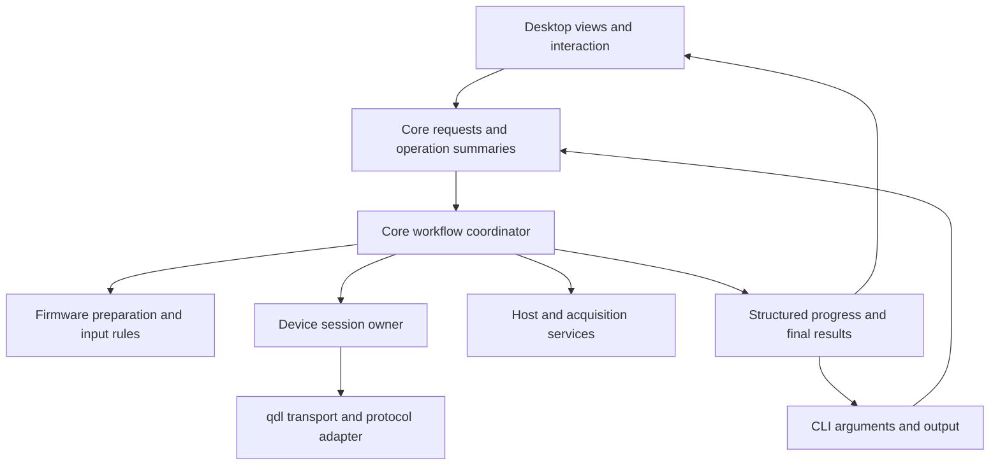
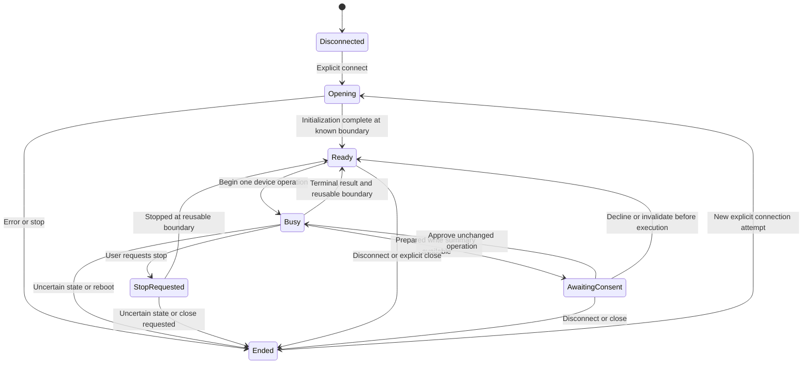

# Oplus EDL desktop application and shared Rust core

* **Author:** LanceaKing
* **Status:** Author-approved design. The Stage 9 design review converged in round 5. The [desktop migration record](../implementation/desktop-migration.md) tracks implementation and the first round of implementation repairs. Native baseline acceptance and in-flight USB read timing remain required.
* **Date:** 2026-11-17
* **Predecessor:** [Approved concept brief](../../concepts_brief.md)
* **Chinese version:** [oplus-edl-desktop.zh-CN.md](oplus-edl-desktop.zh-CN.md)

## Overview

Make a Rust desktop application the main interface for oplus-edl on Windows, macOS, and Linux. It will expose the project's existing device and firmware workflows. The interface will follow the supplied OPLUS TOOL screenshots' broad layout and operation flow. The screenshots are references, not a list of required features.

Extract a shared Rust core for the desktop application and a redesigned CLI. The desktop application serves interactive work. The CLI serves automation and debugging. Both must preserve the same operation rules and result meanings. Old command syntax and scripts do not need compatibility.

Future mobile applications will reuse the core where practical. This release establishes boundaries around desktop-specific services. It does not deliver mobile UI, mobile device access, or shared desktop/mobile views.

The user approved the concept brief and requested this design on 2026-11-17. This document develops that approved direction. It does not replace the historical [CLI design](oplus-edl.md) or claim that a desktop application already exists. Final GUI toolkit selection remains subject to the agreed prototype validation.

## The Problem

Current operation flows require command-line inputs. Users must translate loader, firmware, partition, and verification choices into parameters. A desktop workflow needs to keep those choices visible while showing connection state, progress, and results.

The repository has reusable modules, but application behavior is not yet independent of the CLI. Device configuration accepts CLI types. Write confirmation uses terminal streams. Result data includes terminal output behavior. The main program coordinates preparation, initialization, device checks, and execution. A GUI that calls lower-level helpers directly can omit required steps.

The current process performs one operation and exits. A desktop window persists across input changes, device disconnects, and further operations. It therefore needs explicit rules for stale selections, operation ownership, progress, and stopping. A rearrangement of existing calls does not supply these rules.

The UI must preserve the evidence available after an operation. Transferred bytes, acknowledged writes, readback verification, and remaining unattempted work describe different facts. Users need these distinctions when an operation stops or finishes without complete verification.

The problem is exposing existing capability through usable interfaces while maintaining one operation implementation. It is not expanding device protocol support or reproducing every screenshot control.

## Goals

| ID | Goal | Evidence required for acceptance |
| --- | --- | --- |
| G1 | Deliver a desktop application on Windows, macOS, and Linux. Prefer UI code written in Rust. | Native packaged launch and interaction checks on each selected platform baseline. A CI build alone is insufficient. |
| G2 | Expose all supported workflows in the approved capability inventory. | Each workflow has a usable desktop path and an automation path, or a documented shared sub-operation. |
| G3 | Make desktop and CLI use one independent product core. | An independent caller uses the core without CLI or GUI types. Both frontends produce equivalent semantic results for the same scripted device responses. |
| G4 | Make operation target and scope visible before execution. | Device partitions, restore mappings, and ordered firmware operations remain distinct. Empty selection means none. Selecting all is explicit. |
| G5 | Preserve existing preparation, validation, write, and verification behavior. | Existing behavioral tests are retained or adapted. Package mismatch, invalid boot selection, and rejected confirmation cause no mutation through either frontend. |
| G6 | Keep interaction responsive and results accurate during long operations. | Delayed I/O leaves the window usable. Progress does not imply verification. Stop requests preserve completed work and unknown outcomes. |
| G7 | Prevent stale UI state from controlling a new or changed target. | Device changes, reconnects, changed inputs, and affected partition layouts invalidate dependent operations. Late events cannot replace current results. |
| G8 | Preserve user data while replacing the CLI contract. | Existing backup directories, firmware inputs, partial outputs, cloud configuration, and installation identity remain usable. |
| G9 | Allow future core reuse without a mobile implementation now. | Tests replace actual host services without frontend dependencies. The design names remaining desktop assumptions and makes no mobile-support claim. |

The release includes backup, image/directory restore, XML flash, extracted-package preparation, guarded package flash, and existing cloud asset acquisition. Offline preparation and download remain possible without a connected device where currently supported. Existing loader initialization, verification policies, and flash final actions remain part of their workflows.

Partition browsing exposes existing GPT reading through a new application flow. Persistent UI state, structured progress, and cooperative stopping are required integration work. They are not evidence of new device commands. Advanced controls must retain supported configuration without overcrowding the main workflow.

Stages can deliver these paths incrementally. They do not reduce the first release's approved capability inventory. Actual hardware claims remain specific to the tested host, device, loader, and firmware combination.

## Non-Goals

- Preserve old CLI names, flags, JSON formats, exit-code mappings, or scripts.
- Build guided terminal menus as the main interactive interface.
- Reproduce all screenshot controls or add unsupported platform tabs.
- Implement new unlock/lock methods, erase, A/B slot switching, OCDT repair, Fastboot, MediaTek, or downgrade assistance.
- Rewrite qdl protocols, add authorization methods, or change authentic cloud identity and trust behavior for UI convenience.
- Deliver Android/iOS UI, mobile transports, or a common desktop/mobile interface.
- Add automatic write resumption, a daemon, a plugin framework, a saved approval database, or stable cross-language bindings.
- Add a remote telemetry service, a new account system, or a cloud backend rewrite.
- Remove every native dependency from the application because the UI uses Rust.

Boot-LUN selection is distinct from A/B slot switching. Existing boot-LUN and reboot requests remain conditional flash final actions. Unsupported lock/unlock stubs do not become working GUI features.

The design must not infer that downloaded assets are suitable for every device. Offline preparation, package/device matching, confirmed writes, and verified contents remain separate claims. Source inspection, offline tests, desktop checks, and hardware tests remain separate evidence.

## Technical Plan (Architecture)

The author approved this architecture section. D1 reuses healthy sessions. D2 uses original files with change checks. D3 uses human logs by default, JSON Lines with `--json`, and event suppression with `--quiet/-q`. The sections below develop these decisions. Detailed Implementation specifies fields, parameter values, and the approved release targets.

### Components and dependency direction

Use the three workspace crates described in the brief. `oplus-edl-core` owns product operations. `oplus-edl-desktop` owns graphical interaction. `oplus-edl-cli` owns automation and terminal output. GUI framework dependencies and Clap stay in their respective frontends.

The diagram shows logical responsibilities, not additional crates or a new service protocol. Both frontends call the Rust library directly. The core never calls UI widgets, reads terminal input, or exits the process. It returns data for the frontend to render.

| Current code | Destination responsibility | Required change |
| --- | --- | --- |
| `src/main.rs::run` | Core workflow coordinator | Move preparation, initialization, preview-mode handling, package checks, execution, and final-action ordering together. |
| `src/cli.rs` | CLI parser and core configuration types | Keep argument parsing in CLI. Move operation policies out of Clap-derived enums. |
| `src/device.rs` | Core device service and host transport adapter | Accept core configuration. Separate discovery/opening from protocol initialization. |
| `src/write.rs` | Core operation preparation and execution | Replace terminal confirmation/summary with inspectable operation data. Retain execution and verification rules. |
| `src/output.rs` | Core results and frontend renderers | Preserve result facts. Move stdout, terminal text, JSON presentation policy, and exit codes to CLI. |
| `src/backup.rs`, `src/restore.rs`, `src/storage.rs` | Core storage workflows | Retain naming, range, partial-output, coverage, and lookup behavior. |
| `src/program_xml.rs`, `src/package.rs`, `src/project.rs`, `src/sparse.rs`, `src/super_image.rs` | Core firmware workflows | Keep ordered inputs, package provenance, exclusions, sparse handling, and device checks. |
| `src/cloud.rs`, `src/swm.rs` | Core acquisition rules with host services | Preserve asset/trust validation. Separate host identity collection and runtime ownership from UI. |
| `src/input.rs`, `src/publish.rs` | Input/storage services | Preserve regular-file handling and atomic publication without accidental replacement. Isolate platform-specific calls. |
| `src/firehose.rs` and pinned qdl | Existing protocol boundary | Retain supported wire behavior. Do not replace it while moving application code. |

These mappings describe responsibilities. Detailed Implementation enumerates the destination files.

### Shared workflow and operation data

The public API must express the following responsibilities without parsing formatted logs. Names below describe conceptual data, not finalized Rust signatures or a serialized schema.

| Data or operation | Required content or behavior |
| --- | --- |
| Device configuration | Selected transport/target, memory, sector settings and provenance, local loader materials, and applicable acquisition inputs. |
| Partition snapshot | Connection generation, observed LUN/partition identity and geometry, discovery scope, and validity. A row number is not a target identifier. |
| Operation request | Operation kind, inputs, explicit target selection, output locations, verification choice, and applicable final actions. |
| Prepared operation | Validated inputs and ordered work, scope and exclusions, package origin, summary, and the session/input revisions on which it depends. |
| Execution decision | Approve or decline the prepared operation. Changing the target or relevant inputs requires new preparation and confirmation. |
| Progress | Operation identity, session generation where applicable, phase, optional item, and known counts. Unknown totals remain absent. |
| Final result | Per-item execution, write acknowledgement, verification, errors, coverage, retained outputs, and whether the session can continue. |
| Stop request | Requests cooperative stopping. It is not a final result or a rollback command. |

A prepared operation exists in memory. It is not an importable saved plan or a durable approval record. The CLI supplies explicit write consent without prompting. The GUI displays the core summary and asks once. Both use the same guarded execution entry point.

The coordinator preserves the current distinction between package and generic XML input. Package-origin work retains its project and range guard. Converting prepared package output into generic XML must not silently discard that guard. Generic XML does not acquire an identity check unsupported by its inputs.

Restore verifies each image after writing it. XML flash retains program/patch ordering and its existing verification phase. Requested final actions run only when preceding results permit them. A failure or uncertain write stops later prohibited work. Moving these rules must not create separate GUI and CLI implementations.

### Work ownership, host boundaries, and events

A device worker owns the live channel. It creates and uses that channel on the same thread, so the design does not assume the current channel can move between threads. Only request/result data cross the frontend boundary. One device operation runs at a time. Repeated clicks cannot queue hidden writes against an old selection.

Preparation or acquisition uses the brief's separate bounded work slot. The interface remains usable while device, file, or network work blocks. The core does not install process signal handlers. GUI stop/close actions and CLI signal handling translate into the same stop request.

Progress delivery must not block protocol I/O. Coalesce frequent counts and bound display history. Retain the final result independently of the visible log. Detailed Implementation specifies the queue shape and limits. A consumer that stops reading cannot turn a partial operation into reported success.

The host boundary covers device enumeration/opening, platform identity, storage locations/publication, and execution scheduling. Ordinary Rust paths and file-backed input remain sufficient for current desktop workflows. No universal virtual filesystem or mobile adapter is introduced now.

The current cloud entry creates a blocking runtime. The extracted API must define runtime ownership rather than calling that entry from an unknown async context. SWM continues to use genuine host identity and existing persisted keys. GUI preference locations must not silently select a new identity. Local/offline work does not require cloud setup.

### Desktop and CLI projections

Use one workspace with Backup, Restore, and Flash operation modes. The left panel holds loader and firmware inputs. The center changes between Device partitions, Restore mappings, and Planned operations. The right panel shows device state, result details, and bounded logs. The bottom shows phase, progress, and stop-request state.

Filtering or sorting changes presentation only. Empty selection means none, and Select All is explicit. Ordered XML work remains a plan view, not an arbitrary editable partition checklist. Disabled actions explain missing inputs or unusable state. Completed results remain readable after a disconnect.

CLI covers the same operation families plus device inspection and offline acquisition/preparation needed for automation. It never calls GUI code or presents interactive menus. Missing required inputs return an error. D3 fixes output framing. Detailed Implementation specifies command grammar and exit codes. Existing command names are not compatibility requirements.

Toolkit validation follows the approved egui/eframe-first investigation, with iced as the alternative. The design does not add a toolkit dependency or assert that the prototype passed. The chosen adapter must display Chinese input, select files/folders, resize the three panels, and handle delayed work on all three desktop systems.

### Base invalidation and stopping rules

Device changes, reconnects, relevant configuration/input changes, and possible GPT changes invalidate dependent snapshots and prepared operations. A delayed event from an old generation cannot update the current selection or readiness. Preserve historical operation results as records, not executable work.

Separate `stop requested` from `stopped`. Stop before a new command when possible. An in-flight protocol transaction must either reach a known boundary or end with the appropriate failure/uncertainty. Do not stop its transport halfway and report that nothing changed. A session with uncertain protocol state cannot accept further work.

A normal window close while busy requests a stop and keeps the operation owner alive until a final result. A reboot, disconnect, or failed transaction cannot cause automatic reconnection or replay. Closing a healthy idle connection does not send an implicit reset. D1 and D2 below define lifecycle, stopping, and source checks. Detailed Implementation, step 3 specifies the backend timeout audit. Its results are required before claiming bounded stopping.

### D1: Reuse healthy device sessions — approved

The author selected A: reuse healthy sessions after reads and writes. End the session after uncertain protocol state, disconnection, or reboot. Never reconnect or replay automatically. This is a product decision, not evidence that every existing loader supports consecutive operations.

A live session retains the selected device, loader/material context, configured geometry, negotiated wire mode, and its connection generation. The worker keeps ownership across operations. It does not repeat Sahara, authorization, or configure between healthy operations. Each operation still runs its applicable input, scope, package/device, and final-action checks.

Connection health and operation outcome are separate. Health comes from the completed protocol exchange, not a UI flag, byte count, or broad result category. A session is reusable only if no command remains outstanding, required data and terminal responses were consumed, and the adapter establishes a usable command boundary. The transport must not have reported loss or an ambiguous state. Unknown continuation behavior closes the session rather than guessing.

No new ping or loader command is added merely to label a session healthy. The adapter derives boundary evidence from existing supported transactions. Absence of a disconnect notification is not proof of physical presence. The next explicit operation can discover a loss and must then invalidate the session without changing target.

| Observation | Operation result | Session disposition |
| --- | --- | --- |
| Input or consent rejected before a command is sent | Rejected/not attempted | Retain an already healthy session. |
| Complete read or write exchange, including required terminal response | Preserve acknowledgement and verification facts | Reuse if the adapter establishes the command boundary. |
| Complete readback differs from expected content | Verification mismatch; stop the current workflow | The session can remain reusable if all data/responses were consumed. Do not resume or retry the failed work. |
| Explicit initial read refusal with a known non-raw boundary | Preserve refused/incomplete verification according to policy | Reuse only when the adapter establishes that boundary. Retry/restart hints or uncertain mode do not qualify. |
| Local source/output failure while raw data is in flight | Preserve acknowledged work, partial output, and uncertainty | End the session because the transaction is incomplete. A local error is not necessarily harmless to protocol state. |
| Timeout, truncated response, unaccounted raw data, disconnect, or unknown mutation | Preserve failure and unknown outcomes | Invalidate and release the connection. |
| Reboot command sent | Report its ACK or uncertainty separately | End the session even if the command was acknowledged. |

The current `ReadRejected` path in `src/firehose.rs` distinguishes a complete initial refusal from unusable retry/restart responses. Current `src/write.rs` can finish a readback transaction even when compared bytes differ. These are starting evidence for the new contract, not an existing session-health API. A bare mutation NAK must not automatically qualify as reusable without boundary evidence.

Check the explicit `rawmode` attribute on `configure` and `getstorageinfo` before recording a completed exchange. An ACK that reports a mode inconsistent with XML command mode ends the session and blocks the next command. Preserve compatibility with responses that omit the attribute.

D1 also considered read-only reuse with closure after writes, and a new connection for every operation. The author selected A instead of those earlier-closure policies.

### Session and operation transitions

Session state describes whether the connection can accept work. Operation state describes a particular job and its result. A previous failed result remains visible even when a healthy session can accept a new user-requested operation.

Any live state ends on an observed disconnect or unknown protocol state, even where the diagram omits that edge for readability. An explicit close in `Ready` releases the handle without a reset command. Closing during work requests a stop, then ends the session when the worker has classified the outcome. There is no automatic edge from `Ended` to `Opening`.

`AwaitingConsent` reserves the device for that prepared operation. The UI stays responsive, but another device job cannot change its assumptions. Relevant input changes discard the prepared operation and its consent. Declining a write sends no mutation and returns to `Ready` only if connection health remains known.

Execution accepts one decision for one prepared operation. Once execution begins, the same prepared operation cannot be submitted again. A duplicate click or delayed approval returns a stale/already-consumed result without additional device I/O. This is a process-local ownership rule, not a persistent job store.

Connection generation changes with each new connection. Partition snapshots also have a revision within that generation. A write that can touch GPT invalidates affected snapshots before another dependent operation. If a write or patch has unresolved target ranges, invalidate snapshots for every potentially affected LUN. Refresh uses existing GPT reads when the next explicit action needs them. Do not automatically scan the device after every write.

A refreshed snapshot does not restore an old approval. Retain the user's visible selection only where identity and geometry still match, and prepare a new operation before execution. Changing the device, loader, transport, memory, or sector settings requires an explicit new session. A healthy connection does not prove that every partition or later operation is authorized.

After an ordinary backup read receives its terminal ACK, keep the item `done` and retain the byte count even if local sync or publication fails. Retain the owned partial, report the local output error on the operation, and skip later backup reads. Use the normal session boundary rules.

When a snapshot becomes invalid, hide its selection until an explicit refresh. Within the same connection generation, remap matching GPT entry, LUN, name, geometry, and sector size to the new revision. Drop selection on session or explicit scope changes.

### Cooperative stopping by phase

The first implementation stops at existing complete-command boundaries. It does not promise to interrupt a large raw transfer immediately. A finite backend timeout remains required to resolve stalled I/O. The detailed backend audit must identify timeout coverage before a stop control is described as bounded.

| Phase | Stop handling | Result and session effect |
| --- | --- | --- |
| Device wait before opening | Observe stop between enumeration attempts, and again after releasing the previous channel and immediately before the backend open. | A stop at this boundary ends the wait without a new open or loader upload. |
| Offline preparation/download | Stop before the next local work unit, identity creation, or network exchange | Record each owned file at exclusive creation. Mark it complete after sync or publication succeeds. Commit ready package or asset data with the successful terminal result under the stop lock. On failure or stop, keep the actual file states and omit the ready data. |
| Loader/authentication initialization | Do not begin another transaction after a stop request. Finish the current indivisible exchange or let its bounded I/O fail | End the opening session and retain completed initialization steps in the terminal result. Do not claim the device returned to EDL. |
| Prepared write awaiting consent | Discard the preparation and consent | No mutation. Retain an otherwise healthy connection unless closing. |
| Raw read/write in flight | Finish that command's declared transfer and terminal response when possible. Do not begin the next command | Preserve completed/unknown work. Reuse only at a known boundary; otherwise end. |
| Between write and verification | Do not start more commands after observing the request | Retain the write ACK and the accepted-byte count. For `best-effort` and `required`, mark outstanding applicable verification incomplete. For `none`, record verification as not requested. |
| Verification command in flight | Finish the current read exchange when possible, then stop further verification and final actions | Preserve measured results and mark unverified ranges incomplete. |
| Before boot-LUN/reboot final actions | Skip actions not yet submitted after observing stop | Report not attempted. If reboot was already submitted, its result ends the session. |

Stopping is a requested terminal outcome, not an excuse to overwrite a failure. A timeout or unknown write observed while stopping remains a failure/unknown fact. Cancellation latency can include the rest of the current command. Do not implement apparent fast cancellation by dropping a GUI future while the worker continues invisibly.

Publish a new standalone `Connect` session under the same lock that accepts stop. If stop wins, release the channel before publishing the result and keep the completed initialization steps. Use the ordinary reuse rules after initialization in a Run or when a later job uses a healthy session.

### Contract checks for healthy reuse

The implementation must exercise the following sequences through scripted I/O before hardware validation:

- Initialize once, inspect, back up, and inspect again without a second loader upload or concurrent channel owner.
- Complete a write and verification, then start a new explicit operation on the same healthy session.
- Receive a complete verification mismatch and preserve the failed result while allowing a separately requested job only at a known boundary.
- Lose an ACK or truncate raw data, end the session, and reject any subsequent execution that carries the old generation.
- Mutate GPT or use unresolved patch ranges, then reject an old snapshot/approval before another dependent operation.
- Receive duplicate approval or an event from an older operation, and issue no extra device command.
- Request stop during a transfer, preserve the command's actual outcome, and send no later program/patch/final-action command.
- Acknowledge reboot and end the connection without automatic discovery, initialization, or replay.

These checks establish the application contract. Hardware tests must separately establish consecutive-operation behavior for each supported loader/transport combination. No such tests ran while drafting.

### D2: Original files with change checks — approved

The author selected A. Use original files directly and check for changes. Do not copy the complete firmware into a private snapshot. Source files must remain unchanged throughout the job. On a detected change, stop the operation and require explicit preparation again.

This does not remove outputs already required by package preparation, such as the generated sparse `super.img` and XML. Those outputs remain normal workflow artifacts. They are also tracked as sources if a later write reads them. Do not add mandatory whole-file hashes, filesystem snapshots, or a persistent approval manifest.

For each source on which a prepared operation depends, record its selected path, regular-file status, length, and available identity/modification metadata. Keep the opened image handles used by execution and comparison. Compare the current selected path and the opened file so replacing a path cannot silently redirect a later read. If platform metadata cannot supply a field, record that limitation instead of inventing a value. Failure to read or compare previously available required metadata stops preparation/execution.

Check metadata around source parsing and preparation. If a source changes during that work, do not publish the preparation as ready. Build the snapshot of source metadata before confirmation. Relevant UI input edits discard that preparation independently of metadata checks.

The snapshot covers the XML/configuration and images that determine the operation, including generated images it will read. Read the loader, signed digest, and DIGEST signature from the regular-file handles bound to their selected paths. Check the handles and paths before discovery, after device selection, and after any prior channel releases. Check again when the backend opens, before the first initialization exchange. Report `input_changed` with the affected path. If a new channel is already open, release it before publishing that result. Preserve the pinned decoder’s single-image and CPIO newc behavior. Their in-memory values and provenance belong to the established session. The application does not reload them from a changed path between operations. Choosing different session materials requires a new explicit connection under D1.

| Checkpoint | Required action |
| --- | --- |
| Before exposing a prepared summary | Recheck preparation inputs and reject detected changes. |
| After consent, before the first device mutation | Recheck every source dependency of the prepared operation. An invalid preparation sends no mutation. |
| Before a later command reads a source | Recheck the source and relevant plan metadata before submitting the command. |
| After a source-backed command completes | Recheck that source before proceeding to the next command. If it changed, keep the actual transaction outcome and stop. |
| Before and after readback comparison | Check the source used as expected content. Do not report a match against a detected changed reference as verification of the approved input. |
| Before final boot/reboot actions or successful completion | Recheck source dependencies. A detected change prevents unsubmitted final actions and successful completion. |

These are deliberate checkpoints, not a continuous filesystem watcher or per-byte proof. If metadata changes are detected at a command boundary, start no further protocol command. If reading a source fails during a raw transfer, apply the existing failed-transfer classification and end the uncertain session. Do not keep reading altered data merely to make the progress bar finish.

| Detection timing | Result | Session and recovery |
| --- | --- | --- |
| Before any mutation | Input changed, operation not attempted | Discard preparation/consent. A healthy connection can remain open. |
| After one or more completed commands | Input changed with completed item facts and unattempted remainder | Preserve ACKs and independently established results. Do not claim remaining or affected verification completed. Reuse only if D1 health is known. |
| During a source read in an incomplete device exchange | Input/read failure plus the actual write uncertainty | End the session. No automatic reconnect, retry, or reprepare. |

A source error is not itself evidence that the device contents differ. Keep `input changed`, `write acknowledged`, `verification incomplete`, and `unknown write` as distinct facts. The UI names the affected path and the detected change without exposing credentials. It offers a new Prepare action. CLI returns a failure and requires a new invocation or explicitly submitted operation.

Metadata checks cannot detect every same-size edit, timestamp-preserving change, or race after a check. This accepted policy depends on the user keeping sources stable. Neither frontend can describe these inputs as immutable. Do not claim a full hash comparison or an original point-in-time snapshot.

The private-copy alternative was not adopted because the author chose direct source use without copying the complete firmware. Detected changes invalidate preparation and consent. Input-change checks never renew consent automatically and do not modify or delete the source files.

### Core interaction contract after D1 and D2

The following operation boundaries refine the shared responsibilities above. They are library responsibilities, not final command spelling or executable Rust signatures.

In this project, NV ID selects a package definition. The ID names `META/super_def.<ID>.json` in the extracted package. That definition supplies partition images and layout inputs for the generated `super.img`. The ID remains a digit string, including any leading zeros.

To find available IDs, inspect filenames in the package's `META` directory. For example, `super_def.123.json` provides ID `123`. Choose the ID for the intended firmware variant from the package instructions or an already established package selection. An available filename does not establish device compatibility. If the required variant is unknown, do not guess an ID. The tool does not infer an NV ID from the connected device.

| Operation boundary | Core responsibility | Frontend responsibility |
| --- | --- | --- |
| Discover devices | Enumerate supported candidates and explain selection failures | Present or serialize candidates; require an unambiguous target. |
| Open session | Own the channel; initialize the selected loader/materials; establish D1 state | Explicitly request connection and show actual initialization results. |
| Inspect partitions | Read requested storage information/GPT into a scoped snapshot | Render Device partitions or machine-readable inspection results. |
| Acquire/prepare firmware | Run the supported acquisition or package flow; retain origin and outputs | Supply existing configuration/NV selection/paths; show offline completion separately. |
| Prepare backup/restore/flash | Bind target/snapshot/input revisions; check inputs and prepare ordered work | Show scope and mappings; do not reconstruct rules from logs. |
| Execute prepared work | Consume the preparation once, enforce D1/D2 and applicable guards, return semantic results | Supply explicit consent where required; render progress/results. |
| Stop or close | Stop at defined boundaries; classify the result; release the connection when closing | Translate user action or a process signal; wait for the actual result. |

Backup destination and overwrite rules remain part of backup preparation. Existing `.partial` files are not overwritten as a side effect of a retry. An output publication failure remains a backup failure even when the device read completed and the session is reusable.

GUI controls retain only display data and request identities. Live channels, open source handles, and executable preparations stay with the core operation owner. No frontend owns a writable copy of a prepared step list. A second submission cannot change the scope of an operation already running.

### Progress, failures, and output consumers

Every device event identifies its connection generation and operation. Offline work has an operation identity without a fabricated device session. Stage and byte progress are optional observations. A terminal result is authoritative and remains available independently of progress delivery.

Separate connection disposition, requested stopping, input validity, write confirmation, verification, and overall operation outcome. A stopped request can still contain an unknown write. An input-change failure can still contain acknowledged writes. A healthy reusable session can follow an operation failure at a known boundary. No single green/red flag replaces these facts.

The frontend adapter must consume events without slowing device I/O. Progress snapshots can be replaced by newer values. Logs have a bounded display history. Item errors and final results remain in the core result, even when the visible log is cleared or truncated. Detailed Implementation specifies queue limits and history retention. They do not require additional backend services.

If CLI output fails, it must not propagate a blocked write to stdout into the protocol worker. The adapter records the delivery failure and requests a stop through the same control path. The worker completes or fails the in-flight transaction under D1 and preserves its actual result. Do not claim that a final report reached a consumer whose pipe closed. After output loss, the process returns failure when it can exit normally.

A process crash, forced termination, or host power loss is outside normal cooperative stopping. Without a received terminal result, callers must not infer success, no changes, or a resumable operation. This design does not add a durable execution journal.

### Focused D2 and frontend contract checks

- Change an image size or modification metadata after preparation. Execution must reject the old preparation before mutation.
- Replace or remove a selected source path while its old handle remains open. A detected replacement invalidates preparation instead of silently using a new target file.
- Change a source between completed commands. Preserve earlier ACKs, stop later work, and require a new preparation.
- Fail a source read during raw transfer. Preserve mutation uncertainty and end the session rather than reporting a clean cancellation.
- Change the expected source before comparison. Do not label a comparison against the changed file as a match to the approved input.
- Exhaust or disconnect the event consumer. The protocol cannot block on presentation, and no unreceived final result becomes a success claim.
- Inspect generated outputs and I/O traces to confirm that D2 adds metadata checks, not a complete firmware copy or compulsory full-file hash pass.

These are new acceptance cases, not tests run during drafting. Existing wire, storage, and input-validation tests remain semantic references.

### D3: Human logs by default, JSON Lines on request — approved

The author specified the output contract directly. Default output is a human-readable stream of event logs followed by a human-readable final result. `--json` changes the output to JSON Lines. `--quiet` and `-q` suppress event output only. They do not suppress the final result.

| Flags | Event output | Final output |
| --- | --- | --- |
| None | Human-readable event logs | Human-readable final result |
| `--quiet` or `-q` | Suppressed | Human-readable final result |
| `--json` | JSON Lines event records | One JSON Lines terminal-result record |
| `--json --quiet` or `--json -q` | Suppressed | One JSON Lines terminal-result record |

Formatting and event visibility are independent settings. `--json` and `--quiet` can be combined in either order. The short form `-q` has the same meaning as `--quiet`. Do not add a separate final-JSON mode: `--json -q` already supplies a single terminal record.

At checkpoint B, run help, version, and invalid input in real subprocesses with full unread stdout pipes. Require bounded exit 74. Use the production runner to inject a writer failure during a scripted program response wait. Check the first stop reason, the actual ACK or uncertainty, retained bytes, and absence of later commands.

For operation invocations, write the selected application stream to stdout. In JSON mode, each physical line contains one complete JSON object followed by a newline. Escape newlines inside string values. Do not insert ANSI control sequences, pretty-printed multiline objects, raw library logs, or human summaries into JSON stdout. A single output renderer serializes records so worker messages cannot interleave bytes.

Use a record kind to distinguish events from the final result. An event identifies its operation, phase, severity, and available structured progress. A terminal record contains the full outcome, item errors, write/verification facts, coverage, retained outputs, session disposition and reason, and completed initialization steps. Detailed Implementation defines the versioned field names and command spelling. Both modes render the same core data.

`--quiet` filters events at the CLI presentation boundary. It does not disable core checks, stop handling, result collection, or error classification. It also does not remove errors and relevant warnings from the final result. A failure cannot disappear merely because its earlier event was suppressed. Never redirect filtered events to stderr to bypass the quiet setting.

Emit one terminal result for a handled operation, including rejected input, detected source changes, cooperative stopping, and operation failures, when stdout remains usable. Early argument errors in machine mode use a terminal error record even when no device operation started. An absent operation/session identity is represented as absent, not invented.

After the terminal result, emit no more operation events. A consumer determines completion from that record and the process outcome, not from the last progress percentage. EOF, a partial JSON line, forced process termination, or output delivery failure does not establish successful completion.

Routine operational events and results use the selected stdout format. Stderr is reserved for failures that cannot be delivered through that stream, such as an output write failure. It is not a second progress feed. Help/version are informational invocations rather than device operations; Detailed Implementation defines their machine-mode treatment.

Quiet and JSON flags do not change device requests, write consent, stop policy, or exit-code meaning. Preserve non-success outcomes for uncertain writes, incomplete requested verification, input changes, execution failure, and stopping. Detailed Implementation specifies numeric exit codes and the command/argument catalog.

The earlier D3 alternatives are superseded by this explicit contract. Human output is the default. JSON Lines is the machine format, and quiet mode provides final-only output without another schema.

### CLI output acceptance

The detailed plan must retain the existing subprocess approach to detecting stray stdout, while replacing its old single-JSON assumption. These checks concern proposed behavior, not tests run during drafting.

- Run the same scripted operation in all four flag combinations. Device I/O and normalized final facts must match.
- Compare `-q` with `--quiet`, including their combination with `--json` and flag-order changes.
- Parse each nonempty JSON output line independently. Exactly one terminal record must occur last, with no ANSI codes or raw dependency text.
- Under `--json -q`, require exactly one terminal record. No progress, warning, or error event can leak to stdout or stderr.
- In quiet mode, retain terminal error details for invalid input, changed sources, lost ACKs, verification failure, and stopped operations.
- Exercise input errors before connection. Machine mode still returns a terminal error record without touching a device.
- Escape multiline device messages as JSON strings. Keep credentials and authenticated response bodies out of both formats. For response decoding errors, retain the stage, error category, and available line and column. Report the HTTP status for a rejected response.
- Simulate a broken output consumer. Do not block the protocol worker or claim that an undelivered terminal record reached the caller.

## Critical User Journeys

These journeys apply the approved concept and D1–D3 to both frontends. Each acceptance outcome concerns actual core results, not a screenshot state.

| Journey | Given | When | Then |
| --- | --- | --- | --- |
| Prepare without a device | A supported extracted package, an explicit NV ID from the package definition described above, and output location | The user requests preparation only | Generate the existing required artifacts, show exclusions and preparation results, and make no device-validation claim. |
| Inspect and back up in one connection | A selected device and matching initialization inputs | The user explicitly connects, reads partitions, and requests backup | Use one session while healthy; show scoped data and backup coverage; retain final results and partial outputs where applicable. |
| Review and execute a write | Current inputs, a valid session, and a prepared operation | The user reviews the core summary and approves it | Execute that operation once, preserve applicable guards, and report write acknowledgement separately from verification. |
| Handle changed sources | A prepared operation depends on original source files | D2 detects a change before or during execution | Stop under D1/D2, retain actual completed work, invalidate preparation, and require an explicit new preparation. |
| Stop or lose a connection | A device operation is active | The user requests stop/close or transport state becomes uncertain | Preserve the actual result; finish or fail the active exchange; never reconnect or replay automatically. |
| Automate or debug | Complete noninteractive inputs and explicit write consent where required | A caller chooses default, quiet, JSON, or JSON plus quiet output | Run identical core work; vary rendering only; retain the final outcome in every normal output mode. |

## Alternatives Considered

This section uses the approved brief's Alternatives Weighed and the author's D1–D3 decisions. It records why alternatives were not adopted without treating untested candidates as proven failures. The author approved this section.

### Product direction and compatibility

| Alternative | Benefit and cost | Disposition and reason |
| --- | --- | --- |
| Build a guided CLI first and defer the GUI | Reuses terminal interaction, but delays the main interface the user now wants. | Not adopted for this release: desktop GUI is the primary product; CLI is for automation and debugging. |
| Preserve old command names, flags, and script behavior | Reduces disruption to old callers, but adds compatibility paths and constrains the new interface. | Not adopted for this release: old commands and scripts do not need compatibility. Existing firmware inputs, backups, partial files, and installation identity still remain usable. |

### Application and dependency boundaries

| Alternative | Benefit and cost | Disposition and reason |
| --- | --- | --- |
| Have the GUI launch the CLI as a subprocess | Provides process separation and can still reuse the core through the CLI. It also needs a process protocol for sessions, events, consent, stopping, and failures. | Not adopted in the approved design: both Rust frontends call the core directly. Process isolation alone does not remove the need to classify interrupted device writes. |
| Rewrite qdl and protocol handling during GUI migration | Allows a different internal API, but couples presentation work to new protocol regression risk. | Not adopted in the approved design: retain existing protocol behavior and extract product orchestration. Necessary defects can be handled separately; migration alone is not grounds for a rewrite. |
| Build a general mobile platform framework or stable C ABI now | Can support later languages and hosts, but fixes interfaces before mobile permission, storage, and transport requirements are known. | Deferred by the approved scope: isolate actual host dependencies now. Revisit concrete adapters or bindings when a mobile consumer exists. |
| Remove all non-Rust dependencies | Reduces some native build dependencies, but expands work into transport, network, and platform integration. | Not adopted in the approved design: the Rust preference applies to UI and application code, not every transitive dependency. |

### Connection lifetime and source handling

| Alternative | Benefit and cost | Disposition and reason |
| --- | --- | --- |
| Reuse sessions only for reads and close after writes | Reduces post-write reuse cases, but requires explicit re-entry for the next write even when the protocol boundary is known. | Not adopted under D1: reuse healthy sessions after both reads and writes. Unknown state, disconnect, and reboot still end the session. |
| Open a fresh session for every operation | Resembles the existing invocation lifetime, but repeats setup and cannot carry an earlier partition view into a new connection unchanged. Re-entering a loader is not guaranteed. | Not adopted under D1 as the normal workflow: retain a healthy connection. A closed or unusable session still requires a new explicit connection; there is no automatic fallback or replay. |
| Copy the firmware inputs into a private job directory | Isolates later execution from edits to the originals after copying. It requires disk space, copy time, cleanup rules, and stable inputs during the copy itself. | Not adopted under D2: use original files and check changes instead of copying the complete firmware. Accept the stated metadata-check limits and require stable sources throughout the job. |

These decisions preserve two limits. Session reuse does not imply that all operations are authorized or that old partition data remains valid. Direct file use does not provide immutable content or detect every same-size edit.

### GUI candidates and qualification

| Candidate or direction | Reason to consider it | Current disposition |
| --- | --- | --- |
| egui with eframe | The prior research identified a path for the required panels, table, and worker-driven updates. | First prototype candidate, not an unconditionally selected or already validated framework. |
| iced | An alternative Rust implementation path if the first candidate fails a concrete requirement. | Retained as an alternative. Do not record it as rejected or maintain two complete frontends merely for comparison. |
| Webview-first UI | Allows a web UI stack but adds another interface technology to this Rust-focused application. | Not adopted for this release under the author's preference to write the interface in Rust. This is a scope choice, not a claim of technical impossibility. |
| Slint | The brief considered it for GUI construction, but its separate UI language fits the Rust-written-interface preference less closely. | Not selected for the first prototype. No project prototype established that it cannot meet the requirements. See the existing [framework research](../../reviews/2026-11-17-desktop-concept/framework-notes.md). |

The agreed prototype checks Chinese text/input, file selection, table behavior, responsive background work, and packaged startup on three platforms. Results can justify revisiting the candidate without changing the core contract. No framework benchmark or GUI qualification ran during drafting.

### CLI output arrangements

| Alternative | Benefit and cost | Disposition and reason |
| --- | --- | --- |
| Always output one final JSON object in machine mode | Simplifies final-result parsing but omits structured live events from that stream. | Superseded by D3: `--json` emits JSON Lines, and `--json -q` gives one final record when events are not wanted. |
| Add separate final-JSON and streaming-JSON format switches | Makes both arrangements selectable but adds redundant format modes and parser branches. | Not adopted under D3: JSON formatting and quiet event filtering are independent. The four approved flag combinations cover the required cases with one machine schema. |

Quiet output never means no final result or suppressed failure facts. No alternative grants old-script compatibility, automatic retry, or a different execution policy based on the output format.

## Detailed Implementation

All paths are relative to the repository root. A move creates the named destination and removes the old path after its tests migrate. Files grouped in a row receive the stated change individually. The author approved D4 option A and all ten Stage 9 design amendments. Toolkit and backend qualification require recorded evidence. See completed work and validation in the [desktop migration record](../implementation/desktop-migration.md).

Deliver this list through four buildable checkpoints. The numbered sections group responsibilities; dependent file moves must land together at the checkpoint that owns them.

Checkpoint A qualifies the desktop shell while retaining the root `oplus-edl` package, its existing source targets, integration tests, and `json_stdout` target with `harness = false`. Add a workspace containing the root package and `crates/oplus-edl-desktop`; do not create core or CLI workspace members yet. Create the desktop manifest, `src/main.rs`, `src/lib.rs`, `src/app.rs`, `src/views.rs`, `src/dialogs.rs`, and the listed font/license assets now. Put the scripted service in a `prototype`-gated module within `app.rs`. It exercises the eventual views and cannot open devices. Create the two listed packaging scripts, macOS `Info.plist`, and Linux desktop entry now so the native shell checks can run. Prototype packages must identify themselves as qualification builds. They include the unchanged root CLI and do not claim completed GUI workflows.

Checkpoint B performs sections 2–4, the existing-test moves from section 6, and the focused stop regressions in the dependency prerequisite as one atomic migration. Create the core and CLI manifests and their entry points, configuration/model, host, session, service, coordinator, and event modules before switching consumers. Move every existing test to its assigned package in this checkpoint, including the split package subprocess test and `json_stdout` harness declaration. Update imports and test fixture paths together. Only after moving the test targets, remove the root package declaration and convert the root to the final virtual workspace. Add the offline stop regressions to migrated core `tests/writes.rs` and `tests/device.rs`. Create core `tests/session.rs` for the corresponding real-service stop and terminal-result cases. Before completing B, pass those regressions and the matching serialization checks in the migrated CLI `tests/cli.rs`. The desktop can retain its scripted adapter until checkpoint C. No intermediate commit may lose the old executable or omit its tests from Cargo discovery.

Checkpoint C completes section 5 and the remaining integration cases in section 6. Replace the scripted desktop adapter with the shared service, remove the `prototype` feature/module, and run the real-adapter parity cases. Keep the same views and dialogs.

Checkpoint D completes section 7, final package contents, user documentation, and native release qualification. The early packaging files are modified here, not created a second time.

At every checkpoint, run the format, workspace Clippy, workspace build, and workspace test commands listed in section 7 after fetching and locking that checkpoint's dependencies. From checkpoint B onward, also run the two isolated core tests listed there for the public API and the session stop clock. Record which Cargo package owns every migrated test target. A required dependency repair is completed before the checkpoint that depends on it.

#### Dependency prerequisite for checkpoint B

Before checkpoint B, complete a separately reviewed qdl response-wait repair. Preserve the current pin for baseline comparison; update Cargo.toml and Cargo.lock only to the verified commit produced by that repair. Do not invent a future commit hash or treat the current pin as satisfying the new stop contract.

The chosen policy is a ten-second response-wait grace period after a stop request. Store the request time using a monotonic clock. During a Firehose XML response wait, check that deadline before and after each response read attempt and after each complete log packet. Logs and partial XML do not restart the grace period. Existing transport timeouts remain in force. Expiry fails the outstanding exchange and closes the session. Preserve earlier ACKs and completed verification facts, and send no later command, reset, or retry. Raw payload I/O uses ordinary reads and writes.

In the qdl fork, modify `qdl/src/types.rs` to add `fill_response_buf` to `QdlChan` and `QdlReadWrite`. The defaults call ordinary `fill_buf`. `QdlDevice` and borrowed `QdlReadWrite` transports forward the refill. `QdlChan::check_response_wait` defaults to a no-op. Modify `qdl/src/lib.rs` to use the response refill and deadline checks throughout XML parsing, including partial-packet and log loops. Preserve existing call signatures.

Modify `qdl/src/usb.rs` to use the short-packet reader for each response refill. Share the receive buffer with ordinary reads and retain the existing transport timeout. If the short-packet reader returns zero bytes at a delimiter, consume the delimiter and return retryable `Interrupted` to the XML loop. An empty slice from `fill_response_buf` signals end of stream. The locked `nusb` readers filter the native `TransferError::Cancelled` status. A cancelled completion can still provide bytes already received or a short-packet boundary. Validate error propagation at the boundary where the reader reports errors. Update the qdl fork's `AGENTS.md` to document both methods. Add `qdl/tests/response_stop.rs` with a scripted channel and injected monotonic time.

In the product core, `service.rs` passes the same monotonic clock to job control and the session worker. The stop-owning channel in `session.rs` supplies `check_response_wait` from that clock and the job's first recorded stop time. It delegates `fill_response_buf` to its inner channel. Every further `QdlChan` wrapper forwards both methods. In `write.rs`, forward both explicitly in `CountChannel`, including the original refill and deadline errors. Use the same stop time and grace period. Preserve accepted-byte counts and unknown counts. The `firehose.rs` program path uses this forwarding for the initial raw-mode response and final program ACK. Service stop acceptance requires the reviewed source pin and this integration.

When the grace period expires, the hook in `session.rs` returns the typed core cause `ResponseWaitExpired`. Preserve the original cause through `firehose.rs`, the read and write paths, and the initializer's error path into `OperationResult` in `result.rs`. Before assigning the outcome, inspect `MutationFailure::cause` or walk the error source chain to identify that typed cause through response wrappers and added context. Retain it in the affected item's errors, or in operation errors for an exchange outside an item. Keep the cause and stop reason when another outcome takes precedence. For a transport timeout error returned before expiry, retain the transport cause.

Determine write uncertainty from the actual outstanding command and its wire evidence. A dispatched modifying command without a usable terminal confirmation remains unknown. A read-only exchange or welcome receive can fail and close the session with the same deadline cause. Preserve prior ACKs and completed verification facts on those paths. The use of `MutationFailure::unknown` by a shared response helper carries no storage mutation evidence for a read-only command.

A mutation NAK can establish a refusal when it has a usable XML boundary. An explicit non-XML mode or a retry/restart hint on a program terminal NAK leaves the dispatched write unknown. Keep its accepted bytes and close the session. Keep the usual refusal for a clean NAK and the read outcome for a read-only exchange.

For initialization, `session.rs` supplies a transaction-start check to the initializer in `device.rs`. The check uses the same job stop state and stops at the next boundary as soon as a request is pending, including within the grace period. Check before each applicable exchange.

- Sahara programmer upload.
- Firehose welcome receive.
- Signed digest transmission and its ACK.
- DIGEST verify command, raw-ready ACK, binary signature transmission with the existing USB terminator and flush, and terminal signature ACK. These steps form one exchange.
- Hash initialization with `sha256init` and its ACK.
- Firehose configure command and response.

Once an exchange starts, let it finish or fail on an I/O error or an XML response deadline. In particular, the verify exchange continues through its binary transfer and terminal ACK without another transaction-start check. If an exchange fails, preserve its original error. After each successful exchange, `device.rs` records the completed step in session-owned facts before the next stop check. `session.rs` transfers the ordered steps into the terminal result, including on error or closure. When initialization reaches a successful boundary with a pending stop, end the opening session as stopped and retain these steps and the stop reason. Send no implicit reset.

Use the same transaction-start check in read-only preflight and partition inspection. `coordinator.rs` passes the session's check to the helpers that send device commands. Check before the boot-LUN query in `device.rs`, the preview probe in `firehose.rs`, the GPT and OCDT reads in `project.rs`, and the restore GPT reads in `write.rs`. In every GPT scan, including `storage.rs::read_gpt` for `Inspect`, check in each invocation of the reader callback passed to `read_gpt_with`. For OCDT, check separately before the header and any additional payload read. After sending a preview probe, treat the initial ACK, raw data, and terminal response as one exchange. The XML response deadline still applies to both ACK waits. At a successful boundary with a pending stop, return a typed stop indication to the coordinator before sending the next command. This contributes `stopped` and preserves the completed read facts. Apply D1 to session disposition and retain any earlier failure.

In `write.rs::prepare_restore`, let the typed stop from the GPT reader callback bypass the `inspect_err` path that records GPT validation failures. Propagate the stop directly to the coordinator. Preserve the completed read item's `done` state and transferred-byte count.

Pass the same transaction-start check to `backup.rs`. At the start of each primary GPT reader callback, check before truncating, rewinding, or modifying the owned `.partial` file. Check before starting the secondary GPT capture and each partition read. Propagate the typed stop from any of these checks through the backup workflow to the coordinator. Bypass the failure path that relabels the last successful read. Preserve completed items and byte counts, published files, and the owned partial file and its bytes. Set the completed header read's `reason` to `GPT header probe`. Mark the probe as superseded only after the full primary capture replaces its bytes and receives its terminal ACK. Report the owned file as partial in the result until a complete capture can be published under the existing rules.

The CLI `partitions` command submits one `Run` with `Open(config)` and `Inspect { scope }`. Initialization and inspection use the same job handle, stop state, operation ID, and result. After successful initialization, `coordinator.rs` enters the same guarded inspection used with an existing session. Check the job's stop state before the first scan command. For backup, restore, or inspection without an explicit LUN, check immediately before sending `getstorageinfo` through `qdl::firehose_get_storage_info`. In an inspection with explicit LUNs, check in the first GPT reader callback. Preserve the opening exchanges in the job's terminal result. The CLI releases its session without reset before rendering that result.

After the device worker completes the last GPT read and local validation, the coordinator checks the same job stop state before committing a partition snapshot. Serialize that check and the commit of the snapshot, its revision, and the successful inspection outcome with acceptance of stop requests. If a stop was accepted before the commit, finish as `stopped` and retain the prior snapshot and revision subject to D1 invalidation. A stopped or failed inspection retains completed read items and their actual byte counts and publishes no new snapshot or revision. Its CLI terminal result has `data: null`.

Record each completed preflight device exchange once in `OperationResult.items`, in wire order, with `execution = done`. Record a boot-LUN query or implicit LUN discovery as `operation = getstorageinfo` with the command's LUN and null byte fields. Record each preview, GPT, and OCDT raw read as `operation = read` with its LUN, start byte, requested transfer bytes, and actual transferred bytes. Reuse the result item where the path already records the read. Mark write and verification as `not_applicable`. Record completion once the exchange succeeds, including its required terminal ACK. Retain the item when subsequent local validation fails or a later exchange stops or expires.

In backup and restore, route a local GPT validation error following an acknowledged read to `OperationResult.errors`. In backup, record the primary and secondary GPT captures as `done` at their respective terminal ACKs, with their actual transferred bytes. Put a subsequent local sync or publication failure for either GPT capture in `OperationResult.errors` with a null item ID. Preserve the completed read item and owned `.partial`, contribute `execution_failed`, and end the backup before another device command. Apply D1 using the completed exchange's boundary evidence. Scope this post-ACK output rule to GPT captures. A failure during a dispatched raw read belongs to that read item.

Preserve the error source when adding context to both response waits in `probe_preview_mode`. When the boot-LUN or automatic LUN `getstorageinfo` query expires, store `ResponseWaitExpired` in `OperationResult.errors` with a null item ID. A query that expires creates no completed item. Each dispatched preview, GPT, or OCDT raw read has one result item in device-command order. On expiry, record `execution = failed`, the requested transfer bytes, the known actual bytes, and the original `ResponseWaitExpired` in that item's errors. Use the same item ID in its serialized error. A stop check that blocks dispatch contributes a stopped operation without creating a read item. Expiry of these read-only exchanges contributes `execution_failed` and closes the session. Retain earlier completed items and the stop reason. Skip all later commands. The expired read contributes no unknown write.

In `write.rs`, use the same job stop state for a separate check before starting each modifying command, each verification read exchange, and each final device action. Once program starts, its initial response, raw payload, and terminal response form one exchange. Apply the XML deadline within the exchange. Record a timely terminal ACK and the accepted-byte count before checking for the next command. Preserve the actual failure if the exchange fails. With a pending stop at a successful boundary, skip later commands. Apply D1 for session reuse at that boundary and for explicit close.

Check again after potentially blocking source metadata or backup file preparation and immediately before dispatching patch, set-bootable, reset, or a backup read. Keep a blocked mutation `not_attempted`. Create no read item for a read that did not dispatch. A stop that blocks the second primary GPT read leaves the acknowledged probe bytes intact. Keep completed reads, ACKs, accepted bytes, and owned partial files. Exercise these dispatch boundaries and contradictory mode ACKs through the scripted service at checkpoint B.

When a stop is pending at a timely program ACK, retain the ACK, accepted-byte count, and any completed verification facts. For `best-effort` and `required`, mark the outstanding applicable ranges and their write item `incomplete`. This contributes `verification_incomplete` and yields exit 5 when no higher-priority outcome applies. For `none`, record verification as `not_requested`. The stop contributes `stopped` and yields exit 130 when no higher-priority outcome applies.

If the terminal response to a verification read expires, record `incomplete` for that range even if the comparison already observed differing bytes. In that case retain the observation in the range's `reason` as `byte_difference_observed`. Preserve `ResponseWaitExpired` in the affected item's errors, together with the prior write ACK, byte count, and completed verification facts in the result. The incomplete exchange contributes `verification_incomplete` under the outcome rules in section 4.

At checkpoint B, add core integration regressions in the migrated `crates/oplus-edl-core/tests/writes.rs`, with real-service assertions in the new `crates/oplus-edl-core/tests/session.rs`. Exercise the actual program path through `CountChannel`. Test continuing logs and retryable empty completions at the initial response and at the final ACK after the full payload transfers. Deliver empty completions through the scripted `fill_response_buf`. Fail the test if the XML wait uses an ordinary read or refill. In the service cases, create the real service with the test clock from section 3, submit the job, and call `JobHandle::request_stop()`. Advance that clock beyond the ten-second grace. Collect the terminal result with `try_take_result()`. Require the typed expiry cause, unknown mutation when the dispatched program lacks its terminal response, session closure, preserved byte counts and earlier facts, and no later command, reset, or retry. Keep the direct qdl regression as separate coverage.

In the B service cases, also return a final program ACK within the grace period after requesting stop. Use plans where the next scheduled command would be a verification read, another mutation, or a final action. Exercise `best-effort`, `required`, and `none`. Assert the item and range verification states, the aggregate outcome, the retained ACK and byte count, and the stop reason. The device trace ends at the program exchange in each case. The B CLI cases assert the corresponding outcomes and exit codes.

In the B service preflight cases, restore with an explicit LUN and exercise `prepare_restore`. Return a valid header that needs a second command within the same `read_gpt_with` call. Request stop while waiting for the first read's terminal ACK, then return it within the grace period. Require the first item to retain `done` and its transferred-byte count. The outcome is `stopped`, and the trace has no second read or write.

Run the corresponding backup case through `backup.rs::capture_primary`. After delivering the first valid GPT header, request stop while waiting for its terminal ACK and return the ACK within the grace period. Require `stopped`, the first read item still `done` with `reason = GPT header probe`, and the correct byte count. Require the owned `.partial` to contain those header bytes and be reported in the result. Assert that the second read and publication of the final GPT file never occur.

In the B backup publication test, use no-replace publication and a scripted channel that completes the primary capture and dispatches the secondary GPT read. After the secondary `.partial` is open and has received the full payload, create the final secondary GPT file with distinct contents before delivering its terminal ACK. Assert `done` and the full transferred count for the secondary read, the publication failure in the operation errors, and `execution_failed`. Check that the result reports the owned `.partial` with the exact secondary GPT bytes. Check the contents of the pre-existing destination and the published primary capture. Assert that the trace ends with the secondary exchange.

In the B implicit-LUN reuse cases, use an established session. In a backup or restore case and an `Inspect` case, use the test-only LUN query gate in section 3 to hold the accepted job immediately before its transaction-start check. Wait for the notification, request stop through the returned job handle, and release the worker. Assert no device commands for the job and outcome `stopped`. In a separate case, send `getstorageinfo` and expire its response wait after requesting stop. Assert the typed `ResponseWaitExpired` in the operation errors, `execution_failed`, a closed session, and the stop reason. The trace contains no later GPT read or write, and the result records no unknown write. Also let `Inspect` finish its first GPT read within grace after a stop request. Assert that the header read retains `done` and its byte count, the next read is absent, and the inspection publishes no new snapshot.

In a separate B CLI case, use the production adapter with an injected service and transport to run `partitions --json -q` without `--lun`. Complete initialization on its new session. When the LUN query gate signals arrival, invoke the adapter's signal relay and release the worker after the relay returns. Assert no `getstorageinfo`, GPT read, or reset in the trace and observe release of the CLI-owned channel before the terminal record. Require exactly one terminal record with the ordered initialization steps, `stop_reason = signal`, `outcome = stopped`, and `data: null`. Require exit code 130.

In a separate B real-service case, publish a snapshot from an `Inspect` of one explicit LUN. Read the committed snapshot through `test_support::committed_partition_snapshot` from section 3. Inspect the same LUN on the reused session with the same valid GPT bytes. Request stop through the second job's handle while it waits for the terminal ACK of the final GPT read. Return the ACK within the original grace period and allow local validation to finish. Assert that both read items retain `done` and their exact transferred-byte counts, and the terminal outcome is `stopped` with the recorded stop reason and no snapshot data. Read the committed snapshot again through the same accessor. Require `Some` from both calls and matching snapshot contents, session generation, and revision. Match the first observation to the successful inspection result.

Separately expire each of the preview probe's two ACK waits. Require the failed preview read item to report zero transferred bytes at raw-ready ACK expiry and five sectors at terminal ACK expiry after a full payload. Check the item's ID, requested length, and typed expiry error after the actual response wrapper and contextual error path. Assert `execution_failed`, a closed session, the stop reason, and no unknown write or later command. In one preview-expiry case, complete the boot-LUN query first and retain its `done` item, LUN, and null byte fields ahead of the failed item. In a package preflight case, complete the raw GPT header read and expire the next read. Assert its earlier completed item and counts alongside the later failed item and its typed expiry. The B CLI cases assert that preflight error placement and item ID references survive serialization.

In two B service cases, use the injected clock while a program with verification set to `none` awaits its terminal ACK. Request user stop, then call `request_close(StopReason::WindowClose)` five seconds later. In the expiry case, advance to eleven seconds after the first request. Require `ResponseWaitExpired` using the original deadline and `stop_reason = user` in the terminal result. In the timely case, deliver the ACK after the close request and within the original grace period. Assert `stopped` with the ACK, accepted-byte count, and the first reason. Assert a closed session at the known boundary because of the explicit close. Both traces exclude later device commands.

Exercise verification-read expiry after a successful program in both the B write and service tests. Return matching payload bytes in one case and differing bytes in another. Let the terminal XML response wait expire after requesting stop and use its actual `MutationFailure` wrapper. Assert incomplete verification for the range, the typed expiry cause, the earlier program ACK and byte count, and no new unknown write or later command. Require `byte_difference_observed` in the range reason in the differing case. In the real-service cases, also assert session closure and `verification_incomplete` as the job outcome when it has no higher-priority result. The B CLI cases verify that outcome and exit code 5.

The product-side `device::digest_welcome` parses startup XML independently of qdl's parser. In core `device.rs`, replace its XML `read_exact` loop with `fill_response_buf` and `BufRead::consume`. Check the same deadline before and after each attempt, including framing whitespace and partial XML. Run the post-attempt check before handling the result. If that check succeeds, retry `Interrupted` and accept `TimedOut` only as the existing idle-timeout fallback with no bytes accumulated in the current packet. Propagate deadline and other I/O errors unchanged. An empty slice is `UnexpectedEof`. Skip framing whitespace before each packet. Consume only through that packet's `</data>` marker and leave following bytes buffered. Keep the existing packet and log limits. Check the deadline after parsing each complete log, before returning at the VIP request or supported-functions end marker. Use ordinary transport methods for Sahara, binary digest/signature writes, and raw payload I/O.

At checkpoint B, exercise `initialize_with_digest_signature` in migrated `crates/oplus-edl-core/tests/device.rs` using a scripted channel and injected monotonic time. After the loader phase, test nonterminal welcome logs, framing whitespace, partial XML, and retryable empty completions separately. Deliver empty completions through `fill_response_buf` and fail the test if an ordinary read or refill serves the welcome XML. Test timely VIP and supported-functions markers with the following ACK in the same refill. Each marker preserves its parsing result and leaves the ACK unread. A pending stop prevents the next initialization exchange. Retain the existing no-stop binary-byte and ACK-order tests.

Exercise both welcome deadline boundaries.

- Return `TimedOut` from a refill with no bytes accumulated in the current packet. Within the grace period, preserve the existing idle fallback and its collected logs. In the expiry case, advance the injected clock to the deadline during that refill. Require the original deadline error.
- Return a complete welcome end-marker log and the following ACK in one refill. Keep the clock within the grace period through the post-refill check. Advance it to the deadline when consuming the marker. Without another refill, require the post-log check to return the original deadline error and leave the ACK unread.

For each welcome expiry, require no later initialization command, reset, or retry. In `crates/oplus-edl-core/tests/session.rs`, use the real service and `JobHandle::request_stop()` with the injected clock. Assert that each failure closes the opening session. From `try_take_result()`, check the typed expiry cause, the stop reason, and a completed Sahara upload with no completed welcome step or unknown storage write. With a timely marker and a pending stop, assert a stopped opening session and no next exchange. Also request stop during the verify raw-ready wait before the signature transfer starts. Require the complete verify exchange, including the signature and terminal ACK within the grace period, followed by a stopped opening session with no hash initialization or configure command. The terminal result includes the steps through the terminal signature ACK. Assert the retained steps after closure using the result alone, even when progress events have been discarded.

Test continuing logs and partial XML without a terminal response, both with and without an outstanding mutation. Advance the test clock past the grace period and require failure, session closure, preserved completed facts, and no later command. Test that a complete response within the grace period preserves its actual result. Follow the [native USB timing procedure](../testing.md#usb-在途读取计时) to prove a native response read was in flight when the first stop was accepted and measure the extra delay of the read that crosses the original deadline. Record `t_core_result` at core result commit and `t_worker_drop` when the worker finishes dropping its channel. A timely ACK can yield a reusable core result that the CLI collects before closing. An early backend timeout or response-wait expiry drops the channel before core commit. When measuring visible JSONL, record delivery after both program events. Use a native USB event to record `t_native_done` for transfer completion or cancellation completion. If measuring native interface release, record its event separately. Retain the typed outcome and command trace. This policy bounds this response-wait case; it does not establish an end-to-end Stop deadline for device opening, raw transfers, or host filesystem work.

### 1. Qualify the desktop shell and freeze the build inputs

Start with the accepted egui/eframe candidate in the eventual desktop crate. Use a scripted service for this prototype. Do not connect to hardware. Exercise the actual views that will become the application, rather than a second disposable frontend.

| File action | Change and reason |
| --- | --- |
| Modify `Cargo.toml` | At checkpoint A retain the current package and add the desktop workspace member. At checkpoint B convert to a virtual workspace with the three named crates, edition 2024, shared dependency declarations, and desktop/CLI as default members. Preserve MIT and unpublished packages. |
| Modify `Cargo.lock` | Retain existing dependency pins where possible. Lock GUI and adapter dependencies after qualification. Preserve `wreq =0.16.3`. Keep qdl revision `205c7d4d9f15add22d78c422ba77843ab72c95d4` as the baseline, then update Cargo.toml and Cargo.lock to the verified response-wait repair commit before checkpoint B. The current pin does not satisfy the new stop contract. |
| Create `crates/oplus-edl-core/Cargo.toml` | At checkpoint B, own operation dependencies. Separate optional `usb`, `serial`, `desktop-host`, and `cloud` features. Add the non-default `test-support` feature independently of `cloud`. Declare the `session` integration-test target with `required-features = ["test-support"]`. Do not enable these features by default. Keep protocol/parser code usable with supplied host services. |
| Create `crates/oplus-edl-cli/Cargo.toml` | At checkpoint B, own Clap, terminal/signal integration, and CLI serialization. Enable the existing desktop backends/cloud features. Name the binary `oplus-edl`. Transfer its test targets, including `json_stdout` with `harness = false`, in the same checkpoint. |
| Create `crates/oplus-edl-desktop/Cargo.toml` | Create at checkpoint A with the qualified GUI dependencies, file dialogs, and scripted `prototype` adapter. Add its production core dependency at checkpoint C with the same core capabilities as CLI. Name the binary `oplus-edl-desktop`. |
| Create `docs/implementation/desktop-migration.md` | Record the capability-to-view/command mapping, selected versions/features, baseline measurements, dependency changes, and evidence for each step below. |

Qualify the three resizable panels, bottom progress area, and mode-specific center views. At 1280 × 800 logical pixels, no primary action can become unreachable. At 1024 × 768, allow scrolling or collapsing panels. Test 100%, 150%, and 200% scaling, Chinese display/IME input, paths with spaces, clipboard input, keyboard focus, and file/folder picker cancellation. Run a synthetic 10,000-row table and a 30-second delayed job together. During that run, selection, scrolling, and Stop must respond within 250 ms on the recorded test host. This is an interaction threshold, not a promise that a device command stops in 250 ms.

Use `rfd` as the proposed dialog adapter. It documents native dialogs on the three platforms. Test its Linux portal requirements and macOS window/main-thread rules in the packaged application. Keep path entry available when a picker fails. Context7 did not find a matching library entry, so this proposal uses the [official rfd documentation](https://docs.rs/rfd/latest/rfd/). No rfd version is yet a tested project pin.

Bundle one unmodified Simplified Chinese font so a clean host does not depend on a locally installed CJK font. The proposed asset is Noto Sans CJK SC Regular, with its upstream copyright and license. Record its revision and checksum during acquisition. See the [font formats](https://github.com/notofonts/noto-cjk/blob/main/Sans/README.md) and [font license](https://github.com/notofonts/noto-cjk/blob/main/Sans/LICENSE). Do not download fonts at application startup.

Accept egui/eframe only when all selected baseline checks pass. If a concrete requirement fails, record the failure and test iced against that requirement before changing the adapter. Do not silently drop a platform or keep two production UIs. Exact GUI versions, renderer features, and native build packages become locked outputs of this step, before feature implementation. Unresolved failures return to design review.

### 2. Move existing behavior into the core without changing its meaning

| Old file → new file | Change and reason |
| --- | --- |
| `src/lib.rs` → `crates/oplus-edl-core/src/lib.rs` | Export the application API and host injection points. Remove CLI imports and document the supported workflow entry points. |
| `src/backup.rs` → `crates/oplus-edl-core/src/backup.rs` | Preserve GPT capture, directory naming, overwrite/partial rules, and device read outcomes. Convert explicit selections to the existing execution scope. Check stop at each primary GPT callback before file changes and before the secondary GPT and partition reads. Propagate typed stop with completed items, counts, and owned partial outputs. Report GPT validation and post-ACK sync or publication errors for either GPT capture at operation level. Preserve the acknowledged read and stop the backup on those errors. |
| `src/restore.rs` → `crates/oplus-edl-core/src/restore.rs` | Preserve image/directory mapping, ambiguity checks, padding, and uncovered-tail reporting. |
| `src/storage.rs` → `crates/oplus-edl-core/src/storage.rs` | Retain qdl storage adapters and check stop in the GPT reader callbacks for preflight and `Inspect`. Produce scoped partition snapshots with stable identities and revisions after successful inspections. |
| `src/device.rs` → `crates/oplus-edl-core/src/device.rs` | Replace Clap inputs with core configuration. Keep loader/digest/signature sequencing, preview checks, and no implicit reset. Check for stop during device waiting, before each initialization exchange, and before the preview boot-LUN query. Record completed initialization exchanges and preserve the original error cause. In `digest_welcome`, use `fill_response_buf`, `BufRead::consume`, and `check_response_wait`. Preserve its markers, unread ACK, size limits, and binary-transfer boundaries. |
| `src/firehose.rs` → `crates/oplus-edl-core/src/firehose.rs` | Preserve Firehose command and payload semantics. Use the job deadline and report transaction-boundary evidence for D1 and progress without presentation callbacks that block I/O. Route the initial raw-mode response and final program ACK through `CountChannel`'s response refill and deadline check. Check stop before sending the preview probe. Keep its raw transfer and both ACKs in one exchange and preserve the typed expiry cause when adding context to either response error. Use ordinary methods for raw payload I/O. |
| `src/write.rs` → `crates/oplus-edl-core/src/write.rs` | Remove terminal prompts and presentation helpers. Keep the typed prepared summary and decision path. Keep ordered execution, mutation classification, verification, and final-action conditions. Check pending stop before each device exchange started by the write executor or the restore GPT reader callback. Route typed stop to the coordinator and later local GPT validation failures to operation errors. Preserve completed read states and counts. Forward `fill_response_buf` and `check_response_wait` through `CountChannel`'s `QdlChan` implementation. Carry the original cause, command evidence, ACK, and byte counts into the result. Apply the dependency prerequisite's verification outcomes for a timely ACK followed by stop and for terminal response expiry. |
| `src/output.rs` → `crates/oplus-edl-core/src/result.rs` | Keep semantic result facts. Keep stdout, process exit codes, and the CLI wire schema in the CLI adapter. Use `ExecutionState`, `WriteState`, and `VerificationState` for item states. Range verification also uses `VerificationState`. Map item and range states explicitly to the existing schema v1 values in the CLI. Invalidate the device snapshot on an acknowledged or unknown write. Retain completed preflight reads as ordered items, the typed expiry cause in errors, and completed initialization steps in the terminal session details. |
| `src/input.rs` → `crates/oplus-edl-core/src/input.rs` | Preserve regular-file checks and retained handles. Add D2 metadata snapshots and comparisons at the approved checkpoints. |
| `src/publish.rs` → `crates/oplus-edl-core/src/publish.rs` | Keep platform-specific atomic no-replace publication and partial-output ownership. |
| `src/program_xml.rs` → `crates/oplus-edl-core/src/program_xml.rs` | Preserve XML order, source offsets, DISK patch rules, and explicit skips. Record source dependencies. Validate reopened package XML against reconstructed operation fields, order, source bindings, and patch ranges. Coordinate this comparison with selection reconstruction in `package.rs` and orchestration in `coordinator.rs`. |
| `src/sparse.rs` → `crates/oplus-edl-core/src/sparse.rs` | Preserve supported Android sparse v1.0 RAW/FILL/DONT_CARE semantics, version and geometry validation, alignment, source offsets, payload/range and total-size checks, and bounded file-backed payloads. Check stop before reading the sparse header and between metadata chunks. Use this path in XML, package preparation and reopening, and super image validation. Keep payloads file-backed. |
| `src/super_image.rs` → `crates/oplus-edl-core/src/super_image.rs` | Preserve generated sparse super layout. Report progress and check stop before publication. |
| `src/package.rs` → `crates/oplus-edl-core/src/package.rs` | Preserve explicit NV selection, exclusions, generated artifacts, and package provenance. Add guarded `--prepared` reuse and shared selection reconstruction without regenerating `super.img`, as specified in section 4. |
| `src/project.rs` → `crates/oplus-edl-core/src/project.rs` | Preserve OCDT project/range guards and fail before mutation on a mismatch. Rebuild `PackageGuard` for prepared-package reuse. Check stop inside each GPT reader callback and before each OCDT read. Preserve expiry causes through the project guard. |
| `src/cloud.rs` → `crates/oplus-edl-core/src/cloud.rs` | Preserve download validation, existing configuration, and assets output. Move runtime ownership to the service worker and add cooperative stop points. Accept resolved typed paths and identity mode. Inject the acquisition environment for the test-only loopback path described in section 3. |
| `src/swm.rs` → `crates/oplus-edl-core/src/swm.rs` | Preserve enrollment/trust and stored identity. Get host evidence from HostServices when constructing the registration request. Keep the native collector as its default. Verify only regular release members. Check stop before each member and before each bounded hash read. Apply explicit OpenExisting/CreateNew behavior to the resolved identity path in section 5. Adjust moved fixture paths. |

Move orchestration from `src/main.rs::run` into the new coordinator in step 3. Only then replace the old main with the CLI entry in step 4. Do not delete a guard because its original command branch disappears. Keep package provenance, preview read probing, boot-LUN preflight, project/range checks, and final-action ordering together. Frontends call the coordinator, not lower-level write helpers.

### 3. Add the shared application contract and worker ownership

| New file | Responsibility and reason |
| --- | --- |
| `crates/oplus-edl-core/src/model.rs` | Requests, core configuration, partition keys, snapshots, prepared summaries, and policy enums independent of either frontend. Define Request, connection variants, SubmitError, StopReason, resolved cloud paths, and IdentityMode. Define the shared `Backend` type and the explicit backend field on discovery requests. |
| `crates/oplus-edl-core/src/coordinator.rs` | The guarded workflow formerly in main. Preparation, consent, and execution are phases of one Run job. Reconstruct and validate package provenance when reopening prepared artifacts. Run initialization and inspection in one job for `Open` with `Inspect { scope }`. Pass the session's transaction-start check into read-only preflight, inspection, and backup. Check before implicit LUN discovery via `getstorageinfo`, immediately after the test-only query gate when present. Check the same stop state at the inspection snapshot commit. Preserve read items, stopped boundaries, and typed expiry in the result. |
| `crates/oplus-edl-core/src/session.rs` | Session generation/state, transaction health, snapshot invalidation, and D1 reuse. Use the job's stop state for `check_response_wait` and transaction-start checks in initialization, read-only preflight, inspection, backup, and write execution. Emit `ResponseWaitExpired` on grace expiry. Delegate `fill_response_buf` to the inner channel. Carry completed initialization steps into the terminal result when the opening session completes or closes. |
| `crates/oplus-edl-core/src/service.rs` | Unique service/session ownership, device worker and separate preparation/acquisition worker. Nonblocking submission, one-job consent, bounded retained results, stop/close, job handles, and injected acquisition environment. Share the stop clock and the first time/reason record between job control and the session worker. Track an explicit close independently from that record. Route discovery only to the requested backend enumerator. Reject unsupported requests before provider access. |
| `crates/oplus-edl-core/src/events.rs` | Structured events, coalesced progress, bounded log delivery, reliable current state/summary/result, and redaction before delivery. Publish a fixed event for each device-supplied startup log. Retain the phase and ring limits. |
| `crates/oplus-edl-core/src/host.rs` | Shareable providers for enumeration/opening, host evidence, task scheduling, and acquisition environment. Transport creation/use stays inside its worker. Platform adapters stay here or in existing input/publication modules. No plugin registry. |
| `crates/oplus-edl-core/src/test_support.rs` | Expose `service_with_stop_clock`, `service_with_lun_query_gate`, and `committed_partition_snapshot` under `test-support`. Expose the validated loopback service constructor below when `test-support` and `cloud` are both enabled. No product endpoint/trust override. |

`CoreService` is the unique frontend owner of the service and its persistent session. Construct it with explicit `HostServices`; the desktop constructor supplies native providers. HostServices holds device enumeration/opening, host evidence, worker scheduling, and the acquisition environment described below. Providers are shareable, but transport creation and use occur inside the device worker. The open provider returns the existing `QdlDevice<dyn QdlReadWrite>` boundary; tests return a scripted channel through the same provider. Worker scheduling accepts one owned task and reports spawn failure before a request is accepted.

The public submission contract is `submit(Request) -> Result<JobHandle, SubmitError>`. Request variants are `Discover { backend: Backend }`, `Connect(SessionConfig)`, `Inspect(SessionId, Scope)`, and `Run { connection, operation }`. A Run connection is `Existing(SessionId)`, `Open(SessionConfig)`, or `Offline`. Only operations that need no device accept `Offline`. The `OperationRequest` variants cover backup, restore, XML/package flash, package preparation, cloud acquisition, and `Inspect { scope: Scope }`. Use the Run inspection variant with `Open(SessionConfig)` only. Reject an incompatible connection as an invalid request before provider access. Inspect an established session through `Request::Inspect(SessionId, Scope)`. The GUI uses Connect then the existing-session inspection entry or a Run job with `Existing`. `CoreService::request_close(reason: StopReason)` sends a close over the separate control path.

For both inspection entries, define `Scope::Selected(Vec<u8>)` for a nonempty list of explicit LUNs and `Scope::All` for all discoverable LUNs. Reject an empty or duplicate explicit list before provider access. `partitions` maps its `--lun` values to `Selected` and omission to `All`.

Define `Backend` with `Usb` and `Serial` in core `model.rs`, and use it in both discovery and session configuration. The CLI and GUI resolve the USB default before submission and pass the selected backend explicitly. In `service.rs`, discovery invokes only that backend's enumeration provider. It does not open a channel, enumerate the other backend, or fall back to it. When neither an injected provider nor a compiled native provider supports the requested backend, return the existing unsupported-capability SubmitError before enumeration or opening. An injected provider remains usable without its native transport feature.

The CLI `args.rs`/`run.rs` adapter and desktop `app.rs` pass this request through the same CoreService. Add independent-caller cases in `crates/oplus-edl-core/tests/public_api.rs` and corresponding adapter cases in `crates/oplus-edl-cli/tests/cli.rs`, `crates/oplus-edl-desktop/tests/app.rs`, and `crates/oplus-edl-desktop/tests/frontend_parity.rs`. Cover the omitted USB default, explicit USB, explicit serial, an unavailable requested backend, and an injected provider with native features disabled. Assert calls only to the selected enumerator, zero calls to every opening provider, and zero provider access on unsupported rejection.

A write Run job performs preparation, exposes a prepared summary, and waits for `JobHandle::decide(PreparationId, Approve | Decline)`. Approval continues that same job; it does not submit a second execution request, allocate a new operation ID, or reacquire its reserved slot. The preparation ID is valid only for that job and its unchanged revisions. Duplicate, consumed, or stale decisions return a decision error and send no additional device I/O. Unrelated device submissions remain busy while consent is pending.

JobHandle exposes nonblocking state/summary snapshots, event polling, `request_stop()`, `request_stop_with_reason(reason: StopReason)`, one decision, and `try_take_result() -> Option<OperationResult>`. The result can be taken once. A completed job keeps its slot reserved until its result is collected. If its handle is dropped first, the result transfers to the service; `take_abandoned_result(slot)` collects it and frees that slot. There can therefore be at most one uncollected result per work slot. Dropping a completed job does not close a reusable session. Dropping an unfinished job requests stop with `ConsumerLost`. The worker retains ownership until it classifies the terminal outcome. Dropping CoreService requests stop for active jobs with `ConsumerLost` and closes the session. Frontends keep the service owner until normal close finishes. A completed Connect handle can be collected and dropped while the service retains its session.

`StopReason` has the variants `User`, `Signal`, `WindowClose`, `ConsumerLost`, and `OutputFailed`. `request_stop()` calls the reason-bearing path with `User`. The close control records the requested release of the session and uses the same reason-bearing stop path for active jobs. A later close preserves the recorded first stop time and reason and releases the session after the current exchange finishes or fails, without an implicit reset. A close with no active job releases the session directly.

SubmitError distinguishes busy, invalid request, stale session, unsupported capability, and worker-start failure. Feature flags control built-in providers. A transport request fails with unsupported capability before access when neither an injected provider nor a compiled native provider supports it. No-default-feature callers can supply a scripted transport and scheduler through those provider interfaces. A disabled cloud implementation returns unsupported capability before network or identity work; transport injection does not enable cloud. CLI serialization wraps immediate errors in its required terminal record without inventing an operation/session identity.

Add independent-caller tests for collecting/dropping Connect and then reusing its session, continuing the same job on one consent decision, rejecting an unrelated job while consent reserves the slot, dropping an unfinished job, dropping the service owner, and rejecting unavailable capabilities before access.

There is no CLI session daemon or cross-invocation session token.

The minimum data contract is:

| Type | Required fields and rules |
| --- | --- |
| `SessionConfig` | Backend, selected device key, memory, sector value and configured/detected provenance, and loader/material input. Local material and cloud acquisition inputs are mutually exclusive. |
| `PartitionKey` / `PartitionSnapshot` | Session generation, snapshot revision, LUN, GPT entry identity, name, start sector, length, sector size, and discovered scope. Never identify a target by row number. |
| `OperationRequest` | Inspection carries `scope: Scope`. Other variants carry their specified input/output paths, scope, verification, RAW length policy, and final actions as applicable. Backup and restore use `PartitionSelection` with a LUN scope and `PartitionTargets::All` or `PartitionTargets::Selected`. Reject an empty Selected list before worker or provider access. All backs up eligible partitions in the requested or discovered scope and restores only available, valid mappings within that scope. |
| `PreparedSummary` | Opaque preparation ID, operation/session/input/snapshot revisions, ordered items with the actual write slot where applicable, mappings, exclusions, coverage, verification, final actions, and package origin. Executable work and handles remain private to the owner. |
| `OperationResult` | Operation identity, target/scope, item/range facts, errors/warnings, retained outputs, stop reason, input validity, and session details. Retain completed preflight queries and raw reads in `items` in wire order, using the dependency prerequisite's item rules. Preserve `ResponseWaitExpired` as a typed error cause when applicable. Session details include disposition, reason, and `completed_initialization_steps`. Acknowledgement and verification remain separate. |

`completed_initialization_steps` is an ordered list of typed `InitializationStep` values for the exchanges completed by this job's opening attempt. Collect it through `JobHandle::try_take_result()` after success, stop, or failure, including after closing an opening session. The list is empty when the job completed no initialization exchange. Render the ordered steps and session reason from the terminal result in the human CLI and GUI. The facts remain available in quiet CLI output and after clearing GUI logs.

One device slot and one preparation/acquisition slot accept work. Reserve a slot before accepting a request. Reject additional jobs as busy instead of queueing them. A device job that needs acquisition reserves that slot too, before either job starts. Independent local work can use the other slot. Include the resolved SWM release directory and identity path in the same overlap check as the config and output. Reserve first identity creation as a write and existing identity access as a read. Reject overlaps involving a writer before accessing the conflicting identity or release files. Use the resolved cloud configuration, asset output, and SWM paths for both reservation and file access. Recheck those bindings after reservation. Publish under the bound asset directory. Recheck it at creation and before each asset file. Resolve identity creation against its actual parent and keep exclusive creation. Once backup LUNs are known, also reserve the resolved `lunN` and `.gpt` output directories before creating files or issuing GPT or partition reads. Resolve existing child directory aliases for these reservations. Reject a backup before its first GPT read if any resolved LUN or GPT directory is shared with another output destination. Apply this to CoreService and the public directory backup helper. Create partial files and publish backups under the same resolved directories. Recheck the resolved paths before accessing the output files. Reject an output if its bound directory resolves to a different location or cannot be used. Stop/close/consent use a separate control path so log congestion cannot delay them. Result collection and handle/service lifetime follow the JobHandle contract above.

Use a latest-value progress cell per active job, sampled for presentation at most 10 times per second. Use a nonblocking pending log ring capped at 256 records or 512 KiB. Cap each redacted display message at 8 KiB. The GUI retains at most 2,000 records or 2 MiB. Eviction increments a visible dropped-log count. Keep errors, warnings, ordered item outcomes, and terminal results separately from those rings. Prepared state and terminal completion cannot be lost when logs are dropped. No durable event journal is added.

Create and use each qdl channel on its device worker. Reserve and start an acquisition worker before accepting an integrated acquisition job. That worker owns the current-thread Tokio runtime and passes validated materials and output facts back to the device worker before device access. Both workers observe the same job and first stop request. The standalone acquisition runs on the offline worker. Check stop after validating the SWM release before identity access and before each bootstrap, registration, challenge, and ticket request. Finish the current request and validate its response before starting any next exchange. Keep the current 250 ms device-wait interval and check stop before opening. Preserve source-file handles until the operation ends or preparation is discarded.

At the baseline qdl revision, serial read/write and USB transfer/read paths configure 10-second I/O timeouts. Current cloud requests use 15-second connection and 120-second request timeouts; SWM uses 15 and 30 seconds. These are source observations, not end-to-end cancellation bounds. Audit device opening, interface claim, response loops, and host filesystem calls separately. Record the underlying timeouts and cooperative boundaries. Track pending native checks in the [stop audit](../testing.md#停止边界审计). Check Stop before the next XML file, input source, or package patch file. If cooperative Stop prevents a later write item, record that reason on the item. Test a stalled read/write and a continuing stream of logs. Do not promise a 10-second Stop deadline: a command can contain many transfers. The continuing-log response wait is a known dependency prerequisite: implement and qualify the ten-second post-stop grace and hook specified before section 1. Other paths that prevent the agreed stop behavior must also be resolved before release; do not kill the worker or silently change protocol timing.

At checkpoint B, exercise stop while the previous channel releases and just before publishing a new Connect. Require no replacement open in the first case and channel release with complete initialization history in the second. Use a bounded Unix FIFO swap after loader binding and a same-directory rename for the missing consent-time path on every platform. Compare single-image and newc decoding with the pinned behavior. Replace bound materials during discovery, prior-channel release, and backend open. Assert InputChanged with the path, no new open in the first two cases, and channel release without upload in the last case. Collect core terminal results after sparse interruption, late package or asset stop, and cloud publication failure. Assert owned paths, actual output states, and absent ready data. Cover terminal program NAK ambiguity, ordinary backup publication failure after ACK, and SWM/backup overlap in both job orders. Repeat the backup/SWM overlap cases with existing LUN and GPT directory aliases in both job orders. Retarget each alias after backup reserves its directories while the SWM input stays reserved. Verify the retained SWM bytes and the backup outputs under the original resolved paths. Replace a resolved GPT directory with an alias and verify rejection before GPT reads. Through the public API, verify that an empty Selected request fails before provider access and that explicit All backs up the discovered scope and restores available mappings in the requested scope. The retained `write::prepare_restore` uses the requested GPT scan list and the caller's `selected_lun` independently. The latter limits directory mappings and supplies the target for flat input. For flat input, require an explicit `selected_lun`. Test flat and LUN-directory inputs with two scanned LUNs and one explicitly mapped LUN. Verify that both GPTs are scanned and the program exchange targets only the selected LUN. Use a test-only exchange to drive the actual SWM challenge and ticket branches. Inject host evidence before building the registration request. Assert the evidence that reaches that exchange. Cover regular-file checks and stop between release member reads. Exercise Stop inside sparse parsing through the XML path and between two sparse chunks. Test two LUNs with a shared output directory and retarget SWM aliases while backup has a reservation. Validate completed replies and require stop to skip the subsequent request.

At checkpoint B, test duplicate resolved destinations through both backup entry points. Require zero storage reads. In CoreService, occupy a final filename after its first check and before dispatch. Assert zero bytes for that partition and a completed next partition. Test cloud config and output alias changes while backup holds a reservation. Verify that the asset publisher keeps its bound directory when the caller alias moves later. Test an unavailable identity location after review. Check Stop after identity path revalidation before file creation. Exercise Stop after the first ordinary XML and package input. Require the next input to stay unopened. Send a malformed cloud reply with a synthetic marker through both frontends and check that the marker stays out of terminal output.

#### Test-only stop clock

At checkpoint B, share an `Arc<dyn Fn() -> Instant + Send + Sync>` from `service.rs` with job control and the session worker. Production service construction uses `Instant::now`. The stop, close, and drop control paths use the same job stop state. Record the monotonic instant and typed reason together for the first accepted stop request. All later requests retain that pair. Use the first instant to enforce the grace period and the first reason for `OperationResult.stop_reason`.

Under the non-default `test-support` feature, export `test_support::service_with_stop_clock(host, clock) -> CoreService` from `test_support.rs`. It accepts the shared clock type and uses the same internal service construction path as production. It is available with `cloud` disabled. Real-session tests inject the scripted transport through `HostServices`, request stop through the actual job handle, and advance the shared clock at scripted I/O boundaries. Run the `session` target in isolation with only `test-support` enabled, as specified in section 7.

Also export `test_support::service_with_lun_query_gate(host, clock, gate) -> CoreService` with `test-support` alone. It uses the same internal construction path and adds one owned `Box<dyn FnOnce() + Send>` callback. The first eligible job to reach implicit LUN discovery consumes the callback. Eligible jobs are `Inspect` or Run on an existing session, and Run inspection on a newly initialized session. Its device worker invokes the callback immediately before the transaction-start check for `getstorageinfo`, after initialization if the job opened the session. The fixture signals arrival and waits for the test to release it. Use bounded waits and arrange release on test failure. Invoke the callback outside the service control and result locks so `submit()` can return the handle and the stop path can update the job. The original worker owns the session and the accepted job throughout.

Under the same feature, export `test_support::committed_partition_snapshot(service: &CoreService, session: SessionId, scope: &Scope) -> Option<PartitionSnapshot>`. Read the authoritative committed snapshot for the live session and requested scope under the same state synchronization used for commit and invalidation. Return an owned copy with its original session generation and revision, or `None` for a stale session or missing committed snapshot. The accessor only reads service state.

#### Test-only acquisition environment

When both `test-support` and `cloud` are enabled, expose `test_support::loopback_service(host, address) -> CoreService` in `crates/oplus-edl-core/src/test_support.rs`. Wire its acquisition environment through `host.rs`, `service.rs`, and `cloud.rs`. It changes only the cloud enrollment/list/ticket API origin to a validated loopback address. Production construction retains the fixed production origin and existing redirects, URL validation, trust, and signed-data checks. Neither frontend exposes an endpoint or trust override in its product arguments or preferences. Release packaging uses explicit production features and does not enable test-support.

The required real-adapter loopback parity case reuses the existing legacy enrollment-ticket fixture: enrollment succeeds, one profile is selected, and an invalid ticket HMAC fails before an asset request or output publication. Pass the same injected CoreService to the real CLI and desktop adapters. Compare the phase/outcome facts, error category, absent device session, and absence of published assets. Do not replace acquisition with a successful stub or claim a successful asset-download test. Keep the existing unit validation of signed SWM fixtures separate.

The loopback constructor rejects SWM configuration before network access, so the test cannot accidentally contact SWM's fixed production origin or alter DPoP origin binding. Successful end-to-end SWM enrollment and HTTPS asset acquisition are not claimed by this parity case. A future positive acquisition integration case needs a separately specified signed fixture and HTTPS trust setup; production verification must not be weakened to create one.

Create `crates/oplus-edl-core/tests/support/cloud_fixture.rs` for the reusable loopback fixture server. Use a nonblocking accept loop with an explicit stop signal and a five-second total fixture deadline; accepted sockets also use bounded read/write timeouts. Assert the expected three API requests and join the server on every success/failure path. Frontend tests include this test-only module by path and enable core cloud plus test-support in dev-dependencies. Add these checks to the existing service/parity tests and preserve the isolated no-default-feature public-API run.

### 4. Replace the CLI contract

| File action | Change and reason |
| --- | --- |
| Move `src/main.rs` → `crates/oplus-edl-cli/src/main.rs` | Keep only startup, parsing/error rendering, signal translation, final delivery, and process exit. The CLI signal relay invokes `request_stop_with_reason(StopReason::Signal)`. Core orchestration moves to step 3. |
| Move `src/cli.rs` → `crates/oplus-edl-cli/src/args.rs` | Replace old grammar with the catalog below. Remove unsupported lock/unlock entries and move policy enums to core types. Resolve the USB default for discovery and carry the selected backend. Resolve `OutputMode` from the parsed JSON and quiet flags. |
| Create `crates/oplus-edl-cli/src/lib.rs` | Expose the adapter to offline frontend-equivalence tests without starting a process or touching hardware. Export the production argument parser, `run_with_service`, and `OutputWriter` for both the executable and integration tests. |
| Create `crates/oplus-edl-cli/src/run.rs` | Translate arguments into one core workflow, supply explicit consent, consume results, and close the CLI-owned connection at process completion. Submit `partitions` as one Run with `Open` and `Inspect { scope }`. Carry signal and typed output stop reasons to that job handle. Submit backend-bearing discovery through CoreService without opening a channel or falling back to another backend. |
| Create `crates/oplus-edl-cli/src/render.rs` | Implement the shared `OutputWriter` with event filtering, human and JSONL output, exit mapping, and error reporting to the output consumer. Serialize the core expiry cause and completed initialization steps in the final record. |

The production renderer thread and the B integration tests use `OutputWriter<W: Write>` through the CLI library. Construct it with `OutputWriter::new(mode, writer)`, where `mode` is the `OutputMode` from the production argument parser. The renderer thread supplies stdout and the tests supply an in-memory writer. `write_event` accepts one typed core event, applies quiet filtering, and writes any resulting record. `finish(self, result: &OperationResult) -> io::Result<i32>` writes and flushes the terminal record, then returns the mapped exit code. Writer errors follow the output-delivery failure policy below. The renderer retains ownership of these writes.

Use `run_with_service<W: Write + Send + 'static>(cli: Cli, service: CoreService, writer: W, register_signal: impl FnOnce(Arc<dyn Fn() + Send + Sync>)) -> i32` as the shared adapter entry. Construct the renderer with the given writer. After accepting a job, pass `register_signal` a relay bound to the actual job handle. The relay calls `request_stop_with_reason(StopReason::Signal)` synchronously so stop acceptance completes before the relay returns. In production, `main.rs` installs the relay for process signals. In the B test, the registrar waits for the LUN query gate, calls the relay, and releases the gate. Both paths use the same adapter, renderer, and session cleanup.

The approved executable grammar is below. Bracketed descriptions name shared argument sets, not literal CLI tokens. No old aliases are required.

| Command | Required scope and behavior |
| --- | --- |
| `devices [--backend usb\|serial]` | List candidates without loading files or opening a channel. Default backend is USB. |
| `partitions [connection] [--lun N ...]` | Open and inspect in one Run job. Inspect selected LUNs, or all discovered LUNs when omitted. Report discovery limits. |
| `backup [connection] --output DIR (--partition LUN:NAME ... \| --all) [--lun N ...] [--overwrite]` | Back up selected partitions, or explicitly all within the requested/discovered LUN scope, with existing GPT/output rules. |
| `restore image [connection] --image FILE --partition LUN:NAME [write options]` | Restore one image to one unambiguous partition. |
| `restore directory [connection] --from DIR (--partition LUN:NAME ... \| --all) [--lun N ...] [write options]` | Restore explicit mappings or all valid mappings found in the directory. `--all` does not invent files for missing partitions. |
| `flash xml [connection] --program FILE ... [--patch FILE ...] [flash options]` | Preserve program-file order, node order, and the existing subsequent patch order. No arbitrary partition filtering. |
| `flash package [connection] --package DIR --nv-id ID (--prepare-output DIR \| --prepared DIR) [--flash-config FILE] [flash options]` | Prepare new artifacts or reopen existing artifacts, then execute the package with its origin and project/range guards retained. Use the NV selection rules in the core interaction contract. |
| `package prepare --package DIR --nv-id ID --output DIR [--flash-config FILE]` | Offline package preparation. No device options or write consent. Later guarded use supplies the original package and `--prepared DIR` to `flash package`. It creates a new in-memory preparation and requires new consent. Use the same NV selection rules. |
| `cloud fetch --config FILE --output DIR` | Existing asset acquisition/enrollment uses genuine configured inputs without opening a device. Use the configured query and preserve existing unique-profile selection. Require `profile_id` when selection is ambiguous; reject zero matches. This command does not discover a connected device's identity or fabricate matching inputs. |

All commands accept global `--json`, `--quiet/-q`, `--help/-h`, and `--version`. Connection options are `--backend usb|serial`, `--device KEY`, `--memory ufs|emmc`, `--sector-size 512|4096`, and `--wait-timeout SECONDS`. Default memory/sector rules remain UFS/4096 and eMMC/512. Omitted wait means one discovery attempt; a positive value waits up to that duration; explicit zero waits until stopped. Never select the first of several matching devices. Local initialization uses `--loader FILE [--signed-digest FILE [--digest-signature FILE]]`. Integrated cloud acquisition remains available for flash via `--cloud-config FILE --cloud-output DIR`, mutually exclusive with local material. Other commands can use already acquired local assets. Cloud options add `--create-identity` only for SWM configuration, including integrated acquisition. It explicitly selects CreateNew; otherwise use OpenExisting. Apply the resolved-path and identity policy in section 5.

Write options are `--yes` and `--verify best-effort|required|none`, defaulting to best-effort. Missing `--yes` fails before device access. Flash options add `--set-bootable LUN` and `--reboot` as conditional final actions. XML flash accepts `--raw-size declared|file` and defaults to `declared`. Package preparation and package flash use file size rounded up to sectors and capped by the XML span. `flash package` accepts `--raw-size file` to select that fixed policy explicitly. Split `LUN:NAME` at the first colon and retain the remaining name exactly. Duplicate target specifications fail. Restrict `--lun` to inspection, backup, and directory restore. Reject conflicts with explicitly named target LUNs.

#### Guarded prepared-package reuse

`--prepare-output` generates new artifacts as today. `--prepared` reopens existing artifacts without copying the firmware or importing an approval. Implement this path in core `package.rs`, `program_xml.rs`, `project.rs`, and `coordinator.rs`, with CLI parsing in `args.rs` and GUI selection in `app.rs`. Both paths use package RAW-file semantics and the same project/range guard.

Reconstruct the selected operation order and exclusions from the explicitly supplied original package, NV definition, and optional flash configuration. Refactor the existing package-selection logic so this reconstruction does not regenerate `super.img`. Read `selection.json` as untrusted preparation evidence. Require its profile, NV, project, definition path, program paths, patch paths, and RAW-size mode to match the reconstructed inputs. Parse the generated XML and require its operation fields, order, source bindings, and patch ranges to match that reconstruction. Validate the prepared super image's layout and expected span against the selected definition. Treat its current bytes as an input subject to D2; do not claim that metadata establishes byte equivalence to historical source images.

Missing, mixed, relocated, or inconsistent bindings fail with an input error and require a fresh output directory and preparation. Do not rewrite paths, silently regenerate artifacts, fall back to generic XML, or trust `device_validated` as approval. Bind all current source dependencies under D2, rebuild `PackageGuard`, validate the connected device, and obtain new consent before mutation.

The GUI retains the package type when reopening known package output. The generic XML path does not infer authenticated provenance from arbitrary XML and must identify itself in the summary as lacking package/project matching. A known package operation cannot change into generic XML through a display or adapter conversion.

Add a two-process CLI test and the corresponding real-adapter case: prepare offline, reopen through `flash package --prepared`, and reject a device-project mismatch before mutation. Also reject missing evidence, mixed output directories, changed operation fields, and relocated path bindings. Confirm that reopening does not copy complete firmware inputs or reuse prior consent.

The CLI wire schema has `schema_version: 1`. Every JSONL record has `kind`, `seq`, `operation_id`, `session_generation`, and `operation`. IDs and sequence values are decimal strings. Unknown identities are `null`. Sequence is assigned by the output serializer. Emitted records are ordered, and the final record is last. Byte offsets/counts are decimal strings to preserve 64-bit values. LUNs and the schema version are numbers. Optional values use `null`; collections use arrays.

| Record | Additional fields |
| --- | --- |
| `kind: event` | `phase`, `level`, `message`, `item_id`, `progress` (`completed_bytes`, `total_bytes`), and `dropped_logs`. Coalesced progress is observational, not a replay log. |
| `kind: result` | `outcome`, `target`, `coverage`, `items`, `errors`, `warnings`, `outputs`, `stop_reason`, `input_validity`, `session`, and `data`. `data` holds command-specific candidate/partition/preparation/informational output. |
| Item | `id`, `operation`, `lun`, `partition`, `source`, `xml_node`, `start_byte`, `source_bytes`, `partition_bytes`, `transfer_bytes`, `transferred_bytes`, `execution`, `write`, `verification`, `ranges`, `reason`, `errors`. Serialize the completed `getstorageinfo` and `read` items from core preflight in result order. Preserve the current range and coverage facts. |
| Error/warning | `code`, `message`, `item_id`, and optional affected `path`. Use stable codes such as `input_changed`, `stale_preparation`, `device_ambiguous`, `verification_mismatch`, and `unknown_write`. Serialize the typed `ResponseWaitExpired` cause with `code` equal to `response_wait_expired` at the location specified in the dependency prerequisite. Use null `item_id` for a `getstorageinfo` expiry and the failed read item's ID for raw preflight expiry. Preserve this code alongside the actual outcome and stop reason. |

`outcome` uses `success`, `input_error`, `unsupported`, `execution_failed`, `verification_incomplete`, `unknown_write`, `input_changed`, or `stopped`. `phase` uses `discovery`, `acquisition`, `preparation`, `initialization`, `inspection`, `awaiting_consent`, `read`, `write`, `verification`, `finalization`, or `closing`. `level` is `debug`, `info`, `warning`, or `error`. `target` carries `device`, `backend`, `memory`, and `luns`. `coverage` carries `limited` and `reason`; each range carries `start_byte`, `length_bytes`, `verification`, and `reason`. Each output carries `path`, `kind`, and `state` (`complete` or `partial`). Serialize the first recorded `StopReason` as `user`, `signal`, `window_close`, `consumer_lost`, or `output_failed`. Use null when no stop reason was recorded.

For `devices`, `data.candidates` contains device keys and backends. A successfully completed `partitions` scan returns the step 3 snapshot in `data.snapshot`. Use `data: null` for a stopped or failed inspection. Package preparation returns `data.preparation` with output paths, selected NV, package origin, and exclusions. Cloud fetch returns `data.assets` with validated local asset paths and provenance. Use `data: null` for stopped or failed package preparation or cloud fetch. Record retained files in `outputs`. Keep credentials and key bytes out of both fields. Backup/restore/flash use `data: null`, since their item/output fields contain the result. Informational requests use the help/version fields below. Pre-operation errors use `data: null`. These shapes also belong in `docs/cli.md`; do not invent a second serialization contract there.

Use typed core values and a CLI-only serialization adapter. Keep existing item state meanings, including not-attempted, acknowledged, unknown, skipped, matched, and incomplete. `session` reports `disposition` (`reusable`, `closed`, or `none`), `reason`, and `completed_initialization_steps`. Serialize the ordered list with the values `sahara_upload`, `firehose_welcome`, `signed_digest_ack`, `digest_signature_ack`, `sha256init_ack`, and `configure_ack` for their respective completed exchanges. The DIGEST signature value requires the terminal signature ACK. Report an empty array when the job completed no initialization exchange. A CLI closes its own healthy connection without reset before its terminal record. `input_validity` is `valid`, `changed`, `unchecked`, or `not_applicable`. Paths have a readable `display` plus lossless OS data when they are not Unicode (`unix_bytes_base64` or `windows_utf16`); frontend strings must not change the path used for execution.

Exit codes are 0 success, 2 input/consent error, 3 unsupported capability, 4 execution failure, 5 verification incomplete, 6 unknown mutation, 7 changed input, 130 cooperative stop, and 74 output delivery failure.

A whole-operation preflight rejection prevents that operation from starting. A backup item rejection prevents that item's read. Other eligible items can complete. Check occupied directory entries, including dangling links. When replacement is disabled, check the final name again after local preparation just before dispatch. If the name is occupied, reject that item with zero bytes and retain any partial file that this job owns. A pre-dispatch collision at exclusive partial file creation also rejects the item with zero bytes. Preserve acknowledged reads and the publication error if a collision occurs after the read ACK. Keep input and unsupported categories on rejected items even when GPT or other partition reads have already occurred. Preserve successful outputs and partial-output ownership.

Aggregate contributing facts in this total order, highest first: `unknown_write`, `execution_failed`, `input_changed`, `input_error`, `unsupported`, `verification_incomplete`, `stopped`, `success`. A verification mismatch confirmed by a completed exchange contributes `execution_failed`. A terminal-response expiry during verification contributes `verification_incomplete`, including when differing bytes were observed. Keep the typed cause as an item error with that classification. If no higher-priority result applies, report `verification_incomplete` and exit 5. When stop skips verification after a timely program ACK, apply the mode-specific verification contribution in the dependency prerequisite. A stop request contributes `stopped` only when no higher outcome applies. Keep `stop_reason`, each item error, and completed results regardless of the aggregate category. Output delivery failure overrides the process exit code with 74 without rewriting the core outcome.

Add core and frontend-parity cases for successful and rejected backup items together, existing final/partial output collisions, and stopping after an item rejection. In both adapters, assert `not_attempted` and zero bytes for the collided partition. Assert no read of its data range in the command trace. Compare completed GPT items and their byte counts, retained files, and unchanged sentinel content. Assert retained completed files, all item errors, `stop_reason`, and the aggregate result in human, quiet, JSONL, and JSONL-quiet modes.

Handle help/version as final-only informational results in JSON mode, with `data.topic` and `data.text`, exit 0, and no operation identity. Human mode keeps ordinary help/version text. On parse failure, recognize complete `--json` and quiet tokens outside option values and before `--`, even when other arguments are invalid. Use the same argument metadata to avoid interpreting a filename as a flag. Emit one machine error result, not Clap's default mixed output.

A dedicated renderer thread owns stdout, including help, version, and early errors. After five seconds without progress on a pending write, or on other write errors, request `OutputFailed` for any active job. A broken pipe or loss of the renderer uses `ConsumerLost`. Retain the core result and first stop reason, then exit 74 after the device worker finishes. Sample available job byte counts at most ten times per second. Quiet filters logs and progress. In human and JSONL modes retain warnings and the actual complete and partial output paths in the terminal result. On parse failure distinguish a separate `--json` following a missing option value from an attached path such as `--output=--json`. On successful inspection, record whether the checked GPTs cover selected or discovered LUNs. A stopped or failed inspection retains its completed reads and has no new snapshot.

### 5. Build the desktop workflows on the same API

| New file | Responsibility and reason |
| --- | --- |
| `crates/oplus-edl-desktop/src/main.rs` | Create at checkpoint A; complete the shared-service integration at checkpoint C. Window startup and GUI event loop. No device I/O on the UI thread. |
| `crates/oplus-edl-desktop/src/lib.rs` | Create at checkpoint A; complete the shared-service integration at checkpoint C. Expose the desktop adapter/model for scripted tests. |
| `crates/oplus-edl-desktop/src/app.rs` | Create at checkpoint A and complete the shared-service integration at checkpoint C. Current mode, core job handles, revisions, consent, stop/close, stale-event rejection, and retained final result. The Stop control calls `request_stop()`. Window close uses `CoreService::request_close(StopReason::WindowClose)`. Keep package type on reopen and expose explicit cloud base-directory selection and identity creation. Resolve the USB discovery default and submit the explicit selected backend through CoreService. |
| `crates/oplus-edl-desktop/src/views.rs` | Create at checkpoint A; complete the shared-service integration at checkpoint C. Loader/firmware panel, partition/mapping/plan center, status/log panel, progress area, result details, and advanced controls. |
| `crates/oplus-edl-desktop/src/dialogs.rs` | Create at checkpoint A; complete the shared-service integration at checkpoint C. File/folder selection, path preservation, and the single write-summary confirmation. Dialog cancellation sends no core request. |
| `crates/oplus-edl-desktop/src/preferences.rs` | Create at checkpoint C. Window/panel settings and remembered selected paths, including the explicit SWM base directory. Do not persist executable preparations, consent, identity bytes, credentials, keys, or tickets. |
| `crates/oplus-edl-desktop/src/diagnostics.rs` | Create at checkpoint C. Explicit local export of redacted phase history, current result, dropped-log count, and output paths. No remote upload. |
| `crates/oplus-edl-desktop/assets/fonts/NotoSansCJKsc-Regular.otf` and `crates/oplus-edl-desktop/assets/fonts/LICENSE` | Create at checkpoint A. Bundle the qualified font and its upstream notice so Chinese remains visible offline. |

First connect discovery → explicit initialization → inspection → backup through the shared service. Then add image/directory restore, XML/package flash, package-only preparation, and cloud-only acquisition. Show supported advanced inputs from the CLI catalog. The Flash center renders immutable ordered work and exclusions. It does not convert that plan into partition checkboxes. Clear Log changes display only. Starting a new job does not erase an uncollected result. Preserve results on disconnect and offer explicit export before dismissing them. In the result panel, show each item's partition name when known, LUN, byte range, execution, transferred bytes, write and verification states, and associated errors. Test a completed GPT read and a rejected partition in the offline result view. Show each verification subrange, its status, and its reason. Keep the range facts in diagnostic exports. Preserve fixed reasons such as `byte_difference_observed` and redact free text in exported reasons. Test matched, mismatched, and incomplete ranges in the result view.

Show LUN, the actual slot where applicable, starting byte, and transfer length in planned work and the write confirmation. Mark symbolic or unresolved locations explicitly. Keep non-Unicode paths read-only in the edit control until the user selects a replacement or explicitly clears the field. Capture diagnostics when the native picker confirms a destination, then serialize, sync, and publish on a background worker. Keep the GUI responsive to Stop and window close while the export finishes.

Keep accepted Stop feedback after terminal collection until the next job in that slot. The request and terminal result can appear in the same frame. Save the logical client dimensions from the physical window size and system display scale. Save app zoom independently so the dimensions persist on Wayland and across app zoom changes. Preserve finite values in the keyboard zoom range 0.2 through 5.0 when saving and loading. A round-trip test covers 110% and logical client size. Check these paths offline, including equal-range writes with different slots. Include resize, close, and reopen in native acceptance.

Put GUI preferences under `%APPDATA%/oplus-edl/desktop.json`, `~/Library/Application Support/oplus-edl/desktop.json`, or `$XDG_CONFIG_HOME/oplus-edl/desktop.json` (fallback `~/.config/oplus-edl/desktop.json`). These are runtime files, not repository files. Load the existing cloud configuration selected by the user and resolve its paths by the explicit policy below. Never move or regenerate SWM identity through GUI preference migration. Use typed `PathBuf` values for selected files; lossy display text is not an execution input.

Resolve cloud configuration paths before the acquisition job starts. The CLI uses the invocation's captured working directory as its base for relative paths, preserving current resolution. The GUI requires an explicitly selected base directory when the configuration contains relative SWM paths. It does not infer that base from the config location, application bundle, or launch directory. It can remember the selected base as a path preference. Pass absolute typed paths to the core without changing the process working directory or rewriting the user's configuration.

The request carries `IdentityMode::OpenExisting` or `CreateNew`. OpenExisting is the default and fails before enrollment if the selected identity is absent or invalid. The GUI offers a separate Create installation identity action for first use. CLI cloud options add `--create-identity`, accepted only for SWM configuration; it explicitly selects CreateNew. CreateNew uses exclusive creation and fails if a file already exists. It never replaces or repairs an existing identity. Show the resolved identity location before first creation. At confirmation, resolve that location again. If it changed or became unresolvable, return `InputChanged` with the reviewed path. Report release directory errors separately. After path revalidation, check Stop before reading or creating the identity. Track the owned file as partial immediately after exclusive open and complete only after sync. Keep the file’s state after a later write, sync, registration, or acquisition failure. Report the file path and state. Keep identity bytes, credentials, and keys out of GUI preferences.

Resolve `release_directory` against the same selected base and retain its existing validation. Add tests with one unchanged relative-path configuration and two launch directories: an explicitly selected existing identity must be reused, and missing resolution must fail before network enrollment or key creation. Separately test intentional first creation and refusal to replace an existing file.

### 6. Migrate behavioral tests and add the missing integration coverage

| File action | Change and reason |
| --- | --- |
| Move `tests/device.rs`, `tests/firehose.rs`, `tests/firmware.rs`, `tests/input.rs`, `tests/project.rs`, `tests/storage.rs`, `tests/writes.rs`, `tests/workflows.rs` respectively to the same basenames under `crates/oplus-edl-core/tests/` | Retain protocol traces and failure coverage. Replace CLI coupling and text assertions with core configuration and results. Transfer rendering assertions to CLI tests. At B, migrate `invalid_gpt_contents_remain_partial_with_item_error` in `tests/storage.rs` to assert `done` and full transferred bytes for the second acknowledged read, GPT validation in operation errors, aggregate `execution_failed`, an owned `.partial`, and no final GPT publication. Add the post-ACK secondary GPT publication collision case from the dependency prerequisite. At checkpoint B, add and run the program/`CountChannel` and `initialize_with_digest_signature` regressions from the dependency prerequisite. Both exercise retryable empty completions through `fill_response_buf`. The write tests include the timely program ACK boundary and verification terminal expiry with matching and differing bytes. The welcome regression covers logs, framing whitespace, partial XML, the marker/ACK boundary, and both welcome expiry cases. |
| Move `tests/package.rs` → `crates/oplus-edl-core/tests/package.rs` | Move library package/super/exclusion assertions from `tests/package.rs` to `crates/oplus-edl-core/tests/package.rs`. Transfer both the CLI-parser case and the subprocess block currently at lines 216–231 to `crates/oplus-edl-cli/tests/cli.rs`. Update the subprocess to `package prepare --json -q`, require exactly one successful terminal record, null device/session identity, generated outputs, and no device access. The core package must contain no CLI imports or `CARGO_BIN_EXE_oplus-edl` references. |
| Create `crates/oplus-edl-core/tests/support/package_fixture.rs` | At checkpoint B, extract the existing synthetic package fixture builders needed by the split tests into this test-only module. Both core package tests and CLI integration tests include it by path. Keep its imports on core types and test dependencies, not CLI parser types. Assign the required fixture dev-dependencies to each consuming test package. No production dependency from core to CLI is added. |
| Move `tests/support/mod.rs` → `crates/oplus-edl-core/tests/support/mod.rs` | Retain ScriptedIo and trace helpers. Frontend tests include this test-only module by path instead of adding a production support crate. |
| Move `tests/fixtures/swm/time.json`, `tests/fixtures/swm/time-nonce.txt`, `tests/fixtures/swm/key-manifest.json` respectively under `crates/oplus-edl-core/tests/fixtures/swm/` | Preserve exact public signed fixtures and core-local include paths. |
| Move `tests/cli.rs` → `crates/oplus-edl-cli/tests/cli.rs` | Replace command/exit assertions. Retain device-free parse-failure and no-access checks. Add tests for the new explicit-all contract. Move pure result aggregation cases to core tests. Add the discovery-default, explicit-backend, unsupported-backend, and no-opening adapter cases from section 3. At B, use `run_with_service` for the new-session `partitions` signal regression from the dependency prerequisite. Separately parse `--json -q` with the production parser and construct the shared `OutputWriter` with an in-memory writer. Pass one event and then one terminal result to it for each initialization, preflight, program, and verification expiry case. Require one final record. Check `response_wait_expired` in the assigned error list. For preflight expiry, assert a null query error ID or the failed raw read's matching item ID and byte counts, with any earlier completed items retained. Assert the outcome, stop reason, session disposition, and ordered initialization steps. For verification expiry, check `verification_incomplete`, the retained ACK and byte count, the differing-byte reason where applicable, and the exit code 5 returned by `finish` when no higher-priority result applies. Use the same writer to check outcomes and exit codes 5, 5, and 130 for the timely program ACK stop cases in `best-effort`, `required`, and `none`, respectively. |
| Move `tests/json_stdout.rs` → `crates/oplus-edl-cli/tests/json_stdout.rs` | Keep the independent child-process stdout capture and `harness = false`. Test JSONL framing, four modes, quiet aliases, early errors, multiline text, and dependency output contamination. |
| Create `crates/oplus-edl-core/tests/session.rs` at B and extend it at C | At B, run the real-service stop regressions from the dependency prerequisite. Check the completed first restore, backup, and inspection GPT items when stop blocks the second read. Check the backup header reason and retained partial bytes. Check that `Inspect` publishes no new snapshot in either GPT stop case. At a timely final GPT ACK, check both completed reads. Use `committed_partition_snapshot` to compare snapshot contents, session generation, and revision before and after the stopped inspection. Use the LUN query gate to test stop on the reused worker for Run and `Inspect`. Check the exact error location and read counts on query and preview expiry, preserving earlier completed items and typed sources. Check command-specific mutation status and both verification-expiry payload variants. At a timely program ACK, check the ACK, byte count, each verification mode's outcome, and absence of further commands. Check the original stop time and reason when user stop is followed by close, and verify release after a timely ACK. Check completed initialization steps and the stop reason after DIGEST welcome expiry and at the verify exchange boundary. Declare the target with `required-features = ["test-support"]` and run it separately with `cloud` disabled. At C, complete the remaining D1 cases for reuse, full refusal/mismatch boundaries, lost ACK, duplicate approval, stale generation/GPT, reboot, stop/close, and prepared-package project mismatch before mutation. |
| Extend core `tests/session.rs`, `tests/input.rs`, `tests/writes.rs`, and `tests/package.rs` | D2 checks before/after preparation, consent, commands, comparison, and final actions. Include replacement, deletion, size changes, metadata loss, and read failure during raw transfer. |
| Create `crates/oplus-edl-core/tests/service.rs` | Busy rejection, both work slots, bounded event saturation, retained summaries/results and abandoned-result collection, host substitution, runtime ownership, one-job consent, service/job drop behavior, and the bounded cloud loopback case. |
| Create `crates/oplus-edl-core/tests/result.rs` | Total result precedence, mixed backup success/rejection, final/partial collisions, and stop after item rejection. Preserve completed files, item errors, stop/input/connection facts; no success inferred from byte progress. |
| Create `crates/oplus-edl-core/tests/public_api.rs` | Independent caller constructs HostServices and uses the supported API and scripted channel without CLI/GUI types. Cover Connect collection/drop and reuse, same-job consent, busy slots, dropped unfinished jobs/service, bounded abandoned results, and disabled capability rejection before access. Run separately with default features disabled as well as desktop features enabled. Add discovery cases for the selected provider, unavailable capability, and injected transport without native features; assert no opening or other-provider access. |
| Extend CLI `tests/cli.rs` and the tests in `src/render.rs` and `src/run.rs` | Human final-result details, help/version, exit precedence, non-Unicode paths, blocked/broken stdout, and signal-to-stop behavior. Check that only `--yes` authorizes CLI write execution and map every core status in the production output entry. Check that startup log text stays out of both adapters. |
| Create `crates/oplus-edl-desktop/tests/app.rs` | Table selection survives sorting/filtering correctly; stale events, repeated clicks, input edits, consent dismissal, and close use the defined state transitions. Add the discovery-default, explicit-backend, unsupported-backend, and no-opening adapter cases from section 3. |
| Create `crates/oplus-edl-desktop/tests/frontend_parity.rs` | Dev-depend on the CLI adapter. Feed equivalent requests and scripted responses through both real adapters, comparing device traces and normalized semantic results. Compare discovery backend routing, defaults, unavailable capability, and zero opening-provider access through both real adapters. |
| Create `crates/oplus-edl-core/tests/support/cloud_fixture.rs` | At checkpoint C, share the real legacy enrollment/list/ticket fixture by path. Nonblocking accept, explicit stop, five-second total deadline, bounded socket reads/writes, three expected requests, and server join on every path. Frontend dev-dependencies enable core cloud plus test-support. |

Parity cases include backup, restore, XML flash, offline package preparation followed by a fresh `flash package --prepared` invocation and guard rejection, boot-LUN rejection, the bounded invalid-ticket-HMAC cloud loopback case, verification mismatch/refusal, source change, lost ACK, and stopping. Normalize only presentation, fresh IDs, and intentional CLI connection closure. Do not normalize away item order, transfer counts, verification, or unknown outcomes. The no-feature core test runs separately to avoid workspace feature unification hiding a desktop dependency. Include prepared-output missing/mixed/changed-operation/relocated-binding rejection and check no firmware copy or reused consent. Cover mixed backup results and stopping after item rejection in all four output modes. Reuse the real CLI and desktop adapters; the cloud fixture does not claim successful asset acquisition.

### 7. Package, document, and validate the selected release baseline

| File action | Change and reason |
| --- | --- |
| Modify `.github/workflows/ci.yml` | Build/test all three crates on native hosts. Keep fmt, Clippy, locked dependencies, and offline operation tests. Add the isolated core-feature check and packaging jobs for the approved D4 baseline. |
| Create at checkpoint A; modify at checkpoint D `scripts/package-desktop.ps1`, `scripts/package-desktop.sh` | Assemble Windows and Unix artifacts respectively from locked builds. Checkpoint A packages are labeled qualification builds and include the unchanged root CLI. At checkpoint D use explicit production features, exclude `test-support`, and assemble final release contents. Include CLI, notices, and usage docs. Do not install drivers or contact devices during packaging. |
| Create at checkpoint A; modify at checkpoint D `packaging/macos/Info.plist`, `packaging/linux/oplus-edl.desktop` | Supply macOS application metadata and a Linux desktop entry. Use explicit application identity and paths. |
| Modify `.gitignore` | Ignore `/dist/` packaging outputs while retaining existing firmware, identity, and partial-file exclusions. |
| Modify `README.md` | Make GUI the main entry, document new CLI usage and supported workflows, and separate current acceptance from historical device evidence. |
| Modify `docs/README.md` | Link the new desktop/core design and user/developer guides while retaining historical design links. |
| Modify `docs/testing.md` | Update test paths and required commands. Add GUI/native package checks without rewriting historical evidence as current results. |
| Modify `docs/implementation/README.md` | Link the migration record and distinguish planned, tested, and untested stages. |
| Create `docs/cli.md` | Publish complete grammar, JSONL fields, command-specific `data` shapes, exit precedence, stop/output-loss behavior, and automation examples. Explain NV ID, its package definition filename, and how to obtain and select an available ID. |
| Create `docs/desktop.md` | Explain loader selection, three modes, preparation, confirmation, result meanings, source stability, stopping, and diagnostics. Explain NV ID, its package definition filename, and how to obtain and select an available ID. |
| Create `docs/development.md` | Document crate boundaries, feature checks, local build/native dependencies, and how to use the core independently. |
| Create `docs/distribution.md` | Publish D4 targets, artifact contents, host dependencies, permission/driver setup, signing status, and tested package-launch evidence. |
| Modify `THIRD_PARTY_NOTICES.md` | Retain qdl/network notices and add selected GUI/dialog/font notices. Keep `LICENSE` unchanged. |

Existing `examples/cloud-config.json` and stored data formats remain unchanged. Historical research, design, review, and implementation evidence is not rewritten to use new paths or commands. Design finalization creates `docs/designs/oplus-edl-desktop.md` and `docs/designs/oplus-edl-desktop.zh-CN.md` as the formal English and Chinese design. It updates `design_draft.md` and `design_draft.zh-CN.md` as drafting records, `docs/README.md` as the document index, and `reviews/README.md` as the review-status index. These documentation changes precede implementation. Generated binaries/archives, runtime preferences, backups, and test temporary files are outputs, not extra checked-in implementation files.

**D4 — option A approved.** The author approved Detailed Implementation and selected A. A defines the first-release qualification targets and archive formats below. B remains a record of the unselected alternative. The release includes every approved workflow and requires native package launch. No minimum-OS claim can be published until that minimum is tested.

| Option | Mechanism and tradeoff | Conditions that prevent release under this option |
| --- | --- | --- |
| A: Three initial CPU targets — selected | Windows 11 x86_64, macOS 14 arm64, Ubuntu 24.04 x86_64 with GNOME on X11 and Wayland. Windows ZIP, macOS `.app` plus CLI in ZIP, Linux tar.gz plus desktop entry. The macOS app bundle and CLI use ad hoc signatures. Initial artifacts have no publisher signatures or notarization. Document OS-supported launch. Limits the native test and packaging matrix. | Any baseline fails launch, dialogs, Chinese input, responsiveness, required host services, or documented ordinary-user launch. Does not cover Intel Mac, Windows ARM, other Linux distributions, or older systems. |
| B: Add native Intel Mac — not selected | Same baseline and artifact policy as A, plus macOS 14 x86_64 and a separate native Mac archive. Avoids relying on emulation for Intel users. Adds an architecture, native test host, and dependency/build checks. | All A failures plus absence of an Intel host or failed native Intel qualification. Cross-compilation alone cannot satisfy the extra target. |

Use A for the prototype and packaging matrix. Publisher-signed installers, notarization, Intel Mac, other OS minimums, and other Linux environments are outside the approved first-release delivery scope. Adding them requires a release-scope revision and matching validation. A failed baseline returns to design review; it does not silently reduce the platform scope.

Run `cargo fmt --all -- --check`, `cargo clippy --workspace --all-targets --all-features --locked --offline -- -D warnings`, `cargo build --workspace --all-features --locked --offline`, and `cargo test --workspace --all-features --locked --offline` on native hosts after fetching locked dependencies. These all-feature commands validate the workspace. Release packaging builds separately with explicit production features and excludes `test-support`.

From checkpoint B onward, verify the core public API without default features and the session stop clock with `cloud` disabled. Run the targets in separate Cargo invocations.

- `cargo test -p oplus-edl-core --no-default-features --test public_api --locked --offline`
- `cargo test -p oplus-edl-core --no-default-features --features test-support --test session --locked --offline`

Test extracted packages on clean baseline hosts without a Rust toolchain. Check absent devices, denied access, missing files, partial outputs, cloud-unconfigured offline work, both USB/serial selection paths, and normal close during delayed work. Keep cloud tests on loopback by default. Hardware acceptance requires separately authorized devices and records host, transport, loader, firmware, operations, verification, and results. Historical CLI success does not satisfy GUI acceptance or prove every host/device combination.

Use the [native acceptance procedures](../testing.md#检查点-d-发布包) for the repeatable absent-device delay on the extracted production app. Build `crates/oplus-edl-desktop/examples/native-qualification.rs` separately for the same-views benchmark with 10,000 scripted GPT entries and a 30-second offline preparation delay. Run its fixture regression offline. Use an authorized read-only GPT fixture for the [existing partial file case](../testing.md#已有分区部分文件) in the extracted production GUI. Collect the commands that the fixture receives during backup. Use each read's LUN and sector range to check for overlap with the selected partition. Verify the unchanged sentinel bytes, completed GPT items, and a zero-byte `not_attempted` partition in the GUI. Check 110% zoom and logical client size after reopening. Record production-package and benchmark evidence with their respective binary hashes, the candidate commit, and the CI run link. Production scripts build `--bins` with explicit production features.

Each checkpoint A–D ends with its listed behavior and required tests passing; numbered sections group responsibilities and are not separate build checkpoints. A qualifies the shell with the retained root CLI; B atomically extracts core/CLI and migrates existing tests; C connects the real desktop adapter and adds integration coverage; D qualifies final delivery. Focused tests can be added earlier. No interim read-only build counts as completion of the first-release capability inventory. Complete the separately reviewed qdl response-wait repair before checkpoint B.

## Qualification required during implementation

D1–D4 and the Stage 9 design amendments are author-approved. The Stage 9 review converged after two clean rounds. The [desktop migration record](../implementation/desktop-migration.md) tracks the pinned qdl repair, later implementation reviews, and qualification evidence. The chosen toolkit and packaged operation still require the specified evidence on the selected baseline systems.

## Reconciliation with the approved brief

The original authoring reconciliation found no contradiction between the approved brief and this design after applying D1–D4. The subsequent Stage 9 amendments below are author-approved design choices; their application is not an independent reconciliation or review result.

The comparison used the current [approved brief](../../concepts_brief.md), including its capability inventory, boundaries, alternatives, and acceptance requirements. The scope remains existing workflows, a Rust desktop UI, a shared core, and a redesigned CLI. Mobile UI, new device protocols, old command compatibility, and automatic replay remain outside scope. Existing file formats, partial outputs, package guards, and installation identity remain protected.

The brief explicitly left session lifetime, source freshness, the CLI contract, and desktop delivery for design. D1–D4 resolve those questions. D4 selects qualification targets before testing; it does not claim that the brief's required platform tests passed. The toolkit remains subject to the agreed prototype sequence. Selecting healthy reuse under D1 also settles the brief's per-operation-session fallback discussion without silently choosing that fallback.

The following material details were added during drafting and the approved Stage 9 repair. They affect an application interface, architecture, or dependency and are covered by the approved Technical Plan, Detailed Implementation, or explicit Stage 9 acceptance.

| Added detail | Effect and approval basis |
| --- | --- |
| Concrete Rust service and feature boundaries | `CoreService`/`JobHandle`, preparation IDs, session/snapshot revisions, explicit busy rejection, separate control/result delivery, and optional host/cloud/transport features define how independent callers use the core. The detailed plan fixes worker/runtime ownership and delivery limits. |
| Concrete CLI command and output contract | The new grammar, explicit scope/consent, stdout-only normal stream, JSONL schema, quiet behavior, help/version results, non-Unicode paths, and exit precedence define the external automation interface. D3 fixes the output direction; Detailed Implementation supplies the remaining contract. |
| Output-stall response | A pending stdout write with no progress for five seconds requests cooperative stop and leads to exit 74 after device work ends. This adds a specific consumer-failure rule to the brief's nonblocking-output requirement. It does not impose a device-command deadline. |
| Dialog and font dependencies | The plan adds rfd and an unmodified Noto Sans CJK SC Regular asset with its notice. They remain subject to prototype/package qualification, with exact acquired versions recorded before implementation depends on them. |
| GUI persistence locations | The plan fixes per-platform `desktop.json` locations for preferences. It does not move or regenerate the existing cloud identity, persist consent, or create a job database. |
| Concrete release profile | Approved D4 A fixes OS/CPU targets, GNOME X11/Wayland checks, archive formats, macOS ad hoc signatures, and initial delivery without publisher signatures or notarization. Those targets require native evidence before support is advertised. |
| Stage 9 design amendments | Four buildable checkpoints; guarded prepared-package reuse; service/job ownership and one-job consent; a ten-second post-stop response-wait policy and qdl prerequisite; mixed backup precedence; split subprocess fixtures; explicit SWM path/identity choices; bounded test-only cloud injection; accurate profile matching and explicit-all tests. The author accepted all ten groups, including these design choices. Existing stored identity data and evidence formats remain unchanged; new identity creation becomes explicit. |

This is an authoring reconciliation, not an independent review of the design or an implementation result. The brief remains unchanged as the predecessor record. All design sections and the `docs/designs/` destination are author-approved. The formal design is finalized in English and Chinese.

## Additional Resources

- [Approved concept brief](../../concepts_brief.md), including its capability inventory and alternatives.
- [Stage 9 repair application](../../reviews/2026-11-17-desktop-design/stage-9/round-1/resolution/application-report.md), which records accepted amendments, pending re-review, and the remaining earlier findings.
- [Stage 9 round-2 repair application](../../reviews/2026-11-17-desktop-design/stage-9/round-2/resolution/application-report.md), which records the three accepted corrections and pending independent re-review.
- [Stage 9 round-3 repair application](../../reviews/2026-11-17-desktop-design/stage-9/round-3/resolution/application-report.md), which records all six accepted repairs and pending independent re-review.
- [Stage 9 round-4 repair application](../../reviews/2026-11-17-desktop-design/stage-9/round-4/resolution/application-report.md), which records the accepted Nit, its applied repair pending re-review, and the preserved review history.
- [Stage 9 final re-review](../../reviews/2026-11-17-desktop-design/stage-9/round-5/implementation_readiness_report.md), which records the verified final repair, two consecutive clean rounds, and preserved historical findings.
- [Six-lens concept review](../../reviews/2026-11-17-desktop-concept/goldfish_review_report.md), which reviewed the original hypothesis rather than this design.
- [Framework research](../../reviews/2026-11-17-desktop-concept/framework-notes.md), which contains documentation evidence, not prototype results.
- [Source fingerprints](../../reviews/2026-11-17-desktop-concept/review_scope.json), which identify the source examined during concept review.
- [Historical CLI design](oplus-edl.md), retained for operation semantics and prior decisions.

All design sections and review repairs are author-approved. Stage 9 converged after clean rounds 4 and 5. No review findings remain open. Historical findings and their original severities remain in the review records. This review result does not authorize implementation or device operations.

*Drafted with EGM*
