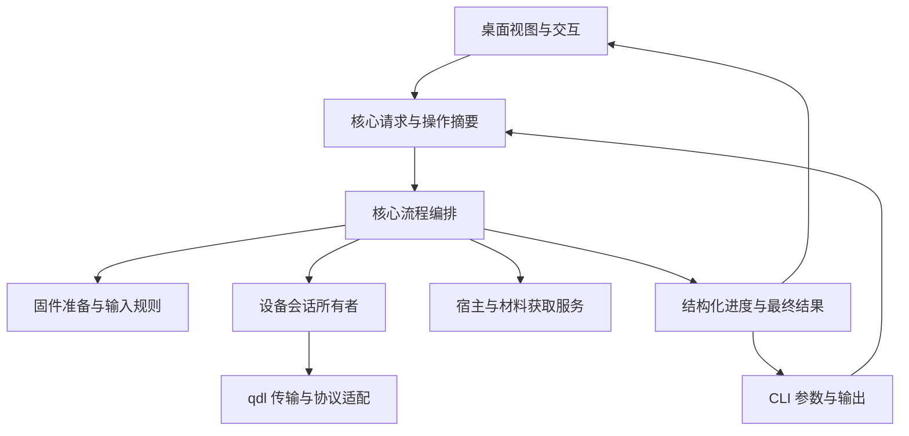
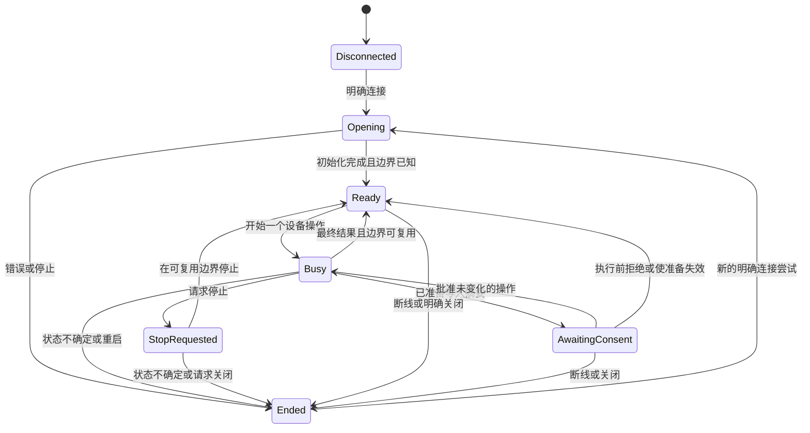

# Oplus EDL 桌面应用与共用 Rust 核心

* **作者：** LanceaKing
* **状态：** 作者已批准设计。第 9 阶段设计评审在第五轮收敛。[桌面迁移记录](../implementation/desktop-migration.md)记录实施与第一轮实施修订。原生基线验收和 USB 在途读取计时仍需实测。
* **日期：** 2026-11-17
* **前序资料：** [已确认的概念简报](../../concepts_brief.zh-CN.md)
* **英文版本：** [oplus-edl-desktop.md](oplus-edl-desktop.md)

## 概述

将 Rust 桌面应用作为 oplus-edl 的主要入口，支持 Windows、macOS 和 Linux，提供项目现有的设备与固件工作流。界面参考所提供 OPLUS TOOL 截图的大体布局和操作流程。截图是参考，不是必做功能清单。

提取共用 Rust 核心，供桌面应用和重新设计的 CLI 调用。桌面应用用于交互操作，CLI 用于自动化和调试。两种入口保留相同的操作规则和结果含义，不要求兼容旧命令语法和脚本。

未来移动端在适用范围内复用核心。本期建立桌面专用服务的依赖边界，不交付移动端界面、移动端设备访问或桌面／移动端共用视图。

用户于 2026-11-17 确认概念简报并要求进入正式设计。本文细化该方向，不覆盖历史 [CLI 设计](oplus-edl.md)，也不表示桌面应用已经存在。最终 GUI 框架仍须经过简报约定的原型验证。

## 问题

现有操作流程依赖命令行输入。用户需要将引导、固件、分区和验证选择转换为参数。桌面流程需要持续展示这些选择，同时显示连接状态、进度和结果。

仓库已有可复用模块，但应用行为尚未独立于 CLI：设备配置接收 CLI 类型，写入确认依赖终端流，结果数据包含终端输出行为。主程序编排输入准备、初始化、设备检查和执行。GUI 如果直接调用底层辅助函数，可能遗漏必要步骤。

现有进程执行一次操作后退出。桌面窗口则会经历输入变化、设备断线和后续操作。因此需要明确过期选择、操作所有权、进度和停止规则，仅重新排列现有调用不足以实现这些行为。

界面必须保留操作后的证据区别。传输字节数、设备确认写入、回读验证和未尝试的后续操作分别表达不同事实。当操作停止或未完成验证时，用户需要看到这些区别。

本次要解决的是通过可用界面提供已有能力，并保持唯一的操作实现，不扩展设备协议支持，也不复刻截图中的全部控件。

## 目标

| 编号 | 目标 | 验收所需证据 |
| --- | --- | --- |
| G1 | 交付 Windows、macOS 和 Linux 桌面应用，优先用 Rust 编写界面。 | 在选定平台基线上运行打包应用并检查交互，CI 构建成功不足以代替。 |
| G2 | 提供已确认能力清单中的全部受支持工作流。 | 每项工作流都有可用桌面路径和自动化路径，或明确作为共用子操作。 |
| G3 | 桌面与 CLI 调用同一个独立产品核心。 | 独立调用方无需 CLI／GUI 类型即可使用核心；相同模拟设备响应产生语义等价结果。 |
| G4 | 执行前明确展示目标和影响范围。 | 区分设备分区、恢复映射和有序固件操作；未选择表示无目标，全部目标需要明确选择。 |
| G5 | 保留现有准备、检查、写入与验证行为。 | 保留或迁移行为测试；包项目不匹配、启动选择无效、拒绝确认时，两种入口都不能修改设备。 |
| G6 | 长时间操作期间保持交互可用和结果准确。 | I/O 延迟时窗口仍可使用；进度不代表验证；停止请求保留已完成工作和未知结果。 |
| G7 | 避免旧界面状态控制新的或已变化的目标。 | 设备变化、重新连接、输入变化和相关分区布局变化使依赖操作失效；迟到事件不能覆盖当前结果。 |
| G8 | 替换 CLI 约定时保留用户数据。 | 现有备份目录、固件输入、部分输出、云端配置和安装身份继续可用。 |
| G9 | 为以后复用核心留下边界，本期不实现移动端。 | 测试可替换实际宿主服务，无需前端依赖；设计列出剩余桌面假设，不声称移动端已受支持。 |

本版包括备份、镜像／目录恢复、XML 刷写、已解压固件包准备、带设备检查的固件包刷写，以及已有云端材料获取。在当前支持的范围内，无设备时仍可准备固件或下载材料。现有引导初始化、验证策略和刷写收尾动作保留在所属流程中。

分区浏览通过新的应用流程展示现有 GPT 读取能力。持续界面状态、结构化进度和协作停止属于必要集成工作，不代表新增设备命令。高级控件保留受支持配置，同时避免主流程过于拥挤。

各阶段可以逐步接入这些流程，但不能缩减首版已确认能力清单。实际硬件支持声明仍限定到经过测试的宿主、设备、引导和固件组合。

## 非目标

- 兼容旧 CLI 命令、参数、JSON 格式、退出码映射或脚本。
- 将引导式终端菜单作为主要交互入口。
- 复刻全部截图控件或加入未支持的平台标签。
- 新增解锁／上锁方法、擦除、A/B 槽位切换、OCDT 修复、Fastboot、MediaTek 或降级助手。
- 重写 qdl 协议、增加授权方法，或为了界面方便改变真实云端身份及信任行为。
- 交付 Android／iOS 界面、移动端传输或桌面／移动端共用界面。
- 增加自动续写、常驻服务、插件框架、持久化审批数据库或稳定跨语言接口。
- 增加远程遥测服务、新账户系统或云端后端重写。
- 因为界面使用 Rust 就移除应用的全部原生依赖。

启动 LUN 选择不同于 A/B 槽位切换。已有启动 LUN 和重启请求仍是满足前置条件后执行的刷写收尾动作。不支持的 lock／unlock 占位入口不会变成可用 GUI 功能。

设计不能推断已下载材料适用于所有设备。离线准备、包／设备匹配、已确认写入和已验证内容分别表达不同结论。源码检查、离线测试、桌面验收与硬件测试也分别记录。

## 技术方案（架构）

本节已获作者批准。D1 复用健康会话，D2 直接使用原文件并检查变化，D3 默认可读日志、`--json` 输出 JSON Lines、`--quiet/-q` 只隐藏事件。下文细化这些已定决策，详细实施计划已列出字段、参数数值和已批准的发布目标。

### 组件与依赖方向

采用简报中的三个 workspace crate：`oplus-edl-core` 负责产品操作，`oplus-edl-desktop` 负责图形交互，`oplus-edl-cli` 负责自动化和终端输出。GUI 框架依赖和 Clap 分别留在对应前端。

图中表示逻辑职责，不代表额外 crate 或新服务协议。两种入口直接调用 Rust 库。核心不调用控件、不读取终端输入、不退出进程，只返回供前端展示的数据。

| 现有代码 | 目标职责 | 必要变化 |
| --- | --- | --- |
| `src/main.rs::run` | 核心流程编排 | 将准备、初始化、preview 模式处理、包检查、执行和收尾顺序一起迁移。 |
| `src/cli.rs` | CLI 解析与核心配置类型 | 参数解析留在 CLI，操作策略移出带 Clap 派生的枚举。 |
| `src/device.rs` | 核心设备服务与宿主传输适配 | 接收核心配置，分离枚举／打开与协议初始化。 |
| `src/write.rs` | 核心操作准备与执行 | 用可查看的操作数据替代终端确认／摘要，保留执行和验证规则。 |
| `src/output.rs` | 核心结果与前端渲染 | 保留结果事实，将 stdout、终端文本、JSON 输出策略和退出码移到 CLI。 |
| `src/backup.rs`、`src/restore.rs`、`src/storage.rs` | 核心存储流程 | 保留命名、范围、部分输出、覆盖范围和定位行为。 |
| `src/program_xml.rs`、`src/package.rs`、`src/project.rs`、`src/sparse.rs`、`src/super_image.rs` | 核心固件流程 | 保留输入顺序、包来源、排除项、稀疏处理和设备检查。 |
| `src/cloud.rs`、`src/swm.rs` | 核心获取规则与宿主服务 | 保留材料／信任校验，将宿主身份采集和运行时所有权与 UI 分离。 |
| `src/input.rs`、`src/publish.rs` | 输入与存储服务 | 保留普通文件处理和不意外覆盖目标的原子发布，隔离平台调用。 |
| `src/firehose.rs` 与固定版本 qdl | 既有协议边界 | 保留已支持的传输行为，不在迁移应用代码时替换协议。 |

这些映射说明职责。详细实施计划已逐项列出目标文件。

### 共用流程与操作数据

公开接口通过数据表达以下职责，不解析格式化日志。下列名称是概念数据，不是已定 Rust 签名或序列化格式。

| 数据或操作 | 必需内容或行为 |
| --- | --- |
| 设备配置 | 选定传输／目标、存储与扇区设置及来源、本地引导材料、适用的云端输入。 |
| 分区快照 | 连接代次、实测 LUN／分区身份与布局、发现范围和有效性。行号不作为目标身份。 |
| 操作请求 | 操作类型、输入、明确目标选择、输出位置、验证选择和适用收尾动作。 |
| 已准备操作 | 已检查输入和有序工作、范围与排除项、包来源、摘要，以及依赖的会话／输入版本。 |
| 执行决定 | 批准或拒绝该份已准备操作。目标或相关输入变化后重新准备和确认。 |
| 进度 | 操作标识、适用时的会话代次、阶段、可选条目和已知计数。总量未知时不填写。 |
| 最终结果 | 各条目的执行、写入确认、验证、错误、覆盖范围、保留输出，以及会话能否继续使用。 |
| 停止请求 | 请求协作停止，不是最终结果，也不是回滚命令。 |

已准备操作只存在于内存，不是可导入的计划文件或持久审批记录。CLI 提供明确的写入授权，不弹出提示；GUI 展示核心摘要并确认一次。两者使用包含必要检查的同一执行入口。

编排层保留固件包与普通 XML 的区别。来自固件包的操作保留项目与范围检查，不能转成普通 XML 后悄悄丢失该检查。普通 XML 也不增加其输入无法支持的身份检查。

恢复在每个镜像写入后验证。XML 刷写保留 program／patch 顺序和现有验证阶段。只有前序结果允许时才运行已请求的收尾动作。失败或未知写入会停止后续不允许的工作。迁移这些规则不能产生 GUI 和 CLI 两套实现。

### 工作所有权、宿主边界与事件

设备工作线程持有活动连接，并在同一线程创建和使用它，不假设现有连接对象可以跨线程移动。前端边界只传递请求和结果数据。同一时间执行一个设备操作，重复点击不能排队积累依赖旧选择的隐藏写入。

准备或下载使用简报约定的独立有界任务位置。设备、文件或网络工作阻塞时，界面仍可操作。核心不安装进程信号处理器，GUI 停止／关闭和 CLI 信号处理都转换为相同的停止请求。

进度传递不能阻塞协议 I/O。合并高频计数，限制显示历史，最终结果独立于可见日志保留。详细实施计划已明确队列形态和具体上限。消费者停止读取不能使部分执行被报告为成功。

宿主边界涵盖设备枚举／打开、平台身份、存储位置／发布和执行调度。当前桌面流程仍使用普通 Rust 路径和基于文件的输入，不引入通用虚拟文件系统或移动端适配器。

现有云端入口创建阻塞运行时。提取后的 API 必须明确运行时所有权，不能从未知异步上下文直接调用该入口。SWM 继续使用真实宿主身份和已有持久密钥，GUI 偏好目录不能悄悄选择新身份。本地／离线工作不要求完成云端配置。

### 桌面与 CLI 呈现

共用工作区提供备份、恢复、刷写模式。操作视图按模式显示设备分区、恢复映射或计划操作。宽窗口使用固定三栏，左侧显示输入，右侧显示设备状态、结果和有界日志。窄窗口通过「输入」和「状态与日志」按钮切换视图。底部显示阶段、进度和停止请求状态。界面遵循系统显示比例。

筛选和排序只改变显示。空选择表示无目标，全选必须明确。XML 是有序计划视图，不是任意编辑的分区复选清单。不可用操作说明缺少的输入或不可继续的状态。设备断线后仍可查看已完成结果。

CLI 提供同一组操作，以及自动化需要的设备检查、离线材料获取和准备。它不调用 GUI，也不提供交互菜单。缺少必需输入时返回错误。输出组织按 D3 固定；详细实施计划已明确命令语法和具体退出码，旧命令名称不是兼容要求。

框架按已确认顺序先调查 egui／eframe，以 iced 为备选。本设计不添加框架依赖，也不声称原型已经通过。最终适配层需要在三个桌面系统支持中文输入、文件和目录选择、宽窄窗口布局及延迟任务。

### 基本失效与停止规则

更换设备、重新连接、相关配置／输入变化、可能的 GPT 变化，都会使依赖的快照和已准备操作失效。旧代次的迟到事件不能更新当前选择或就绪状态。历史操作结果可以保留查看，但不能作为可执行工作。

区分“已请求停止”和“已停止”。尽可能在新命令开始前停止；正在传输的协议事务必须到达已知边界，或以相应失败／未知结果结束。不能中途切断传输后报告没有发生修改。协议状态不确定的会话不接收后续工作。

忙碌时正常关闭窗口会请求停止，并保持操作所有者存活，直至得到最终结果。重启、断线或事务失败不能触发自动重连／重放。关闭健康的空闲连接不隐式发送重置。下文按 D1、D2 展开状态、停止与源文件检查规则。详细实施第 3 步规定后端超时审计；取得审计结果后，才能声明停止时间有明确上界。

### D1：复用健康设备会话——已批准

作者选择 A：读写后复用健康会话；协议状态不确定、断线或重启后结束会话，不自动重连或重放。这是产品决策，不是所有现有 loader 均支持连续操作的实测证据。

活动会话保留已选设备、引导／材料上下文、配置的存储布局、已确定的传输模式和连接代次。工作线程跨操作持续持有连接。健康操作之间不重复 Sahara、授权或 configure，但每项操作仍执行其适用的输入、范围、包／设备和收尾检查。

连接健康与操作结果分开判断。健康依据是已完成的协议交换，不是 UI 标记、字节数或笼统结果分类。只有没有未完成命令、必要数据和结束响应均已消费、适配层确认处于可用命令边界时，才能复用会话。传输层不能已经报告连接丢失或状态模糊。无法确认后续行为时结束会话，不猜测可继续。

不为标记健康而增加新的 ping 或 loader 命令。适配层依据已有受支持事务判断边界。没有收到断线通知不证明设备仍在；下一项明确请求的操作可能发现连接丢失，此时使会话失效，不更换目标。

| 观察结果 | 操作结果 | 会话处理 |
| --- | --- | --- |
| 发送命令前，输入被拒绝或用户拒绝确认 | 已拒绝／未尝试 | 保留原本健康的会话。 |
| 读写交换完整结束，包含必需的结束响应 | 保留写入确认与验证事实 | 适配层确认命令边界后复用。 |
| 完整回读内容与预期不符 | 验证不匹配，停止当前流程 | 数据与响应全部收齐时可以保持可用；不续作或重试失败工作。 |
| 初始读取被明确拒绝，且处于已知非 raw 边界 | 按策略保留拒读／验证未完成 | 只有适配层确认边界时才复用；要求重试／重启或模式不确定时不符合条件。 |
| raw 数据传输期间本地源文件或输出失败 | 保留已确认工作、部分输出和未知结果 | 事务未完成，结束会话；本地错误也可能破坏协议状态。 |
| 超时、响应截断、raw 数据未收齐、断线或未知修改 | 保留失败与未知事实 | 使会话失效并释放连接。 |
| 重启命令已发送 | 单独记录其 ACK 或未知结果 | 即使收到 ACK 也结束会话。 |

当前 `src/firehose.rs` 的 `ReadRejected` 路径区分完整初始拒读与不可继续的重试／重启响应。当前 `src/write.rs` 即使比较内容不符，也可以完整读完事务。这些是新约定的源码依据，不代表已经存在会话健康 API。单独收到修改命令的 NAK，不能在没有边界证据时自动判为可复用。

在登记 `configure` 和 `getstorageinfo` 完成之前，检查应答中明确给出的 `rawmode` 属性。ACK 若报告与 XML 命令模式矛盾的值，结束会话并阻止下一条命令。沿用对省略该属性的应答的兼容处理。

D1 比较过只读复用／写后结束，以及每次操作独立连接。作者选择 A，未采用这两种更早结束会话的策略。

### 会话与操作状态流转

会话状态表示连接能否接受工作，操作状态表示某个任务及其结果。即使健康会话可以接受用户明确发起的新操作，上次失败结果也继续保留。

任何活动状态一旦观察到断线或未知协议状态，都结束会话；图中为便于阅读省略了部分相同连线。在 `Ready` 明确关闭只释放句柄，不发送重置。工作期间关闭窗口会请求停止，等工作线程判定结果后结束会话。`Ended` 不会自动进入 `Opening`。

`AwaitingConsent` 为该份准备操作保留设备使用权。UI 保持响应，但其他设备任务不能改变其依据。相关输入变化后，丢弃已准备操作及确认。拒绝写入不会修改设备，且仅在连接状态仍明确时返回 `Ready`。

一份已准备操作只接受一次执行决定。执行开始后，同一份准备不能再次提交。重复点击或迟到确认返回已过期／已消费结果，不增加设备 I/O。这是进程内所有权规则，不是持久任务库。

每次新连接使用新的连接代次；同一代次内分区快照还具有自己的版本。可能触及 GPT 的写入会使相关快照失效，然后才能执行依赖快照的下一项操作。如果写入或 patch 的目标范围无法解析，则使所有可能受影响 LUN 的快照失效。下一项明确操作需要这些数据时，使用现有 GPT 读取刷新，不在每次写入后自动扫描设备。

刷新快照不会恢复旧确认。只有身份和布局仍一致时，才保留界面上的选择，执行前仍需重新准备操作。改变设备、loader、传输方式、存储类型或扇区设置，需要明确建立新会话。连接健康不证明每个分区或后续操作都已授权。

普通备份读取取得终止 ACK 后，即使本地同步或发布失败，也保留项目的 `done` 状态和实际字节数。保留所属部分文件，在任务结果登记输出错误，并跳过后续备份读取。按命令边界判断会话是否可复用。

快照失效后隐藏旧选择，等待明确刷新。在同一连接代次内，将 GPT 条目、LUN、名称、布局和扇区大小均匹配的选择映射到新版本。会话或明确选择的范围变化时清除旧选择。

### 分阶段协作停止

首个实现使用现有完整命令边界停止，不承诺立即打断大型 raw 传输。阻塞 I/O 仍需要有限的后端超时。详细后端检查必须明确超时覆盖范围，之后才能声称停止等待有界。

| 阶段 | 停止处理 | 结果与会话影响 |
| --- | --- | --- |
| 打开设备前的等待 | 在枚举之间检查停止。释放之前的通道后，紧靠新后端的打开调用再次检查。 | 停止先被接受时，结束等待且不打开新设备或上传加载器。 |
| 离线准备／下载 | 在下一项本地工作、身份创建或网络交换开始前停止 | 排他打开文件时登记所有权。同步或发布成功后标为完整。在停止控制锁内仅随成功终态提交包准备或资产的就绪数据。失败或停止时保留文件实际状态，就绪数据为空。 |
| 引导／授权初始化 | 收到停止请求后不开始新事务，当前不可分割交换完成或由有界 I/O 失败结束 | 结束正在建立的会话，在终态结果中保留已完成的初始化阶段。不声称设备已回到 EDL。 |
| 已准备写入，等待确认 | 丢弃准备和确认 | 不修改设备；若不是关闭窗口，保留其他方面仍健康的连接。 |
| raw 读写进行中 | 尽可能完成当前命令声明的数据量及结束响应，不开始下一条命令 | 保留已完成／未知事实；边界已知才能复用，否则结束。 |
| 写入与验证之间 | 观察到请求后不开始更多命令 | 保留写入 ACK 和已接受字节计数。`best-effort` 和 `required` 将尚未进行的适用验证记为未完成。`none` 将验证记为未请求。 |
| 验证读取进行中 | 尽可能完成当前读取，然后停止后续验证和收尾动作 | 保留实测结果，未验证范围标为未完成。 |
| 启动 LUN／重启收尾前 | 观察到停止后跳过尚未提交的动作 | 记录未尝试；如果已发送重启，则判定其结果并结束会话。 |

停止是请求的结束方式，不能覆盖失败。停止期间发生超时或未知写入，仍保留失败／未知事实。取消等待可能包含当前命令剩余执行时间，不能通过丢弃 GUI future 制造已停止假象，而让工作线程在后台继续。

独立 `Connect` 在接受停止的同一把锁内发布新会话。停止先被接受时，释放通道后再发布终态，保留已完成的初始化阶段。Run 完成初始化后，以及后续任务使用健康会话时，沿用普通复用规则。

### 健康复用的契约验证

实施时先用模拟 I/O 验证以下序列，再做硬件验证：

- 初始化一次，连续查看、备份、再查看，不重复上传引导，也不产生第二个连接所有者。
- 完成写入与验证后，在同一健康会话接受用户明确发起的新操作。
- 完整回读不匹配后保留失败结果；仅在边界已知时允许单独发起另一项工作。
- 丢失 ACK 或 raw 数据截断后结束会话，拒绝携带旧连接代次的后续执行。
- 修改 GPT 或执行范围未解析的 patch 后，在下一项依赖操作前拒绝旧快照／旧确认。
- 收到重复确认或旧操作事件时，不增加设备命令。
- 传输中请求停止，保留当前命令的实际结果，不发送后续 program／patch／收尾命令。
- 重启收到 ACK 后结束连接，不自动发现、初始化或重放。

这些检查验证应用约定。硬件测试还须单独验证受支持 loader／传输组合的连续操作行为。本轮起草没有运行这些测试。

### D2：直接使用原文件并检查变化——已批准

作者选择 A：直接使用原文件并检查变化，不把整份固件复制到私有快照。任务期间源文件必须保持不变；检测到变化时停止操作，要求用户明确重新准备。

这不移除已有包准备所需的输出，例如生成的稀疏 `super.img` 和 XML。它们仍是正常工作流产物；后续写入使用它们时，也将其作为源文件跟踪。不增加强制整文件哈希、文件系统快照或持久审批清单。

对已准备操作依赖的每个源文件，记录所选路径、普通文件属性、长度以及可获取的身份／修改元数据。保留执行和比较使用的已打开镜像句柄，同时比较当前所选路径和已打开文件，避免路径替换静默改变后续读取目标。平台不能提供某个字段时记录该限制，不伪造值。原先可用的必要元数据无法读取或比较时，停止准备／执行。

解析和准备前后检查元数据。准备期间源文件变化时，不把准备结果发布为就绪。确认前建立源文件元数据记录；用户修改相关 UI 输入时，无论元数据是否变化，都丢弃原准备。

跟踪范围包括决定操作的 XML／配置和镜像，以及后续要读取的生成镜像。从已绑定到所选路径的普通文件句柄读取加载器、签名摘要和 DIGEST 签名。设备发现前、选定设备后及旧通道释放后分别检查句柄和路径。新后端打开后，在首次初始化交换前再次检查。变化时报告 `input_changed` 和受影响路径。若新通道已打开，先释放通道再发布终态。保留锁定解码器的单映像和 CPIO newc 行为。内存值及来源记录属于已建立会话。操作之间不从已变化路径重新加载这些材料；改选会话材料按 D1 明确建立新连接。

| 检查时机 | 必需处理 |
| --- | --- |
| 展示已准备摘要前 | 复查准备输入，检测到变化则拒绝。 |
| 获得确认后、第一次修改设备前 | 复查整份准备的源文件依赖；准备无效时不修改设备。 |
| 后续命令读取源文件前 | 在提交命令前复查该文件及相关计划元数据。 |
| 使用源文件的命令完成后 | 进入下一条命令前复查该源文件；变化时保留实际事务结果并停止。 |
| 回读比较前后 | 检查用作预期内容的源文件；不能把与已检测到变化的参考文件相匹配，报告为已批准输入的验证成功。 |
| 启动 LUN／重启收尾或成功结束前 | 复查源文件依赖；发现变化时不提交剩余收尾动作，也不报告成功完成。 |

这些是明确检查点，不是连续文件监控或逐字节证明。在命令边界检测到元数据变化后，不开始更多协议命令。raw 传输中源读取失败时，按既有传输失败规则分类并结束不确定会话，不能为了让进度走完而继续读取已变化数据。

| 发现时机 | 结果 | 会话与恢复 |
| --- | --- | --- |
| 尚未修改设备 | 输入已变化，操作未尝试 | 丢弃准备／确认；健康连接可以保留。 |
| 已完成一条或多条命令 | 输入已变化，同时保留已完成条目和未执行余项 | 保留 ACK 和独立成立的结果，不声称剩余或受影响验证已完成；仅按 D1 健康条件复用。 |
| 未完成设备交换中的源读取失败 | 输入／读取失败，加上实际写入不确定性 | 结束会话，不自动重连、重试或重新准备。 |

源文件错误本身不证明设备内容不一致。“输入已变化”“写入已确认”“验证未完成”“写入未知”分别保留。UI 显示受影响路径和检测到的变化，不暴露凭据，并提供新的“准备”操作。CLI 返回失败，需要新的调用或明确提交的新操作。

元数据检查不能发现所有同大小修改、保留时间戳的变化或检查后的竞态。所选策略依赖用户保持源文件稳定，两种入口都不能声称输入不可变，也不能声称已经完成全量哈希比较或取得原始时点快照。

作者选择不复制整份固件，因此未采用私有副本方案。检测到变化后，准备和确认均失效。输入变化检查不会自动重新确认，也不会修改或删除源文件。

### D1、D2 确定后的核心交互约定

下述操作边界细化前面的共用职责，表示库的职责，不是最终命令拼写或可执行 Rust 签名。

在本项目中，NV ID 用于选择固件包定义。ID 对应已解压包中的 `META/super_def.<ID>.json`。该定义为生成的 `super.img` 提供分区镜像和布局输入。ID 保持为数字字符串，包括开头的零。

查看固件包 `META` 目录中的文件名，即可取得包内可用 ID。例如，`super_def.123.json` 对应 ID `123`。根据固件包说明或已确认的包选择，选取目标固件变体所需的 ID。存在对应文件不等于设备兼容。如果不能确定所需变体，不要猜测 ID。工具不从已连接设备自动推断 NV ID。

| 操作边界 | 核心职责 | 前端职责 |
| --- | --- | --- |
| 发现设备 | 枚举受支持候选，说明选择失败原因 | 展示或序列化候选，要求目标唯一明确。 |
| 建立会话 | 持有连接，初始化所选引导／材料，建立 D1 状态 | 明确请求连接，展示实际初始化结果。 |
| 查看分区 | 读取请求范围内的存储信息／GPT，生成有范围说明的快照 | 展示设备分区或机器可读的检查结果。 |
| 获取／准备固件 | 执行已有材料获取或包准备流程，保留来源与输出 | 提供已有配置、NV 选择和路径，单独显示离线完成。 |
| 准备备份／恢复／刷写 | 绑定目标／快照／输入版本，检查输入并准备有序工作 | 展示范围和映射，不从日志重新推导规则。 |
| 执行已准备工作 | 一次性消费准备，执行 D1／D2 和适用检查，返回语义结果 | 按要求提供明确授权，展示进度和结果。 |
| 停止或关闭 | 在定义的边界停止，判定结果，关闭时释放连接 | 将用户操作或进程信号转换为请求，等待真实结果。 |

备份目标和覆盖规则仍属于备份准备。重试不能顺带覆盖现有 `.partial` 文件。即使设备读取完整结束且会话可以复用，输出发布失败仍是备份失败。

GUI 控件只保留显示数据和请求标识。活动连接、打开的源文件句柄和可执行准备仍由核心操作所有者持有。前端不持有可随意修改的准备步骤副本。第二次提交不能改变已经运行操作的范围。

### 进度、失败与输出消费者

每个设备事件标识连接代次和操作。离线工作只有操作标识，不伪造设备会话。阶段和字节进度是可选观察值。最终结果具有决定性，并独立于进度传递保留。

连接处理方式、停止请求、输入有效性、写入确认、验证和整体操作结果分开表示。已请求停止仍可能包含未知写入；输入变化失败仍可能包含已确认写入；在已知边界发生操作失败后，会话仍可能健康可复用。不能用一个绿／红标记代替这些事实。

前端适配层消费事件不能拖慢设备 I/O。较新的进度快照可以替代旧值，日志显示历史有界。即使可见日志被清空或截断，条目错误和最终结果仍保留在核心结果中。详细实施计划已明确队列上限与历史保留，不引入额外后端服务。

CLI 输出失败时，stdout 的阻塞不能传导到协议工作线程。适配层记录输出失败，并通过同一控制路径请求停止。工作线程按 D1 完成或失败当前事务，保留实际结果。输出管道已关闭时，不能声称最终报告已经送达；进程可以正常退出时返回失败。

进程崩溃、强制终止或宿主断电不属于正常协作停止。调用方未收到最终结果时，不能推断成功、未发生修改或操作可以续作。本设计不增加持久执行日志。

### D2 与前端约定的针对性验证

- 准备后改变镜像长度或修改元数据，执行必须在修改设备前拒绝旧准备。
- 旧句柄仍打开时替换或移除所选路径；检测到替换后使准备失效，不静默使用新的文件。
- 在两条已完成命令之间改变源文件，保留先前 ACK，停止后续工作并要求重新准备。
- raw 传输中源文件读取失败，保留修改不确定性并结束会话，不报告正常取消。
- 比较前改变预期源文件，不能将与已变化文件的比较标为已批准输入匹配。
- 让事件消费者积压或断开，协议不能阻塞在显示路径上，未送达的最终结果不能成为成功声明。
- 检查生成输出和 I/O 记录，确认 D2 增加的是元数据检查，而不是完整固件复制或强制整文件哈希扫描。

这些是新增验收场景，不是本轮起草已运行的测试。现有协议、存储和输入校验测试继续作为语义依据。

### D3：默认可读日志，按需输出 JSON Lines——已批准

作者直接指定输出约定：默认输出用户可读的事件日志，最后输出用户可读的最终结果；`--json` 将输出改为 JSON Lines；`--quiet` 和 `-q` 只屏蔽事件输出，不屏蔽最终结果。

| 参数 | 事件输出 | 最终输出 |
| --- | --- | --- |
| 无 | 用户可读事件日志 | 用户可读最终结果 |
| `--quiet` 或 `-q` | 不输出 | 用户可读最终结果 |
| `--json` | JSON Lines 事件记录 | 一条 JSON Lines 最终结果记录 |
| `--json --quiet` 或 `--json -q` | 不输出 | 一条 JSON Lines 最终结果记录 |

格式与事件可见性是两个独立设置。`--json` 和 `--quiet` 可以组合，顺序不影响含义；`-q` 与 `--quiet` 等价。不再增加单独的“最终 JSON”模式，因为 `--json -q` 已经只输出一条最终记录。

检查点 B 在真实 CLI 子进程中以写满且不读取的 stdout 管道运行 help、version 和参数缺值，断言有界退出 74。用生产运行入口在脚本 program 等待应答时注入输出失败，核对首次停止原因、实际 ACK 或未知状态、保留的字节计数及无后续命令。

操作调用将选定格式的应用输出写到 stdout。JSON 模式下，每个物理行包含一个完整 JSON 对象，后接换行；字符串内的换行必须转义。JSON stdout 不混入 ANSI 控制序列、多行美化对象、依赖库原始日志或人工摘要。由单一输出渲染器依次写入记录，避免不同工作线程的字节交错。

通过记录类型区分事件与最终结果。事件标识操作、阶段、级别和可获取的结构化进度；最终记录包含完整结果、条目错误、写入／验证事实、覆盖范围、保留输出、会话处置及原因和已完成的初始化阶段。详细实施计划已固定带版本的字段名称和命令拼写。两种格式渲染同一份核心数据。

`--quiet` 在 CLI 展示边界过滤事件，不关闭核心检查、停止处理、结果收集或错误分类，也不删除最终结果中的错误和相关警告。不能因为先前事件被屏蔽就让失败消失，也不能把被过滤事件改写到 stderr 来绕过安静设置。

stdout 可用时，每个已处理操作输出一次最终结果，包括输入拒绝、源文件变化、协作停止和执行失败。机器模式下，设备操作尚未开始时的参数错误也使用最终错误记录。操作／会话标识尚不存在时表示为缺失，不伪造标识。

最终结果之后不再输出操作事件。调用方根据最终记录和进程结果判断完成，不能根据最后一次进度百分比判断。EOF、半行 JSON、进程被强制终止或输出失败，不证明操作成功完成。

常规操作事件和结果使用所选 stdout 格式。stderr 只用于无法通过该输出流送达的故障，例如写输出失败，不作为第二条进度流。帮助／版本属于信息调用，而非设备操作，详细实施计划已明确其机器模式行为。

quiet 和 JSON 参数不改变设备请求、写入授权、停止规则或退出码含义。未知写入、所需验证未完成、输入变化、执行失败和停止仍是非成功结果。详细实施计划已明确具体退出码数字和命令／参数目录。

先前的 D3 候选由这份明确约定替代：默认人工可读输出，机器格式为 JSON Lines，通过 quiet 提供仅最终结果输出，不增加另一份 schema。

### CLI 输出验收

详细计划保留现有通过子进程发现 stdout 杂质的测试方法，但替换旧的“单个 JSON”假设。下列内容是拟验收行为，不是本轮已运行测试。

- 对相同模拟操作运行四种参数组合，设备 I/O 和归一化后的最终事实必须相同。
- 比较 `-q` 与 `--quiet`，包括与 `--json` 组合及改变参数顺序。
- 逐行独立解析每个非空 JSON 输出行，要求恰好一个最终记录且位于末尾，不含 ANSI 代码或依赖库原始文本。
- `--json -q` 必须恰好输出一条最终记录，进度、警告和错误事件不能泄漏到 stdout 或 stderr。
- 安静模式的最终结果保留输入无效、源文件变化、ACK 丢失、验证失败和停止操作的错误详情。
- 在连接前触发输入错误，机器模式仍返回最终错误记录，不接触设备。
- 设备消息中的换行作为 JSON 字符串转义，两种输出格式均排除凭据和带认证材料的响应正文。响应解析出错时保留阶段、错误类别及可用的行列号。服务端拒绝时报告 HTTP 状态。
- 模拟输出消费者断开，不能阻塞协议工作线程，也不能声称未送达的最终记录已被调用方收到。

## 关键用户流程

以下流程将已确认概念及 D1–D3 应用于两种入口。验收依据是实际核心结果，不是截图中的界面状态。

| 流程 | 前提 | 触发 | 预期结果 |
| --- | --- | --- | --- |
| 无设备准备固件 | 受支持的已解压固件包、按上文包定义明确选择的 NV ID和输出位置 | 用户请求仅准备 | 生成已有流程所需产物，显示排除项和准备结果，不声称已验证设备。 |
| 一次连接内查看并备份 | 已选设备和配套初始化材料 | 用户明确连接、读取分区并请求备份 | 健康时复用同一会话，显示发现范围与备份覆盖范围，按实际结果保留最终报告和部分输出。 |
| 审阅并执行写入 | 当前输入、有效会话和已准备操作 | 用户审阅核心摘要并批准 | 仅执行一次该份操作，保留适用检查，分开报告写入确认与验证。 |
| 处理源文件变化 | 已准备操作依赖原始源文件 | D2 在执行前或执行期间检测到变化 | 按 D1／D2 停止，保留实际已完成工作，使准备失效，要求明确重新准备。 |
| 停止或连接丢失 | 设备操作正在执行 | 用户请求停止／关闭，或传输状态变得不确定 | 保留实际结果，完成或失败当前交换，不自动重连或重放。 |
| 自动化或调试 | 输入完整、无需交互，必要时已明确授权写入 | 调用方选择默认、quiet、JSON 或 JSON 加 quiet | 核心工作一致，只改变渲染；正常输出路径下各模式都保留最终结果。 |

## 替代方案

本节依据已确认简报中的“比较过的替代方案”和作者的 D1–D3 决策整理，说明未采用原因，不把尚未测试的候选写成已证明不可用。作者已批准本节。

### 产品方向与兼容性

| 替代方案 | 收益与代价 | 处理及原因 |
| --- | --- | --- |
| 先做引导式 CLI，延后 GUI | 可沿用终端交互，但会推迟用户当前需要的主要入口。 | 本版不采用：桌面 GUI 是主要产品，CLI 用于自动化和调试。 |
| 保留旧命令、参数和脚本行为 | 可减少旧调用方迁移，但增加兼容分支并限制新接口。 | 本版不采用：不要求兼容旧命令和脚本。已有固件输入、备份、部分文件和安装身份仍须可用。 |

### 应用与依赖边界

| 替代方案 | 收益与代价 | 处理及原因 |
| --- | --- | --- |
| GUI 启动 CLI 子进程 | 提供进程隔离，也可以通过 CLI 复用核心；但需要定义会话、事件、确认、停止和错误的进程协议。 | 已批准设计未采用：两个 Rust 前端直接调用核心。进程隔离本身不能代替中断写入的结果判定。 |
| GUI 迁移时重写 qdl 和协议处理 | 可以重新设计内部 API，但会让界面工作同时承担协议回归风险。 | 已批准设计未采用：保留现有协议行为，提取产品流程。必要缺陷可以单独处理，迁移本身不是重写理由。 |
| 现在建立通用移动端平台框架或稳定 C ABI | 可以服务未来语言和宿主，但会在移动端权限、存储、传输需求尚未明确时固定接口。 | 按已确认范围暂缓：现在隔离实际宿主依赖，出现具体移动端调用方后再决定适配或绑定。 |
| 移除全部非 Rust 依赖 | 可以减少部分原生构建依赖，但会扩展到传输、网络和平台集成。 | 已批准设计未采用：Rust 偏好针对界面与应用代码，不要求整个传递依赖树都是 Rust。 |

### 连接生命周期与源文件处理

| 替代方案 | 收益与代价 | 处理及原因 |
| --- | --- | --- |
| 只读复用，写入后关闭会话 | 减少写后复用情况，但即使协议边界已知，下一次写入仍需明确重新进入。 | D1 不采用：读写后都复用健康会话；状态未知、断线、重启仍结束会话。 |
| 每次操作建立全新会话 | 接近现有命令生命周期，但重复初始化，不能把先前分区视图直接沿用到新连接；loader 也不保证可反复进入。 | D1 不采用其作为常规流程：保留健康连接。连接关闭或不可用后仍需明确新建，不进行自动回退或重放。 |
| 将固件输入复制到私有任务目录 | 复制完成后，可以隔离原文件后续修改；但需要额外磁盘、复制时间、清理规则，复制期间原输入仍须稳定。 | D2 不采用：直接使用原文件并检查变化，不复制整份固件；接受元数据检查的明确限制，并要求任务期间源文件稳定。 |

这些决策保留两项边界：会话复用不代表所有操作都已授权，也不代表旧分区数据仍有效；直接使用文件不提供不可变内容，也不能发现所有同大小修改。

### GUI 候选与验证

| 候选或方向 | 考虑理由 | 当前处理 |
| --- | --- | --- |
| egui + eframe | 前期调查确认了所需面板、表格和后台更新的实现路径。 | 首个原型候选，不是无条件选定或已经验证的框架。 |
| iced | 首个候选无法满足具体要求时，可采用另一种 Rust 实现路径。 | 保留为备选，不记录为已否决，也不为了比较而长期维护两套完整前端。 |
| 优先采用 Webview 界面 | 可以使用 Web UI 技术栈，但会为以 Rust 为主的应用引入另一套界面技术。 | 本期按作者界面也用 Rust 编写的偏好不采用；这是范围选择，不是技术上无法实现。 |
| Slint | 简报曾将其作为 GUI 方向考虑，但独立界面语言与直接用 Rust 编写界面的偏好较不一致。 | 不作为首个原型候选，未通过项目原型证明其不能满足要求。依据见已有[框架调查](../../reviews/2026-11-17-desktop-concept/framework-notes.md)。 |

已约定原型检查中文显示／输入、文件选择、表格行为、后台任务响应和三平台打包启动。验证结果可以推动重新考虑候选，不改变核心约定。本轮设计没有运行框架基准测试或 GUI 验收。

### CLI 输出组织

| 替代方案 | 收益与代价 | 处理及原因 |
| --- | --- | --- |
| 机器模式始终只输出一个最终 JSON 对象 | 最终结果容易解析，但该流没有结构化实时事件。 | 被 D3 替代：`--json` 输出 JSON Lines，不需要事件时用 `--json -q` 得到一条最终记录。 |
| 为最终 JSON 和流式 JSON 增加两个格式开关 | 可以单独选择两种组织，但增加重复模式与解析分支。 | D3 不采用：JSON 格式与 quiet 事件过滤独立，四种已定参数组合通过同一个机器 schema 覆盖所需用途。 |

安静输出不等于没有最终结果，也不等于隐藏失败事实。任何替代方案都不授予旧脚本兼容、自动重试或按输出格式改变执行策略。

## 详细实施计划

所有路径相对于仓库根目录。“迁移”表示创建目标文件，测试迁移后再移除原路径。同一行列出的文件分别执行该行说明的变更。作者已批准 D4 选项 A 和第 9 阶段全部十组设计修订。框架与后端验证须有记录可查。已完成的工作及验证见[桌面迁移记录](../implementation/desktop-migration.md)。

按四个可构建检查点交付本清单。编号分节只划分职责；有依赖关系的文件迁移必须在所属检查点一起提交。

检查点 A 验证桌面框架，同时保留根目录的 `oplus-edl` package、现有源码 target、集成测试，以及设置 `harness = false` 的 `json_stdout` target。添加包含根 package 和 `crates/oplus-edl-desktop` 的 workspace，暂不添加核心或 CLI 成员。在此检查点创建桌面 manifest、`src/main.rs`、`src/lib.rs`、`src/app.rs`、`src/views.rs`、`src/dialogs.rs` 和列出的字体／许可证资源。将模拟服务放在 `app.rs` 内受 `prototype` feature 控制的模块中。模拟服务使用最终视图，不能打开设备。同时创建下文列出的两个打包脚本、macOS `Info.plist` 和 Linux 桌面入口，以便执行原生框架检查。原型包必须标明验证构建身份，携带未改动的根 CLI，不宣称 GUI 工作流已经完成。

检查点 B 将第 2–4 节、第 6 节的已有测试迁移和依赖前提中的停止专项回归作为一次原子迁移。切换使用方前，创建核心与 CLI 的 manifest、入口、配置／模型、宿主、会话、服务、协调器和事件模块。在本检查点将每个已有测试移到指定 package，包括拆出的包准备子进程测试和 `json_stdout` harness 声明。同时更新导入和测试 fixture 路径。迁移测试目标后，移除根 package 声明，将根 manifest 改为最终的虚拟 workspace。在迁移后的核心 `tests/writes.rs` 和 `tests/device.rs` 添加离线停止回归。新建核心 `tests/session.rs`，添加对应的真实服务停止和终态结果用例。完成 B 前，须通过这些回归及迁移后的 CLI `tests/cli.rs` 中对应的序列化检查。桌面可以保留模拟适配器到检查点 C。任何中间提交都不能丢失旧可执行文件，也不能让其测试脱离 Cargo 发现范围。

检查点 C 完成第 5 节和第 6 节的其余集成用例。用共用服务替换桌面模拟适配器，移除 `prototype` feature／模块，运行真实适配器的等价测试。沿用相同视图和对话框。

检查点 D 完成第 7 节、最终包内容、用户文档和原生发布验证。早期打包文件在此修改，不重复创建。

每个检查点获取并锁定依赖后，都运行第 7 节列出的格式、workspace Clippy、workspace 构建和测试命令。从检查点 B 开始，另行运行该节列出的核心公共 API 和会话停止时钟两项独立测试。记录每个已迁移测试 target 所属的 Cargo package。必需的依赖修复必须在依赖它的检查点之前完成。

#### 检查点 B 的依赖前提

在检查点 B 之前，完成一次单独评审的 qdl 响应等待修复。保留当前 pin 作为比较基线；只有修复产出经过验证的提交后，才更新 Cargo.toml 和 Cargo.lock。不能虚构未来提交 hash，也不能将当前 pin 视为满足新停止约定。

收到停止请求后，响应等待有十秒宽限期。用单调时钟记录请求时间。等待 Firehose XML 响应时，在每次响应读取尝试前后以及每个完整日志包之后检查截止时间。日志和部分 XML 都不重置宽限期。保留已有传输超时。宽限期届满时，使未完成交换失败并关闭会话。保留先前 ACK 和已经完成的验证事实，不发送后续命令、reset 或重试。raw payload 使用普通读写方法。

在 qdl fork 中，修改 `qdl/src/types.rs`，给 `QdlChan` 和 `QdlReadWrite` 添加 `fill_response_buf`。默认实现调用普通 `fill_buf`。由 `QdlDevice` 和借用的 `QdlReadWrite` 传输转发专用读取。`QdlChan::check_response_wait` 默认不执行检查。修改 `qdl/src/lib.rs`，在 XML 解析中使用专用读取和截止检查，覆盖部分包和日志循环。保留现有调用签名。

修改 `qdl/src/usb.rs`，每次专用读取使用短包读取器。与普通读取共用接收缓冲区，并保留已有传输超时。短包读取器在分隔处返回零字节时，消费分隔标记，向 XML 循环返回可重试的 `Interrupted`。`fill_response_buf` 返回空切片表示流结束。锁定的 `nusb` 读取器会过滤原生 `TransferError::Cancelled` 状态。取消的传输完成事件仍可提供已接收字节或短包边界。以读取器已报告的错误为起点验证错误传递。更新 qdl fork 的 `AGENTS.md`，记录这两个方法。添加 `qdl/tests/response_stop.rs`，使用模拟通道和注入的单调时间。

在产品核心中，`service.rs` 将同一单调时钟传给任务控制和会话 worker。`session.rs` 内持有任务停止状态的通道用该时钟和首次记录的停止时间实现 `check_response_wait`，并向内部通道委托 `fill_response_buf`。后续的每层 `QdlChan` 封装均转发两个方法。在 `write.rs` 中，由 `CountChannel` 显式转发两个方法及其原始错误。使用同一停止时间和宽限期。保留已接受的字节计数及未知计数。`firehose.rs` 的 program 路径在初始 raw-mode 响应和最终 program ACK 时都使用这两个转发方法。服务停止验收要求接入经过评审的源码 pin 并完成本项目集成。

宽限期届满时，`session.rs` 的检查方法返回有类型的核心原因 `ResponseWaitExpired`。通过 `firehose.rs`、读写路径及初始化器的错误路径保留原始原因，并传入 `result.rs` 的 `OperationResult`。判定结果前，检查 `MutationFailure::cause` 或遍历错误源链，从响应包装及其上下文中识别该有类型原因。有对应操作项时，记录在该项的错误列表中。其余交换记录在任务错误列表中。其他 outcome 优先时，仍保留该原因和停止原因。宽限期届满前返回传输超时错误时，保留其原始传输原因。

根据实际在途命令和传输证据判定写入不确定性。已发送的修改命令缺少可用的终止确认时，结果保持未知。只读交换或欢迎阶段可以因同一截止原因失败并关闭会话，仍保留此前 ACK 和已完成的验证事实。公用响应辅助函数给只读命令包装的 `MutationFailure::unknown` 不提供存储修改证据。

修改 NAK 有可用的 XML 边界时可确定拒绝。program 的终止 NAK 若明示非 XML 模式或带重试／重启提示，报告已派发写入为未知。保留设备已接受的已知字节数，并关闭会话。具备明确边界的 NAK 仍为拒绝。只读交换沿用读取分类。

初始化时，`session.rs` 向 `device.rs` 的初始化器提供事务开始检查。该检查使用同一任务停止状态。只要已有停止请求，就在下一事务边界停止，即使宽限期尚未届满。在以下各项适用的交换开始前检查。

- Sahara programmer 上传。
- Firehose 欢迎阶段读取。
- 发送签名摘要及接收其 ACK。
- DIGEST verify 命令、raw-ready ACK、传输二进制签名及原有的 USB 终止处理与 flush、最终签名 ACK。这些步骤属于同一个交换。
- `sha256init` 哈希初始化及其 ACK。
- Firehose configure 命令及其响应。

交换开始后，让它完成，或因 I/O 错误或 XML 响应到期而失败。verify 交换开始后，直到签名传输和最终 ACK 都完成前，不再执行事务开始检查。交换失败时保留原始错误。每项交换成功后，`device.rs` 在下次停止检查前将已完成阶段记入会话持有的事实。`session.rs` 将有序阶段列表传入终态结果，交换失败或会话关闭时也保留该列表。初始化在成功的事务边界观察到待处理的停止请求时，以已停止结束正在打开的会话，保留这些阶段和停止原因。不隐式发送 reset。

只读预检和分区检查使用同一事务开始检查。`coordinator.rs` 将会话提供的检查传给发送设备命令的辅助函数。在 `device.rs` 的 boot-LUN 查询、`firehose.rs` 的 preview 探测、`project.rs` 的 GPT 和 OCDT 读取及 `write.rs` 的恢复 GPT 读取之前检查。所有 GPT 扫描均在每次调用 `read_gpt_with` 的读取回调时检查，包括 `Inspect` 的 `storage.rs::read_gpt` 路径。OCDT 的头部读取和按需进行的载荷读取分别检查。preview 探测发出后，初始 ACK、raw 数据和终止响应属于同一项交换。两次 ACK 等待都受 XML 响应截止时间约束。若已成功完成一次读取且收到停止请求，在发送下一命令前向协调器返回有类型的停止指示。该指示贡献 `stopped`，并保留已完成的读取事实。按 D1 判定会话处置并保留此前失败。

在 `write.rs::prepare_restore` 中，GPT 读取回调返回有类型的停止指示时，跳过记录 GPT 验证失败的 `inspect_err` 路径。将停止指示直接传给协调器，保留已完成读取项的 `done` 状态和传输字节计数。

将同一事务开始检查传给 `backup.rs`。每次主 GPT 读取回调开始时，在截断本任务拥有的 `.partial` 文件、将文件位置移回开头或修改文件之前执行检查。读取备份 GPT 和每次分区读取开始前也要检查。将这些检查返回的有类型停止指示经备份流程传给协调器，跳过把最后一个成功读取改记为失败的路径。保留已完成项及字节计数、已发布文件和本任务拥有的部分文件及其中的字节。头部读取完成后，将该项的 `reason` 记为 `GPT header probe`。完整主 GPT 采集替换头部字节并收到终止 ACK 后，才将头部读取标记为已取代。完整采集按现有规则发布前，将所属文件记为部分输出。

CLI 的 `partitions` 提交一个含 `Open(config)` 和 `Inspect { scope }` 的 Run 任务。初始化和分区检查共用任务句柄、停止状态、任务 ID 和结果。初始化成功后，`coordinator.rs` 进入与已有会话共用的分区检查路径，在发送首条扫描命令前检查该任务的停止状态。备份、恢复或分区检查未明确指定 LUN 时，在通过 `qdl::firehose_get_storage_info` 发送 `getstorageinfo` 前立即检查。明确指定 LUN 的分区检查在第一个 GPT 读取回调中检查。任务终态保留已完成的初始化交换。CLI 在渲染终态前释放会话，不发送 reset。

设备 worker 完成最后一条 GPT 读取和本地校验后，协调器在提交分区快照前检查同一任务的停止状态。将该检查与提交快照、revision 和检查成功终态合为一次决策，与接收停止请求串行处理。若提交前已接收停止请求，终态为 `stopped`，并按 D1 的失效规则保留原快照及 revision。分区检查停止或失败时，保留已完成的读取项和实际字节数，不发布新快照或 revision。CLI 终态结果的 `data` 为 `null`。

按设备命令顺序，将每项已完成的预检设备交换在 `OperationResult.items` 中记录一次，`execution` 为 `done`。boot-LUN 查询或自动 LUN 查询的 `operation` 为 `getstorageinfo`，记录该命令的 LUN，各字节字段为 null。preview、GPT 和 OCDT 的每项 raw 读取将 `operation` 记为 `read`，并记录 LUN、起始字节、请求传输字节数及实际传输字节数。已有读取项的路径复用该项。写入和验证记为 `not_applicable`。交换成功并收到所需的终止 ACK 后，记录该项完成。之后本地校验失败、任务停止或后续交换到期时，保留该项。

备份和恢复在收到读取 ACK 后发生本地 GPT 校验失败时，将错误记入 `OperationResult.errors`。备份在主 GPT 和备份 GPT 采集各自收到终止 ACK 时，将对应读取记为 `done`，并记录实际传输字节数。任一 GPT 采集在此后发生本地同步或发布失败时，将错误记入 `OperationResult.errors`，错误的项标识为 `null`。保留已完成的读取项和所属 `.partial`，计入 `execution_failed`，并在下一条设备命令前结束备份。按已完成交换的边界证据应用 D1。这条 ACK 后输出规则适用于 GPT 采集。已发出的 raw 读取在交换中失败时，错误归在该读取项中。

为 `probe_preview_mode` 的两次响应等待追加上下文时，保留错误源。boot-LUN 或自动 LUN 的 `getstorageinfo` 查询到期时，将 `ResponseWaitExpired` 记入 `OperationResult.errors`，错误的项标识为 null。到期查询不生成已完成项。每条已发出的 preview、GPT 或 OCDT raw 读取按设备命令顺序记录一个结果项。到期时记录 `execution = failed`、请求传输字节数、已知的实际字节数及该项的原始 `ResponseWaitExpired`。序列化错误时使用相同的项标识。停止检查阻止发出命令时，将结果记为任务停止，不创建读取项。这些只读交换到期贡献 `execution_failed` 并关闭会话。保留此前完成的项及停止原因。跳过所有后续命令。到期读取不产生未知写入。

在 `write.rs` 中，每次开始修改命令、验证读取交换或设备收尾动作前，用同一任务停止状态执行独立检查。program 开始后，将初始响应、raw payload 和终止响应作为一项交换。交换中的 XML 等待受截止时间约束。及时收到终止 ACK 时，先记录 ACK 和已接受字节计数，再检查下一条命令。交换失败时保留实际错误。成功到达事务边界且已有停止请求时，跳过后续命令。按 D1 判定该边界的会话复用，并处理显式关闭。

源元数据检查和备份文件准备可能阻塞。完成这些本地工作后，在 patch、设启动 LUN、重启及备份读取的发送边界再检查停止。被挡下的修改项保持 `not_attempted`。未发出的读取不创建读取项。停止挡下主 GPT 第二次读取时，保留已确认的头部字节。保留此前的读取、ACK、已接受字节和本任务的部分文件。在检查点 B 用脚本传输覆盖这些发送边界和 raw 模式矛盾应答。

及时收到 program ACK 且已有停止请求时，保留 ACK、已接受字节计数和已完成的验证事实。`best-effort` 和 `required` 将尚未验证的适用范围及对应写入项记为 `incomplete`。这贡献 `verification_incomplete`，无更高优先级结果时退出码为 5。`none` 将验证记为 `not_requested`。停止贡献 `stopped`，无更高优先级结果时退出码为 130。

验证读取的终止响应到期时，将该范围记为 `incomplete`，即使比较已观察到字节差异。若有此差异，在范围的 `reason` 中记录 `byte_difference_observed`。在对应操作项的错误中保留 `ResponseWaitExpired`，并在结果中保留此前写入 ACK、字节计数和已完成的验证事实。未完成的交换按第 4 节的结果规则贡献 `verification_incomplete`。

在检查点 B，向迁移后的 `crates/oplus-edl-core/tests/writes.rs` 增加核心集成回归，在新建的 `crates/oplus-edl-core/tests/session.rs` 断言真实服务结果。执行走真实 program 路径和 `CountChannel`。分别在初始响应期间和完整载荷传输后的最终 ACK 等待期间，测试持续日志和可重试空完成。脚本通过 `fill_response_buf` 提供空完成。若 XML 等待走普通读或普通缓冲读取，测试应失败。在服务用例中，用第 3 节的测试时钟创建真实服务，提交任务并调用 `JobHandle::request_stop()`。将该时钟推进到十秒宽限期之后，再用 `try_take_result()` 取走终态结果。断言保留有类型的到期原因、已发送 program 缺少终止响应时判为未知修改、会话关闭、字节计数及此前事实保留，且无后续命令、reset 或重试。保留直接 qdl 回归作为独立覆盖。

B 的服务用例还要在请求停止后、宽限期内返回最终 program ACK。分别安排下一条原定命令为验证读取、另一项修改或收尾动作。覆盖 `best-effort`、`required` 和 `none` 三种模式。断言操作项和范围的验证状态、聚合结果、保留的 ACK 和字节计数以及停止原因。每个用例的设备 trace 均在 program 交换后结束。B 的 CLI 用例断言对应的终态和退出码。

B 的预检服务用例使用明确指定 LUN 的恢复任务，经过 `prepare_restore`。返回有效头部，使同一次 `read_gpt_with` 调用还需要第二条命令。等待第一条读取的终止 ACK 时请求停止，并在宽限期内返回该 ACK。第一条读取项须保留 `done` 和传输字节计数。终态为 `stopped`，trace 中没有第二条读取或写入。

通过 `backup.rs::capture_primary` 执行对应的备份用例。交付首个有效 GPT 头部后，在等待终止 ACK 时请求停止，并在宽限期内返回 ACK。断言终态为 `stopped`，第一条读取仍为 `done`，其 `reason` 为 `GPT header probe`，且字节计数正确。断言本任务的 `.partial` 包含该头部字节并记录在结果中。验证未发送第二条读取且未发布最终 GPT 文件。

在 B 的备份发布用例中，采用不替换已有文件的发布方式。脚本通道完成主 GPT 采集并发出备份 GPT 读取。在备份 GPT 的 `.partial` 已打开并收到完整载荷后、交付终止 ACK 前，在最终路径创建内容不同的备份 GPT 文件。断言备份 GPT 读取为 `done` 且计数完整，发布失败记入任务错误，终态为 `execution_failed`。检查结果记录了所属 `.partial`，且文件包含准确的备份 GPT 字节。检查发生冲突的目标文件内容及已发布的主 GPT 内容。断言 trace 结束于备份 GPT 交换。

B 中省略 LUN 的复用用例使用已建立的会话。对备份或恢复用例及 `Inspect` 用例，通过第 3 节的测试专用 LUN 查询等待点，在事务开始检查前暂停已接收的任务。等待通知后，通过返回的任务句柄请求停止，再放行 worker。断言本次任务没有发送设备命令，终态为 `stopped`。另一个用例发送 `getstorageinfo`，请求停止后使响应等待到期。断言任务错误列表中的有类型原因 `ResponseWaitExpired`、`execution_failed`、会话关闭及停止原因。trace 中没有后续 GPT 读取或写入，结果没有未知写入。另在 `Inspect` 中于请求停止后、宽限期内完成第一条 GPT 读取。断言头部读取保留 `done` 和字节计数，没有下一条读取，且不发布新快照。

在 B 的另一项 CLI 用例中，通过生产适配器注入服务和传输，运行省略 `--lun` 的 `partitions --json -q`，在新会话完成初始化。收到 LUN 查询等待点的通知后，调用适配器的信号转发入口。转发返回后放行 worker。断言 trace 中没有 `getstorageinfo`、GPT 读取或 reset，并观察到 CLI 所属通道在输出终态记录前已释放。要求恰好输出一条终态记录，保留有序的初始化阶段，`stop_reason` 为 `signal`，`outcome` 为 `stopped`，`data` 为 `null`，退出码为 130。

在 B 的另一个真实服务用例中，对一个明确指定的 LUN 执行 `Inspect` 并发布快照。通过第 3 节的 `test_support::committed_partition_snapshot` 读取已提交的快照。复用同一会话，以相同的有效 GPT 字节再次检查该 LUN。第二个任务等待最后一条 GPT 读取的终止 ACK 时，通过任务句柄请求停止。在原宽限期内返回 ACK，并让本地校验完成。断言两条读取仍为 `done`，均保留准确的传输字节数，终态为 `stopped`，包含所记录的停止原因且没有快照数据。通过同一入口再次读取已提交的快照。要求两次都返回 `Some`，比较快照内容、会话 generation 和 revision，并验证第一次读取与成功检查的结果一致。

另分别令 preview 探测的两次 ACK 等待到期。raw-ready ACK 到期时，失败读取项的实际传输量为零字节。交付完整载荷后令终止 ACK 到期，失败读取项的实际传输量为五个扇区。检查项标识、请求长度及经实际响应包装和上下文路径保留的有类型到期原因。断言 `execution_failed`、会话关闭、停止原因，且没有未知写入或后续命令。在一个 preview 到期用例中先完成 boot-LUN 查询，在失败项之前保留查询项的 `done`、LUN 和 null 字节字段。在固件包预检用例中，先完成 raw GPT 头部读取，再使下一条读取到期。断言保留此前完成项及计数，并保留后一失败项及有类型到期原因。B 的 CLI 用例验证预检错误位置和项标识引用在序列化后仍正确。

B 的两个真实服务用例使用注入时钟，让验证设为 `none` 的 program 等待终止 ACK。先请求用户停止，五秒后调用 `request_close(StopReason::WindowClose)`。在到期用例中，将时钟推进到首次请求后的第十一秒。要求按首次请求的截止时间返回 `ResponseWaitExpired`，终态的 `stop_reason` 为 `user`。在及时收到 ACK 的用例中，关闭请求发出后、原宽限期内返回 ACK。断言终态为 `stopped`，保留 ACK、已接受字节计数及首个原因。显式关闭使会话在已知事务边界关闭。两个 trace 均无后续设备命令。

B 的写入和服务测试均覆盖 program 成功后的验证读取到期。分别返回匹配和不同的载荷字节。请求停止后使终止 XML 响应等待到期，并经实际的 `MutationFailure` 包装返回。断言该范围验证未完成，保留有类型的到期原因、此前 program ACK 和字节计数，且没有新增未知写入或后续命令。字节不同的用例要求范围原因包含 `byte_difference_observed`。真实服务用例还要断言会话关闭，以及没有更高优先级结果时任务 outcome 为 `verification_incomplete`。B 的 CLI 用例验证该 outcome 和退出码 5。

产品侧的 `device::digest_welcome` 独立于 qdl 解析器读取启动 XML。在核心 `device.rs` 中，用 `fill_response_buf` 和 `BufRead::consume` 替换 XML 的 `read_exact` 循环。每次尝试前后检查同一截止时间，覆盖帧间空白和部分 XML。先执行读取后检查，再处理读取结果。检查通过时，重试 `Interrupted`。仅当当前包没有累积字节且读取返回 `TimedOut` 时，按原空闲超时规则返回已收集日志。原样传播截止错误和其他 I/O 错误。空切片返回 `UnexpectedEof`。跳过每个包前的帧间空白，只消费到该包的 `</data>` 标记，将后续字节留在缓冲区。沿用包和日志的大小限制。每解析完一个完整日志先检查截止时间，再决定是否在 VIP 请求或 supported-functions 结束标记处返回。Sahara、digest／signature 二进制写入和 raw payload I/O 使用普通传输方法。

在检查点 B，在迁移后的 `crates/oplus-edl-core/tests/device.rs` 中使用模拟通道和注入的单调时间执行 `initialize_with_digest_signature`。loader 阶段之后，分别测试非终止欢迎日志、帧间空白、部分 XML 和可重试空完成。通过 `fill_response_buf` 提供空完成。如果欢迎 XML 使用普通读或普通缓冲读取，测试应失败。分别测试宽限期内收到 VIP 和 supported-functions 标记，且后续 ACK 与标记来自同一次读取。保留标记的解析结果，留下未读 ACK。已有停止请求时，禁止开始下一项初始化交换。保留现有未请求停止时的二进制字节和 ACK 顺序测试。

验证欢迎阶段的两个到期边界。

- 当前包没有累积字节时，让一次专用读取返回 `TimedOut`。宽限期内沿用原有的空闲返回行为，保留已收集日志。到期用例须在该次读取期间将注入时钟推进至截止时间。断言以原始截止错误结束等待。
- 同一次专用读取返回完整的欢迎结束标记日志和后续 ACK。读取后检查仍处于宽限期内。消费标记时将时钟推进至截止时间。断言日志处理后检查在没有再次读取的情况下返回原始截止错误，后续 ACK 保持未读。

欢迎阶段到期时，断言没有后续初始化命令、reset 或重试。在 `crates/oplus-edl-core/tests/session.rs` 中，用注入时钟创建真实服务并调用 `JobHandle::request_stop()`。断言每种到期失败都关闭正在打开的会话。通过 `try_take_result()` 检查有类型的到期原因、停止原因和已完成的 Sahara 上传。欢迎阶段不能记为已完成，结果也不能报告未知存储写入。及时收到标记且已有停止请求时，断言正在打开的会话以已停止结束，且没有下一事务。另在签名传输前等待 verify 的 raw-ready ACK 期间请求停止。断言 verify 完成整个交换，包括签名传输和宽限期内的最终 ACK。随后正在打开的会话以已停止结束，不发送哈希初始化或 configure 命令。终态结果记录截至最终签名 ACK 的阶段。关闭会话后从结果断言这些阶段，即使进度事件已经丢弃。

测试没有终止响应的持续日志和部分 XML，分别覆盖有、无待确认修改的情况。将测试时钟推进到宽限期之后，要求交换失败、会话关闭、已完成事实保留且没有后续命令。测试宽限期内收到完整响应时保留真实结果。按 [USB 在途读取计时规程](../testing.md#usb-在途读取计时) 验证首次接受停止时 USB 应答读取已在途。测量跨越原截止的读取造成的额外延迟。用 `t_core_result` 记录核心终态提交，用 `t_worker_drop` 记录 worker 完成丢弃通道。及时收到 ACK 时，CLI 先取走可复用的核心结果，再关闭会话。原生后端先超时或应答宽限期到期时，worker 丢弃通道后提交核心终态。测量可见的 JSONL 时，在两个程序事件之后记录交付。用匹配的原生 USB 事件记录底层传输完成或取消完成的 `t_native_done`。如果测量接口释放，另行记录对应的原生事件。保留有类型的终态和命令记录。该策略约束此类响应等待，不为设备打开、raw 传输或宿主文件系统工作提供端到端 Stop 时限。

### 1. 验证桌面框架并固定构建输入

在最终桌面 crate 中先验证已约定的 egui／eframe 候选，使用模拟服务，不连接设备。原型视图随后发展为正式应用，不另外维护一套一次性前端。

| 文件动作 | 变更及原因 |
| --- | --- |
| 修改 `Cargo.toml` | 检查点 A 保留当前 package，并添加桌面 workspace 成员。检查点 B 改成包含三个既定 crate 的虚拟 workspace，使用 edition 2024、共用依赖声明，并将桌面与 CLI 设为默认成员。保留 MIT 和不发布 crate 的设置。 |
| 修改 `Cargo.lock` | 尽量保留已有依赖固定版本，验证后锁定 GUI 与适配依赖。保留 `wreq =0.16.3`。qdl revision `205c7d4d9f15add22d78c422ba77843ab72c95d4` 作为基线；在检查点 B 前，将 Cargo.toml 和 Cargo.lock 更新到经过验证的响应等待修复提交。当前 pin 不满足新停止约定。 |
| 新建 `crates/oplus-edl-core/Cargo.toml` | 检查点 B 创建，管理操作依赖，拆出可选 `usb`、`serial`、`desktop-host` 和 `cloud` feature。增加独立于 `cloud` 的非默认 `test-support` feature。为 `session` 集成测试目标声明 `required-features = ["test-support"]`。默认均不启用。协议／解析代码可使用调用方提供的宿主服务。 |
| 新建 `crates/oplus-edl-cli/Cargo.toml` | 检查点 B 创建，管理 Clap、终端／信号处理和 CLI 序列化，启用已有桌面后端与 cloud feature。二进制名为 `oplus-edl`。同一检查点迁入测试 target，包括设置 `harness = false` 的 `json_stdout`。 |
| 新建 `crates/oplus-edl-desktop/Cargo.toml` | 检查点 A 创建，管理通过验证的 GUI、文件对话框和模拟 `prototype` 适配器。检查点 C 添加生产核心依赖，启用与 CLI 相同的核心能力。二进制名为 `oplus-edl-desktop`。 |
| 新建 `docs/implementation/desktop-migration.md` | 记录能力与视图／命令映射、选定版本／feature、基线测量、依赖变化，以及下列各步的证据。 |

在 1280 × 800 和 1024 × 768 逻辑像素下验证工作区和底部进度区。主要操作可通过布局和滚动到达。窗口进入窄布局后，核对输入和状态视图可达，点击模式按钮可返回操作视图。检查中文显示和输入法、带空格路径、剪贴板输入、键盘焦点及文件和目录选择取消。在两种规定尺寸下，让模拟的 10,000 行表格与延迟 30 秒的任务同时运行。在记录配置的测试主机上，选择、滚动、停止请求的可见反馈不得超过 250 毫秒。

拟采用 `rfd` 作为文件对话框适配器，其文档列出三平台原生对话框支持。必须在打包应用中验证 Linux portal 条件和 macOS 窗口／主线程要求。选择器失败时仍保留路径输入。Context7 未找到匹配条目，因此本建议依据 [rfd 官方文档](https://docs.rs/rfd/latest/rfd/)。尚未确定经过项目验证的 rfd 版本。

随包提供一个未经修改的简体中文字体，避免干净主机依赖本地 CJK 字体。拟使用 Noto Sans CJK SC Regular，携带上游版权和许可证，获取时记录 revision 与校验和。参见[字体格式](https://github.com/notofonts/noto-cjk/blob/main/Sans/README.md)及[字体许可证](https://github.com/notofonts/noto-cjk/blob/main/Sans/LICENSE)。应用启动时不下载字体。

选定基线全部通过后才接受 egui／eframe。某项明确要求失败时，先记录问题，再用 iced 验证该要求，之后才决定是否更换适配层。不静默删除平台，也不维护两套生产 UI。GUI 精确版本、渲染器 feature 和原生构建依赖是本步骤的锁定产物，必须在功能实现前确定。无法解决的失败返回设计评审。

### 2. 将已有行为迁入核心，保留其语义

| 原文件 → 新文件 | 变更及原因 |
| --- | --- |
| `src/lib.rs` → `crates/oplus-edl-core/src/lib.rs` | 导出应用 API 和宿主注入点，移除 CLI 导入，说明受支持的流程入口。 |
| `src/backup.rs` → `crates/oplus-edl-core/src/backup.rs` | 保留 GPT 捕获、目录命名、覆盖／partial 规则及设备读取结果。将明确选择转换为现有执行范围。在每次主 GPT 回调修改文件前，以及读取备份 GPT 和分区前检查停止。传递有类型的停止指示、已完成项、字节计数和本任务拥有的部分输出。主 GPT 或备份 GPT 采集收到 ACK 后，本地 GPT 校验、同步或发布失败归入任务错误。保留已确认的读取并结束当前备份。 |
| `src/restore.rs` → `crates/oplus-edl-core/src/restore.rs` | 保留镜像／目录映射、歧义检查、补零和未覆盖尾部报告。 |
| `src/storage.rs` → `crates/oplus-edl-core/src/storage.rs` | 保留 qdl 存储适配，在预检和 `Inspect` 的 GPT 读取回调中检查停止。分区检查成功完成后，产生带稳定身份、范围和 revision 的快照。 |
| `src/device.rs` → `crates/oplus-edl-core/src/device.rs` | 用核心配置替代 Clap 输入。保留 loader／digest／signature 顺序、preview 检查和无隐式 reset 行为。等待设备时、每项初始化交换前及 preview boot-LUN 查询前检查停止。记录已完成的初始化交换并保留原始错误原因。在 `digest_welcome` 使用 `fill_response_buf`、`BufRead::consume` 和 `check_response_wait`。保留结束标记、未读 ACK、大小限制和二进制传输边界。 |
| `src/firehose.rs` → `crates/oplus-edl-core/src/firehose.rs` | 保留 Firehose 命令和载荷语义。使用任务截止时间，为 D1 提供事务边界证据，报告进度时保持 I/O 不受展示回调阻塞。初始 raw-mode 响应和最终 program ACK 均通过 `CountChannel` 的专用读取和截止检查。发送 preview 探测前检查停止。探测的 raw 传输和两次 ACK 属于同一项交换。给任一次响应错误追加上下文时，保留有类型的到期原因。raw payload 使用普通方法。 |
| `src/write.rs` → `crates/oplus-edl-core/src/write.rs` | 移除终端提示和展示辅助函数。保留有类型的准备摘要和决定入口。保留有序执行、写入判定、验证及收尾条件。写入执行器或恢复 GPT 读取回调开始每项设备交换前检查停止。将有类型的停止指示传给协调器，后续本地 GPT 校验失败则归入任务错误。保留已完成读取的状态和字节计数。通过 `CountChannel` 的 `QdlChan` 实现转发 `fill_response_buf` 和 `check_response_wait`。将原始原因、命令证据、ACK 和字节计数传入结果。按依赖前提记录及时收到 ACK 后停止和终止响应到期时的验证结果。 |
| `src/output.rs` → `crates/oplus-edl-core/src/result.rs` | 保留结果事实。由 CLI 适配器处理 stdout、进程退出码和 CLI wire 结构。逐项状态使用 `ExecutionState`、`WriteState` 和 `VerificationState`。范围验证也使用 `VerificationState`。CLI 将项目及范围状态显式映射到已有 schema v1 值。写入收到确认或结果未知时使设备快照失效。按顺序保留已完成的预检读取项，在错误中保留有类型的到期原因，在终态会话详情中保留已完成的初始化阶段。 |
| `src/input.rs` → `crates/oplus-edl-core/src/input.rs` | 保留普通文件检查与打开的句柄，在已批准检查点增加 D2 元数据快照与比较。 |
| `src/publish.rs` → `crates/oplus-edl-core/src/publish.rs` | 保留平台相关的原子不替换发布和部分输出归属规则。 |
| `src/program_xml.rs` → `crates/oplus-edl-core/src/program_xml.rs` | 保留 XML 顺序、源偏移、DISK patch 规则和明确跳过项，记录源依赖。重新打开固件包 XML 时，对照重建结果检查操作字段、顺序、源绑定及 patch 范围。该比较与 `package.rs` 的选择重建及 `coordinator.rs` 的编排协同完成。 |
| `src/sparse.rs` → `crates/oplus-edl-core/src/sparse.rs` | 保留受支持的 Android sparse v1.0 RAW／FILL／DONT_CARE 语义、版本与几何验证、对齐、源偏移、payload／范围与总大小检查，以及有界的文件支持 payload。读取 sparse 头部前和各元数据 chunk 之间检查停止。XML、包准备和重开、super 验证使用此路径。载荷继续由文件支持。 |
| `src/super_image.rs` → `crates/oplus-edl-core/src/super_image.rs` | 保留生成的 sparse super 布局，报告进度并在发布前检查停止请求。 |
| `src/package.rs` → `crates/oplus-edl-core/src/package.rs` | 保留明确 NV 选择、排除项、生成文件及固件包来源。按第 4 节添加受检查的 `--prepared` 复用，并共用选择重建逻辑，不重新生成 `super.img`。 |
| `src/project.rs` → `crates/oplus-edl-core/src/project.rs` | 保留 OCDT 项目／范围检查，不匹配时在修改设备前失败。复用已准备固件包时重建 `PackageGuard`。在每次 GPT 读取回调中以及每次 OCDT 读取前检查停止。通过项目检查传递到期原因。 |
| `src/cloud.rs` → `crates/oplus-edl-core/src/cloud.rs` | 保留下载校验、现有配置与 assets 输出，将 runtime 所有权移到服务 worker，并增加协作停止点。接收解析后的有类型路径和身份模式。按第 3 节注入获取环境，供仅限测试的 loopback 路径使用。 |
| `src/swm.rs` → `crates/oplus-edl-core/src/swm.rs` | 保留注册／信任规则和已有身份，构造注册请求时，通过 HostServices 取得宿主证据。默认使用原生采集。发布成员须为普通文件。打开每个成员前及每次有界哈希读取前检查停止。对解析后的身份路径应用第 5 节明确的 OpenExisting／CreateNew 行为。调整迁移后的 fixture 路径。 |

将 `src/main.rs::run` 的编排迁入第 3 步的新协调器，之后才在第 4 步替换旧 main。原命令分支消失不构成删除检查的理由。包来源、preview 读取探测、boot-LUN 前检、项目／范围检查、收尾顺序一起保留。前端调用协调器，不直接调用底层写入辅助函数。

### 3. 增加共用应用约定和 worker 所有权

| 新文件 | 职责及原因 |
| --- | --- |
| `crates/oplus-edl-core/src/model.rs` | 定义请求、核心配置、分区身份、快照、准备摘要及策略枚举，不依赖任何前端。定义 Request、连接变体、SubmitError、StopReason、解析后的云端路径及 IdentityMode。定义共用 `Backend` 类型及发现请求的明确后端字段。 |
| `crates/oplus-edl-core/src/coordinator.rs` | 接收原 main 中带检查的流程。准备、确认和执行是同一个 Run 任务的阶段。重新打开准备产物时，重建并验证固件包来源。含 `Open` 和 `Inspect { scope }` 时，在同一个 Run 任务中初始化和检查分区。将会话的事务开始检查传给只读预检、分区检查和备份。通过 `getstorageinfo` 自动发现 LUN 前执行检查。有测试专用查询等待点时，放行后立即执行该检查。提交分区快照时检查同一停止状态。在结果中保留读取项、停止边界和有类型的到期原因。 |
| `crates/oplus-edl-core/src/session.rs` | 管理会话 generation／状态、事务健康、快照失效和 D1 复用。使用任务停止状态实现 `check_response_wait`，并为初始化、只读预检、分区检查、备份和执行写入提供事务开始检查。宽限期届满时返回 `ResponseWaitExpired`。向内部通道委托 `fill_response_buf`。会话建立完成或关闭时，将已完成的初始化阶段传入终态结果。 |
| `crates/oplus-edl-core/src/service.rs` | 唯一服务／会话所有者、设备 worker 和独立准备／获取 worker。提供非阻塞提交、同一任务内确认、有界保留结果、停止／关闭、任务句柄及注入的获取环境。任务控制和会话 worker 共用停止时钟和首次停止的时间及原因记录。独立跟踪显式关闭。发现请求只路由到所请求后端的枚举器。不支持时在访问 provider 前拒绝。 |
| `crates/oplus-edl-core/src/events.rs` | 结构化事件、合并进度、有界日志、可靠的当前状态／摘要／结果，以及交付前脱敏。对设备提供的每条启动日志发布固定事件，保留阶段和队列限制。 |
| `crates/oplus-edl-core/src/host.rs` | 为枚举／打开、宿主信息、任务调度和获取环境提供可共用 provider。传输的创建和使用留在所属 worker 内。平台适配放在此处或已有输入／发布模块，不建立插件注册系统。 |
| `crates/oplus-edl-core/src/test_support.rs` | 在 `test-support` 下导出 `service_with_stop_clock`、`service_with_lun_query_gate` 和 `committed_partition_snapshot`。同时启用 `test-support` 和 `cloud` 时，导出下述经验证的 loopback 服务构造器。不提供产品端点／信任覆盖入口。 |

`CoreService` 是前端对服务及其持久会话的唯一所有者。用明确的 `HostServices` 构造服务；桌面构造器提供原生 provider。HostServices 持有设备枚举／打开、宿主信息、worker 调度和下述获取环境。Provider 可共用，但传输创建和使用发生在设备 worker 内。打开 provider 返回已有 `QdlDevice<dyn QdlReadWrite>` 边界；测试通过同一 provider 返回模拟通道。Worker 调度接收一个由其拥有的任务，在接收请求之前报告启动失败。

公共提交约定为 `submit(Request) -> Result<JobHandle, SubmitError>`。Request 变体包括 `Discover { backend: Backend }`、`Connect(SessionConfig)`、`Inspect(SessionId, Scope)` 和 `Run { connection, operation }`。Run 的连接选择为 `Existing(SessionId)`、`Open(SessionConfig)` 或 `Offline`。只有无需设备的操作可以使用 `Offline`。`OperationRequest` 的变体包括备份、恢复、XML／包刷写、包准备、云端获取和 `Inspect { scope: Scope }`。Run 的分区检查变体只接受 `Open(SessionConfig)`。连接类型不符时，在访问 provider 前按无效请求拒绝。通过 `Request::Inspect(SessionId, Scope)` 检查已有会话。GUI 先 Connect，再使用已有会话的检查入口或带 `Existing` 的 Run 任务。`CoreService::request_close(reason: StopReason)` 通过独立控制路径发送关闭请求。

两个分区检查入口都使用 `Scope::Selected(Vec<u8>)` 指定非空 LUN 列表，或用 `Scope::All` 检查全部可发现 LUN。明确列表为空或含重复 LUN 时，在访问 provider 前拒绝。`partitions` 将 `--lun` 的值映射为 `Selected`，省略 `--lun` 时使用 `All`。

在核心 `model.rs` 中定义含 `Usb`、`Serial` 的 `Backend`，供发现请求和会话配置共同使用。CLI 和 GUI 在提交前确定默认 USB，并明确传递选定后端。`service.rs` 的发现流程只调用该后端的枚举 provider，不打开通道、不枚举另一后端，也不回退到另一后端。如果注入 provider 和已编译的原生 provider 都不支持所请求后端，则在枚举或打开之前返回现有“不支持能力”SubmitError。未启用原生传输 feature 时，仍可使用注入 provider。

CLI 的 `args.rs`／`run.rs` 适配器和桌面的 `app.rs` 通过同一 CoreService 传递此请求。在 `crates/oplus-edl-core/tests/public_api.rs` 增加独立调用方用例，并在 `crates/oplus-edl-cli/tests/cli.rs`、`crates/oplus-edl-desktop/tests/app.rs`、`crates/oplus-edl-desktop/tests/frontend_parity.rs` 增加对应适配器用例。覆盖省略参数时默认 USB、明确 USB、明确 serial、请求不可用后端，以及关闭原生 feature 时使用注入 provider。断言仅选定枚举器被调用、全部打开 provider 均未被调用；不支持拒绝不得访问任何 provider。

写入 Run 任务完成准备、公开准备摘要，然后等待 `JobHandle::decide(PreparationId, Approve | Decline)`。批准后继续同一个任务，不再提交执行请求、不分配新操作 ID，也不重新申请已预留任务槽。准备 ID 仅对该任务及其未改变的 revision 有效。重复、已消费或过期的决定返回决定错误，不产生额外设备 I/O。等待同意期间，无关设备提交仍报 busy。

JobHandle 提供非阻塞状态／摘要快照、事件读取、`request_stop()`、`request_stop_with_reason(reason: StopReason)`、一次决定及 `try_take_result() -> Option<OperationResult>`。结果只能取走一次。已完成任务继续占用任务槽，直到结果被取走。如果句柄先被丢弃，结果转交服务；`take_abandoned_result(slot)` 取走结果并释放该槽。因此每个工作槽最多保留一份未取走结果。丢弃已完成任务不会关闭可复用会话。丢弃未完成任务时，以 `ConsumerLost` 请求停止。worker 保留所有权，直到完成终态判定。丢弃 CoreService 时，以 `ConsumerLost` 请求活动任务停止并关闭会话。前端保留服务所有者，直到正常关闭完成。已完成的 Connect 句柄可以取走结果后丢弃，服务仍保留会话。

`StopReason` 包含 `User`、`Signal`、`WindowClose`、`ConsumerLost` 和 `OutputFailed`。`request_stop()` 以 `User` 调用接收原因的停止路径。关闭控制记录会话须释放，并通过同一停止路径向活动任务传入原因。后续关闭保留首个停止时间和原因，并在当前交换完成或失败后释放会话，不隐式 reset。没有活动任务时，关闭请求直接释放会话。

SubmitError 区分 busy、无效请求、过期会话、不支持的能力和 worker 启动失败。Feature 控制内建 provider。当注入 provider 和已编译的原生 provider 均不支持所请求传输时，在访问前返回不支持能力。关闭默认 feature 的调用方可通过这些接口注入模拟传输和调度器。禁用 cloud 实现时，在网络或身份工作之前返回不支持能力；注入传输不等于启用 cloud。CLI 将立即错误封装为所需最终记录，不虚构操作／会话身份。

增加独立调用方测试：取走并丢弃 Connect 结果后复用会话；一次确认继续原任务；确认占用任务槽时拒绝无关任务；丢弃未完成任务；丢弃服务所有者；访问前拒绝不可用能力。

不提供 CLI 会话守护进程或跨调用会话 token。

最小数据约定如下：

| 类型 | 必需字段与规则 |
| --- | --- |
| `SessionConfig` | 后端、选定设备标识、存储类型、扇区值及配置／检测来源、loader／材料输入。本地材料与云端获取输入互斥。 |
| `PartitionKey`／`PartitionSnapshot` | 会话 generation、快照 revision、LUN、GPT entry 身份、名称、起始扇区、长度、扇区大小与发现范围，不按显示行号定位目标。 |
| `OperationRequest` | 分区检查携带 `scope: Scope`。其他变体按各自约定携带输入／输出路径、范围、验证、RAW 长度策略和收尾动作。备份和恢复使用 `PartitionSelection`，含 LUN 范围及 `PartitionTargets::All` 或 `PartitionTargets::Selected`。在启动 worker 或访问 provider 前拒绝空的 Selected 列表。All 备份指定或发现范围内的合格分区。恢复 All 时只使用范围内现有且有效的映射。 |
| `PreparedSummary` | 不透明准备 ID、操作／会话／输入／快照 revision、含实际写入 slot 的有序项、映射、排除项、覆盖范围、验证、收尾动作和包来源。可执行工作及句柄由 owner 私有持有。 |
| `OperationResult` | 操作身份、目标／范围、逐项／范围事实、错误／警告、保留输出、停止原因、输入有效性和会话详情。按依赖前提的逐项规则，在 `items` 中按设备命令顺序保留已完成的预检查询和 raw 读取。到期时保留有类型的错误原因 `ResponseWaitExpired`。会话详情包含处置、原因和 `completed_initialization_steps`。ACK 与验证保持独立。 |

`completed_initialization_steps` 是有序的 `InitializationStep` 类型列表，记录本任务打开会话时已完成的交换。任务成功、停止或失败后，用 `JobHandle::try_take_result()` 取得列表，包括在正在打开的会话关闭后。本任务未完成任何初始化交换时，列表为空。人类 CLI 和 GUI 从终态显示有序初始化阶段及会话原因。CLI 使用 quiet 或 GUI 清空日志时仍可读取这些事实。

设置一个设备任务槽和一个准备／获取槽，接收前先预留；多余任务立即报 busy，不排队。设备任务若需要获取材料，必须在开始前同时预留该槽。独立本地工作可以使用另一槽。在同一重叠检查中加入云配置、输出和已解析的 SWM 发布目录与身份路径。首次创建身份为写入，使用已有身份为读取。在访问冲突的身份或发布文件前拒绝涉及活动写入的重叠任务。预留和实际文件访问使用同一组解析后的云配置、资产输出和 SWM 路径。预留后复核绑定。创建资产目录和打开每个资产文件前，复核已绑定的资产目录。创建身份时解析实际父目录，保留排他创建。备份确定 LUN 后，在创建文件、读取 GPT 或分区之前，加入解析后的 `lunN` 和 `.gpt` 输出目录。预留时解析已有子目录别名。若 LUN 或 GPT 输出目录解析后与另一个输出目录相同，在首条 GPT 读取前拒绝该次备份。CoreService 和公共目录备份助手均执行该检查。在同一组解析后的实际目录创建部分文件和发布备份。访问输出文件前复核实际路径。已绑定目录指向其他位置或不可用时，拒绝对应的输出操作。停止／关闭／确认走独立控制通道，日志拥堵不能延迟它们。结果取走及句柄／服务生命周期遵循上文 JobHandle 约定。

每个活动任务保留一个最新进度值，展示端每秒最多采样 10 次。待交付日志采用非阻塞环形队列，上限为 256 条或 512 KiB；每条脱敏显示消息上限 8 KiB。GUI 历史上限为 2,000 条或 2 MiB。淘汰日志增加可见丢弃计数。错误、警告、有序逐项结果和最终结果单独保留；日志淘汰不能丢失准备状态或任务完成信息。不增加持久事件日志。

每个 qdl 通道在自己的设备 worker 创建和使用。接受集成获取任务前，预留并启动获取 worker。它持有 current-thread Tokio runtime，将验证过的材料和输出事实交回设备 worker，随后才访问设备。两个 worker 共用任务及首次停止请求。独立获取在离线 worker 运行。校验 SWM 发布后、访问身份前检查停止，在引导、登记、challenge 和取票各次请求前也检查。保留在途请求的结果和应答校验。保留 250 毫秒设备等待间隔，打开前检查停止。源句柄保留到任务结束或准备被丢弃。

基线 qdl revision 的串口读／写、USB 传输／读取路径配置了 10 秒 I/O 超时。当前 cloud 请求连接超时为 15 秒、请求超时为 120 秒；SWM 分别为 15 秒和 30 秒。这是源码观察，不是端到端取消时限。单独核查打开设备、claim interface、响应循环与宿主文件系统调用。按[停止边界审计](../testing.md#停止边界审计)记录底层超时、协作停止边界及待执行的原生用例。测试停滞读／写和持续输出日志。读取下一份 XML、下一输入源或下一包 patch 前检查停止。后续写入项目因协作停止未执行时，逐项记录停止原因。不承诺 Stop 在 10 秒内完成，因为一个命令可包含多次传输。持续日志响应等待是已知的依赖前提：实现并验证第 1 节之前规定的停止后十秒宽限期和检查机制。其他妨碍已约定停止行为的路径也必须在发布前解决；不杀 worker，也不静默更改协议时序。

检查点 B 在旧通道释放期间和独立 Connect 提交前测试停止。前者断言无替换打开，后者断言通道关闭且保留已完成阶段。使用有界 Unix FIFO 替换用例覆盖加载器绑定后变化。审批时路径缺失回归在各平台将仍打开的源重命名到同目录。比较单映像和 newc 解码。在发现、旧通道释放和新后端打开三个阶段改变已绑定材料。断言 InputChanged 和变化路径。前两种情况无新打开，第三种先释放新通道且不上传加载器。收集 sparse 中断、包或资产提交前停止、云文件发布失败的核心终态，核对所属路径、实际状态和空的就绪数据。覆盖 program 终止 NAK 的模式与重试提示、普通备份 ACK 后发布失败和备份／SWM 两种顺序的路径冲突。已有 LUN 或 GPT 目录别名时，再按两种任务先后顺序验证备份与 SWM 路径冲突。在 SWM 输入已预留、备份已预留目录时，分别改指两种别名。核对 SWM 字节原样保留，备份输出仍在原解析路径。把已解析的 GPT 目录换成别名，核对 GPT 读取前拒绝。通过公共 API 验证空 Selected 在 provider 访问前被拒绝，显式 All 按发现范围备份，按指定范围恢复已有映射。保留的 `write::prepare_restore` 分别使用调用方指定的 GPT 扫描列表和 `selected_lun`。后者限制目录映射并为平面目录指定目标。平面目录需要显式 `selected_lun`。用平面目录及分 LUN 目录分别测试扫描两个 LUN、显式映射一个 LUN。核对两份 GPT 均被扫描，program 仅发往所选 LUN。以测试专用交换驱动真实 SWM challenge 和取票分支，验证已完成应答，并断言停止阻止下一次请求。构造注册请求前注入宿主证据，核对送入交换的证据。覆盖发布成员普通文件检查及成员读取之间的停止。覆盖 XML 路径中的 sparse 停止及两个 chunk 之间的停止。测试两个 LUN 的重复输出目录，以及备份预留期间 SWM 的别名变化。

在检查点 B 经两个备份入口测试重复实际目录，核对无存储读取。经 CoreService 在正式文件的首次检查之后、读取调度之前占用该名称。断言该分区传输零字节，下一合格分区完成。测试备份预留期间云配置及输出的别名变化。测试发布前调用方别名再次变化时仍使用已绑定的资产目录。覆盖已审阅的身份位置不可解析，以及身份位置复核后、创建前停止。对普通 XML 和包的首个普通输入之后请求停止，核对后续输入未打开。向两个前端送入含合成敏感标记的格式错误云应答，核对标记未进入终态输出。

#### 仅用于测试的停止时钟

在检查点 B，`service.rs` 将同一个 `Arc<dyn Fn() -> Instant + Send + Sync>` 传给任务控制和会话 worker。生产服务使用 `Instant::now`。停止、关闭和丢弃路径使用同一任务停止状态。首次接收停止请求时一并记录单调时钟时间和有类型的原因。后续请求保留这一对记录。以首个时间计算宽限期，以首个原因填写 `OperationResult.stop_reason`。

在非默认 `test-support` feature 下，从 `test_support.rs` 导出 `test_support::service_with_stop_clock(host, clock) -> CoreService`。它接收上述共用时钟类型，与生产服务使用同一内部构造路径。关闭 `cloud` 时仍可使用。真实会话测试通过 `HostServices` 注入模拟传输，使用实际任务句柄请求停止，并在脚本指定的 I/O 边界推进共用时钟。按第 7 节单独运行 `session` 目标，且只启用 `test-support`。

仅启用 `test-support` 即可导出 `test_support::service_with_lun_query_gate(host, clock, gate) -> CoreService`。它使用同一内部构造路径，并增加一个拥有的 `Box<dyn FnOnce() + Send>` 回调。首个进入自动 LUN 查询的符合条件的任务消费该回调。符合条件的任务包括复用会话的 `Inspect` 或 Run，以及新会话已完成初始化的 Run 分区检查。设备 worker 在 `getstorageinfo` 的事务开始检查前立即调用回调。由任务打开会话时，先完成初始化再调用。测试脚本发出到达通知，等待测试放行。等待应设期限，并能在测试失败时放行。调用回调时不持有服务控制或结果的锁，使 `submit()` 能返回句柄、停止入口能更新任务。原 worker 始终持有会话和已接收任务。

同一 feature 下导出 `test_support::committed_partition_snapshot(service: &CoreService, session: SessionId, scope: &Scope) -> Option<PartitionSnapshot>`。使用与提交和失效处理相同的状态同步机制，读取当前会话和请求范围内实际已提交的快照。返回包含原会话 generation 和 revision 的独立副本。会话已失效或该范围没有已提交快照时，返回 `None`。该入口只读取服务状态。

#### 仅用于测试的获取环境

同时启用 `test-support` 和 `cloud` 时，在 `crates/oplus-edl-core/src/test_support.rs` 导出 `test_support::loopback_service(host, address) -> CoreService`。通过 `host.rs`、`service.rs` 和 `cloud.rs` 传递获取环境。它只将云端注册／列表／ticket API 的 origin 改为经过验证的 loopback 地址。生产构造器保留固定生产 origin、已有重定向、URL 校验、信任及签名数据检查。两个前端的产品参数和偏好均不暴露端点或信任覆盖项。发布打包明确启用生产 feature，不启用 test-support。

必需的真实适配器 loopback 等价用例复用已有 legacy 注册／ticket fixture：注册成功、选择唯一 profile，然后无效 ticket HMAC 在资产请求或输出发布前失败。将相同注入 CoreService 传给真实 CLI 和桌面适配器。比较阶段／outcome 事实、错误类别、无设备会话和无已发布资产。不能用成功 stub 替换获取流程，也不能据此宣称资产下载成功。已有签名 SWM fixture 的单元验证单独保留。

Loopback 构造器在任何网络访问前拒绝 SWM 配置，防止测试意外访问 SWM 的固定生产 origin 或改变 DPoP origin 绑定。本用例不证明完整 SWM 注册或 HTTPS 资产获取成功。未来若增加获取成功的集成用例，必须另行规定签名 fixture 和 HTTPS 信任设置，不能为此削弱生产校验。

创建 `crates/oplus-edl-core/tests/support/cloud_fixture.rs`，提供可复用 loopback fixture 服务。使用非阻塞 accept 循环、明确停止信号和五秒总 fixture 截止时间；已接受 socket 同样使用有界读写超时。断言预期的三个 API 请求，在所有成功／失败路径 join 服务线程。前端测试按路径引用此测试模块，并在 dev-dependencies 中启用核心 cloud 和 test-support。将这些检查加入已有 service／parity 测试，并保留独立关闭默认 feature 的公共 API 测试。

### 4. 替换 CLI 约定

| 文件动作 | 变更及原因 |
| --- | --- |
| 迁移 `src/main.rs` → `crates/oplus-edl-cli/src/main.rs` | 只保留启动、解析／错误展示、信号转换、最终交付和进程退出。CLI 信号转发调用 `request_stop_with_reason(StopReason::Signal)`。核心编排移到第 3 步。 |
| 迁移 `src/cli.rs` → `crates/oplus-edl-cli/src/args.rs` | 用下表替换旧语法，移除不支持的 lock／unlock 入口，策略枚举迁入核心。为发现请求确定默认 USB，并传递选定后端。用解析后的 JSON 和 quiet 标志生成 `OutputMode`。 |
| 新建 `crates/oplus-edl-cli/src/lib.rs` | 导出适配层供离线两端等价测试调用，无需启动进程或访问设备。为可执行文件和集成测试导出生产参数解析器、`run_with_service` 和 `OutputWriter`。 |
| 新建 `crates/oplus-edl-cli/src/run.rs` | 将参数转换为一个核心流程，提供明确同意、消费结果，并在进程结束时关闭 CLI 持有的连接。为 `partitions` 提交一个含 `Open` 和 `Inspect { scope }` 的 Run 任务。将信号及有类型的输出停止原因传给该任务句柄。通过 CoreService 提交带后端的发现请求，不打开通道，也不回退到另一后端。 |
| 新建 `crates/oplus-edl-cli/src/render.rs` | 实现共用的 `OutputWriter`，负责事件过滤、人类可读与 JSONL 输出、退出码映射和向输出消费者报告错误。在最终记录中序列化核心到期原因和已完成的初始化阶段。 |

生产渲染线程和 B 的集成测试均通过 CLI 库使用 `OutputWriter<W: Write>`。用 `OutputWriter::new(mode, writer)` 创建实例，其中 `mode` 是生产参数解析器返回的 `OutputMode`。渲染线程传入 stdout，测试传入内存 writer。`write_event` 接收一个有类型的核心事件，按 quiet 设置过滤，再写出应输出的记录。`finish(self, result: &OperationResult) -> io::Result<i32>` 写出并刷新终态记录，再返回映射后的退出码。writer 错误按下文的输出交付失败规则处理。这些写入由渲染器持有。

适配器共用入口为 `run_with_service<W: Write + Send + 'static>(cli: Cli, service: CoreService, writer: W, register_signal: impl FnOnce(Arc<dyn Fn() + Send + Sync>)) -> i32`。用传入的 writer 构造渲染器。接收任务后，将绑定到实际任务句柄的信号转发回调交给 `register_signal`。转发同步调用 `request_stop_with_reason(StopReason::Signal)`，任务处理完这次停止请求后返回。生产环境由 `main.rs` 将进程信号接入该回调。B 的测试在注册回调时等待 LUN 查询等待点，调用信号转发后放行 worker。两条路径共用适配器、渲染器和会话释放流程。

已批准的命令语法如下。方括号描述共用参数组，不是实际 CLI token，不要求提供旧别名。

| 命令 | 必需范围与行为 |
| --- | --- |
| `devices [--backend usb\|serial]` | 列出候选，不读取引导文件或打开通道；后端默认 USB。 |
| `partitions [connection] [--lun N ...]` | 在一个 Run 任务中打开会话并检查分区。检查指定 LUN，省略时检查全部已发现 LUN。报告发现范围限制。 |
| `backup [connection] --output DIR (--partition LUN:NAME ... \| --all) [--lun N ...] [--overwrite]` | 备份明确分区，或明确选择请求／发现 LUN 范围内的全部分区，保留 GPT／输出规则。 |
| `restore image [connection] --image FILE --partition LUN:NAME [write options]` | 将一个镜像恢复到唯一分区。 |
| `restore directory [connection] --from DIR (--partition LUN:NAME ... \| --all) [--lun N ...] [write options]` | 恢复明确映射，或目录中找到的全部有效映射；`--all` 不为缺失分区虚构文件。 |
| `flash xml [connection] --program FILE ... [--patch FILE ...] [flash options]` | 保留 program 文件顺序、节点顺序及现有后续 patch 顺序，不提供任意分区过滤。 |
| `flash package [connection] --package DIR --nv-id ID (--prepare-output DIR \| --prepared DIR) [--flash-config FILE] [flash options]` | 准备新产物或重新打开已有产物，然后执行固件包，保留来源及项目／范围检查。 按核心交互约定中的 NV 规则选择 ID。 |
| `package prepare --package DIR --nv-id ID --output DIR [--flash-config FILE]` | 离线准备固件包，不接收设备参数或写入同意。以后通过带检查的路径使用时，向 `flash package` 提供原始固件包和 `--prepared DIR`，建立新的内存准备并要求重新同意。 使用相同 NV 选择规则。 |
| `cloud fetch --config FILE --output DIR` | 不打开设备，使用真实配置输入执行已有材料获取／注册。按配置查询并保留已有的唯一 profile 选择行为。选择有歧义时要求提供 `profile_id`，没有匹配时拒绝。本命令不发现已连接设备的身份，也不伪造匹配输入。 |

所有命令接受全局 `--json`、`--quiet/-q`、`--help/-h`、`--version`。连接参数为 `--backend usb|serial`、`--device KEY`、`--memory ufs|emmc`、`--sector-size 512|4096`、`--wait-timeout SECONDS`。默认存储／扇区规则保持 UFS／4096、eMMC／512。省略等待参数表示只发现一次；正数表示最多等待相应秒数；明确为零表示等到停止。多个匹配设备时绝不选第一个。本地初始化采用 `--loader FILE [--signed-digest FILE [--digest-signature FILE]]`。Flash 仍支持 `--cloud-config FILE --cloud-output DIR` 集成获取，与本地材料互斥；其他命令可使用已经获取的本地材料。 云端参数增加 `--create-identity`，仅接受 SWM 配置，包括集成获取。该参数明确选择 CreateNew；否则使用 OpenExisting。应用第 5 节的路径解析与身份策略。

写入参数为 `--yes`、`--verify best-effort|required|none`，验证默认 best-effort。缺少 `--yes` 时在设备访问前失败。Flash 提供条件收尾动作 `--set-bootable LUN` 和 `--reboot`。XML 刷写接受 `--raw-size declared|file`，默认 `declared`。包准备及包刷写固定按文件长度向上补齐末扇区，并以 XML 声明的跨度为上限。`flash package` 可传 `--raw-size file` 明确选择此规则。在第一个冒号处分割 `LUN:NAME`，剩余名称原样保留。重复目标报错。`--lun` 仅用于检查、备份和目录恢复，与明确目标 LUN 冲突时报错。

#### 通过检查复用已准备固件包

`--prepare-output` 按现有方式生成新产物。`--prepared` 重新打开已有产物，不复制固件，也不导入同意记录。此路径由核心 `package.rs`、`program_xml.rs`、`project.rs`、`coordinator.rs` 实现，CLI 在 `args.rs` 解析，GUI 在 `app.rs` 选择。两条路径均使用包 RAW 文件语义和相同项目／范围检查。

根据明确提供的原始包、NV 定义和可选刷写配置，重建所选操作顺序和排除项。重构现有包选择逻辑，使重建无需重新生成 `super.img`。将 `selection.json` 作为不可信准备证据读取。要求其 profile、NV、project、定义路径、program 路径、patch 路径及 RAW 大小模式与重建输入一致。解析生成 XML，要求操作字段、顺序、源绑定及 patch 范围与重建结果一致。依据所选定义验证已准备 super 镜像的布局和预期跨度。将其当前字节视为受 D2 约束的输入；不能声称元数据证明其与历史源镜像字节等价。

绑定缺失、混用、迁移位置或不一致时，以输入错误失败，要求使用新的输出目录重新准备。不改写路径、不静默重新生成产物、不回退到通用 XML，也不将 `device_validated` 视为同意。按 D2 绑定所有当前源依赖，重建 `PackageGuard`，验证所连接设备，并在修改前取得新的同意。

GUI 重新打开已知包输出时保留其固件包类型。通用 XML 路径不从任意 XML 推断可信来源，摘要必须明确说明没有包／项目匹配检查。已知固件包操作不能通过展示或适配转换变成通用 XML。

增加双进程 CLI 测试及对应真实适配器用例：离线准备，经 `flash package --prepared` 重新打开，并在修改前拒绝设备项目不匹配。还须拒绝证据缺失、混用输出目录、操作字段变化和路径绑定迁移。确认重新打开不复制完整固件输入，也不复用先前同意。

CLI wire schema 使用 `schema_version: 1`。每条 JSONL 含 `kind`、`seq`、`operation_id`、`session_generation`、`operation`。ID 和序号为十进制字符串，未知身份为 `null`。输出序列化器分配序号，已输出记录有序，最终记录位于末尾。字节偏移／计数使用十进制字符串以保留 64 位值；LUN 和 schema version 为数字。可选值用 `null`，集合用数组。

| 记录 | 附加字段 |
| --- | --- |
| `kind: event` | `phase`、`level`、`message`、`item_id`、`progress`（`completed_bytes`、`total_bytes`）、`dropped_logs`。合并进度是观察值，不是可重放日志。 |
| `kind: result` | `outcome`、`target`、`coverage`、`items`、`errors`、`warnings`、`outputs`、`stop_reason`、`input_validity`、`session`、`data`。`data` 承载该命令的候选／分区／准备／信息输出。 |
| Item | `id`、`operation`、`lun`、`partition`、`source`、`xml_node`、`start_byte`、`source_bytes`、`partition_bytes`、`transfer_bytes`、`transferred_bytes`、`execution`、`write`、`verification`、`ranges`、`reason`、`errors`。按核心结果的顺序序列化已完成的预检 `getstorageinfo` 和 `read` 项。保留现有范围和覆盖事实。 |
| 错误／警告 | `code`、`message`、`item_id` 及可选受影响 `path`。采用 `input_changed`、`stale_preparation`、`device_ambiguous`、`verification_mismatch`、`unknown_write` 等稳定 code。按依赖前提指定的位置，将有类型的 `ResponseWaitExpired` 原因序列化为 `code` 值 `response_wait_expired`。`getstorageinfo` 到期的 `item_id` 为 null，raw 预检读取到期则使用失败读取项的标识。同时保留实际 outcome 和停止原因。 |

`outcome` 使用 `success`、`input_error`、`unsupported`、`execution_failed`、`verification_incomplete`、`unknown_write`、`input_changed`、`stopped`。`phase` 使用 `discovery`、`acquisition`、`preparation`、`initialization`、`inspection`、`awaiting_consent`、`read`、`write`、`verification`、`finalization`、`closing`。`level` 为 `debug`、`info`、`warning`、`error`。`target` 含 `device`、`backend`、`memory`、`luns`。`coverage` 含 `limited`、`reason`；每个 range 含 `start_byte`、`length_bytes`、`verification`、`reason`。每个 output 含 `path`、`kind`、`state`（`complete`／`partial`）。将首次记录的 `StopReason` 序列化为 `user`、`signal`、`window_close`、`consumer_lost` 或 `output_failed`。没有记录停止原因时使用 null。

`devices` 的 `data.candidates` 含设备标识和后端。`partitions` 成功完成扫描后，在 `data.snapshot` 中返回第 3 步的快照。检查停止或失败时使用 `data: null`。包准备的 `data.preparation` 含输出路径、选定 NV、包来源和排除项。云端获取的 `data.assets` 含校验过的本地材料路径与来源。包准备或云获取失败、停止时，`data` 为 null。保留文件使用 `outputs` 报告。两者均不包含凭据或密钥字节。备份／恢复／刷写使用 `data: null`，其结果已在 item／output 字段中；信息请求使用下文 help／version 字段；操作前错误使用 `data: null`。这些结构同步写入 `docs/cli.md`，不在那里另创序列化约定。

核心使用有类型的值，CLI 单独序列化。保留现有逐项状态含义，包括未尝试、已确认、未知、跳过、匹配、不完整。`session` 报告 `disposition`（`reusable`／`closed`／`none`）、`reason` 和 `completed_initialization_steps`。按交换完成顺序将阶段序列化为 `sahara_upload`、`firehose_welcome`、`signed_digest_ack`、`digest_signature_ack`、`sha256init_ack` 和 `configure_ack` 中对应的值。DIGEST 签名阶段以最终签名 ACK 为准。本任务未完成任何初始化交换时，报告空数组。CLI 在最终记录前无 reset 地关闭自己的健康连接。`input_validity` 为 `valid`、`changed`、`unchecked` 或 `not_applicable`。路径带可读 `display`，非 Unicode 时另带无损 OS 数据（`unix_bytes_base64` 或 `windows_utf16`），前端字符串不能改变实际执行路径。

退出码：0 成功，2 输入／同意错误，3 不支持的能力，4 执行失败，5 验证未完成，6 未知修改结果，7 输入变化，130 协作停止，74 输出交付失败。

整个操作的前检拒绝会阻止该操作开始。备份项目的拒绝阻止该项目读取。其他合格项目可以完成。按目录项检查占用，覆盖失效链接。禁止替换时，本地准备结束后在读取调度前再次检查正式文件名。已占用时按零字节拒绝该项，保留该任务已创建的部分文件。调度读取前排他创建部分文件发生冲突时，以零字节拒绝该项目。读取 ACK 后发生发布冲突时，保留已确认读取和发布错误。即使已读取 GPT 或其他分区，被拒绝项目也保留输入／不支持类别。保留成功输出和部分输出归属。

按从高到低的优先序归纳所有相关事实，依次为 `unknown_write`、`execution_failed`、`input_changed`、`input_error`、`unsupported`、`verification_incomplete`、`stopped`、`success`。完整交换确认的验证不匹配贡献 `execution_failed`。验证中的终止响应到期贡献 `verification_incomplete`，即使已观察到字节差异。将有类型的原因按此分类保留为操作项错误。无更高优先级结果时，报告 `verification_incomplete` 并以 5 退出。及时收到 program ACK 后因停止跳过验证时，按依赖前提中各模式的规则计入验证结果。只有不存在更高 outcome 时，停止请求才贡献 `stopped`。无论聚合为何种结果，均保留 `stop_reason`、逐项错误及完成结果。输出交付失败将进程退出码覆盖为 74，不改写核心 outcome。

增加核心及两端等价用例，覆盖备份成功项与拒绝项并存、已有最终／部分输出冲突，以及项目被拒绝后的停止。两端均断言冲突分区为 `not_attempted`、传输零字节。用命令记录核对该分区数据范围无读取。比较已完成 GPT 项及其字节数、保留的文件和未变的固定内容。在人类、quiet、JSONL 和 JSONL-quiet 四种模式中，断言已完成文件、全部逐项错误、`stop_reason` 和总结果均保留。

JSON 模式将 help／version 作为仅最终记录的信息结果，含 `data.topic`、`data.text`，退出码为 0，无操作身份。人类模式保留普通帮助／版本文本。解析失败时，仍识别不处于参数值内、且在 `--` 前的完整 `--json` 与 quiet token。复用同一份参数元数据，避免把文件名当开关；输出一条机器错误结果，不采用 Clap 默认混合输出。

独立渲染线程持有 stdout，覆盖帮助、版本和早期错误。有活动任务时，待写数据连续五秒无进展或发生其他写入错误，使用 `OutputFailed` 请求停止。断管或渲染线程消失使用 `ConsumerLost`。保留核心结果和首个停止原因，设备 worker 结束后以 74 退出。展示端每秒最多采样十次已知字节进度。Quiet 过滤日志和进度。人类及 JSONL 终态均保留警告和实际完整／部分产物路径。参数值缺失时，区分独立 `--json` 和 `--output=--json` 这类附带路径。分区检查成功时记录已检查的是显式选择还是自动发现的 LUN；停止或失败时保留完成的读取，快照数据为空。

### 5. 在同一 API 上实现桌面流程

| 新文件 | 职责及原因 |
| --- | --- |
| `crates/oplus-edl-desktop/src/main.rs` | 检查点 A 创建，检查点 C 完成共用服务集成。窗口启动和 GUI 事件循环，UI 线程不做设备 I/O。 |
| `crates/oplus-edl-desktop/src/lib.rs` | 检查点 A 创建，检查点 C 完成共用服务集成。导出桌面适配层／模型供模拟测试。 |
| `crates/oplus-edl-desktop/src/app.rs` | 检查点 A 创建，检查点 C 完成共用服务集成。当前模式、核心任务句柄、revision、确认、停止／关闭、旧事件拒绝与保留的最终结果。停止控件调用 `request_stop()`。关闭窗口使用 `CoreService::request_close(StopReason::WindowClose)`。重新打开时保留包类型，提供明确云端基目录选择和身份创建入口。 确定发现请求的默认 USB，通过 CoreService 明确提交选定后端。 |
| `crates/oplus-edl-desktop/src/views.rs` | 检查点 A 创建，检查点 C 完成共用服务集成。引导／固件面板，分区／映射／计划中央视图，状态／日志面板，进度区，结果详情和高级配置。 |
| `crates/oplus-edl-desktop/src/dialogs.rs` | 检查点 A 创建，检查点 C 完成共用服务集成。文件／目录选择、路径保真及唯一一次写入摘要确认。取消对话框不发送核心请求。 |
| `crates/oplus-edl-desktop/src/preferences.rs` | 检查点 C 创建。保存所选操作模式、恢复和刷写来源类型及路径，包括明确的 SWM 基目录。不持久化可执行准备、同意、身份字节、凭据、密钥或 ticket。 |
| `crates/oplus-edl-desktop/src/diagnostics.rs` | 检查点 C 创建。明确导出脱敏阶段历史、当前结果、日志丢弃计数和输出路径到本地，不上传远端。 |
| `crates/oplus-edl-desktop/assets/fonts/NotoSansCJKsc-Regular.otf` 与 `crates/oplus-edl-desktop/assets/fonts/LICENSE` | 检查点 A 创建，随包提供验证过的字体及上游声明，使中文离线可见。 |

先经共用服务接通发现 → 明确初始化 → 检查 → 备份，再加入镜像／目录恢复、XML／包刷写、仅包准备、仅云端获取。展示 CLI 目录中受支持的高级输入。Flash 中央视图显示不可直接修改的有序工作和排除项，不转换为分区复选框。清空日志只改变显示；新任务不能抹去尚未取走的结果。断线后保留结果，关闭结果前可明确导出。结果面板逐项显示已知的分区名、LUN、字节范围、执行状态、传输字节数、写入和验证状态及对应错误。在离线结果视图测试一条已完成的 GPT 读取和一个被拒绝的分区。逐项显示实际回读子范围、验证状态和原因。诊断导出保留范围事实及 `byte_difference_observed` 等固定原因，对自由文本原因脱敏。离线视图覆盖匹配、不匹配及未完成的范围。

计划视图和写入确认展示 LUN、适用时的实际 slot、起始字节和传输长度。对表达式或未解析的位置明确标识。非 Unicode 路径在编辑框中只读，用户可用原生对话框重新选择，或明确清空后输入完整路径。原生对话框确认诊断目标后，采集需要导出的内容，交后台线程序列化、同步和发布。导出期间界面继续响应停止和关窗。

各槽保留已接受的停止反馈，直到该槽的下一任务启动。请求与终态可同帧出现。窗口以 1280 × 800 逻辑像素打开，受宿主窗口限制约束。调整原生窗口尺寸时，工作区自动切换布局。读取旧偏好时恢复保存的模式和路径，在下一次保存时省去过时的显示字段。离线回归覆盖偏好加载及范围相同、slot 不同的写入。原生验收包含调整窗口、关闭和重开。

GUI 偏好放在 `%APPDATA%/oplus-edl/desktop.json`、`~/Library/Application Support/oplus-edl/desktop.json` 或 `$XDG_CONFIG_HOME/oplus-edl/desktop.json`（回退到 `~/.config/oplus-edl/desktop.json`）。这些是运行时文件，不是仓库文件。读取用户选择的现有云端配置，按下述明确策略解析路径，不借 GUI 偏好迁移移动或重新生成 SWM 身份。选定文件保留为 `PathBuf`，有损显示文字不作为执行输入。

在获取任务开始前解析云端配置路径。CLI 用调用时捕获的工作目录作为相对路径基准，保留当前解析方式。配置含相对 SWM 路径时，GUI 要求明确选择基目录，不根据配置文件位置、应用 bundle 或启动目录推断基准。GUI 可以将选定基目录保存为路径偏好。向核心传递绝对、有类型路径，不改变进程工作目录，也不改写用户配置。

请求携带 `IdentityMode::OpenExisting` 或 `CreateNew`。默认 OpenExisting；所选身份不存在或无效时，在注册前失败。GUI 为首次使用提供独立的“创建安装身份”操作。CLI 云端参数增加 `--create-identity`，仅用于 SWM 配置，明确选择 CreateNew。CreateNew 使用排他创建，文件已存在时失败，绝不替换或修复已有身份。首次创建前展示解析后的身份位置。确认时重新解析该位置。位置变化或不可解析时，返回 `InputChanged` 并保留已审阅路径。发布目录错误单独报告。路径复核结束后，在读取或创建身份前再次检查停止。排他打开后立即记录身份文件为部分，同步成功后标为完整。即使随后的写入、同步、注册或获取失败，也保留文件实际状态。结果只记录身份文件路径与状态。GUI 偏好不保存身份字节、凭据和密钥。

`release_directory` 按相同选定基准解析，保留已有验证。增加测试：不改动相对路径配置，在两个启动目录下使用；明确选定的已有身份必须被复用，无法确定路径时必须在网络注册或密钥创建前失败。另行测试明确首次创建，以及拒绝替换已有文件。

### 6. 迁移行为测试并补齐集成覆盖

| 文件动作 | 变更及原因 |
| --- | --- |
| 将 `tests/device.rs`、`tests/firehose.rs`、`tests/firmware.rs`、`tests/input.rs`、`tests/project.rs`、`tests/storage.rs`、`tests/writes.rs`、`tests/workflows.rs` 分别迁到 `crates/oplus-edl-core/tests/` 下同名文件 | 保留协议 trace 和失败覆盖，以核心配置和结果替换 CLI 耦合与文本断言。将展示断言迁入 CLI 测试。在 B 迁移 `tests/storage.rs` 的 `invalid_gpt_contents_remain_partial_with_item_error` 时，断言第二条已确认读取为 `done` 且字节数完整、GPT 校验失败位于任务错误列表、整体为 `execution_failed`、保留所属 `.partial`，且未发布最终 GPT 文件。增加依赖前提中备份 GPT 已获 ACK 后的发布冲突回归。在检查点 B，按依赖前提增加并运行 program／`CountChannel` 和 `initialize_with_digest_signature` 回归。两条路径都通过 `fill_response_buf` 测试可重试空完成。写入测试覆盖及时收到 program ACK 的停止边界，以及字节匹配和不同时的验证终止响应到期。欢迎阶段回归覆盖日志、帧间空白、部分 XML、标记／ACK 边界和两个到期用例。 |
| 迁移 `tests/package.rs` → `crates/oplus-edl-core/tests/package.rs` | 将 `tests/package.rs` 中库级包／super／排除断言移到 `crates/oplus-edl-core/tests/package.rs`。将 CLI 参数解析用例和当前第 216–231 行的子进程块都迁到 `crates/oplus-edl-cli/tests/cli.rs`。子进程改用 `package prepare --json -q`，要求恰好一条成功最终记录、空设备／会话身份、生成输出且无设备访问。核心 package 中不得包含 CLI 导入或 `CARGO_BIN_EXE_oplus-edl` 引用。 |
| 新建 `crates/oplus-edl-core/tests/support/package_fixture.rs` | 检查点 B 将拆分测试所需的现有合成包 fixture builder 提取到此测试模块。核心包测试和 CLI 集成测试都按路径引用。只导入核心类型和测试依赖，不导入 CLI 参数类型。各使用方测试 package 声明所需 fixture dev-dependencies，不增加核心到 CLI 的生产依赖。 |
| 迁移 `tests/support/mod.rs` → `crates/oplus-edl-core/tests/support/mod.rs` | 保留 ScriptedIo 和 trace 辅助代码。前端测试按路径引用该测试模块，不增加生产支持 crate。 |
| 将 `tests/fixtures/swm/time.json`、`tests/fixtures/swm/time-nonce.txt`、`tests/fixtures/swm/key-manifest.json` 分别迁到 `crates/oplus-edl-core/tests/fixtures/swm/` | 保留公开签名 fixture 的原始内容，改成核心内部资源路径。 |
| 迁移 `tests/cli.rs` → `crates/oplus-edl-cli/tests/cli.rs` | 替换命令／退出码断言。保留无设备解析失败和无访问检查。为新的明确全选约定增加测试。纯结果归纳用例移到核心测试。增加第 3 节规定的发现默认值、明确后端、不支持后端及无打开操作的适配器用例。在 B，用 `run_with_service` 执行依赖前提中的新会话 `partitions` 信号回归。另用生产参数解析器解析 `--json -q`，并用内存 writer 创建共用 `OutputWriter`。对初始化、预检、program 和验证到期用例，先传入一个事件，再传入一个终态结果。要求只输出一条最终记录。在指定的错误列表中检查 `response_wait_expired`。预检到期时，检查查询错误的空项标识，或失败 raw 读取匹配的项标识及字节计数，并保留此前完成项。断言 outcome、停止原因、会话处置和有序初始化阶段。验证到期时检查 `verification_incomplete`、保留的 ACK 和字节计数、适用时的字节差异原因，以及无更高优先级结果时 `finish` 返回的退出码 5。用同一 writer 验证及时收到 program ACK 后停止的三种模式的终态，`best-effort`、`required` 和 `none` 分别退出 5、5 和 130。 |
| 迁移 `tests/json_stdout.rs` → `crates/oplus-edl-cli/tests/json_stdout.rs` | 保留独立子进程捕获和 `harness = false`；测试 JSONL、四模式、quiet 别名、早期错误、多行文本及依赖输出污染。 |
| 检查点 B 新建 `crates/oplus-edl-core/tests/session.rs`，检查点 C 扩展 | 在 B 运行依赖前提中使用真实服务的停止回归。停止阻止第二条读取时，检查恢复、备份和分区检查的首条 GPT 读取项。检查备份头部读取的原因说明及保留的部分文件字节。验证两个 GPT 停止用例都不发布新分区快照。及时收到最后一条 GPT 读取的 ACK 时，检查两条已完成读取，并用 `committed_partition_snapshot` 对比停止前后的快照内容、会话 generation 和 revision。用 LUN 查询等待点验证 Run 和 `Inspect` 在复用 worker 上的停止。检查查询及 preview 到期的确切错误位置和读取计数，保留此前完成项和有类型错误源。检查按实际命令判定的修改结果和两种验证到期载荷。及时收到 program ACK 时检查 ACK、字节计数、各验证模式的结果，且无后续命令。验证用户停止后请求关闭时保留首个停止时间和原因，并在及时收到 ACK 后释放会话。检查 DIGEST 欢迎到期及 verify 交换边界之后保留的已完成初始化阶段和停止原因。为测试目标声明 `required-features = ["test-support"]`，关闭 `cloud` 时单独运行。在 C 补齐其余 D1 用例，包括复用、完整拒绝／不匹配边界、丢 ACK、重复批准、旧 generation／GPT、重启、停止／关闭，以及修改前拒绝已准备固件包的项目不匹配。 |
| 扩展 core 的 `tests/session.rs`、`tests/input.rs`、`tests/writes.rs` 和 `tests/package.rs` | D2 准备、同意、命令、比较、收尾前后检查，覆盖替换、删除、大小变化、元数据丢失和 raw 传输中的读取失败。 |
| 新建 `crates/oplus-edl-core/tests/service.rs` | Busy 拒绝、双任务槽、有界事件饱和、摘要／结果保留及遗留结果取回、宿主替换、runtime 所有权、同任务确认、服务／任务丢弃，以及有界云端 loopback 用例。 |
| 新建 `crates/oplus-edl-core/tests/result.rs` | 完整结果优先序、备份成功／拒绝混合、最终／部分输出冲突和项目拒绝后停止。保留已完成文件、逐项错误及停止／输入／连接事实，不由字节进度推导成功。 |
| 新建 `crates/oplus-edl-core/tests/public_api.rs` | 独立调用方构造 HostServices，经受支持 API 和模拟通道调用，不依赖 CLI／GUI 类型。覆盖 Connect 结果取走／丢弃后复用、同任务确认、busy 槽、丢弃未完成任务／服务、有界遗留结果，以及访问前拒绝禁用能力。分别独立运行关闭默认 feature 和启用桌面 feature 的情况。 增加选定 provider、不可用能力和未启用原生 feature 时注入传输的发现用例；断言没有打开操作，也未访问其他 provider。 |
| 扩展 CLI 的 `tests/cli.rs` 及 `src/render.rs`、`src/run.rs` 中的测试 | 人类可读最终详情、help／version、退出优先级、非 Unicode 路径、阻塞／断开 stdout 及信号到停止转换。通过生产输出入口核对各核心状态的退出码。验证 CLI 通过 `--yes` 授权写入，并核对两个适配器均排除设备启动日志原文。 |
| 新建 `crates/oplus-edl-desktop/tests/app.rs` | 排序／过滤后的正确选择、旧事件、重复点击、输入修改、取消同意和窗口关闭状态转换。 增加第 3 节规定的发现默认值、明确后端、不支持后端及无打开操作的适配器用例。 |
| 新建 `crates/oplus-edl-desktop/tests/frontend_parity.rs` | Dev-depend CLI 适配层，向两个真实适配层输入等价请求和模拟响应，比较设备 trace 与规范化语义结果。 经两个真实适配器比较发现后端路由、默认值、不可用能力及打开 provider 的零访问。 |
| 新建 `crates/oplus-edl-core/tests/support/cloud_fixture.rs` | 检查点 C 创建，按路径共用真实 legacy 注册／列表／ticket fixture。非阻塞 accept、明确停止、五秒总截止时间、有界 socket 读写、三个预期请求，所有路径 join 服务线程。前端 dev-dependencies 启用核心 cloud 和 test-support。 |

两端等价用例包括备份、恢复、XML 刷写、离线包准备后新调用 `flash package --prepared` 及检查拒绝、boot-LUN 拒绝、有界无效 ticket HMAC 云端 loopback 用例、验证不匹配／拒绝、输入变化、丢 ACK 和停止。只消除展示、新生成 ID、CLI 按约关闭连接造成的差异，不能消除项目顺序、传输计数、验证或未知结果差异。无 feature 核心测试单独运行，避免 workspace feature 合并掩盖桌面依赖。 覆盖已准备输出证据缺失／混用／操作变化／绑定迁移的拒绝，检查没有复制固件或复用同意。四种输出模式都覆盖混合备份结果和项目拒绝后停止。使用真实 CLI 与桌面适配器；云端 fixture 不证明资产获取成功。

### 7. 打包、补充文档并验证选定发布基线

| 文件动作 | 变更及原因 |
| --- | --- |
| 修改 `.github/workflows/ci.yml` | 在原生主机构建／测试三个 crate，保留 fmt、Clippy、锁定依赖和离线操作测试；增加隔离核心 feature 检查，按已批准的 D4 基线加入打包任务。 |
| 检查点 A 新建；检查点 D 修改 `scripts/package-desktop.ps1`、`scripts/package-desktop.sh` | 分别由锁定构建组装 Windows 和 Unix 产物。检查点 A 的包标明验证构建并携带未改动的根 CLI；检查点 D 明确启用生产 feature、排除 `test-support` 并组装最终交付物，携带 CLI、声明和使用文档。打包时不安装驱动或连接设备。 |
| 检查点 A 新建；检查点 D 修改 `packaging/macos/Info.plist`、`packaging/linux/oplus-edl.desktop` | 提供 macOS 应用元数据和 Linux 桌面入口，明确应用身份及路径。 |
| 修改 `.gitignore` | 忽略 `/dist/` 打包输出，保留固件、身份和部分文件的现有排除规则。 |
| 修改 `README.md` | 以 GUI 为主要入口，说明新 CLI 和支持流程，区分当前验收与历史设备证据。 |
| 修改 `docs/README.md` | 链接新桌面／核心设计及用户／开发指南，保留历史设计入口。 |
| 修改 `docs/testing.md` | 更新测试路径和必做命令，加入 GUI／原生包检查，不将历史证据改写成当前结果。 |
| 修改 `docs/implementation/README.md` | 链接迁移记录，区分计划、已测试、未测试阶段。 |
| 新建 `docs/cli.md` | 发布完整语法、JSONL 字段、命令专属 `data` 结构、退出优先级、停止／输出丢失行为和自动化示例。 说明 NV ID、对应的包定义文件名，以及可用 ID 的获取与选择方法。 |
| 新建 `docs/desktop.md` | 说明引导选择、三种模式、准备、确认、结果含义、源稳定性、停止和诊断。 说明 NV ID、对应的包定义文件名，以及可用 ID 的获取与选择方法。 |
| 新建 `docs/development.md` | 说明 crate 边界、feature 检查、本地构建／原生依赖和独立核心调用方法。 |
| 新建 `docs/distribution.md` | 记录 D4 目标、包内容、宿主依赖、权限／驱动设置、签名状态及实际包启动证据。 |
| 修改 `THIRD_PARTY_NOTICES.md` | 保留 qdl／网络声明，增加选定 GUI／对话框／字体声明；`LICENSE` 不变。 |

已有 `examples/cloud-config.json` 和持久数据格式保持不变。历史研究、设计、评审、实施证据不改成新路径或新命令。设计定稿创建 `docs/designs/oplus-edl-desktop.md` 和 `docs/designs/oplus-edl-desktop.zh-CN.md`，分别作为英文与中文正式设计；更新 `design_draft.md`、`design_draft.zh-CN.md` 起草记录、`docs/README.md` 文档索引及 `reviews/README.md` 评审状态入口。这些文档变更先于实现。生成的二进制／压缩包、运行时偏好、备份和测试临时文件是输出，不是额外提交的实现文件。

**D4 — 选项 A 已批准。** 作者批准详细实施计划并选择 A。A 确定下表中的首版验证目标与压缩包形式，B 保留为未选替代方案的记录。本版包含全部已批准工作流，并要求原生包启动。最低系统未经测试前，不能发布最低版本支持声明。

| 选项 | 机制与代价 | 导致该范围不能发布的条件 |
| --- | --- | --- |
| A：首批三种 CPU 目标——已选 | Windows 11 x86_64、macOS 14 arm64、Ubuntu 24.04 x86_64，GNOME 下检查 X11 与 Wayland。Windows ZIP，macOS `.app` 与 CLI 放入 ZIP，Linux tar.gz 加桌面入口。macOS 应用包和 CLI 使用临时签名（ad hoc）。首版产物无发布者签名或公证。提供操作系统允许的启动说明。原生测试与打包矩阵较小。 | 任一基线未通过启动、对话框、中文输入、响应性、必需宿主服务或文档所述普通用户启动。不覆盖 Intel Mac、Windows ARM、其他 Linux 发行版或更老系统。 |
| B：增加原生 Intel Mac——未选 | 与 A 相同，另加 macOS 14 x86_64 和独立原生 Mac 压缩包，使 Intel 用户不依赖模拟。增加一种架构、原生测试主机及依赖／构建检查。 | 包含 A 的全部失败条件；另包括缺少 Intel 主机或原生 Intel 验证失败。只交叉编译不能满足新增目标。 |

原型和打包矩阵采用 A。发布者签名的安装包、公证、Intel Mac、其他最低系统和 Linux 环境不在已批准的首版交付范围内；增加这些目标需要修改发布范围并完成对应验证。基线验证失败时返回设计评审，不静默缩减平台范围。

获取锁定依赖后，在原生主机运行 `cargo fmt --all -- --check`、`cargo clippy --workspace --all-targets --all-features --locked --offline -- -D warnings`、`cargo build --workspace --all-features --locked --offline`、`cargo test --workspace --all-features --locked --offline`。这些 all-feature 命令用于 workspace 验证。发布打包另外使用明确生产 feature 构建，排除 `test-support`。

从检查点 B 开始，验证关闭默认 feature 时的核心公共 API，以及关闭 `cloud` 时的会话停止时钟。分别运行以下测试目标。

- `cargo test -p oplus-edl-core --no-default-features --test public_api --locked --offline`
- `cargo test -p oplus-edl-core --no-default-features --features test-support --test session --locked --offline`

在没有 Rust 工具链的干净基线主机上检查解压后的包，覆盖无设备、访问拒绝、文件缺失、部分输出、未配置云端的离线工作、USB／串口选择及延迟任务中的正常关闭。云端默认测试只使用 loopback。实机验收需要另行授权的设备，记录宿主、传输、loader、固件、操作、验证及结果。历史 CLI 成功不能代替 GUI 验收，也不能证明每个宿主／设备组合。

按[原生验收步骤](../testing.md#检查点-d-发布包)在解包的生产程序中复现无设备时的延迟等待。独立构建 `crates/oplus-edl-desktop/examples/native-qualification.rs`，用生产视图测量 10,000 条模拟 GPT 数据与延迟 30 秒的离线准备，并离线运行它的 fixture 回归。[已有部分文件验收](../testing.md#已有分区部分文件)用另行授权的只读 GPT 夹具和解包后的生产 GUI。采集备份期间夹具接收的命令。用每条读取的 LUN 和扇区范围核对是否与所选分区有交集。在 GUI 核对已完成的 GPT 读取和传输零字节的 `not_attempted` 分区。核对固定内容原样保留。重开窗口后核对初始客户区尺寸和恢复的输入路径。分别记录生产包与基准程序的哈希、候选提交及 CI 运行链接。生产脚本以显式生产特性执行 `--bins` 构建。

A–D 每个检查点以列明行为及必需测试通过为结束条件；编号分节划分职责，不是独立构建检查点。A 保留根 CLI 并验证框架；B 原子提取核心／CLI 并迁移已有测试；C 接通真实桌面适配器并补充集成覆盖；D 验证最终交付。针对性测试可以提前加入。阶段性的只读构建不等于首版能力清单已完成。检查点 B 前必须完成单独评审的 qdl 响应等待修复。

## 实施阶段仍须验证的事项

D1–D4 及第 9 阶段设计修订均获作者批准。第 9 阶段在连续两轮干净评审后收敛。[桌面迁移记录](../implementation/desktop-migration.md)记录锁定的 qdl 修复、后续实施评审和验收证据。所选框架及打包运行仍需取得选定基线系统上的证据。

## 与已批准简报的核对

原起草方核对在应用 D1–D4 决策后，未发现已批准简报与设计之间存在冲突。后续第 9 阶段修订属于作者明确批准的设计选择；应用这些修订不构成独立核对或评审结果。

本次比较读取了当前[已批准简报](../../concepts_brief.zh-CN.md)的能力清单、边界、替代方案和验收要求。范围仍是已有工作流、Rust 桌面界面、共用核心和重新设计的 CLI。移动端 UI、新设备协议、旧命令兼容、自动重放仍在范围外。现有文件格式、部分输出、固件包检查和安装身份仍须保留。

简报明确将会话生命周期、源文件有效性、CLI 约定和桌面交付留给设计，D1–D4 解决了这些问题。D4 在测试前选定验证目标，不表示简报要求的平台验收已经通过。框架仍须按已约定的顺序完成原型验证。D1 选择健康会话复用，也明确处理了简报中的“每次操作新建会话”备选，不会静默采用该备选。

起草及第 9 阶段获批修订增加了以下具体约定。它们影响应用接口、架构或依赖，已包含在获批技术方案、详细实施计划或第 9 阶段明确接受的修订中。

| 新增约定 | 影响及批准依据 |
| --- | --- |
| 具体 Rust 服务和 feature 边界 | `CoreService`／`JobHandle`、准备 ID、会话／快照 revision、明确 busy 拒绝、独立控制／结果交付、可选宿主／cloud／传输 feature，定义独立调用方使用核心的方法。详细计划明确 worker／runtime 所有权和交付上限。 |
| 具体 CLI 命令与输出约定 | 新语法、明确范围／同意、正常输出只走 stdout、JSONL schema、quiet 行为、help／version 结果、非 Unicode 路径和退出优先级，组成外部自动化接口。D3 确定输出方向，详细计划补齐其余约定。 |
| 输出阻塞处理 | 待写 stdout 连续五秒没有进展时请求协作停止，设备工作结束后以 74 退出。这为简报“不阻塞协议”的要求增加了明确消费者故障规则，不是设备命令时限。 |
| 对话框与字体依赖 | 计划增加 rfd 及未经修改的 Noto Sans CJK SC Regular 字体和声明。它们仍须通过原型／打包验证，实现在依赖它们前记录获取的精确版本。 |
| GUI 偏好保存位置 | 计划固定各平台 `desktop.json` 位置，不移动或重新生成已有云端身份，不持久化同意，也不建立任务数据库。 |
| 具体发布范围 | 已批准的 D4 A 明确系统／CPU、GNOME X11／Wayland 检查、压缩包格式、macOS 临时签名，以及首版无发布者签名或公证。对外声明支持前必须取得原生验收证据。 |
| 第 9 阶段设计修订 | 四个可构建检查点；受检查的已准备固件包复用；服务／任务所有权及同任务确认；停止后十秒响应等待策略与 qdl 前提；混合备份结果优先序；拆分子进程 fixture；明确 SWM 路径／身份选择；有界测试专用云端注入；准确 profile 匹配描述及明确全选测试。作者接受全部十组，包括这些设计选择。已有身份数据和证据格式保持不变；新建身份改为明确动作。 |

这是起草方的前序核对，不是独立设计评审或实现结果。简报保持原样，作为前序记录。全部设计分节及 `docs/designs/` 保存位置均获作者批准，中英文正式设计已定稿。

## 参考资料

- [已确认的概念简报](../../concepts_brief.zh-CN.md)，包含能力清单和替代方案。
- [第 9 阶段修订应用记录](../../reviews/2026-11-17-desktop-design/stage-9/round-1/resolution/application-report.md)，记录已接受修订、待复审状态及此前保留发现。
- [第 9 阶段第二轮修订应用记录](../../reviews/2026-11-17-desktop-design/stage-9/round-2/resolution/application-report.md)，记录三组已批准修订及待独立复审状态。
- [第 9 阶段第三轮修订应用记录](../../reviews/2026-11-17-desktop-design/stage-9/round-3/resolution/application-report.md)，记录全部六项已批准修订及待独立复审状态。
- [第 9 阶段第四轮修订应用记录](../../reviews/2026-11-17-desktop-design/stage-9/round-4/resolution/application-report.md)，记录已接受的 Nit、已应用待复审的修订及保留的评审历史。
- [第 9 阶段最终复审](../../reviews/2026-11-17-desktop-design/stage-9/round-5/implementation_readiness_report.md)，记录最后一处修订的复核、连续两轮干净评审及保留的历史发现。
- [六视角概念评审](../../reviews/2026-11-17-desktop-concept/goldfish_review_report.md)，评审对象是原始工作假设，不是本设计。
- [框架调查](../../reviews/2026-11-17-desktop-concept/framework-notes.md)，提供文档依据，不代表原型已验证。
- [源码指纹](../../reviews/2026-11-17-desktop-concept/review_scope.json)，标识概念评审时检查的源码。
- [历史 CLI 设计](oplus-edl.md)，用于查阅操作语义与已有决策。

全部设计分节和评审修订均获作者批准。第 9 阶段在第四、第五轮连续干净后收敛。当前没有未解决的评审发现。历史发现及原始严重级别继续保留在评审记录中。本次评审结果不授权实现或设备操作。

*使用 EGM 起草*
