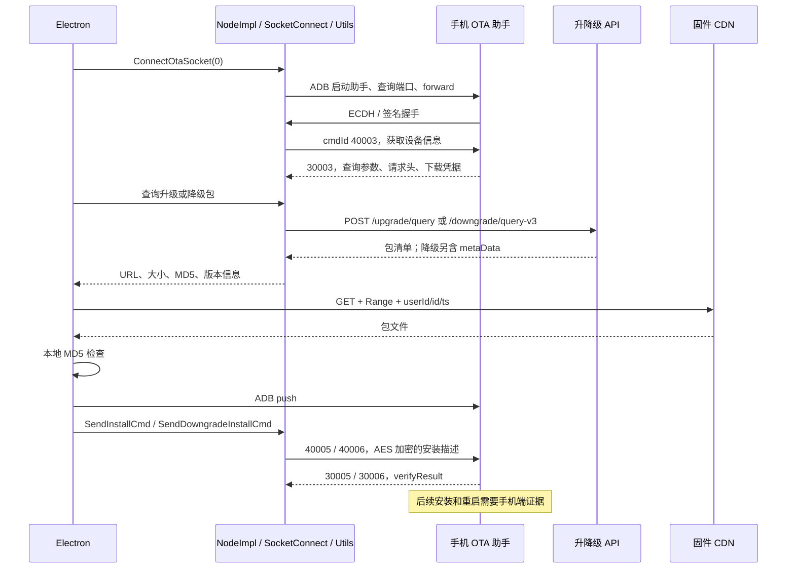

# ColorOS Assist 1.4.42：OTA 下载与安装协议

分析日期：2026-11-15。结论适用于本文的确切样本。

## 结论与证据范围

此版本的主要流程是：PC 查询升级/降级包 → HTTP 下载 → 本地 MD5 检查 → ADB push 到手机 → 通过 OTA 助手的 TCP 协议发送安装请求。实际安装由手机端处理。已追踪的完整 UI 调用链中没有 Sahara、Firehose、9008 分区写入或 fastboot flash。

它不是一个仅靠机型名称就能完成全部查询的独立下载器。升级查询使用手机返回的参数和请求头；下载使用手机返回的 `userid/guid/ts`。降级查询由 PC 重新构造，并有设备条件检查、加密和响应签名检查。

本次使用 **Binary Ninja Personal 5.2.8614** 分析 `NodeImpl.node`、`SocketConnect.dll`、`Utils.dll`、`Adb.dll`，并交叉检查 ASAR 内的实际 JavaScript。没有运行 Windows 样本，没有连接设备，没有重放 OTA API，没有下载或刷写固件。因此，本文确认客户端的静态行为，不确认服务器当前接受请求，也不确认任何设备能降级或启动。

手机端 `com.color.otaassistant` APK 不在本次安装包中，客户端通过 APK 管理模块另行获取。本文未恢复该 APK 内的安装器、Recovery 或 update_engine 调用链。不能把 PC 发出的安装请求等同于设备分区写入成功。

## 样本与分析文件

来源：[ColorOSAssistSetupV1.4.42.exe](https://gauss-common.allawnfs.com/downgrade/26/08/31/ColorOSAssistSetupV1.4.42.exe)。安装包是 NSIS，包含 `app-64.7z`；程序是 Electron 加原生 C++ DLL。

| 文件 | 大小 | SHA-256 |
|---|---:|---|
| 安装包 | 94,522,384 | `5b082a2c61ffa0f146fefda99e62a27e140d341c71ad33b4ef6973acdbd4f667` |
| SocketConnect.dll | 427,456 | `2db9ee4c433fd504b9cd2369499b60d4386a9ce2da4e44f82bb915e2312bd134` |
| Utils.dll | 3,231,168 | `9d084e1655e8d63aac3382883ccf5994d38abb5b7f97f9250f69fbd6bfa10c6f` |
| Adb.dll | 161,208 | `a9c1c1145f2791ebdd4e6c532fdd0269bf92fc044ab7bfa1a0f64746cd358f7c` |
| NodeImpl.node | 115,640 | `11725f7dafcff67339bbb42582f706371c0c6d14bc698db79829210eeb07740f` |

所有原生地址均为 PE 首选基址 `0x180000000` 下的 VA，使用时必须同时指定 DLL。ASLR 下要先换算 RVA。

- [采集记录](../../runs/coloros-assist-1.4.42/evidence/acquisition.json)
- [文件清单与哈希](../../runs/coloros-assist-1.4.42/evidence/inventory.json)
- [原始提取目录](../../runs/coloros-assist-1.4.42/app/)
- [SocketConnect 数据库](../../runs/coloros-assist-1.4.42/bn/socket.bndb)
- [Utils 数据库](../../runs/coloros-assist-1.4.42/bn/utils.bndb)
- [Adb 数据库](../../runs/coloros-assist-1.4.42/bn/adb.bndb)
- [NodeImpl 数据库](../../runs/coloros-assist-1.4.42/bn/node.bndb)
- [函数注释与原始名称](../../runs/coloros-assist-1.4.42/evidence/annotations.json)
- [格式化的主进程 JS](../../runs/coloros-assist-1.4.42/evidence/js/main.js)
- [格式化的界面 JS](../../runs/coloros-assist-1.4.42/evidence/js/index-2b9840ed.js)

格式化 JS 只用于阅读，未修改原始 ASAR。提取时验证了 ASAR 文件的内置 SHA-256。HLIL 中部分 C++ 返回值和隐含参数恢复不完整，关键 HTTP、哈希和加密调用另存了汇编作核对；不能直接把 HLIL 复制为可运行实现。

## 整体调用链



## 手机连接与控制协议

`SocketConnect!0x1800266f0` 在参数为零时通过 ADB 启动 OTA 助手，读取手机监听端口，再建立 TCP 转发。正常 UI 使用这个零参数入口。

对应 ADB 命令内容：

```text
shell am broadcast -n com.color.otaassistant/.OtaAssistantReceiver \
  -a oplus.intent.action.OTA_ASSISTANT_PC_TOOL_RECEIVER -f 16777248
shell dumpsys activity service OtaAssistantService getInfo localPort
forward tcp:<PC端口> tcp:<手机端口>
```

PC 首选端口是 **8500** (`0x2134`)；手机端口使用查询结果，非正数时回退到 **9527** (`0x2537`)。转发辅助函数会处理端口映射，不能把最终本地端口永远写死成 8500。参考 `Adb!0x180005590`、`0x180005d10`、`0x180006820`。

控制帧由 24 字节头和 JSON 字节串组成。它与 ADB push 的文件传输通道分开。

| 偏移 | 长度 | 内容 |
|---:|---:|---|
| 0 | 8 | ASCII `GhostPID` |
| 8 | 4 | 大端 uint32，版本 `2` |
| 12 | 4 | 大端 uint32，OTA 协议类型 `3000` (`0xbb8`) |
| 16 | 8 | 大端 uint64，后续 JSON 字节长度 |
| 24 | 可变 | JSON，不把结尾 NUL 计入长度 |

证据：`Utils!0x180034640/0x180034d50`，`SocketConnect!0x180035950/0x180034a40`。

JSON 外层字段：

```json
{
  "uuid": "<消息标识>",
  "cmdId": 40005,
  "createTime": 0,
  "needAck": false,
  "extraInfo": "<业务数据或其密文的 Base64>"
}
```

上例展示字段结构，`createTime` 的 0 仅为数值占位，实际值由代码生成。`sendTimes` 在非零时加入；空 `extraInfo` 不加入。收到 `needAck=true` 的消息时会发送 `11000` (`0x2af8`) ACK；ACK 本身省略 `needAck`。外层 JSON 没有整体加密。证据：`Utils!0x180034f30`。

### 命令号与握手

| 方向 | 十进制命令号 | 作用 |
|---|---:|---|
| 手机 → PC | 30000 | ECDH 公钥、能力信息 |
| PC → 手机 | 40000 | PC 公钥回应 |
| 手机 → PC | 30001 | 签名挑战信息 |
| PC → 手机 | 40001 | 验签及签名回应 |
| 手机 → PC | 30002 | 最终认证结果 |
| PC → 手机 | 40003 | 获取设备信息，亦用于刷新下载凭据 |
| 手机 → PC | 30003 | 设备信息、查询材料、请求头 |
| 手机 → PC | 30004 | 升级包信息回调 |
| PC → 手机 | 40005 | 升级包安装请求 |
| 手机 → PC | 30005 | 升级安装请求检查结果 |
| PC → 手机 | 40006 | 降级包安装请求 |
| 手机 → PC | 30006 | 降级安装请求检查结果 |
| PC ↔ 手机 | 40007/30007、40008/30008 | 手机日志采集开始/停止及回应 |
| PC → 手机 | 11000 | 传输层消息 ACK |

未在此样本的命令发送路径中找到 `40002` 或 `40004`，不要仅按数值连续性补全协议。

握手的 `keyPair_pub` 为 Base64 公钥材料，PC 调用 `EcdhImpl::ecdhGenPubKeyAndSharedKey` 生成自身公钥和共享秘密。会话密钥派生为：

```text
h = lowercase_hex(SHA256(Base64(sharedSecret)))
key = ASCII(h[0:32])
iv  = ASCII(h[-16:])
```

业务 `extraInfo` 使用 **AES-256-CTR**，随后 Base64 编码。这里使用十六进制文本的 ASCII 字节作为 key/IV，不是把十六进制再解码为二进制。依据 `Utils!0x1800355a0`、`0x180008670`、`0x180037a70/0x180037a90`。AES 枚举 8 的映射最终指向 NID 906；枚举表和原始描述符保存在 `evidence/utils/crypto-descriptors.json`。

签名阶段先 Base64 解码、AES 解密，再解析 `pubKey`、`signData`、`signValue` 和最终阶段的 `verifyPass`；调用 ECDSA 验证。对应 `Utils!0x180036a90/0x180037570`。曲线选择和完整信任根关系未以手机端实现或握手抓包验证，本文不推断可以伪造客户端或绕过认证。

## OTA 查询

服务配置位于 `app/config/config.ini`。实际地区选择函数 `SocketConnect!0x18001f310` 优先匹配 CN、IN，其余走 SG 分支。配置文件虽列出 EU 测试地址，不代表这个函数会按 EU 键发起生产查询。

| 地区分支 | 配置中的服务地址 |
|---|---|
| CN | `https://downgrade.coloros.com` |
| IN | `https://downgrade-server-in.allawnos.com` |
| SG | `https://downgrade-server-sg.allawnos.com` |

### 升级

`OnSocketRecvDeviceInfoAck` (`0x180026920`) 解析手机消息里的 `special`、`downgradeRequestBody`、`upgradeRequestBody`、`requestHeader`。其中升级请求 JSON 的 `params` 被保存为请求内容；请求头 JSON 被展开，并补上 `Content-Type: application/json; charset=UTF-8`。

`CallQueryUpgradePackage` (`0x18002a9c0`) 在设备声明支持升级且不是 `special` 时，调用 `0x18001f660`，执行 **POST `/upgrade/query`**。因此普通升级也有 PC 直接调用服务端的路径，不应只看 `OnSocketRecvDownloadUrlAck` 就认为所有查询都在手机执行。

响应需要业务字段 `code == 200`；`data` 是再次解析的 JSON 字符串。主要字段为：

```text
versionName, otaVersion, colorOSVersion, description.url
components[]:
  componentId, componentName, componentVersion
  componentPackets[]: size, md5, manualUrl
```

界面导出的单个下载项使用组件中的 `manualUrl` 作为 `downloadUrl`。`0x180025800` 从组件向量的首项导出下载 URL、MD5 和 componentId；不能据此声称 PC 会完整下载任意多组件响应。

`30004` 的手机回调也能解析相同的升级包结构。两条路径在程序中均存在；本次没有抓包确定具体设备会走哪一条。

### 降级

`CallQueryDowngradePackage` (`0x18002aba0`) 通过设备对象重新构造请求。

请求头包含：

```text
Content-Type: application/json; charset=UTF-8
deviceId: <PC 新生成的 GUID>
cipherInfo: <JSON 字符串>
```

注意 HTTP 头 `deviceId`、JSON 中加密的 `deviceId` 和后述签名字符串里的 `deviceId:` 标签不是同一份数据。

```json
{
  "deviceId": {"cipher": "<Base64密文及tag>", "iv": "<Base64 IV>"},
  "otaVersion": "<当前 OTA 版本>",
  "model": "<otaVersion 的首个下划线之前部分>",
  "androidVersion": "<设备值>",
  "colorosVersion": "<设备值>",
  "nvCarrier": "<设备值>",
  "prjNum": "<设备值>",
  "serialNo": "<设备序列号>"
}
```

PC 每次生成 32 字节 AES key 和 12 字节 IV，以 **AES-256-GCM** 加密设备 ID；结果为 Base64(ciphertext || 16-byte tag)。`cipherInfo` 中的 `downgrade-server` 对象包含 `protectedKey`、`negotiationVersion`、`version`。`protectedKey` 的构造顺序是 Base64(AES key) → 区域公钥 RSA-OAEP → Base64。`version` 来自时间值；地区使用不同公钥和 negotiationVersion。依据 `0x180023080/0x180023210/0x1800232d0`、`Utils!0x180006ed0` 与其汇编。

随后 **POST `/downgrade/query-v3`**。主要响应结构：

```text
code: 200
data:
  metaData: <Base64 RSA signature>
  downgradeVoList[]:
    downloadUrl, otaVersion, colorosVersion,
    androidVersion, fileSize, fileMd5
```

PC 构造以下绑定字符串，并用内置 RSA 公钥验证 `metaData` 对它的 SHA-256 签名：

```text
deviceId:<serialNo>userOtaVersion:<current otaVersion>
```

这里标签虽写 `deviceId:`，输入实际来自与 JSON `serialNo` 相同的设备对象字段 `+0x08`。不要替换成 JSON 内 AES 加密前的设备 ID（字段 `+0x108`）。可核对 `0x18002b372`、`0x18002b3ca`、`0x18002b4a4` 和 `0x180022ed0`。这个验证点不是对固件内容或整个包清单做哈希。

验证通过后，程序将 `metaData` 保存为安装阶段的 `signData`，将绑定字符串保存为 `checkData`。PC 还会：

1. 拒绝设备 ID 恰为 64 个 `0` 的情形。
2. 在 `first_api_level < 35` 且 `sn16 == 2` 时返回不支持降级。
3. 从响应的 Android 描述中解析版本，只保留 **目标 Android = 当前 Android − 1** 的条目，再排序。

这些是客户端限制，不等于服务器规则，也不等于手机的防回滚条件。证据：`0x18002aba0`、`0x180020bd0`、`0x18001f190`。

此外程序包含 `/downgrade/cancel-v3`、`/downgrade/feedback-v3`、`/downgrade/apk`。它们分别涉及恢复 OTA 推送、结果反馈及 APK 信息，不是分区写入协议。

## 下载与校验

当前 UI 的固件下载由 Electron 主进程实现，不是导出名称为 `HttpDownloader` 就必然使用该原生下载器。

界面先调用 `GetDownloadHeaderInfo`；原生流程重新请求手机设备信息，取得 `userid`、`guid`、`ts`。随后注册内部下载任务并获得一次性 ticket。该 ticket 只用于 Electron IPC 的下载注册表，不是 OTA 服务端登录令牌。

实际 CDN 请求为：

```http
GET <服务器返回的下载 URL>
Range: bytes=<本地已有长度>-
userId: <手机 userid>
id: <手机 guid>
ts: <手机 ts>
```

注意请求头实际叫 `id`，不是 `guid`。三项非空是 UI 开始固件下载的前提。

主进程检查固件域名列表，允许指定 OTA/CDN 域名及其子域；逐跳检查 301/302 重定向，最多 5 跳。固件下载允许 HTTP 或 HTTPS，自更新才强制 HTTPS。固件下载主要语义如下：

- 使用文件追加和 Range 恢复部分下载。
- 已有部分文件却收到 HTTP 200 时，删除部分文件并重试；206 走续传。
- 默认最多重试 3 次，间隔 5 秒；携带下载凭据时设置 300 秒超时。
- 升级保存为 `<componentId>.zip`，降级保存为 `<version>.ozip`。
- 已有文件首先按长度决定是否需下载；推送前才检查完整本地 MD5。不匹配时删除并报告错误。
- 手机上已有目标文件时用 `adb shell md5sum` 判断能否跳过 push；新 push 后的 JS 流程没有再显式执行一次 md5sum，后续由手机安装请求检查包。

依据格式化主进程 JS `16015–16580` 附近，以及界面 JS `9538–9705`。`.ozip` 是代码选择的文件扩展名；仅凭该扩展名不能断言实际包采用哪种加密格式。

## 包传输与安装命令

文件由 ADB push 传输，JS 每 3 秒查询 `du -b` 更新进度。目标路径：

| 用途 | 手机路径 |
|---|---|
| 升级 | `/sdcard/update/.d641628b-2d2c-4877-9c00-a5e53b3acc99/<componentId>.zip` |
| 降级 | `/sdcard/<version>.ozip` |

升级命令 `40005` 的解密后业务 JSON：

```json
{
  "versionName": "<版本名称>",
  "needDataSpace": 0,
  "components": [{
    "componentId": "<组件ID>",
    "componentName": "<组件名>",
    "componentVersion": "<组件版本>",
    "packetMd5": "<MD5>",
    "packetSize": 123,
    "packageFullPath": "/sdcard/update/.d641628b-2d2c-4877-9c00-a5e53b3acc99/<componentId>.zip"
  }]
}
```

降级命令 `40006` 的结构类似，但额外含 `signData`、`checkData`；组件的 ID、名称、版本均来自目标版本字段。路径和文件长度由 JS 传入，签名材料沿用服务端响应。`SendDowngradeInstallCmd` 从缓存候选向量的最后一项取元数据，不能假设它按传入路径再次查找匹配版本。升级实现则遍历组件向量，但给各组件使用同一个传入路径。这些细节需要在多组件或多候选场景中单独实测。

安装请求回应里的 `verifyResult` 映射：

| 手机值 | PC 值 | PC 含义 |
|---:|---:|---|
| 0 | 0 | 包可以安装 |
| 1 | 1 | 电量不足 |
| 2、4 | 4 | 包检查错误 |
| 3 | 3 | 空间不足 |
| 5 | 5 | 不支持自动安装 |

证据：`SocketConnect!0x180029100/0x18002bbf0/0x180028950`，界面 JS `4838`、`9665`、`99465` 附近。

UI 把 0 和 5 都转为该阶段成功；界面还有“推送完成后在手机安装”的引导。因此，界面 100%、ADB push 成功、verifyResult=0、手机刷写完成和重启后版本变化是五种不同证据。本样本没有提供 PC 端可用于确认最终分区内容的 readback 流程。

## 对 oplus-edl 的意义与剩余边界

该工具可以提供官方 OTA 查询、下载鉴权、包传输和手机安装请求的参考。它没有在上述路径中解决 9008 loader、Firehose VIP、EDL 授权或 rawprogram 分区写入问题，不能把它的签名字段直接当作 Firehose 签名数据。

如要形成可用的独立实现，还缺实际手机会话和对应 OTA 助手 APK：需要确认其请求参数生成、握手信任关系、服务器时效规则、安装请求实际触发方式，以及目标设备的安装结果。纯 PC 静态分析不能推出无手机查询、任意跨版本降级或绕过设备校验。

可用的下一步验收是保存一次真实设备的正常会话，核对头部、消息号、解密后结构、CDN Range 请求及安装检查回调；实际刷写验收还必须检查重启后的系统版本和设备状态。本次未进行这些设备操作，也未改动 oplus-edl 产品代码。
