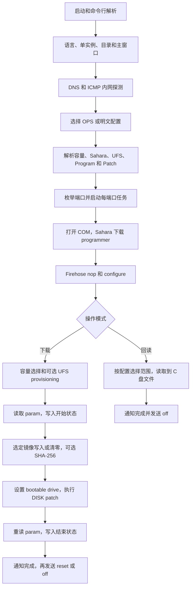
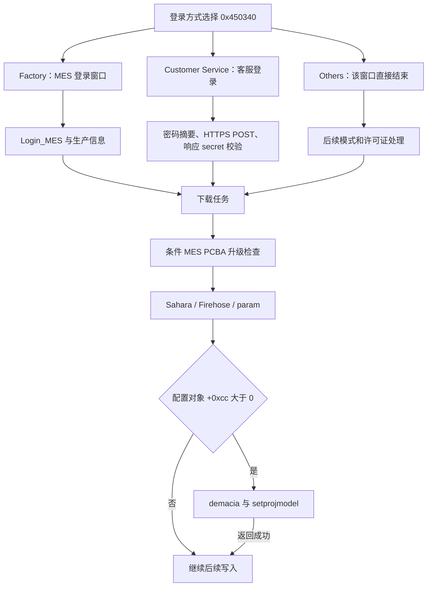
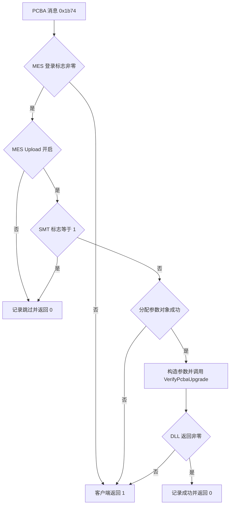
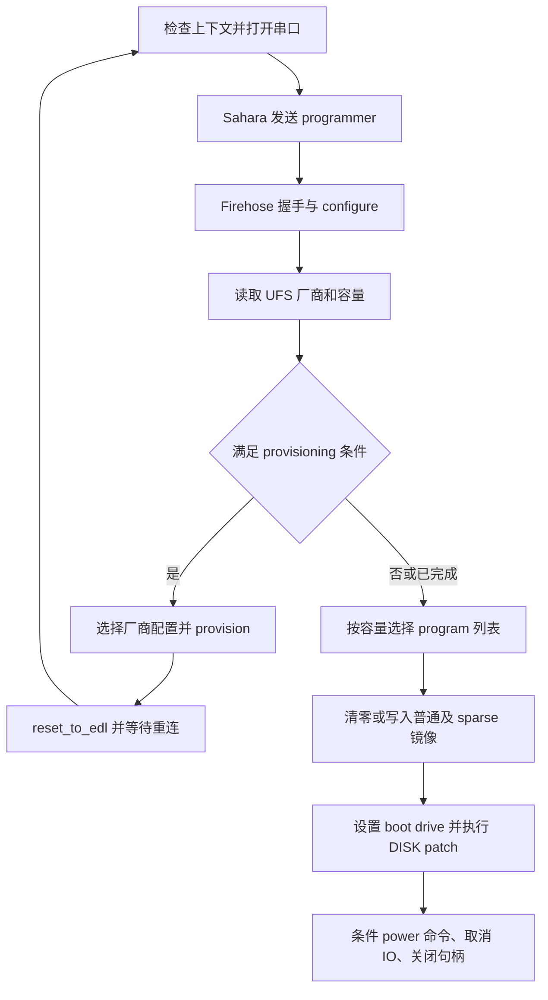

# MSMDownloadTool 综合研究

本报告合并原 4.0.28.0 行为分析、5.1.75.0 续析和多版本分析。研究日期保留在各部分；版本、地址和实验范围分别限定。原始证据目录及复核脚本保持原路径。

## 结论与阅读顺序

| 范围 | 已有证据 | 边界与入口 |
| --- | --- | --- |
| 4.0.28.0 | OPS/XML、Sahara/Firehose、param 修改、校验及回读流程 | [行为基线](#v4028)；不能把旧版错误处理推广到其他版本 |
| 5.1.75.0 | 压缩层恢复、登录与许可证路径、三类设备 token 的已测数据流 | [业务恢复](#v5175)；未完成全部 VM 去虚拟化或完整 Windows 应用运行 |
| 3.0.2.0 / 5.0.15.0 / 5.1.77.0 | 外部 XML、本地许可证与设备授权演进、MES/PCBA、P19 UFS 更新 | [版本差异](#multi)；样本身份与配置分别限定 |
| 5.1.75.0 与 5.1.77.0 对比 | 成对执行补充短 SN 补零、字段符号及输入边界 | [最新差分验证](#multi-12)；不证明 programmer 或服务端接受 |

按问题查阅：[认证](msmdownloadtool/auth.md)、[售后包解析](msmdownloadtool/ota.md)、[刷写协议](msmdownloadtool/flash.md)。其他工具与实机进展见[研究索引](README.md)。官方 OplusFlashTool 5.9.18.0 的完整分析仍[单独保存](oplusflashtool-5.9.18-analysis.md)；末尾保留原有补充摘要。

## 历史结论的修正关系

- 4.0.28.0 部分第 13 节是取得 5.1.75.0 后的早期摘要。“token 尚未完整恢复”须结合 [5.1.75.0 第 13 节](#v5175-13)和[多版本第 12 节](#multi-12)阅读。
- 5.1.75.0 第 11、12 节保留逐轮探索与失败记录；第 13 节补齐已测 token 数据流。后续多版本第 12 节又修正短 SN 和部分字段解释，不把早期候选公式当作最终结论。
- 离线执行与独立复算只证明指定输入和路径。未由这些 MSM 实验确认设备授权成功、真实刷写或启动；RMX3800 的后续实机证据属于独立的 preview 云端资产路径。

<a id="v4028"></a>

## 4.0.28.0：行为基线

本部分保留原报告的章节编号，内部“第 N 节”均指本部分。

- [1. 结论与适用范围](#v4028-1)
- [2. 样本来源与身份](#v4028-2)
- [3. 程序整体结构](#v4028-3)
- [4. 启动、界面和主机副作用](#v4028-4)
- [5. 网络行为与模式授权](#v4028-5)
- [6. OPS、XML 配置和密码算法](#v4028-6)
- [7. 端口枚举、任务调度和 Sahara](#v4028-7)
- [8. Firehose 命令和通信约定](#v4028-8)
- [9. 下载状态机与实际写入范围](#v4028-9)
- [10. 校验的三种不同含义](#v4028-10)
- [11. 回读流程与输出文件](#v4028-11)
- [12. 错误、取消和边界条件](#v4028-12)
- [13. 5.1.75.0 脱壳与业务续析](#v4028-13)
- [14. 覆盖情况和未完成的证明](#v4028-14)
- [15. 证据位置与复核方法](#v4028-15)

分析日期：2026-11-14。主工具：Binary Ninja 5.2.8614 Personal。5.1.75.0 后续脱壳与业务分析已补入第 13 节，并附独立续篇。

<a id="v4028-1"></a>

### 1. 结论与适用范围

本报告的主样本是 OnePlus 6 OxygenOS 5.1.5 救砖包中的 `MsmDownloadTool V4.0.exe`，**PE 文件版本为 4.0.28.0**。它是一个要求管理员权限的 Windows x86 原生 GUI 程序。它读取 OPS 或明文 XML 配置，枚举 Qualcomm 下载端口，利用 Sahara 传输 programmer，然后利用 Firehose 执行存储配置、镜像写入、补丁、可选摘要校验和回读。

有五项行为直接影响对这个程序的理解：

1. 正常刷写流程在镜像写入前后读写 `param` 区，记录时间和状态；执行内容不只来自 program/patch 列表。
2. 程序将“包的 MD5 检查”“设备端 SHA-256 检查”“回读到文件”作为不同流程。一次 Download Complete 不等于全部内容已经回读比对。
3. 禁用自动重启后，正常下载完成路径发送 `power value="off"`；它不是保持 EDL 连接等待下一条命令。
4. 主样本存在 DNS/原始 ICMP 内网探测和本地模式口令检查。已追踪的主链没有证明存在在线帐号登录或刷机授权服务，不能把其他版本的登录机制移植到本样本上解释。
5. 通信、取消和错误汇总中存在宽松或不一致的判断。报告列出代码证据及可能影响，不把静态发现冒充设备上已经复现的故障。

本报告覆盖已识别的业务主链、主要模式和主机副作用，**不是“所有输入、所有分支均已执行”的证明**。没有运行下载到的 EXE，没有操作手机，没有连接厂商服务，也没有下载完整 OPS。镜像内容、真实硬件响应和运行时有效配置不在已验证结果中。

另下载了 OnePlus 8 包中的 **5.1.75.0**。续析已恢复其四个 PE 组件的压缩节，并用 Binary Ninja 追踪客服登录、MES 调用、设备授权命令和主要刷写流程；部分 VMProtect 函数仍未去虚拟化。详见第 13 节和[5.1.75.0 专题续篇](msmdownloadtool-analysis.md#v5175)。本报告第 3—12 节仍限定于 4.0.28.0，不能直接套用到新版。

<a id="v4028-2"></a>

### 2. 样本来源与身份

<a id="v4028-2-1"></a>

#### 2.1 主样本

公开来源：[OnePlus 6 / Oreo 目录](https://onepluscommunityserver.com/list/Unbrick_Tools/OnePlus_6/Oreo/)，[OnePlus_6_OxygenOS_5.1.5.zip](https://onepluscommunityserver.com/list/Unbrick_Tools/OnePlus_6/Oreo/OnePlus_6_OxygenOS_5.1.5.zip)。这是社区镜像，不能仅凭域名、文件名或版本资源证明厂商来源。

| 项目 | 实际值 |
|---|---|
| ZIP 大小 | 1,780,607,318 字节 |
| ZIP 成员 | `enchilada_22_O.09_180517/MsmDownloadTool V4.0.exe` |
| EXE 大小 | 2,322,432 字节 |
| FileVersion / ProductVersion | `4.0.28.0` / `4.0.28.0` |
| SHA-256 | `ea4f8ae38e2feb09def08ff5be35c563376b1773cfc64b95b1128e994e0387c8` |
| MD5，仅作样本标识 | `f30507f811f2463c2af0f3eb1266944c` |
| ZIP 成员 CRC32 | `39e1002f`，提取时已验证 |
| PE | PE32，Machine `0x14c`，Windows GUI，ImageBase `0x400000` |
| 入口 VA | `0x54a569` |
| PE 时间戳 | `2018-05-08T12:36:17Z`；只是文件字段，不是可信签名时间 |
| 证书目录 | offset=0，size=0；未包含嵌入式 Authenticode 证书 |
| 导入表 | 18 个 DLL、623 个导入项 |
| 权限清单 | `requireAdministrator` |

采用 HTTPS Range 读取 ZIP 中央目录和选定成员，再由 Python `zipfile` 解压并校验 CRC。保存了下载 URL、成员路径、压缩长度、偏移、哈希及 HTTP 响应头。**未下载完整 ZIP，因此没有整包 SHA-256；CRC 通过只证明成员与该 ZIP 目录一致，不证明发布者身份。** 同包的 `md5sum_pack.md5` 已提取，但它用于 OPS，不能当成 EXE 签名。

证据：[获取记录](msmdownloadtool-4.0.28-evidence/acquisition-op6.json)、[PE 元数据](msmdownloadtool-4.0.28-evidence/pe-metadata.json)、[HTTP 头](msmdownloadtool-4.0.28-evidence/archive-op6.headers)。

<a id="v4028-2-2"></a>

#### 2.2 分析方法与证据等级

Binary Ninja 完成自动分析后导出了 14,068 个识别到的函数、HLIL、字符串交叉引用和调用关系，并保存 `.bndb`。这个数是自动识别数量，**不是人工审完的函数数量**。本报告整理了 90 个业务相关函数的 HLIL，并对关键错误路径保存了汇编证据。

报告中的地址均为主样本的首选加载地址 VA。若重定位，应按 `RVA = VA - 0x400000` 换算。正文使用地址作为定位依据：BN 的自动签名匹配把部分业务函数误命名为 MFC/STL/PDB 库函数，局部参数类型和调用约定也可能不准。

| 等级 | 本报告中的含义 |
|---|---|
| 文件实证 | 本次下载字节的哈希、PE 字段、资源、常量 |
| 静态确认 | 能从调用者、条件分支、被调用函数或汇编建立行为链 |
| 静态推断 | 根据算法结构或上下文解释含义；未用实际输入输出验证 |
| 未验证 | 运行结果、设备侧实现、服务响应，或尚未恢复的受保护代码 |

一个反编译修正：`0x415300` 的 XML 解析调用被 BN 错误视为不返回，导致后续配置分发未显示。通过汇编找到 `0x415656` 的连续代码并建立临时分析入口，恢复了后续 HLIL。它是**原函数的续段**，不能当成独立源代码函数。保存的基线数据库与补充文本分别保留，见[续段证据](msmdownloadtool-4.0.28-evidence/profile-continuation.txt)。没有修改样本字节。

<a id="v4028-3"></a>

### 3. 程序整体结构



图中展示正常路径；任一步的错误、取消、重新枚举和超时会改变流程。它不表示每个错误都被正确向上传递。

| 层次 | 主要地址 | 作用 |
|---|---|---|
| 应用启动 | `0x40acb0`、`0x40b350`、`0x40c310` | 权限清单以外的初始化、参数、UI、模式 |
| 包和配置 | `0x415000`、`0x415300`、`0x412260` | OPS 尾部元数据、配置解密、XML 解析 |
| 设备管理 | `0x41ae10`、`0x41b340`、`0x40da50` | SetupDi、注册表、到达/移除事件 |
| 任务调度 | `0x406cd0`、`0x420d40` | 每端口工作、下载/回读分派 |
| 业务状态机 | `0x420f10`、`0x421860` | 下载主链、回读主链 |
| Sahara | `0x421bc0`、`0x426c10` | loader 选择、身份检查、包分派 |
| Firehose | `0x428a80`、`0x42ab30` 等 | XML 命令、原始数据阶段、响应处理 |
| 数据写入 | `0x425480`、`0x4247f0`、`0x423800` | 普通镜像、sparse、写零 |
| Windows I/O | `0x4263e0`、`0x426500`、`0x4266a0` | 串口配置、同步读写、超时 |

全部精选函数及 BN 原始名称、调用关系见[函数映射](msmdownloadtool-4.0.28-evidence/function-map.json)。

<a id="v4028-4"></a>

### 4. 启动、界面和主机副作用

<a id="v4028-4-1"></a>

#### 4.1 启动流程

`0x40acb0` 根据系统 LCID 选择初始语言，其中 `0x804` 走中文分支，随后读取 `language.ini`。它创建名为 `MsmDownloadTool` 的信号量以限制实例，初始化 MFC，设置包括自动重启在内的默认选项，解析命令行，创建工作目录并进入模态主窗口。

`0x40b350` 中的帮助文本和解析分支对应以下参数：

| 参数 | 静态可见作用 |
|---|---|
| `-s` | Auto Start |
| `-r` | 禁止刷写成功后 reboot；完成路径改发 `off` |
| `-t` | 不弹出运行时间超限警告 |
| `-b [BootMode]` | 指定启动模式；没有穷尽每种取值与设备侧效果 |
| `--help` | 输出帮助文本 |

这是 GUI 程序附带的参数解析，不是返回结构化结果的完整命令行接口。BootMode 对照表含 `Normal`、`sDebug`、`Auto`、`Debug`，对应索引 0–3。兼容参数入口 `0x40b160` 检查首个参数：`aging` 或表中模式会同时启用自动开始、禁用重启、抑制超时提示；命中模式表时还设置 BootMode 索引。其设备端模式效果没有实测。

<a id="v4028-4-2"></a>

#### 4.2 界面模式

资源和处理函数共同表明存在 Start、Stop、Enum、Upgrade mode、SMT Download mode、Verify、Read Back、Auto reboot、Sha256 check 等入口。镜像列表支持容量档位、外部镜像、全选、排除 userdata 和 A/B 相关选择。

SMT 有本地口令处理（`0x40dfa0`）：由程序常量构造比较值，错误时可重试，计数达到三次后停止该轮尝试；成功后设置会话标志，并按对话框容量选择调用配置切换。进入实际启动前还检查验证状态，失败时提示 `SMT download mode: not verify or verify failed`。Read Back 的 `0x419b50` 对输入做 MD5，与两个固定摘要比较；成功后把勾选状态传播到五个容量列表的同名条目。

这些是 EXE 内的本地门槛，不能当成在线设备授权。EngineerMode 资源包含 BootMode、内网标志、设备选择及重启相关控件。**控件存在不等于所有取值的语义已恢复。** 本次没有穷尽所有隐藏入口和工程模式消息处理，也没有进行认证绕过。

回读切换函数 `0x40f430` 提示仅支持单手机。这个提示不是证明所有后端路径都拒绝多设备；普通刷写则有每端口任务和启用配置。

`0x40f080` 对应运行时间警告；主窗口设置约 6 小时定时器，`-t` 改变该提示行为。退出和取消各有处理函数，不能把关窗口直接等同于设备操作已经结束。

资源证据：[对话框与 manifest 摘录](msmdownloadtool-4.0.28-evidence/dialog-manifest-resources.json)。

<a id="v4028-4-3"></a>

#### 4.3 文件、注册表和进程

| 对象 | 已确认路径/动作 | 依据与限制 |
|---|---|---|
| 工作目录 | 创建 `c:\temp`、`c:\temp\MsmDownloadTool` | `0x40b0b0`；实际创建成功与否未运行验证 |
| COM 配置 | `c:\temp\MsmDownloadTool\QCOM_DownloadTool_Com_Config.ini` | 保存/读取端口配置的路径常量及相关调用 |
| 日志 | 多处以 `a+` 打开 `C:/ToolLog.txt` | 例如 `0x420f10`、参数区处理；不代表这是唯一日志 |
| 语言配置 | 读取 `language.ini` | 启动路径 |
| 输入 | OPS、Setting.xml、program/patch 引用的镜像、外部 loader、`md5sum_pack.md5` | 来源取决于配置和界面选择 |
| 回读输出 | 路径前缀 `C:\\`，附原文件名；无文件名时附 label 和 `.bin` | `0x423f00`，以 `wb` 打开；可能截断同名旧文件 |
| 设备注册表 | `Enum\USB\VID_05C6&PID_9008` 下的 FriendlyName、LocationInformation | 枚举路径；不能据此声称安装了驱动 |
| 设备管理器 | `WinExec("MMC.EXE Devmgmt.msc", 1)` | `0x40f610` |
| 明文模式 Verify | `WinExec("del log.txt", 1)`、`WinExec(".\\checkMd5.bat", 0)`，等待后读取日志 | `0x40ecf0`；`del` 是 shell 内建，代码未据返回值证明删除成功，不能直接写成已成功执行 |

在已追踪的业务链中，没有建立“创建系统服务、注册开机启动、常驻注入其他进程”的证据。此处不是全程序无持久化/无恶意行为的安全认证，尤其不能推广到受保护的 5.1.75.0。

<a id="v4028-5"></a>

### 5. 网络行为与模式授权

主窗口初始化 `0x40c310` 依次尝试以下三个名字，任一探测成功即可设置全局内网标志：

| 名字 | 可见用途 |
|---|---|
| `pjira.oneplus.cn` | 内网探测候选 |
| `romsign.onepluscorp.cn` | 内网探测候选 |
| `mo.adc.com` | 内网探测候选 |

`0x4115a0` 调用 `WSAStartup(2.2)`、`socket(AF_INET, SOCK_RAW, IPPROTO_ICMP)` 和 `gethostbyname`。`0x4116a0` 构造 ICMP Echo 请求，包含计数、tick 值和 `HelloWorld!`，发送长度为 `0x40d` 字节。

关键限制在响应判断：它等待最多约 5 秒的 `select` 可读事件，`select` 返回正值即报告成功。**该函数没有 `recv` 后核对 Echo reply、源地址、序号或载荷。** 因此准确说法是“原始 ICMP socket 可读性启发式”，不是“与三个授权服务器完成认证”。

内网标志影响无有效 OPS 时能否走明文配置等 UI/加载分支。域名文字中的 `romsign` 不足以证明下载期间请求签名。已追踪的 4.0.28.0 主链没有恢复出在线账号登录、HTTPS 授权交换或上传刷写日志的调用链；不能从这一点推断所有版本都离线。

本次没有实际解析、ping 或访问这些内网域名。它们作为样本行为指标列出，不作为本次访问记录或恶意 C2 判定。

证据：[内网探测](msmdownloadtool-4.0.28-evidence/hlil/0x4115a0.txt)、[ICMP 发送](msmdownloadtool-4.0.28-evidence/hlil/0x4116a0.txt)。

<a id="v4028-6"></a>

### 6. OPS、XML 配置和密码算法

<a id="v4028-6-1"></a>

#### 6.1 两种输入分支

`0x40f620` 参与查找/选择 OPS；`0x415000` 检查包尾元数据。正常外部使用路径需要有效软件镜像；内网分支允许读取明文 `Setting.xml`（`0x412260`）。本次选定公开包只提取了 EXE 和 MD5 文件，因此以下是**解析器支持的内容**，不是“该包实际包含的完整配置”。

OPS 路径从文件末尾向前 512 字节定位元数据，读取 `0xac` 字节，检查 `0x7cef`、metadata version 2、crypt version 1。后续将配置的扇区偏移乘以 512，读入配置并解密，再交给 XML 解析器。部分读调用只判断读取量非零，不能据此宣称包格式每个长度都经过严格检查。

恢复的 XML 主层级包括：

```text
BasicInfo
MEMORY_SIZE / Memory
SAHARA
UFS_PROVISION
Program0 ... Program7
Patch0 ... Patch7
```

容量配置包含 `Is16GSupport` 至 `Is256GSupport` 的五个档位。后续按存储类型、容量和模式选择列表，不是只遍历一个固定 `rawprogram.xml`。

<a id="v4028-6-2"></a>

#### 6.2 主要字段

| 解析对象 | 代码可见字段 | 函数 |
|---|---|---|
| BasicInfo | Project、Version、TargetName、MemoryName、GrowLastPartToFillDisk、LogEnable、LogPosition、DelayStartTime、UseGPT、CheckImage、CheckHwId、CheckHwVersion、NeedUsbDownload、BackupPart、BackupPartId、ChipType | `0x4125f0` |
| Program | label、filename、Sha256、filepath、start_sector、NUM_DISK_SECTORS、num_partition_sectors、skip_download、file_sector_offset、not_overwrite、sparse、partofsingleimage、physical_partition_number、readbackverify、SECTOR_SIZE_IN_BYTES、FileOffsetInSrc、SizeInSectorInSrc、SizeInByteInSrc | `0x4138d0` |
| Patch | filename、start_sector、value、byte_offset、size_in_bytes、physical_partition_number、SECTOR_SIZE_IN_BYTES | `0x413fd0` |

Program 的内存记录步长是 `0xa0`，Patch 是 `0x58`。字段能被解析不表示每条路径都使用它，也不表示所有数值/表达式均支持。明文配置和 OPS 配置分别调用相应的文件/包内容加载路径（`0x4146e0`、`0x414e30` 等）。

<a id="v4028-6-3"></a>

#### 6.3 配置和 loader 解密

`0x41e730` 初始化固定 16 字节反馈状态，调用 `0x41e5f0`；后者按 16 字节处理，以密文反馈并 XOR 生成明文。块函数 `0x41e210` 使用 AES T-table 特征，表首可见 `c6 63 63 a5`，轮次数从 key schedule 结构读取。**算法结构可识别为 AES-CFB128 解密路径**，key schedule 使用二进制中的静态数据。

这条链用于配置读取、包内 loader 读取以及镜像身份信息相关路径。普通数据读取函数 `0x42e760` 本身没有调用该解密器。因此不能简单写成“整个 OPS 的每一个字节都先以同一方式解密后刷入”。本次未使用完整 OPS 做明文验算、未验证跨版本密钥兼容性，也未把算法识别当成已实现的解包器。

证据：[解密反馈循环](msmdownloadtool-4.0.28-evidence/hlil/0x41e5f0.txt)、[AES 块函数](msmdownloadtool-4.0.28-evidence/hlil/0x41e210.txt)、[数据常量补充](msmdownloadtool-4.0.28-evidence/supplemental-data.json)。

<a id="v4028-7"></a>

### 7. 端口枚举、任务调度和 Sahara

<a id="v4028-7-1"></a>

#### 7.1 设备发现

枚举逻辑使用 SetupDi、设备注册表、USB hub 查询和设备通知。可见匹配包括 `Qualcomm HS-USB QDLoader 9008`、Forge 变体以及另一路 `Qualcomm MMC Storage USB Device`。USB hub 查询中可见 `DeviceIoControl(0x220408)`。

`0x41bad0` 注册设备通知；`0x40da50` 处理到达/移除和任务相关状态。每端口工作函数 `0x406cd0` 使用三个事件的等待逻辑，并结合端口启用配置；`0x420d40` 检查上下文后分派到下载或回读。没有把这套多端口框架认定为所有 UI 模式都支持同时操作多台设备。

`0x4263e0` 以读写、独占方式打开设备路径，设置 DCB 115200 / 8N1、超时和清队列。这里的 115200 是串口配置值，不是已经测得的 USB/EDL 实际吞吐率。

<a id="v4028-7-2"></a>

#### 7.2 loader 与身份检查

`0x421bc0` 选择 SAHARA 列表中的 loader。启用 `CheckHwId` 时，分别调用镜像身份读取 `0x426de0` 和目标身份查询 `0x4272d0`，再决定能否继续。包内 loader 通过偏移读取和解密；外部 loader 通过普通文件读取（`0x4277a0`）。

`0x426c10` 为 loader 分配约 2 MiB 缓冲，处理约 15 秒的传输循环。静态分派包含：

| 命令号 | 主机侧处理 |
|---|---|
| `0x01` | HELLO，构造回应 |
| `0x03` | 按请求 offset/length 发送 loader 数据 |
| `0x04` | 处理 END_IMAGE_TX，并发送 DONE |
| `0x06` | 处理 DONE_RESP |
| `0x08` | 处理 reset response 路径 |
| `0x12` | READ_DATA_64 分支，但取用的 offset/length 是相应字段的低 32 位 |

在这两个数据请求分支中，发送前没有看到完整的 `offset + length <= loader_size` 范围检查。对于 `0x12`，仅存在分支不能证明支持大于 4 GiB 的请求。以上是待验证的输入处理边界，不是已复现的攻击结果。

programmer 在设备上实际执行的代码不在本次 EXE 分析里；设备是否接受 loader、是否做签名验证、是否要求额外认证，需要对应 loader 和硬件证据。

<a id="v4028-8"></a>

### 8. Firehose 命令和通信约定

<a id="v4028-8-1"></a>

#### 8.1 会话配置

Sahara 后先执行 `nop`（`0x4286a0`），再由 `0x428a80` 构造 configure。下载主链请求 `MaxPayloadSizeToTargetInBytes=0x80000`（512 KiB），回读主链请求 `0x8000`（32 KiB）。可见固定/条件属性包括：

```xml
<configure ZlpAwareHost="1" SkipStorageInit="0或1" TargetName="8974"
           SkipWrite="0" AckRawDataEveryNumPackets="100"
           MemoryName="emmc或ufs" MaxPayloadSizeToTargetInBytes="请求值" />
```

`TargetName="8974"` 是发包模板里的文字，不是本次样本对应手机 SoC 的可靠识别结果。UFS provisioning 分支会改变 `SkipStorageInit` 并重新进入会话。

configure 接收循环最多尝试 10 次。成功读到数据后，它搜索精确字串 `response value="NCK"`；**没有该字串便可保持成功并退出，并不要求找到肯定 ACK**。代码写的是 `NCK`，报告保留原字面值。响应中的 TargetName 还会改变内部标志；本函数未恢复出根据对端返回值重新协商 payload 上限的完整逻辑。

<a id="v4028-8-2"></a>

#### 8.2 命令矩阵

| 功能 | 主地址 | 内容 |
|---|---|---|
| 通信探测 | `0x4286a0` | `nop` |
| 配置 | `0x428a80` | `configure` |
| UFS provisioning | `0x429000`、`0x429280` | 构造和发送配置数据；SMT 条件路径 |
| UFS 信息 | `0x429680` | `getstorageinfo`，取厂商/容量相关信息 |
| 设置启动存储 | `0x429a80` | `setbootablestoragedrive`；UFS 传 1，eMMC 传 0 |
| 电源控制 | `0x429da0` | `power`，延时 1 秒，值可为 reset、off、reset_to_edl |
| 设备补丁 | `0x42a020` | `patch`；偏移、大小、值和物理分区来自记录 |
| 写入 | `0x42ac20`、`0x42c630` | `program`；数值或磁盘尾相对地址 |
| 读取 | `0x42b730`、`0x42beb0` | `read`；数值或磁盘尾相对地址 |
| 特定磁盘尾补丁 | `0x42d180` | 构造以 `NUM_DISK_SECTORS-1` 为地址的特定 patch |
| 摘要会话 | `0x42d940`、`0x42dc60` | `sha256init`、`sha256final`；后者寻找 Digest 文本 |
| 硬件版本 | `0x42e100` | `gethwversion` |

XML 外层由 `0x42e500` 包装。这里列出主机能发出的命令，不保证任意 programmer 都支持。

<a id="v4028-8-3"></a>

#### 8.3 响应处理和底层读写

原始数据结束等待 `0x42ab30` 最多进行 5 轮读，寻找连续字串 `response value="ACK" rawmode="false"`。这是字符串匹配，不是对属性次序、空白、分片均稳健的 XML 流解析。其他命令各有自己的接收处理，不能把这个 ACK 标准推广到全部命令。

普通写函数 `0x426500` 按最多 `0x8000` 字节分块，清 RX/TX 队列、同步 WriteFile，再等待输出队列排空，时间界限约 1 秒。另一系统条件路径调用 `0x4267a0`，按整块发送。数据业务层常以 1024 个扇区作为批次，所以“业务缓冲大小”“请求 payload 大小”“单次 WriteFile 大小”是不同值。

读函数 `0x4266a0` 每轮最多按 `0x1000` 字节规划，查询队列后实际读取 `min(规划量, cbInQue)`。它累加实际读取量，却按规划量减少剩余量。写函数则按请求量推进指针/剩余量，仅另行累计实际写入量。调用者必须结合实际计数理解这些函数的成功返回；相关异常见第 12 节。

<a id="v4028-9"></a>

### 9. 下载状态机与实际写入范围

<a id="v4028-9-1"></a>

#### 9.1 主链顺序

`0x420f10` 的正常顺序为：

1. 打开端口，设置传输状态，加载并传输 programmer。
2. Firehose nop、configure；UFS 路径读取存储信息并选择容量配置。
3. 满足 SMT/UFS 条件时执行 provisioning，发送 `reset_to_edl`，等待约 5 秒，重开会话；它不是普通升级必经步骤。
4. 读取 `param` 区，修改下载时间及开始状态，写回。
5. `0x422360` 遍历选定的 Program，执行写入、清零、跳过及可选摘要检查；之后设置 bootable drive。
6. `0x425dc0` 遍历 Patch，对 `filename == "DISK"` 的记录发设备 patch。
7. 再读 `param`，更新完成时间、状态及模式相关字段，写回。
8. 等待约 3 秒，向 UI 和日志报告 Download Complete。非 SMT 路径再发送 reset 或 off，随后清理连接。

打开端口有计数为 2 的重试/重新进入逻辑，但主链很多失败直接退出。因此不能表述为“任意下载错误自动重试两次”。

主证据：[下载主链](msmdownloadtool-4.0.28-evidence/hlil/0x420f10.txt)、[Program 遍历](msmdownloadtool-4.0.28-evidence/hlil/0x422360.txt)。

<a id="v4028-9-2"></a>

#### 9.2 `param` 是额外的设备修改

`0x422c30` 选择容量列表，`0x422e00` 在该列表中查找 label 精确为 `param` 的记录。`0x423090` / `0x423190` 据此读取/写入 16 KiB 参数区。`0x423290` 更新其中的时间记录。主链在刷写前写入字符值 `0x53`（S），在完成后写入 `0x46`（F）；状态槽的选择随模式变化，还会改动若干下载/启动相关标志。

这里确认的是“该代码会对参数记录进行读改写”。没有将所有偏移恢复成经过设备实测的官方字段结构，也没有证明中断时设备如何消费这些记录。分析其他客户端的兼容行为时，必须单独考虑这项副作用，不能把它归入普通镜像列表后忽略。

两个 helper 在命令/数据阶段发生错误时可以只记日志并继续等末尾响应；最终返回采用后面的完成等待结果。前面的失败因此可能被后面的返回覆盖，见第 12 节。

<a id="v4028-9-3"></a>

#### 9.3 普通镜像、清零与特殊分区

`0x425480` 支持外部文件和 OPS 中的字节范围，处理 512/4096 字节扇区。外部文件按扇区向上取整，末扇区不足部分补零；包内读取使用 `FileOffsetInSrc << 9` 以及配置中的长度。它按 1024 扇区批次传输，并等待原始阶段结束 ACK。

BackupGPT 有磁盘尾相对地址分支：eMMC 可使用 `NUM_DISK_SECTORS-33`，UFS 可使用 `NUM_DISK_SECTORS-5`。这依赖该版本和所选记录，不能直接作为所有 GPT 布局的通则。

被 UI/逻辑称为 erase 的分支 `0x423800` 实际使用 program 命令发送零缓冲。本路径没有发 `<erase>`。因此“清除范围”“写零范围”和 programmer 原生 erase 的副作用不能直接画等号。

`0x407cd0`、`0x40de10` 等对 GPT、dynamic_nvbk、oppodycnvbk、reserve、fsg、fsc、persist、param、op1，以及 devinfo、DDR、modemst 等名字有特殊判断。`0x413480` 有 A/B 配对逻辑，`0x422360` 还有项目号和硬件版本条件。**这些判断分散在选择、跳过和执行上下文中，不能仅凭字符串名单断言“这些分区一律保留”或“一律擦除”。**

<a id="v4028-9-4"></a>

#### 9.4 Android sparse 镜像

`0x4247f0` 检查 magic `0xed26ff3a`、major version 1、头长度和扇区/块相关条件。分派可见：

| chunk | 行为 |
|---|---|
| RAW `0xcac1` | 读入数据，合并/写出 |
| FILL `0xcac2` | 展开填充值，合并/写出 |
| DONT_CARE `0xcac3` | 跳过或填零并入待写缓冲，取决于当前状态和大小 |
| CRC32 `0xcac4` | 当前分派没有专门处理，落入未知类型路径 |

实现使用最大约 128 MiB 的合并缓冲，部分判断还使用约 32 MiB 阈值，刷新路径也可按 64 MiB 拆分。`0x424150` 将合并缓冲写出并等待完成响应。没有待写数据时，DONT_CARE 可以只推进地址；有待写缓冲时，某些内部空洞会被 memset 为零并纳入写入；尾部空洞在部分刷新路径会被扣除。

因此“sparse 的 DONT_CARE 永远不写盘”不适用于该实现。具体镜像的写入范围需要按 chunk 序列和分支重放，本次未对真实 OPS 内 sparse 数据做范围验算。

<a id="v4028-9-5"></a>

#### 9.5 Patch 与结束操作

`0x425dc0` 只将文件名精确等于 `DISK` 的记录交给 `0x42a020`。其他文件名在这一分发器被跳过，不能把它描述成完整的本地镜像补丁引擎。函数结果初始为 1：若整个列表没有执行到一个 DISK patch，当前控制流会保留非零结果。

正常主链在 patch 之前已经完成 Program 和 bootable drive 设置。补丁失败不会自动撤销此前写入；没有从该主链恢复出事务回滚机制。

`0x429da0` 最多尝试 5 次电源命令，读到数据即可停止，返回值最终固定为 0。调用者在发送电源命令之前已经报告完成。因此 Download Complete 不能证明关机/重启命令已被肯定确认，更不能证明系统成功开机。

<a id="v4028-10"></a>

### 10. 校验的三种不同含义

<a id="v4028-10-1"></a>

#### 10.1 软件包 MD5

包模式 Verify 进入 `0x40fd60`，使用 `0x40a070` 计算 OPS 摘要，再与 `md5sum_pack.md5` 中的 32 字符值比较。校验状态先置为成功；MD5 文件不存在或无法读到要求的 33 字节时显示 `MD5 Check skipped!`，仍可能保留成功状态。

这只能说明输入包检查如何实现，不是签名验证，也不是设备内容检查。不能仅凭该状态标志认定“包已校验”。明文模式 Verify 调用外部批处理，行为还取决于本次没有取得的 `checkMd5.bat`。

<a id="v4028-10-2"></a>

#### 10.2 设备端 SHA-256

`0x423aa0` 结合条目 `readbackverify`、全局 Sha256 check、包/外部镜像标志决定是否进入摘要路径。它发送 sha256init，写入镜像，再发送 sha256final，提取 Digest 并和记录中的摘要比较。失配路径最多尝试三轮。

没有满足这些条件时，镜像写入可在 ACK 路径结束。即使满足条件，EXE 也只是请求 programmer 计算/返回摘要；programmer 究竟对接收流、缓存还是最终存储介质求摘要，需要分析对应 loader 才能确认。不能把名字 `readbackverify` 直接翻译为“主机完整回读逐字节验证”。

<a id="v4028-10-3"></a>

#### 10.3 独立回读

Read Back 是下一节的文件导出流程。它与 MD5 Verify 和设备端摘要流程相互独立。三者的 UI 文本不能互相替代其成功条件。

<a id="v4028-11"></a>

### 11. 回读流程与输出文件

`0x421860` 使用相同的端口/Sahara 基础链，配置 Firehose 后选择容量列表，再由 `0x4233c0` 枚举选定条目。它依赖配置列表和选择标志，**没有在这条链中证明先读取 GPT 再自动备份所有物理分区**。

条目决定物理分区、起始扇区和长度；普通零长度条目不按完整分区自动扩展，xbl 有 `0x300` 扇区的特殊回读分支。`0x423f00` 将输出前缀 `C:\\` 与记录文件名连接；没有文件名时使用 label 加 `.bin`。`fopen(..., "wb")` 可以覆盖已有同名文件，未见本路径使用临时文件再原子替换或 `.partial` 标记。

`0x425a10` 按批次发 read，读取原始数据，写入实际收到的字节，然后等待完成响应。取消时可能留下部分文件；中途取消的某些局部返回是 0，而不是明确取消码。上层完成通知因此必须结合实际条目、计数、取消状态和文件长度分析，不能只按 UI 文本认定完整备份。

成功路径发送 `power value="off"`。本次没有生成设备回读文件，也没有验证备份能用于恢复。

证据：[回读主链](msmdownloadtool-4.0.28-evidence/hlil/0x421860.txt)、[范围选择](msmdownloadtool-4.0.28-evidence/hlil/0x4233c0.txt)、[输出路径](msmdownloadtool-4.0.28-evidence/hlil/0x423f00.txt)、[实际读取](msmdownloadtool-4.0.28-evidence/hlil/0x425a10.txt)。

<a id="v4028-12"></a>

### 12. 错误、取消和边界条件

下表将“代码中确认的条件”与“尚待复现的影响”分开。没有给这些发现分配漏洞编号或声称可利用性。

| 编号 | 静态事实和地址 | 影响与验证边界 |
|---|---|---|
| E01 | configure 成功读取后，只以是否包含 `response value="NCK"` 判断；`0x428f7c` 附近 | 纯日志、不匹配的否定响应或残片可能被当成配置成功。未用模拟端验证 |
| E02 | 读循环按规划量扣减剩余量，按实际量累计返回；`0x42677f` | 请求大于即时可读数据时，可能返回成功但不足请求长度；并非所有调用者都要求固定长度，因此需逐个调用点判断损害 |
| E03 | 写循环按请求量推进源指针/剩余量，未补发短写；`0x42661a`–`0x426625` | WriteFile 成功但短写时可能跳过数据。未证明具体 USB 驱动一定触发 |
| E04 | `param` 读写 helper 对早先传输错误记日志后仍走完成等待，返回采用后者；`0x423090`、`0x423190` | 后续成功可能掩盖早先失败；不能据最终 0 推断完整 16 KiB 已正确处理 |
| E05 | `0x423800`、`0x425a10` 等中途取消分支可能返回 0，而入口取消返回 `0x4c7` | 局部取消语义不一致；需连同调用者停止标志判断 UI 最终结果，不能说所有取消必定报成功 |
| E06 | 电源命令结束固定返回 0，且下载完成通知早于该命令；`0x429da0`、`0x420f10` | 完成提示不证明复位/关机成功 |
| E07 | 缺少/短小 MD5 文件可走 skipped，状态仍保留成功；`0x40fd60` | “允许继续”与“已经校验”混用；不证明输入包完整 |
| E08 | DONT_CARE 内部空洞可并入零填充缓冲；`0x4247f0` | 与始终跳过空洞的客户端可能产生不同写入范围；需给定 chunk 序列才能断言 |
| E09 | `0x425dc0` 结果初始为 1，只有执行 DISK patch 后才更新 | 空列表/全非 DISK 列表可能使下载在补丁阶段报告失败，之前的写入不会回滚 |
| E10 | Sahara 数据请求直接使用偏移/长度；READ_DATA_64 只取低位；`0x426c10` | 存在范围和截断疑点；未做恶意输入试验，未证明漏洞可利用 |
| E11 | 完成 ACK 使用精确连续子串；`0x42ab30` | 合法的属性重排、分片可能导致识别失败；是否出现取决于 programmer 输出 |

E01、E02、E03、E04、E06 的关键函数已额外保存[汇编证据目录](msmdownloadtool-4.0.28-evidence/disassembly/)，用于避开 HLIL 类型误判。最小后续验证可在隔离的 Windows 测试环境用受控串口端注入短数据、日志响应和取消事件；这不属于本次已经执行的测试。

“成功”应分成至少四层理解：传输函数返回成功、协议确认完成、所选存储内容经验证、设备成功启动。本程序不同路径覆盖的层次不同；本次静态分析不能把前一层自动升级为后一层。

<a id="v4028-13"></a>

### 13. 5.1.75.0 脱壳与业务续析

来源：[OnePlus 8 Global IN21AA / R 目录](https://onepluscommunityserver.com/list/Unbrick_Tools/OnePlus_8/Global_IN21AA/R/)，[OnePlus_8_Global_OxygenOS_11.0.4.4.zip](https://onepluscommunityserver.com/list/Unbrick_Tools/OnePlus_8/Global_IN21AA/R/OnePlus_8_Global_OxygenOS_11.0.4.4.zip)。

| 项目 | 值 |
|---|---|
| ZIP 大小 | 3,582,307,821 字节 |
| 主成员 | `instantnoodle_15_O.34_210201/MsmDownloadTool V4.0.exe` |
| 文件实际版本 | `5.1.75.0`；文件名仍为 V4.0 |
| 主 EXE 大小 | 13,504,512 字节 |
| 主 EXE SHA-256 | `0ac4005251f060cc759b251fcbb52a07d146c54bd8e4f4eb62092c70f28dc0b6` |
| 主 EXE 入口 VA | `0x1bbed88` |
| 同包变体 | V4.0_Win7.exe、V4.0_factory.exe，版本资源均为 5.1.75.0 |
| 伴随 DLL | `DLLS/libMESAPI.dll`，12,792,832 字节 |
| DLL SHA-256 | `1cc1b9f381065074defd6dc56d6a4dbf87e6c1971f32f84a420ffc0fbab6161c` |

原始主 EXE 的 `.text/.rdata/.data/.vmp0` 节没有磁盘原始内容；主体在高熵 `.vmp1` 中，其熵约 7.99 bit/byte。初次分析只到达保护入口。后续分析定位明文 `PACKER_INFO`，成功静态解压四个组件的共 16 个 LZMA 块，恢复内存布局 PE；主程序恢复文件 SHA-256 为 `cf526788045211590d6fc3d5a1688b87d6377db05532516f5a4f570bd860e68f`。这不等于原始入口/IAT 已修复或所有 VMProtect 代码已去虚拟化。

续析新增以下调用链证据：

1. Factory、Customer Service、Others 是不同 UI 入口。客服请求为 HTTPS POST，包含 `account/password/ma/sn/hn/ts`；密码由固定前后缀拼接后取 MD5。隔离执行该原生摘要函数的三个测试向量均与标准 MD5 一致，未执行真实登录。
2. 客服响应要求 HTTP 200、业务状态和必需字段，并比较本地 HMAC-SHA256 与响应 `secret`。工厂 MES 则经 `libMESAPI.dll` 的 `Login_MES`、`VerifyPcbaUpgrade` 等接口；DLL 内部关键实现仍受保护。
3. 下载主链 `0x4b9690` 包含 Sahara、Firehose、可选 UFS FW 更新/provisioning、param 前后处理、条件 `demacia/setprojmodel`、镜像写入与 DISK patch。设备 token 生成算法尚未完整恢复。
4. 新版电源命令包装器 `0x4c8a50` 仍固定返回 0；完成日志、条件摘要验证、设备复位和真正启动成功必须分开理解。新版错误行为在续篇中单独核对，没有直接沿用旧版发现。

完整地址、分支、失败尝试和未恢复边界见[5.1.75.0 脱壳、登录授权与刷写流程续篇](msmdownloadtool-analysis.md#v5175)，其[证据索引](msmdownloadtool-5.1.75-evidence/function-evidence.json)现整理了 143 份主程序函数/续段 HLIL 及关键汇编。续篇第 11 节新增导入跳板求值、许可证申请/验签/AES/HMAC 原生链和设备 token 常量对照；第 12 节补入两类 VM 操作、token 输入／输出边界，以及 MES 登录和 PCBA 客户端状态机。完整 token 算法和 MES DLL 请求／响应状态机仍未恢复。

初次 MCP 导入查询曾返回空列表，与 pefile 解析出的 30 个 DLL / 42 个导入项不一致；这些原始保护态导入与后续恢复的延迟导入应分别看待。任何阶段的自动识别函数数量都不能作为完整解保护的证明。

5.1.75.0 的三个 EXE 和 DLL 均未见嵌入式证书目录。本次保存了它们的字节和获取记录，但没有以“同名工具”假设不同版本、不同变体行为相同。

证据：[获取记录](msmdownloadtool-4.0.28-evidence/acquisition-op8.json)、[BN 元数据](msmdownloadtool-4.0.28-evidence/bn-op8-metadata.json)、[共同 PE 元数据](msmdownloadtool-4.0.28-evidence/pe-metadata.json)。

<a id="v4028-14"></a>

### 14. 覆盖情况和未完成的证明

| 行为领域 | 本次覆盖 | 尚未证明 |
|---|---|---|
| 身份和来源 | 成员提取、CRC、SHA-256、PE/资源 | 厂商签名来源、整个 ZIP 完整性 |
| 启动/主机影响 | 主初始化、主要路径、进程调用、内网探测 | Windows 实际事件轨迹、所有库初始化副作用 |
| OPS/XML | 尾部读取、解密链、主要字段与列表 | 此包完整 OPS 内容、所有畸形输入路径 |
| 设备发现 | 9008/存储设备识别、通知、任务分派 | 每个驱动/Windows 版本实际匹配结果 |
| Sahara | loader、身份检查、主要包分派 | loader 内部实现、设备签名/认证、完整异常重放 |
| Firehose | 命令构造、主要响应和数据路径 | 所有 programmer 的协议差异和响应边界 |
| 写入 | 正常、sparse、清零、param、DISK patch、结束操作 | 对真实镜像计算后的精确写集合、掉电结果 |
| 校验/回读 | MD5、条件摘要、配置驱动回读 | 完整存储一致性、恢复成功、启动成功 |
| 工程/工厂模式 | UI、本地口令门槛、兼容参数、部分 SMT/UFS 分支 | 所有隐藏入口、BootMode 的设备侧效果和全部生产流程 |
| 新版 5.1.75.0 | 四组件压缩层恢复、客服请求/响应、MES 客户端状态机、主要刷写链、许可证原生格式/密码处理、token 输入／输出边界与两类 VM 操作；见专题续篇第 11、12 节 | 完整去虚拟化、设备 token/MES 业务体、许可证受保护调用边、真实服务端和硬件结果 |

若要将“完整行为”提高到可运行验证的覆盖度，需要同哈希 EXE、完整匹配 OPS/programmer、隔离 Windows 环境和可恢复的目标设备，并记录文件/注册表/网络/串口轨迹。还应单独验证取消、短读写、坏 ACK、容量分支、SMT 和回读输出。上述条件当前没有满足，报告不将其记为已完成。

对本仓库而言，这份报告提供厂商工具的静态参考证据。它不会自动更改 `oplus-edl` 的产品范围或已定行为；也不能据此宣称已兼容新机型、新版 OPS 或 5.1.75.0。`param` 副作用、关机分支、sparse 空洞和宽松错误判断尤其应作为独立差异记录，不能不加判断地复制。

<a id="v4028-15"></a>

### 15. 证据位置与复核方法

<a id="v4028-15-1"></a>

#### 15.1 本报告随附的轻量证据

- [证据说明](msmdownloadtool-4.0.28-evidence/README.md)：目录说明、生成方式和校验入口。
- [文件哈希清单](msmdownloadtool-4.0.28-evidence/SHA256SUMS)：涵盖精选 HLIL、汇编、获取和 PE 元数据，不包括清单自身。
- [函数映射](msmdownloadtool-4.0.28-evidence/function-map.json)：90 个函数的地址、自动名称、调用关系和证据文件。
- [配置解析续段](msmdownloadtool-4.0.28-evidence/profile-continuation.txt)：修正错误 noreturn 后的补充观察。

<a id="v4028-15-2"></a>

#### 15.2 本机原始工作产物

以下文件位于仓库根下的 `runs/msmdownloadtool-analysis/`，不复制进文档证据目录：

- 主样本：[`op6/sample/MsmDownloadTool V4.0.exe`](../../runs/msmdownloadtool-analysis/op6/sample/MsmDownloadTool%20V4.0.exe)。
- 主样本数据库：[`op6/bn/analysis.bndb`](../../runs/msmdownloadtool-analysis/op6/bn/analysis.bndb)。
- 完整自动导出：[`op6/bn/`](../../runs/msmdownloadtool-analysis/op6/bn/)，含全部 HLIL、字符串、字符串引用和函数图。
- 新版数据库：[`bn-MsmDownloadTool_V4.0/analysis.bndb`](../../runs/msmdownloadtool-analysis/bn-MsmDownloadTool_V4.0/analysis.bndb)。
- 获取及元数据脚本：[`fetch_sample.py`](../../runs/msmdownloadtool-analysis/fetch_sample.py)、[`inspect_pe.py`](../../runs/msmdownloadtool-analysis/inspect_pe.py)、[`bn_export_op6.py`](../../runs/msmdownloadtool-analysis/bn_export_op6.py)。

<a id="v4028-15-3"></a>

#### 15.3 复核步骤

1. 对主 EXE 计算 SHA-256，确认与第 2 节一致。
2. 在 Binary Ninja 打开主样本 `.bndb`，跳转正文 VA；核对所选二进制，避免把新版的相同地址当成旧版。
3. 从 `0x420f10` 或 `0x421860` 查看调用者/被调用者，再定位具体命令和读写函数。涉及错误返回时同时查看汇编。
4. 对照 PE 资源和直接数据字节复核版本、路径和常量。不要用自动命名替代地址证据。
5. 若重新导出，`bn_export_op6.py` 应在具有当前 `bv` 的 BN GUI Python 控制台执行。脚本含本机绝对输出路径，须先改为自己的目录；当前 Personal 环境的无界面加载接口不可用，不能把脚本直接当成已经验证的 headless 命令。
6. 若重新获取，使用随附 `fetch_sample.py`，指定同一 URL 和新的空目录；先核对服务端仍支持 Range，随后核对最终成员哈希。服务器内容未来可能变化，报告结论始终绑定本次哈希。

本次交付的验证是样本身份与静态证据一致性检查；没有执行刷写、回读或设备端成功验收。


<a id="v5175"></a>

## 5.1.75.0：脱壳与业务恢复

本部分保留原报告的章节编号，内部“第 N 节”均指本部分。

- [1. 本次结果与边界](#v5175-1)
- [2. 样本绑定与地址规则](#v5175-2)
- [3. 脱壳方法、产物与失败尝试](#v5175-3)
- [4. 授权结构：至少四个不同层次](#v5175-4)
- [5. 客服登录：请求、摘要与成功条件](#v5175-5)
- [6. 工厂 MES 与本地许可证](#v5175-6)
- [7. 主刷写状态机](#v5175-7)
- [8. 本版重新确认的错误与成功语义](#v5175-8)
- [9. 仍未恢复的关键部分](#v5175-9)
- [10. 产物与复核](#v5175-10)
- [11. 去虚拟化续析：设备 token、MES 与许可证](#v5175-11)
- [12. 再次续析：token 数据边界与 MES 客户端状态机](#v5175-12)
- [13. VM 退出原因与三类设备 token 的中间数据流](#v5175-13)

分析日期：2026-11-14 UTC。主工具：Binary Ninja 5.2.8614 Personal。本文是[原分析报告](msmdownloadtool-analysis.md#v4028)第 13 节的续篇；正文地址只适用于下面指定的 5.1.75.0 主 EXE，DLL 地址另行标注。

<a id="v5175-1"></a>

### 1. 本次结果与边界

**已解除四个 PE 的压缩层，恢复主程序的大部分原生业务代码；没有完成所有 VMProtect 函数的去虚拟化，也没有获得经运行验证的独立脱壳版 EXE。**

主要实证是（去虚拟化续析见第 11—13 节）：

1. 主 EXE、Win7 变体、factory 变体和 `libMESAPI.dll` 均成功恢复 `.text/.rdata/.data/.vmp0`。16 个压缩块均可重新解压并与记录的字节哈希对应。
2. 主 EXE 有 Factory、Customer Service、Others 三个登录入口。客服登录请求、密码摘要、响应字段解析和 `secret` 校验已恢复；工厂登录通过独立 MES DLL 调用。
3. 客服请求使用 HTTPS POST，发送六个 JSON 字符串字段。密码先经过固定前后缀的 MD5 处理。响应不仅检查 HTTP 状态，还检查业务状态和本地计算的 HMAC-SHA256。
4. 刷写流程可追踪到 loader 选择、Sahara、Firehose、UFS 固件更新/provisioning、param 处理、条件设备授权、镜像分派、DISK patch 和结束操作。
5. 已定位离线 VM 提前退出的运行时依赖，并恢复 demacia、setprojmodel、setswprojmodel 的已测序列化、SHA-256、随机串、AES-256-CBC 与输出链；11 个完整输出案例通过独立逐字节复算。MES DLL 内部业务仍有缺口。
6. 续析恢复了许可证申请 token 的 RSA 加密，以及原生许可证工作函数的文件头、RSA/SHA-256 验签、AES-CBC 解密、JSON 字段、时间与 HMAC 绑定检查；受保护调用边仍有缺口。没有据此声称能够绕过授权、生成有效设备令牌或完成真实刷写。

没有启动 Windows EXE/DLL 进程，没有连接手机，没有向账号、MES、许可证或遥测服务发送请求。目标机器码只在隔离 Unicorn 环境中执行。第 13 节新增了明确的运行时数据和六种通用 Windows/CRT API 模型，使设备 token 生成路径可以执行；未替换目标密码运算、PRNG、保护比较或授权返回值。详细输入、模型与失败边界见第 11—13 节。

“完整业务逻辑”尚未达到。本文把已经建立调用链的行为、算法局部验证和剩余缺口分开记录，避免把成功解压误作全部保护已解除。

<a id="v5175-2"></a>

### 2. 样本绑定与地址规则

来源：[OnePlus 8 Global OxygenOS 11.0.4.4 ZIP](https://onepluscommunityserver.com/list/Unbrick_Tools/OnePlus_8/Global_IN21AA/R/OnePlus_8_Global_OxygenOS_11.0.4.4.zip)。ZIP 大小 3,582,307,821 字节；成员目录为 `instantnoodle_15_O.34_210201/`。这是社区镜像，哈希和 CRC 不构成厂商签名证明。

| 组件 | 原始文件 SHA-256 |
|---|---|
| `MsmDownloadTool V4.0.exe`，13,504,512 字节，FileVersion 5.1.75.0 | `0ac4005251f060cc759b251fcbb52a07d146c54bd8e4f4eb62092c70f28dc0b6` |
| `MsmDownloadTool V4.0_Win7.exe` | `b9c803c0a14d4b5806d5b9d394fccd9688d0f4bbcbf86694f07636a09f4efc05` |
| `MsmDownloadTool V4.0_factory.exe` | `9709c7d1ac7918de97d02c7f26e5cc9501fa133b7fcf7ad4a8f958a0d822ba8d` |
| `DLLS/libMESAPI.dll` | `1cc1b9f381065074defd6dc56d6a4dbf87e6c1971f32f84a420ffc0fbab6161c` |

四个原件未改动。获取记录包含 Range 提取、成员大小和 CRC32；没有下载整个 ZIP/OPS，因而没有整包哈希或完整镜像清单。见[获取记录](msmdownloadtool-5.1.75-evidence/acquisition-op8.json)和[PE 元数据](msmdownloadtool-5.1.75-evidence/pe-metadata.json)。

主 EXE 的 ImageBase 为 `0x400000`，MES DLL 为 `0x10000000`。文中的 VA 保留原布局，RVA 分别减去对应 ImageBase。**三个 EXE 的恢复成功不代表它们业务相同；以下深入分析只针对主 EXE，未对 Win7/factory 做逐函数等价证明。**

<a id="v5175-3"></a>

### 3. 脱壳方法、产物与失败尝试

<a id="v5175-3-1"></a>

#### 3.1 压缩层已恢复

使用并检查了 [YuroGod/VMPStaticUnpacker 源码](https://github.com/YuroGod/VMPStaticUnpacker)。它支持旧式明文 `PACKER_INFO` 与另一种压缩元数据格式；本样本命中的是前者。该方法恢复供静态分析的内存布局 PE，本身不恢复原始入口、不修复导入、不去虚拟化。这里没有依据工具支持范围推定样本的 VMProtect 精确版本。

主样本的压缩表位于**原文件 offset `0xa76171`**；LZMA properties RVA 为 `0x1754a62`，参数为 `lc=3, lp=0, pb=2, dict=0x1000000`。

| 目标节 | 压缩数据 RVA | 目标 RVA | 消耗压缩字节 | 恢复字节 |
|---|---:|---:|---:|---:|
| `.text` | `0x18f8f93` | `0x1000` | 1,286,763 | 3,077,632 |
| `.rdata` | `0x180e096` | `0x2f1000` | 247,320 | 825,344 |
| `.data` | `0x18d1ad4` | `0x3bb000` | 17,811 | 104,960 |
| `.vmp0` | `0xddad84` | `0x3e7000` | 9,058,440 | 10,026,496 |

解压时检查目标容量、唯一候选表和 LZMA 结束标记；输出按 RVA 放回。主恢复文件为 27,627,520 字节，SHA-256：

`cf526788045211590d6fc3d5a1688b87d6377db05532516f5a4f570bd860e68f`

另三个组件的所有块、输出哈希见[脱壳清单](msmdownloadtool-5.1.75-evidence/unpack-manifest.json)。第三方脚本只增加 `from __future__ import annotations` 以兼容本机 Python 3.11；原脚本与兼容副本的哈希保存在[工具来源记录](msmdownloadtool-5.1.75-evidence/provenance.json)。

<a id="v5175-3-2"></a>

#### 3.2 导入与原始入口没有全部恢复

恢复文件仍保留保护入口和部分加密导入信息。BN 中的 `0x3b8730(...)` 等异常调用表示导入尚未正确解析，不能把这个数字当作真实 Windows API 地址，也不能直接依赖其推断出的参数和返回值。

原始延迟导入结构仍可从恢复字节解析：主 EXE 的 `0x7b5ae0` 指向 MES 描述符，`0x7b5b00` 指向 OneplusXML 描述符。已确认 **13 个 MES 槽和 9 个 OneplusXML 槽**，保存于[延迟导入表](msmdownloadtool-5.1.75-evidence/restored-delay-imports.json)。这证明主程序调用了哪些 DLL 接口，但不是全 IAT 修复。

另外尝试了 [x86rc/vmp-lazy-unpack](https://github.com/x86rc/vmp-lazy-unpack/tree/66f64f6f83e3104735dbfffbd18bfa768ecd4346)：

| 尝试 | 实际结果 | 可作出的结论 |
|---|---|---|
| 对恢复 PE 运行 `--32bit --imports_only` | 90 秒有界运行超时，没有得到修复产物 | 本次未完成静态导入恢复；不证明所有方法均不可行 |
| 对原始 PE 启动 `--32bit --diagnostics` | 构造模拟 Windows 模块时因 `module missing from catalog winspool.drv` 失败 | 尚未执行到目标入口；没有取得 OEP 或运行时解包结果 |

见[导入尝试记录](msmdownloadtool-5.1.75-evidence/imports-attempt.json)、[模拟加载失败日志](msmdownloadtool-5.1.75-evidence/emulation-attempt.log)。没有用“总是成功”的替身来补登录或设备授权结果。

<a id="v5175-3-3"></a>

#### 3.3 Binary Ninja 证据的使用方式

主恢复 PE 通过 BN GUI 加载，使用其 Python API 导出 HLIL、汇编、调用关系和交叉引用，并保存数据库。随附证据整理了 **168 个主程序函数/续段的 HLIL**、关键主程序汇编和 MES 导出入口汇编，共 286 份函数文本。这个数字不是全程序覆盖率，也不表示每个函数的所有路径都已恢复。

自动分析会把保护代码识别成大量函数；库签名也会把业务函数误命名为 `money_get`、`OnAsanReport` 等。本文以地址和原始指令为依据。跨受保护调用后出现的 EBP 重赋值、绝对栈地址和奇异参数，不作为实际业务行为解释。调用地址和返回条件有争议时，参照随附汇编。

<a id="v5175-4"></a>

### 4. 授权结构：至少四个不同层次



这张图描述已恢复的入口与检查层次，**不表示本地许可证与所有登录模式之间的全部控制流已恢复**。尤其不能由 Others 在窗口内不发登录请求，推导为所有包、所有设备都免授权。

<a id="v5175-4-1"></a>

#### 4.1 登录 UI 与本地配置

`0x40a7c0` 建立 Factory、Customer Service、Others 三项。`0x450020` 在 Factory/Others 时禁用用户名、密码控件并显示 Next；客服模式启用控件，读取：

`c:\temp\MsmDownloadTool\customer_settings.ini` → `[Customer_Login]` → `USER`、`PASSWORD`。

`0x450340` 将所选 `Type` 写入该 INI。Factory 打开 `CLoginDlg` 并检查对话框结果；Customer Service 读取两个控件后调用 `0x450690`；Others 从当前处理器进入成功结束分支。

**已确认读取密码配置，不等于已证明如何保存密码。** `0x450690` 在 `0x4506c7` 跳入 `0xc24d9d`，其 UI 校验、保存和后续分派没有完整恢复。`0x4501e8` 也是续段而非独立源函数。证据：[登录入口](msmdownloadtool-5.1.75-evidence/main/hlil/0x450340.txt)、[受保护入口汇编](msmdownloadtool-5.1.75-evidence/main/asm/0x450690.txt)。

<a id="v5175-5"></a>

### 5. 客服登录：请求、摘要与成功条件

<a id="v5175-5-1"></a>

#### 5.1 已恢复的调用链

```text
0x420b20
  -> 0x420cb0  构建账号/密码/机器信息对象
       -> 0x453bb0 -> 0x457400  密码预处理
  -> 0x4575d0  构建 JSON、等待请求、检查响应
       -> 0x4590b0  HTTPS 客户端与 POST
       -> 0x458680  解析业务字段
       -> 0x458070  计算本地 secret 并比较
```

`0x420b20` 到网络层的调用链是原生代码实证；`0x450690` 到这条链的受保护部分没有完全展开，因此不把二者之间尚未恢复的所有输入检查写成已知。

<a id="v5175-5-2"></a>

#### 5.2 请求内容

`0x4590b0` 使用 C++ REST SDK 风格的异步 HTTP 对象；`0x40b970` 将方法字符串初始化为 `POST`。目标常量为：

`https://csdt.1plus.io/downloadTool/login`

请求带 `application/json` 和 `User-Agent: DLTool/V%d.%d.%d`。以上是文件中的客户端逻辑，不代表该地址目前可用或当前仍采用相同协议。

`0x4575d0` 构造的六个值均为 JSON 字符串：

| 键 | 构造对象偏移/来源 | 已确认程度 |
|---|---|---|
| `account` | `+0x00`，账号参数 | 原生调用链确认 |
| `password` | `+0x04`，`0x453bb0 → 0x457400` 输出 | 摘要链确认，见下文 |
| `ma` | `+0x08`，`0x430280` | 含适配器遍历；具体 Windows 调用仍有保护跳板 |
| `sn` | `+0x0c`，`0x4306a0` | 类似卷信息查询的参数结构；精确来源尚未完整恢复 |
| `hn` | `+0x10`，`0x430080` | 已解析为 GetComputerNameExW 的物理 DNS 主机名；见 11.1 |
| `ts` | `0x458880` 生成十进制时间值 | `%llu` 格式确认；不将其描述为随机数 |

字段名由恢复字节确认，不根据 `ma/sn/hn` 缩写擅自补全所有来源和规范化规则。[请求构建证据](msmdownloadtool-5.1.75-evidence/main/hlil/0x4575d0.txt)、[信息对象汇编](msmdownloadtool-5.1.75-evidence/main/asm/0x420cb0.txt)。

<a id="v5175-5-3"></a>

#### 5.3 密码预处理与局部执行验证

`0x457400` 的静态逻辑为：

```text
joined = fixed_prefix + supplied_password + fixed_suffix
converted = wide_to_multibyte(joined, code_page_argument=3)
digest = MD5(converted, length_from_joined_CString)
request.password = lowercase_hex(digest)    // 16 bytes -> 32 hex characters
```

前缀位于 `0x773cdc`，后缀位于 `0x773cf8`，均为固定 12 字符常量；顺序按 `0x457400` 的压栈与格式化参数核对。转换函数是 `0x412d40`，摘要入口是 `0x4d7200`。代码显式使用 `%2.2x`。这里的固定前后缀不是每次登录的新随机盐。

长度取自原 CString 的长度字段，转换时实参为 3；**没有把它直接等同于 UTF-8，也没有验证非 ASCII 密码的字节/长度一致性**。这会影响兼容实现，不能只抄一个抽象 MD5 公式后宣称已经复现所有输入。

在 Unicorn 中把恢复 PE 映射到原地址，只调用 `0x4d7200`，不设置 API 替身；三组输入均正常返回并与 Python `hashlib.md5` 一致：

| 合成输入 | 输出摘要 |
|---|---|
| 空串 | `d41d8cd98f00b204e9800998ecf8427e` |
| `abc` | `900150983cd24fb0d6963f7d28e17f72` |
| `analysis-only-test-vector` | `4a42c1eff982d3677b33ed41e2b4a13d` |

这是摘要原语的局部验证，不是完整密码转换、登录请求或授权成功的动态验证。证据：[预处理汇编](msmdownloadtool-5.1.75-evidence/main/asm/0x457400.txt)、[测试输入输出](msmdownloadtool-5.1.75-evidence/digest-vectors.json)。

<a id="v5175-5-4"></a>

#### 5.4 响应解析与 `secret`

`0x4575d0` 首先要求 HTTP 状态为 200；非 200 设置本地状态 1 并清理会话。200 后由 `0x458680` 解析 JSON：

- 必须读到字符串 `secret` 和整数 `ret`。
- `ret == 0` 时将业务状态置 0，并要求 `scCode`、`region` 字符串。
- `ret != 0` 时要求整数 `error`，映射到本地错误状态。
- 缺字段/解析失败在上层转换为状态 `0xb`。

解析成功后调用 `0x458070`。已从拼接调用、HMAC 内外层 `0x36/0x5c` 处理、摘要描述符 `0x6f23b4`、`0x4d9ed0` 的 SHA-256 初始常量和 32 字节摘要长度确认其为 HMAC-SHA256。正常 ASCII 输入下，数据关系为：

```text
K_text = ma + hn + sn
M_text = ma + hn + sn + account + ts
expected_secret = uppercase_hex(HMAC_SHA256(convert(K_text), convert(M_text)))
```

转换同样使用 `0x412d40(..., 3)`，传入长度来自 CString；非 ASCII 的具体效果仍需独立验证。`password` 不在此函数显示的拼接输入中。`0x457d17` 比较本地结果与服务器 `secret`；不一致设置状态 9。业务状态非 0 时清理会话。匹配路径会缓存账号、处理后的密码、机器信息和时间值；**缓存字段写入不单独代表业务状态成功**。`0x459650` 另有对缓存字段重新计算和比较 `secret` 的入口，但它的全部调用场景未建立。

这是一种客户端可计算的响应一致性校验，不能单凭它宣称存在服务端私钥签名。没有向真实服务验证请求、服务器如何计算 `secret`，或其授权策略。

| 服务端 `error` | 本地状态 | UI 文案/解释 |
|---:|---:|---|
| 0 | 4 | Input argument incorrect |
| 1 | 5 | User Password incorrect |
| 2 | 7 | PC Info is incorrect |
| 3 | 6 | The account has been locked |
| 4 | 8 | 当前错误格式器落入通用 Authenticate failed |
| 其他 | 12 | 通用 Authenticate failed |
| 本地 secret 不匹配 | 9 | Verify server failed |
| 必需响应字段缺失 | 11 | Response data not found |

证据：[字段解析](msmdownloadtool-5.1.75-evidence/main/hlil/0x458680.txt)、[HMAC 调用汇编](msmdownloadtool-5.1.75-evidence/main/asm/0x458070.txt)、[错误格式器](msmdownloadtool-5.1.75-evidence/main/hlil/0x421030.txt)。

<a id="v5175-5-5"></a>

#### 5.5 忘记密码与日志边界

`0x450a10 → 0x457e50` 形成账号相关操作，`0x4589b0` 中有 `https://csdt.1plus.io/forgetPassword`。不将它当作重新授权成功或密码重置已完成。

`0x4590b0` 将序列化请求正文与 User-Agent 格式化后交给日志回调，`0x4575d0` 也向回调交付响应正文。`0x458920` 在回调对象存在时进行虚调用。因此可以确认**请求/响应内容进入可选日志通道**；尚未完整证明回调最终写入何处、是否脱敏或何时启用。不能写成“明文密码一定落盘”或“日志一定上传”。

<a id="v5175-6"></a>

### 6. 工厂 MES 与本地许可证

<a id="v5175-6-1"></a>

#### 6.1 工厂登录与生产信息

`0x4312a0` 处理工厂选择、站点和自定义服务器，并使用：

`c:\temp\MsmDownloadTool\MES_SETTING_SAVE.ini` → `[Factory_Setting]` → `FACTORY_LIST_IDX`、`MES_STATION_IDX`、`CUSTOMIZED_SERVER`。

可见的服务器常量包括 `http://asy1.adc.com`、`asy2.adc.com`、`asy3.adc.com`、`smt1.adc.com`、`smt2.adc.com`、`inasy3.adc.com` 和若干 `172.24.*` 地址；服务名包括 `asymes/mesplus`，拼接格式含 `/%s/service/`。这些只是客户端配置候选，不证明地址当前存在或网络可达。

确定的接口关系如下：

| 主 EXE 包装器 | 延迟 IAT VA | DLL 接口/入口 |
|---|---|---|
| `0x433110` | `0x7d4920` | `Login_MES`，DLL `0x10072650` |
| `0x4334f0` | `0x7d4918` | `GetStandardInfo`，DLL `0x10072cc0` |
| `0x4332b0` | `0x7d491c` | `VerifyPcbaUpgrade`，DLL `0x10076d50` |
| `0x434270` | `0x7d490c` | `CateMappingSnAndSoftware` |
| `0x434360` | `0x7d4908` | `CatePreLot` |
| `0x434460` | `0x7d4904` | `CateEndLot` |

`0x4312a0` 调用登录包装器，之后获取生产信息并处理后续列表。`0x4415c0` 是 PCBA 升级检查的消息处理器：MES 条件启用后，按 SMT 站点和 MES Upload 选项决定是否调用 `VerifyPcbaUpgrade`；返回值转换为主程序的 0/1 结果，并记录软件版本及成功/失败。`0x426980` 又使用软件映射、结束批次等接口，说明 MES 不只用于进入登录窗口。

但 DLL 的 `Login_MES` 在 `0x1007268d` 跳入 `0x106dff88`，`VerifyPcbaUpgrade` 在 `0x10076d8c` 跳入 `0x10a00d56`。**接口参数与调用位置已确认，内部 HTTP 封装、口令验证和服务端应答语义未完整恢复。**

DLL 中还有 `AateAsyApiCheckAuthenForUpgrade`、`AateAsyApiPcbaUpgrade`、`random_number`、`s_msg`、`s_msg_md5`、RSA 公钥和 `Authorization:Basic` 等字符串。它们只能支持后续追踪，不能拼接成“已恢复的 MES 完整协议”。同样，`i.feedback.coloros.com`、`/post/Upload_DTLog`、`/post/Upload_Usage` 和 `StartUploadDownloadFile` 导出不能单独证明主 EXE 在某个条件下一定上传日志。

证据：[MES 登录处理器](msmdownloadtool-5.1.75-evidence/main/hlil/0x4312a0.txt)、[PCBA 检查处理器](msmdownloadtool-5.1.75-evidence/main/hlil/0x4415c0.txt)、[DLL 导出表](msmdownloadtool-5.1.75-evidence/mes-exports.json)、[DLL 登录入口汇编](msmdownloadtool-5.1.75-evidence/mes/asm/0x10072650.txt)。

<a id="v5175-6-2"></a>

#### 6.2 本地许可证

主程序还存在 LicenseGenerator、Generate License Token 菜单、`License4.dat` 导入和 `License4Token.enc` 文件名；UI 内嵌申请地址 `http://10.8.0.92:51000/license/download`。`0x43f770` 处理许可证文件选择，随后进入保护调用。

`0x423bc0` 显示 Factory、Customer Service、Normal 或许可证到期状态；许可证分支使用状态标志、固定标记比较和到期时间计算。`0x436e20` 只是其中一个标志判断，并不是已恢复的完整许可证签名验证器。

后续分析通过独立原生函数恢复了许可证申请 token、文件格式和校验步骤，详见 11.4—11.5。该结论来自代码，不是由界面文字推断；受保护包装器与所有模式的强制门槛仍未完整恢复。

<a id="v5175-7"></a>

### 7. 主刷写状态机

核心任务为 `0x4b9690`，以下是正常下载方向的实际调用顺序，省略重复的 UI 消息和资源清理。每条分支是否启用取决于配置、任务模式及设备返回。

| 阶段 | 主要地址 | 行为及失败影响 |
|---|---|---|
| 端口和 loader 选择 | `0x4b8040`、`0x4c1a20`、`0x4c0920` | 打开端口；可检测 DDR；按 DPIndex/DDR 等条件选择 programmer，找不到则报 Failed to get DP |
| Sahara | `0x4baa20`、`0x4d17a0` | 获取 PBL 信息、可选身份检查、发送 Firehose binary；通信/loader 错误阻止后续正常下载 |
| MES 升级检查 | 主链 `0x4b98c7` 附近；处理器 `0x4415c0` | 根据相关开关发消息检查 PCBA/软件升级条件；不是所有任务都执行 |
| Firehose 握手/配置 | `0x4c64f0`、`0x4c68d0` | 握手及 configure；不成功则退出当前正常路径 |
| UFS 信息与容量 | `0x4c7450`、`0x4bb420` | 读取存储信息、选择适合容量的配置/镜像 |
| 可选 UFS FW 更新 | `0x4c1250`、`0x4c0a90`、`0x4c1610` | P09/P13/P19 等分支，错误区分固件文件、摘要、写入及更新后检查；可 reset_to_edl 后重入 |
| 可选 provisioning | `0x4c6dd0`、`0x4c7050`、`0x4bc920(4)` | 备份/处理软件项目字段，执行存储配置，再复位到 EDL 重入 |
| param 预处理 | `0x4bc920(0/1)` | 预读 param、提取 PCBA/mobid 等；失败通常转清理路径 |
| 条件设备授权 | `0x4c02f0`、`0x4c03f0` | 当配置对象 `+0xcc > 0` 时执行 demacia 和 setprojmodel；非零返回阻止进入本次镜像写入 |
| 写入前状态 | `0x4bc920(2)` | 记录下载时间/开始信息并提交到 UFS |
| 镜像迭代 | `0x4bbbb0 → 0x4bd7a0` | 选择、跳过、擦除和写入项，执行条件摘要检查 |
| DISK patch | `0x4c0060 → 0x4c8cd0` | 在允许的分支中执行 filename=DISK 的补丁 |
| param 后处理 | `0x4bc920(3)` | 更新状态、相关参数，部分分支读回 param 检查 DownloadCurrentState |
| 结束 | `0x4c8a50`、`0x4b9580` | 按模式选择 reset/off 或跳过电源命令，清理并通知完成；存在宽松错误判断，见第 8 节 |

主链证据：[HLIL](msmdownloadtool-5.1.75-evidence/main/hlil/0x4b9690.txt)、[汇编](msmdownloadtool-5.1.75-evidence/main/asm/0x4b9690.txt)。未取得匹配 OPS 的全部 XML 和 programmer，所以表格不表示此次包一定触发所有分支。

<a id="v5175-7-1"></a>

#### 7.1 设备令牌和项目型号校验

`0x4c02f0 → 0x4ce470` 构造：

```xml
<demacia token="..." pk="..." />
```

`0x4ce470` 先把结果字段 `+0x170` 置 1，调用 `0x4d4830` 生成 token；从上下文 `+0x184` 取 16 字节并终止字符串作为 `pk`。生成函数返回 1 时提前结束，不能把所有非 1 值的精确语义补成已知。其后通过 `0x4d0890` 包装 XML，交给 `0x4b81f0` 写入、`0x4b8270` 接收，并解析 XML `response`。

`0x4c03f0` 先设置项目相关上下文，再经 `0x4d4e00/0x4d4e80` 准备数据，调用 `0x4ceb40` 发送：

```xml
<setprojmodel token="..." pk="..." />
```

两者的主成功判断是响应 `value` 与 `ACK` 比较。非 ACK 时记录诊断字段：demacia 使用 `verify_res`，setprojmodel 使用 `auth_token_verify`、`model_check`。**不能改写成客户端无条件要求这些数值字段同时为 0；可见代码是在非 ACK 路径保存它们用于报错。**

后续已进一步区分准备函数与输出函数：`setprojmodel` 的输出入口是 `0x4d44d0`；另有 `setswprojmodel → 0x4d4680` 路径。三个 `pk` 缓冲区和输入字段对应关系见第 12 节，不能把 `0x4d4e80` 单独当作整个项目 token 生成器。

| 报错域 | 已恢复的 UI 含义 |
|---|---|
| UC 状态 1 | uc hash not match |
| UC 状态 2 | uc magic incorrect or token decrypt failed |
| UC 其他状态 | uc verify failed |
| token 状态 1 | Token verify failed |
| token 状态 2 | The model hash is incorrect |
| token 状态 3 | SN not match |
| token 状态 0、model_check 非 0 | Device not match image |
| 其他 token 状态 | Token process failed |

这证明客户端将授权请求发送给 programmer，并据其响应继续或中止。它没有证明 programmer 如何校验 token、公钥含义、密钥来源、nonce/时间窗口及任何设备型号的实际接受条件。

证据：[UC 包装器](msmdownloadtool-5.1.75-evidence/main/hlil/0x4c02f0.txt)、[项目检查包装器](msmdownloadtool-5.1.75-evidence/main/hlil/0x4c03f0.txt)、[demacia 汇编](msmdownloadtool-5.1.75-evidence/main/asm/0x4ce470.txt)、[setprojmodel 汇编](msmdownloadtool-5.1.75-evidence/main/asm/0x4ceb40.txt)。

<a id="v5175-7-2"></a>

#### 7.2 镜像、摘要和 param 不属于同一操作

`0x4bbbb0` 遍历 program 描述项，结合容量对应文件、任务标志和 GPT 跳过选项决定动作。能够区分“跳过项”“单独擦除”“erase_before_flash 后写入”；实际写入交给 `0x4bd7a0`。此处错误通常会立即返回，**已经发生的擦除/写入没有事务回滚**。

`0x4bd7a0` 按 sparse 标志分派到 `0x4be650` 或 `0x4bf6c0`。普通文件路径的部分文件打开续段仍经过保护跳板，不能宣称所有短读、取消和边界行为都已恢复。Sparse 路径保留了独立块处理代码，但本次没有用完整包做逐字节写集合验证。

SHA-256 检查受多个标志和镜像属性控制；启用时在写入前后调用 `0x4cca50`、`0x4ccd70`，将设备返回摘要与镜像描述中的摘要比较。不匹配可重新下载该镜像，局部计数初值 3；也存在明确的 `Skip sha256 checking` 路径。因而“镜像写入返回成功”不自动等于“该镜像做过设备摘要验证”，更不等于完整分区回读。

`0x4bc920` 是按阶段参数分派的 param 处理器：0 预读，1 获取标识，2 写开始信息，3 后处理，4 走 provisioning 相关处理。后处理包含下载状态、软件/运营商字段和若干条件参数写入，并有 param 读回校验分支。某些配置值会使整个处理器提前返回 0。因此，不能把它概括为每次都完全相同的固定 param 写入，也不能从 program/patch 列表单独得出全部写集合。

<a id="v5175-8"></a>

### 8. 本版重新确认的错误与成功语义

以下结论来自 **5.1.75.0 本身**，没有直接沿用旧版漏洞表。

| 编号 | 本版证据 | 含义与限制 |
|---|---|---|
| V5-E01 | `0x4c8a50` 尝试发送电源命令并读取响应，循环最多 5 次，结尾 `0x4c8ccb` 固定返回 0 | 写/读失败可被该包装器吞掉；可见路径没有验证返回内容一定是 power ACK。完成结果不证明已复位/关机 |
| V5-E02 | 主链先经 `0x4ba141` 清理并显示/记录 Download Complete，再检查 `edi`、串行重试计数和取消标志 | 某些模式下保留的错误状态可以在完成日志之后触发 Serial Download Failed；不得仅据该日志判成功。普通路径的电源返回又受 E01 影响 |
| V5-E03 | `0x4c0060` 初始结果为 1，仅在处理精确匹配 DISK 的项时更新；按 `0x58` 字节记录迭代 | 若该阶段被调用且没有合格项，可返回失败；之前镜像已写入。配置/模式也可能直接跳过整个阶段 |
| V5-E04 | `0x4b81f0` 分块调用写函数，每块上限 `0x8000`；成功后按请求块长推进指针，另行累加实际写出量 | 这里本身未要求实际写量等于请求量；底层 `0x4b83c0` 是否始终保证完整写尚未证明，故列为边界疑点而非已复现短写漏洞 |
| V5-E05 | `0x4bd7a0` 的条件 SHA-256 和跳过路径；`0x4bc920` 的条件 param 回读 | 完成不等于全部存储内容已回读验证；没有据此推定启动成功或数据完整 |

E01/E02/E03 已保存对应汇编；E04 不扩大为底层驱动的已知缺陷。没有在真实串口、Windows 或设备上注入错误验证。

<a id="v5175-9"></a>

### 9. 仍未恢复的关键部分

| 入口/对象 | 可定位的保护边界 | 缺失内容 |
|---|---|---|
| `0x450690` | `0x4506c7 → 0xc24d9d` | UI 登录过程的完整校验、保存和分派 |
| `0x4d4830` | `0x4d48ab → 0xc4736a` | 已测 demacia 算法见 13.4；仍缺全部输入边界和设备接受证据 |
| `0x4d4e00/0x4d4e80` | 原生前段后进入保护代码 | 时间与摘要链已恢复；全部初始化和异常路径仍缺失 |
| `0x4d44d0/0x4d4680` | 分别跳到 `0xc2cfdf/0xf92804` | 已测最终生成链见 13.4；全部模式、长度／字符边界及设备接受仍缺失 |
| DLL `0x10072650` | `0x1007268d → 0x106dff88` | MES 登录封装、服务器应答与授权条件 |
| DLL `0x10076d50` | `0x10076d8c → 0x10a00d56` | PCBA 升级协议内部逻辑 |
| DLL `Encode/RsaEncodeForMes/StartUploadDownloadFile` | 导出入口均可见保护跳转 | 编码、加密与上传实际格式/触发条件 |
| 本地许可证导入 | `0x44019d → 0xaddc4c` | 原生格式/校验已恢复（11.5）；UI 到原生工作函数的 VM 调用边、初始化次序和全部模式门槛仍缺失 |
| 导入和 I/O 续段 | 例如 `0x4bf819 → 0x103a0be` | 原始 IAT/OEP、普通写入所有返回路径 |
| OPS/programmer/硬件 | 本次未取得完整匹配内容或执行 | 实际 XML 值、设备端密码实现、精确写集合与运行结果 |

第 11—13 节用离线导入解码、原生续段、VM 操作和受控执行推进了上述缺口。剩余 VM 业务可继续做静态语义恢复；匹配的隔离 Windows 合法运行快照可补充真实导入、对象状态和函数入口/出口，再结合相同包的 programmer 分析设备侧校验。即使取得这些，也仍需逐条验证取消、短读写、NAK、容量分支和 param 状态；不能以通用 Windows API 模拟的“成功”替代厂商授权结果。

<a id="v5175-10"></a>

### 10. 产物与复核

- [证据目录说明](msmdownloadtool-5.1.75-evidence/README.md)、[函数索引](msmdownloadtool-5.1.75-evidence/function-evidence.json)、[SHA256SUMS](msmdownloadtool-5.1.75-evidence/SHA256SUMS)。
- [主程序 BN 数据库](../../runs/msmdownloadtool-analysis/op8-unpack/main-restored.bndb)、[MES BN 数据库](../../runs/msmdownloadtool-analysis/op8-unpack/mes-restored.bndb)。它们包含未完全解析的保护代码，不是已恢复源代码工程。
- [四个恢复 PE 与工作记录](../../runs/msmdownloadtool-analysis/op8-unpack/)，不作为可运行发行版使用。
- [压缩层复现脚本](../../runs/msmdownloadtool-analysis/op8-unpack/reproduce_unpack.py)、[隔离摘要验证脚本](../../runs/msmdownloadtool-analysis/op8-unpack/check_digest.py)、[报告验证脚本](../../runs/msmdownloadtool-analysis/op8-unpack/validate_evidence.py)。

从仓库根目录执行复核：

```sh
runs/msmdownloadtool-analysis/op8-unpack/venv/bin/python runs/msmdownloadtool-analysis/op8-unpack/reproduce_unpack.py
runs/msmdownloadtool-analysis/op8-unpack/venv/bin/python runs/msmdownloadtool-analysis/op8-unpack/check_digest.py
runs/msmdownloadtool-analysis/op8-unpack/venv/bin/python runs/msmdownloadtool-analysis/op8-unpack/validate_evidence.py
runs/msmdownloadtool-analysis/op8-unpack/venv/bin/python runs/msmdownloadtool-analysis/op8-unpack/check_license_primitives.py
runs/msmdownloadtool-analysis/op8-unpack/venv/bin/python runs/msmdownloadtool-analysis/op8-unpack/validate_devirt.py
runs/msmdownloadtool-analysis/op8-unpack/venv/bin/python runs/msmdownloadtool-analysis/op8-unpack/check_token_inputs.py
runs/msmdownloadtool-analysis/op8-unpack/venv/bin/python runs/msmdownloadtool-analysis/op8-unpack/lift_vm_register_ops.py
runs/msmdownloadtool-analysis/op8-unpack/venv/bin/python runs/msmdownloadtool-analysis/op8-unpack/validate_devirt2.py
```

第一次命令默认只比较重新计算的结果，不重写恢复 PE。BN 文本通过 GUI API 导出，未把本机不可用的无界面加载方式描述为已经验证。[本次验证结果](../../runs/msmdownloadtool-analysis/op8-unpack/verification-v5.json)记录了四组件、16 个解压块、三个摘要向量及证据文件的一致性检查。它不能代替真实登录或刷写验收。本次未修改 `oplus-edl` 的产品实现或既定范围。

<a id="v5175-11"></a>

### 11. 去虚拟化续析：设备 token、MES 与许可证

本节保留较早阶段的记录；设备 token 的最新进展以第 13 节为准。**许可证的原生算法已恢复到文件格式、密码原语、JSON 字段和状态判断；设备 token 与 MES 的 VM 业务体仍未完整恢复。** 这些结果来自重新追踪原生续段、解码导入元数据和有界离线执行，不是把第三方客户端当成该 EXE 的源码。

<a id="v5175-11-1"></a>

#### 11.1 保护层：已恢复的跳板与仍失败的 VM 执行

从 `Zw/NtQueryInformationProcess` 名称约束恢复的解码键如下。名称变换为逐字节 XOR，密钥流是 `low8(rol32(key, i & 31) + i)`。

| 组件 | 名称解码键 | 恢复的描述表/独立导入槽 |
|---|---|---:|
| 主 EXE | `0x27454026`、`0x7b7f58ce` | 23 张表，807 个槽，21 个模块 |
| MES DLL | `0xfb730190`、`0x11973336` | 15 张表，673 个槽，13 个模块 |

这是所搜索模块集合内的恢复结果，**不是完整 IAT/OEP 修复**。表记录包括模块名、函数名、槽地址和有符号加数。当前静态槽值不能直接当作 Windows 函数地址。

对已导出的业务函数中 44 个保护目标做了有界求值：36 个解析为 API 转移跳板，3 个解析为向寄存器装入 API 指针的跳板；另外 5 个仍进入 VM。验证时只在模拟器内把已解码导入槽重定位到唯一哨兵地址，到达哨兵就停止。**没有实现 API，没有提供模拟授权成功返回值，也没有改变磁盘上的恢复 PE。**

关键结果：

| 调用位置/保护目标 | 实际 API 或效果 | 对业务分析的影响 |
|---|---|---|
| `0x43f8e0` 附近 → `0xf45785` | `CopyFileW` | 许可证导入先复制选定文件，再调用验证包装器 |
| `0x42fc65 → 0xee3f43` | `CreateFileW` | 申请 token 的保存路径得到确认 |
| `0x42fcc9 → 0x113c158 → 0xb3383c` | `WriteFile`；把保存的返回地址加 1 | 真正续段是 `0x42fccf`，会跳过 `0x42fcce` 的伪装 `ret` |
| `0x4bf819 → 0x103a0be` | `CreateFileW` | 普通镜像文件打开跳板得到确认；不代表所有 I/O 返回路径均已恢复 |
| `0x4300e7 → 0x109e9a4` | `GetComputerNameExW` | 客服 `hn` 的来源可进一步确定 |
| `0xb23c90 / 0xce4698` | ESI ← `GetAdaptersInfo` | 属于取得函数指针，不是已经调用 API |
| `0xbb22b0` | ESI ← `GetAdaptersAddresses` | 同上，不能把两种枚举路径合并 |

客服 `0x430080` 的实参为 `NameType=5`、容量 `0x101` 个宽字符；成功时保存输出并返回 0，失败返回 1。枚举值 5 对应本机物理 DNS 主机名。此前 HLIL 把跳板恢复 EBP 的动作误解成绝对地址读写，应以汇编为准。[Microsoft 的枚举和接口定义](https://learn.microsoft.com/en-us/windows/win32/api/sysinfoapi/ne-sysinfoapi-computer_name_format)

完整记录见[导入表](msmdownloadtool-5.1.75-evidence/devirt/main-import-metadata.json)、[MES 导入表](msmdownloadtool-5.1.75-evidence/devirt/mes-import-metadata.json)、[跳板求值索引](msmdownloadtool-5.1.75-evidence/devirt/resolved-business-thunks.json)。

对 `0x4d4830`、`0x4d4e00`、`0x4d4e80`、`0x440140`、DLL `0x10072650`、`0x10076d50` 还做了无 API 替代的 VM 跟踪。使用零初始化合成对象、人工栈和 FS 页，**不是合法运行会话快照**。已捕获恢复寄存器后的 VM 退出，但这些尝试随后到达零地址，EAX 为 `0xdeadc0de`，没有正常返回业务结果。不能把该值解释为 MES/许可证的真实错误码，也不能仅据此断言存在某种反调试检测。

MES 跟踪还恢复了一个保护层 CRC 处理器：入口 `0x1045016d`，表位于 `0x1034659c`。256 项表逐项等于 IEEE CRC32 表 XOR `0x08277cbb`；循环中的同值 XOR 抵消该掩码。其状态初值为 0，末尾取反。目标实际计算值与独立 `zlib.crc32(data, 0xffffffff)` 一致。它校验所读取的映像区间，**不是 MES 消息摘要算法**。RDTSC 没有被替换，不同次运行的所选区间和块数可以不同；尚未恢复 CRC 结果到后续 VM 分支的完整语义。[CRC 跟踪证据](msmdownloadtool-5.1.75-evidence/devirt/mes-0x10072650-fast-blocks-crc.json)

<a id="v5175-11-2"></a>

#### 11.2 设备 token：常量关系已核实，算法仍是候选

对照固定提交的 [bkerler/edl `oneplus.py`](https://github.com/bkerler/edl/blob/1cda1a616748d608667b2d13b73a28d3197ceb45/edlclient/Library/Modules/oneplus.py)，在本样本中找到以下逐字节一致的数据：

| 参考实现用途 | 本样本 VA | 已核实内容 |
|---|---|---|
| demacia 密钥两端 | `0x76b098`、`0x76b028` | 两段各 8 字节 |
| demacia IV | `0x76b0c4` | 16 字节 |
| oneplus1 项目 token 密钥两端/IV | `0x76b0fc`、`0x76b104`、`0x76b0d4` | 8、8、16 字节 |
| oneplus2 项目 token 密钥前段/IV | `0x76b0e4`、`0x76b0ec` | 8、16 字节 |
| demacia 摘要前后缀与标记 | `0x7801a8`、`0x780194`、`0x780250` | `2e7006834dafe8ad`、`a6674c6b039707ff`、`907heavyworkload` |
| 项目 token 其他常量 | `0x78029c`、`0x7802b0`、`0x780310`、`0x780398` | `5b0217457e49381b`、`c4b95538c57df231`、`7016147d58e8c038`、`8f7359c8a2951e8c` |

参考实现的 demacia 路径把序列号文本与固定前后缀做 SHA-256，再把标记和摘要送入 AES-CBC，密钥中段取自 `pk`。这个算法与样本常量高度相关，但 **BN 尚未建立这些常量到 `0x4d4830` 的有效交叉引用，离线 VM 也未产出 token**。因此没有把参考实现的序列号格式、补零长度、随机数、时间戳或项目分支认定为本样本的实际行为。

特别要保留两点：样本同时含多代参考常量；参考实现 oneplus1 的 `0iyFR00pPnoqjVNL` 没有在恢复字节中找到明文。不能挑选其中一个版本便宣布整个 token 算法恢复。全部字节与来源哈希见[新增常量](msmdownloadtool-5.1.75-evidence/devirt/constants.json)、[来源记录](msmdownloadtool-5.1.75-evidence/devirt/provenance.json)。

<a id="v5175-11-3"></a>

#### 11.3 MES：网络依赖和公钥已明确，协议体仍未恢复

MES 的解码导入表包含 18 个 WinINet 接口，包括 `InternetOpenW`、`InternetConnectW`、`HttpOpenRequestW`、`HttpSendRequestExW`、`InternetWriteFile`、`HttpEndRequestW`、`HttpQueryInfoW` 和 `InternetReadFile`。主程序则有 17 个 WinHTTP 接口。**依赖表不能证明 MES 使用了哪些具体请求参数、TLS 标志或重试策略。**

DLL `0x10224e80` 的 PEM 可解析为 RSA-2048，指数 65537，SPKI DER SHA-256 为：

`efc7db6a5967efa9a45a2ecbf8f63a82b23b65fcb40d59cc180689718094b2a3`

它与下面许可证申请/验签所用的公钥不同。这里只证明该公钥存在；`RsaEncodeForMes` 的受保护体尚未建立到该公钥的完整引用链，不能由导出名直接推定填充方式或签名方向。[公钥证据](msmdownloadtool-5.1.75-evidence/devirt/public-keys.json)

`Login_MES`、`VerifyPcbaUpgrade`、`Encode`、`RsaEncodeForMes` 的完整业务语义仍未恢复。`random_number/s_msg/s_msg_md5` 的字段用途、nonce 生命周期、账号凭据编码、MES 应答成功条件和 PCBA 授权策略继续列为未知；没有向这些服务发送试探请求。

<a id="v5175-11-4"></a>

#### 11.4 许可证申请 token：已恢复原生生成与保存链

已确认的原生链为：

```text
LicenseGenerator 初始化 0x42fa00
  → 0x42fb70
    → 0x4ae010：生成申请 token
    → 0x4ad2d0 → 0x4ae380：取对象 +0x14 的 token
    → 保存到窗口对象 +0xbc，显示到控件 0x42d
保存处理器 0x42fd40
  → 0x42fc20 → CreateFileW / WriteFile → 0x42fccf
```

这里的申请 token 用于申请许可证，**不是 programmer 的 demacia/setprojmodel token**。

| 许可证对象偏移 | 恢复的字段/来源 |
|---|---|
| `+0x04` | MAC 文本；`0x4ae510/0x4ae583` 枚举适配器，取 IP 文本不等于 `0.0.0.0` 的项，将物理地址逐字节格式化为大写十六进制 |
| `+0x08` | 主机名；`0x4ae410` 调用 `GetComputerNameExW` |
| `+0x0c` | 本机 `C:\` 卷序列号文本；`0x4ae710` 调用 `GetVolumeInformationW`，格式为两组十六进制并插入 `-`；不是手机序列号 |
| `+0x10` | 当前 Unix 秒的十进制字符串；`0x6898a4` 使用 `GetSystemTimeAsFileTime` 后换算 |
| `+0x14` | 生成的申请 token |
| `+0x44` | 许可证文件路径；`0x4af8c0` 返回该字段 |
| `+0x48` | 后述 AES 解密所用的 16 字节派生值 |

`0x4ae010` 按 **`hn:ma:sn:ts`** 顺序格式化，调用转换参数为 3 的宽字符转换器，再按转换后字节串长度处理。`0x7782d0` 保存十六进制编码的 PEM；`0x4aece0` 先解码、构造 BIO，再读 RSA 公钥。该公钥也是 `0x4af550` 验签使用的公钥：RSA-2048、指数 65537，SPKI DER SHA-256 为：

`a53e08f79748be773adccfb9130448816a71952dedd05378b808943774b30c67`

加密调用 `0x504120` 使用填充参数 1，对应 RSA PKCS#1 v1.5 加密。成功密文逐字节按 `%02X` 输出，正常 RSA-2048 密文对应 512 个十六进制字符；此类填充包含随机性，不能把重复输入要求密文逐字节相等作为验收条件。[OpenSSL RSA 公钥加密语义](https://docs.openssl.org/1.1.1/man3/RSA_public_encrypt/)

生成函数的成功返回值为 0，RSA 加密返回负值时为 1。未执行该函数的完整 RNG/内存分配运行路径，也没有请求服务器签发许可证。字段采集器和派生器之间仍有受保护调用关系未闭合；以上字段含义分别由各写入函数确认。

保存时 `CreateFileW` 使用写访问、`CREATE_ALWAYS`；`WriteFile` 写入窗口对象 `+0xbc` 中 **宽字符串长度 × 2** 个字节，可见路径未写 BOM 或终止 NUL。还发现一个明确的错误传播问题：打开失败只记录日志后继续，写入失败也只记录日志；续段 `0x42fccf` 最终仍在 `0x42fd12` 返回 0。因此 UI 的 “Save License token Success!” 不能独立证明文件写入成功。此结论来自原始指令和已解析跳板，没有对用户文件执行故障注入。

证据：[生成函数](msmdownloadtool-5.1.75-evidence/main/asm/0x4ae010.txt)、[保存处理器](msmdownloadtool-5.1.75-evidence/main/asm/0x42fc20.txt)、[真实保存续段](msmdownloadtool-5.1.75-evidence/main/asm/0x42fccf.txt)。

<a id="v5175-11-5"></a>

#### 11.5 许可证文件：格式、验签、解密和状态校验

新的核心定位是原生工作函数 **`0x4ad930`**。它与许可证路径、同一 RSA 公钥、状态标记及错误码一致；其内部调用链已恢复。**受保护包装器 `0x440140` 到此工作函数的具体 VM 调用边仍未恢复**，因此不能宣称所有 UI 模式都严格按下面链条执行。

`0x4ade70` 把文件前 12 字节解码为六个**大端 uint16**。格式依据实际读取位置命名：

| 文件偏移 | 字段/使用方式 |
|---|---|
| `0x00` | magic，要求 `0x0332` |
| `0x02` | 未赋予语义；所见主链未使用 |
| `0x04` | 声明的总长度 `L`；检查实际文件长度至少为 `L` |
| `0x06` | 未赋予语义；所见主链未使用 |
| `0x08` | 加密负载长度 `C` |
| `0x0a` | 签名长度 `S` |
| `0x0c` | 16 字节 IV |
| `0x1c` | `C` 字节加密负载 |
| `L-S` | `S` 字节签名 |

`0x4af550` 使用上述 RSA 公钥和 SHA-256 描述符 `0x6f23b4` 建立 EVP 验签。签名覆盖 **`file[0x0c : 0x0c+16+C]`**，即 IV 加加密负载；这段调用不包含 12 字节头部。主链区分验签过程失败（`0x202a`）和签名不匹配（`0x241`）。尚未完成所有畸形长度与内存分配失败路径的审计，也没有匹配的已签发许可证用于端到端验证。

`0x4aded0` 在三个本机字段非空时，把以下输入的 MD5 原始 16 字节写到对象 `+0x48`：

```text
hn + ":" + ma + ":" + sn + ":6bb91c30390d8718"
```

`0x4aed90 → 0x4b08a0` 从同一 `+0x48` 取密钥，使用文件 IV 和 **AES-128-CBC 解密**。派生函数的调用时机仍有 VM 缺口；非 ASCII 输入还需验证转换后的字节长度与 CString 长度是否一致，不能将 ASCII 公式无条件推广到全部字符集。

解密后的缓冲区先经 `0x4aefb0` 截取 JSON 边界、检查字段名，再由 JSON 解析器读取对象。`0x7c1fd0` 的五项字段表以十六进制字符串存储，解码及对象映射为：

| JSON 字段 | 对象偏移 | 用途 |
|---|---:|---|
| `User` | `+0x1c` | 用户标识；`@` 前缀另存 `+0x20` |
| `VerifyCode` | `+0x40` | 后述 HMAC 比较值 |
| `GenTime` | `+0x38` | 生效时间 |
| `ExpTime` | `+0x3c` | 到期时间 |
| `ServerID` | `+0x24` | 参与绑定摘要 |

`0x4af820` 要求当前时间位于 **`GenTime ≤ now ≤ ExpTime`**。它还经 `0x4af7b0/0x4af6b0/0x4af750` 访问 HKCU 下的历史时间 DWORD，路径为 `Software\3368e8637da6ef80d81e0262aef82429\828b0c79fb`，值名 `dc6b4c5881`。比较使用历史 DWORD 与当前时间低 32 位；缺失值有初始化分支。这是客户端本地时间检查，不能描述成服务端时间证明。`RegSetValueExW` 后的续段固定返回 1，未传递其写值结果。

原生 HMAC 校验函数 `0x4ae8e0` 先清空对象 `+0x00` 的状态标记。对 ASCII 输入，其拼接关系为：

```text
P       = User + hn + ma + sn + ServerID
message = "3d76ca2c926f758d" + P
key     = P + GenTime + ExpTime
expected = UpperHex(HMAC-SHA256(key, message))
```

HMAC 初始化使用第二个字符串作为 key，第一个作为 message，不能反写。计算结果与 `VerifyCode` 相等时，才向对象 `+0x00` 写入 `cbbdcaaca74088039b03d81ad7766ef3`。这解释了先前 `0x436e20` 等位置的标记比较来源；标记检查本身仍不是验签。

还须区分返回值：`0x4ad930` 没有传递 `0x4af150` 字段装载函数和 `0x4ae8e0` HMAC 校验的返回值；后者调用后直接把返回结果置为 0。HMAC 失败时标记仍为空，后续标记/全局状态门槛可能继续拒绝操作。**不能把该局部返回 0 推导成完整授权绕过。** 时间检查返回 5 时映射为 `0x1b90`（7056），其他时间检查失败映射为 `0x576`；UI 的 “License Expired!” 因而不是服务端对过期原因的证明。

证据：[文件工作函数](msmdownloadtool-5.1.75-evidence/main/asm/0x4ad930.txt)、[验签](msmdownloadtool-5.1.75-evidence/main/asm/0x4af550.txt)、[AES 包装器](msmdownloadtool-5.1.75-evidence/main/asm/0x4b08a0.txt)、[字段解析](msmdownloadtool-5.1.75-evidence/main/hlil/0x4af150.txt)、[HMAC 与状态标记](msmdownloadtool-5.1.75-evidence/main/asm/0x4ae8e0.txt)、[时间检查](msmdownloadtool-5.1.75-evidence/main/asm/0x4af820.txt)。

<a id="v5175-11-6"></a>

#### 11.6 验证结果与剩余缺口

新增验证直接执行目标机器码：`0x4ade70` 的六字段大小端向量，以及 `0x52f290/0x52f990` 的两个 AES-128-CBC 解密向量，均正常返回并与期望一致；API hook 数为 0。它们证明局部原语，**不证明某份许可证有效，也不证明登录或设备授权成功**。[原语验证结果](msmdownloadtool-5.1.75-evidence/devirt/license-primitive-vectors.json)

仍未恢复或未验证的重点是：

- 设备 token 的完整 VM 数据流、输入规范、随机值、时间字段、补齐和型号分派；目前只有命令封装、入口及常量对照。
- MES 登录/PCBA 的消息构造、编码、RSA 调用链、随机数和服务器应答状态机。
- 受保护许可证 UI 包装器到原生工作函数的调用边、所有模式的状态传播、硬件字段与 AES 派生值的完整初始化顺序。
- 完整 OEP/IAT、有效进程快照、实际签发许可证的正反样本、匹配 programmer 的设备侧验证和真实刷写。

新增脚本：[导入元数据恢复](../../runs/msmdownloadtool-analysis/op8-unpack/recover_import_metadata.py)、[跳板求值](../../runs/msmdownloadtool-analysis/op8-unpack/resolve_target_thunks.py)、[有界 VM 跟踪](../../runs/msmdownloadtool-analysis/op8-unpack/trace_core.py)、[许可证原语验证](../../runs/msmdownloadtool-analysis/op8-unpack/check_license_primitives.py)、[新增证据验证](../../runs/msmdownloadtool-analysis/op8-unpack/validate_devirt.py)。完整原始跟踪在工作目录；报告证据目录收录核心记录并统一计算 SHA-256。[新增复核结果](../../runs/msmdownloadtool-analysis/op8-unpack/verification-devirt.json)只覆盖该范围。

<a id="v5175-12"></a>

### 12. 再次续析：token 数据边界与 MES 客户端状态机

本节保留第 13 节之前的阶段性结果，以下“仍未恢复”描述对应当时边界。本轮仍针对同一 5.1.75.0 样本。新增结果是两类 VM 操作的局部提升、token 输入准备的机器码执行验证，以及 MES 登录与 PCBA 的客户端状态转换。**设备 token 的完整密码数据流和 MES DLL 的请求／响应状态机仍未恢复。** 本节不把客户端分支测试当作真实授权测试。

<a id="v5175-12-1"></a>

#### 12.1 VM 操作恢复与本轮执行边界

主程序跟踪中确认了至少两种处理器寄存器分配：

| 跟踪阶段 | 处理器地址 | 虚拟栈指针 | 字节码指针 | 滚动解码键 |
|---|---|---|---|---|
| 第一类 | ESI | EBP | EDI | EBX |
| 切换后的第二类 | EBP | ESI | EDI | EBX |

例如第一类处理器 `0xa1b405` 从虚拟栈取出 `0xbe27e4`，经 `0xa4cb1e` 重建分派状态，进入第二类处理器 `0xa5081e`。**`0xbe27e4` 在这次转换中是字节码位置，不是可以直接反汇编成业务函数的原生入口。** 单独用 `EIP == ESI` 采样会漏掉中间阶段；新脚本同时记录两类候选处理器。记录只保留前 500、后 400 个候选状态及计数，不是完整执行轨迹或完整 VM CFG。

对第一类中的寄存器槽操作，已恢复操作数解码和后继处理器计算：

- `STORE_VM_SLOT`：解码 1 字节槽偏移，把 `[VSP]` 的 32 位值写入 `[native_ESP + slot]`，`VSP += 4`。
- `LOAD_VM_SLOT`：解码槽偏移，`VSP -= 4`，把 `[native_ESP + slot]` 写入 `[VSP]`。
- 两类均用已解码槽偏移更新键的低字节，再解码后面的 4 字节处理器相对位移，更新 EBX 和下一处理器地址。

这两类共覆盖 **22 个变体、444 次已记录的连续状态转移**。独立解码器逐项比较了槽值、虚拟栈变化、剩余栈内容、字节码位置、滚动键和后继处理器，全部相符。例如 `0xb1813e` 在 VPC `0xd17cf1` 将栈顶写入槽 `+0x24`。槽布局在不同 VM 进入点会重新分配，不能把某个槽永久命名为 EAX/ECX。[提升结果](msmdownloadtool-5.1.75-evidence/devirt2/vm-register-lift.json)、[原生处理器字节](msmdownloadtool-5.1.75-evidence/devirt2/vm-register-handler-bytes.json)、[解码与验证脚本](../../runs/msmdownloadtool-analysis/op8-unpack/lift_vm_register_ops.py)

本轮执行结果如下。块数仅描述该次执行，不能作为覆盖率：

| 入口 | 输入条件 | 原生基本块执行次数 | 结果 |
|---|---|---:|---|
| `0x4d4830` | 合成零对象 | 17,093,326 | EIP=0，EAX=`0xdeadc0de` |
| `0x4d4e00` | 先真实执行 `0x4c03f0` 的输入准备 | 14,798,680 | 同上；进入 VM 后未观察到对象区读取 |
| `0x4d44d0` | 合成零对象 | 13,805,480 | 同上；无对象区读取 |
| `0x4d4680` | 合成零对象 | 16,217,272 | 同上；无对象区读取 |
| MES `0x10072650` | 合成参数和 FS 页 | 4,879,136 | 同上；无对象区读取 |
| MES `0x10076d50` | 合成参数和 FS 页 | 3,973,774 | 同上；无对象区读取 |

六次均未正常返回，也未命中运行超时边界；没有执行 API 实现、改写授权结果或写入映像。`0x4d4830` 的该次记录没有启用对象区监视，不能对它作同样的“无对象读取”结论。准备后的 `0x4d4e00` 记录包含实际对象字节及调用栈，但没有执行受保护构造器和完整 Windows 初始化，仍不是有效会话快照。

在启用对象区监视的五次执行中，退出发生在读取该合成对象区之前；这仍不足以证明程序没有读取其他业务状态。**尚不能证明退出的根因就是缺失初始化、CPUID、RDTSC 或某种检测。** 没有修改分支条件或 CRC 结果来制造业务输出。[执行摘要与逐次记录](msmdownloadtool-5.1.75-evidence/devirt2/trace-summary.json)、[范围及来源说明](msmdownloadtool-5.1.75-evidence/devirt2/provenance.json)、[新跟踪脚本](../../runs/msmdownloadtool-analysis/op8-unpack/trace_vm_stage2.py)

<a id="v5175-12-2"></a>

#### 12.2 token 的输入对象、三个输出入口和缺失的中间变换

令 `S` 为下载对象，`C = *(S+0x90)` 为配置对象，`T = *(S+0x5a0)` 为授权上下文。`0x4b8eb0` 分配 `0x1a8` 字节给 T，调用构造器 `0x4d42c0` 后调用 `0x4d4d40`。构造器仍有 VM 部分；可见重置函数会清空数值字段、六个字符串，以及 `T+0x174`、`T+0x184` 两段 16 字节缓冲区。

`0x4c03f0` 的输入准备关系已闭合到下列写入：

| T 字段 | 来源和条件 | 写入函数／指令 |
|---|---|---|
| `+0x08`，24 字节字符串对象 | `C+0xcc == 1` 时复制 `C+0x00`；等于 2 时复制 `C+0x18`；其他值在此函数中不改该字段 | `0x4d1210` |
| `+0x80`，字符串 | `C+0x30` | `0x4d13f0` |
| `+0x20`，字符串 | `C+0xe4` | `0x4d12b0` |
| `+0x38`，字符串 | `C+0xfc` | `0x4d1350` |
| `+0x98`，uint32 | `S+0x58`；主链可经 param 项 `0x0e` 读取，失败日志称 `cf`；部分模式置 0 | `0x4c044f`，上游 `0x4b9ed2/0x4b9eea` |
| `+0x9c`，uint32 | `S+0x570`；来自 PBL 信息结构首项 | `0x4c045d`；demacia 包装器也在 `0x4c0307` 写入 |

PBL 首项的更上游为 `0x4c0a50 → 0x4d27d0 → 0x4d26e0(command=1)`：返回长度为正且小于 `0x100` 时，将缓冲区首 DWORD 写入该结构首项。它也被下述 PCBA 包装器转成 `%x` 文本。这里保留原始数值来源，**不把 MES 的文本格式自动套到 token 内部**。

已用原始机器码执行 `0x4c03f0`，在首个受保护准备入口 `0x4d4e00` 停止。三个案例分别设置模式 1、2、3，使用短 ASCII 字符串和两个不同的 uint32；六个字段均与上表一致。模式 3 的 `T+8` 保留预置值。测试不调用分配器或 Windows API，范围只覆盖这些短字符串，不覆盖长字符串、异常输入和完整配置加载。[执行输入及结果](msmdownloadtool-5.1.75-evidence/devirt2/token-input-and-gate-vectors.json)、[测试脚本](../../runs/msmdownloadtool-analysis/op8-unpack/check_token_inputs.py)

三条输出路径须分别追踪：

| 设备命令 | 准备／输出调用链 | 输出 token 与 `pk` |
|---|---|---|
| `demacia` | `0x4c02f0 → 0x4ce470 → 0x4d4830` | token 写到调用者的字符串对象；`pk` 从 `T+0x184` 复制 16 字节并补 NUL |
| `setprojmodel` | `0x4c03f0 → 0x4d4e00 → 0x4d4e80`；随后 `0x4ceb40 → 0x4d44d0` | 最终输出入口是 `0x4d44d0 → 0xc2cfdf`；`pk` 来自 `T+0x174` |
| `setswprojmodel` | `0x4c1d60 → 0x4d4e00 → 0x4d5340`；随后 `0x4cf2d0 → 0x4d4680` | 最终输出入口是 `0x4d4680 → 0xf92804`；`pk` 来自 `T+0x194` |

最后一条由配置 `C+0xd0` 控制。可见分支先发送 `setprocstart`，再把返回的 64 位值放入 `T+0xb0/+0xb4`；还准备 `T+0xa4/+0xa8/+0xac`。这些值的 token 内部使用方式尚不明。`0x4d5340` 也仍跳入 VM，不能仅凭多代常量就把这条路径指定为某个公开实现版本。

因此目前的数据流为“配置／PBL／param → T 的已知字段 → **尚未恢复的变换** → 输出字符串及三组 pk → XML → programmer 应答”。已恢复输入与输出边界；仍缺中间字段序列化、散列、AES 调用边、随机源、时间字段、长度补齐和型号分派，未得到可对照的最终 token。

证据：[输入赋值](msmdownloadtool-5.1.75-evidence/main/asm/0x4c03f0.txt)、[重置函数](msmdownloadtool-5.1.75-evidence/main/asm/0x4d4d40.txt)、[PBL 获取](msmdownloadtool-5.1.75-evidence/main/asm/0x4d27d0.txt)、[项目输出入口](msmdownloadtool-5.1.75-evidence/main/asm/0x4d44d0.txt)、[软件项目路径](msmdownloadtool-5.1.75-evidence/main/asm/0x4c1d60.txt)、[软件项目封装](msmdownloadtool-5.1.75-evidence/main/asm/0x4cf2d0.txt)。

<a id="v5175-12-3"></a>

#### 12.3 MES 登录与 PCBA：已恢复的客户端状态机

`0x4312a0` 先选择服务器、工厂／站点标识和 service 路径，调用 `SetServiceConfig(0, path)`；再读取控件 `0x42c/0x42d`，交给 `0x433110`。按实际压栈顺序，`Login_MES` 接收四个 CString 值：服务器、工厂／站点标识、这两个登录控件的内容，另接收消息输出引用 `0x7dfdb4`。

DLL 返回后，`0x433110` 的状态变化是：

| DLL 返回值 | 客户端操作 |
|---|---|
| `0` | 将 `0x7df7c8` 置 0；UI 走登录失败消息 |
| 非 `0` | 依次缓存四个输入到 `0x7dfdb0/+8/+0xc/+0x10`，将 `0x7df7c8` 置 1；UI 保存站点设置并调用 `GetStandardInfo` |

这是非零判断，**不是已经证明 DLL 内部只有 0/1 两种结果**。失败分支可见的动作是清除登录标志；不能声称它也清空了之前的四个缓存字符串。`GetStandardInfo` 后还有列表／窗口续段，未把“Login_MES 非零”描述成所有生产信息就绪。

下载主链通过消息 `0x1b74` 调用 PCBA 处理器；MFC 消息表 `0x771b08` 明确将其映射到 `0x4415c0`。传入的是 `S+0x570` 的 PBL 信息结构。处理器的控制流为：



图中的跳过分支只是客户端允许继续，不能称为服务器通过了该设备。SMT 与关闭上传同时满足时，实际选择关闭上传的日志。对三个布尔条件的 **8 组组合**，已执行目标机器码并在失败／跳过／调用准备分支入口停止，均与图一致；没有执行后面的分配或 MES 请求。参数对象分配失败时返回 1 的路径由 `0x44163c → 0x4418e1` 静态确认。

`0x4332b0` 把 PCBA 参数组装成以下六个 CString 值，另带同一消息输出引用：

1. 登录缓存中的服务器 `0x7dfdb0`。
2. PBL 首 DWORD 经宽格式 `%x` 得到的文本；可见格式没有固定宽度或补零。
3. 字段 A：根据 `0x7e015c` 选择 `0x7e0160` 或 `0x7dfff4` 的字符串，经过 `%S` 转换。
4. 空字符串。
5. 空字符串。
6. 字段 B：`0x7e0024` 的字符串，经过 `%S` 转换。

代码日志将 A/B 放在软件信息位置，但尚未证明它们在所有包中的业务命名，故不把两个字段都强行标成“软件版本”。DLL 非零返回在 `0x44173a` 转为客户端 0；DLL 0 返回走错误日志并保留客户端 1。失败日志还读取 IP、MAC、服务器、工厂和消息缓存；此处理器内未见失败后清除登录标志或重试调用。两条正常返回路径随后清理临时参数对象。**MES 的非零成功约定与客服响应 `ret==0`、许可证原生函数返回 0 的约定不同。**

DLL 内部新增确认了两个 API 名称的静态初始化：`0x1005fb40` 将 `AateAsyApiCheckAuthenForUpgrade` 装入全局 CString `0x10255c98`；`0x1005fc80` 将 `AateAsyApiPcbaUpgrade` 装入 `0x10255cc0`。这比孤立字符串更明确，但仍没有恢复两者到 `VerifyPcbaUpgrade` 的完整调用关系或 HTTP 参数。

证据：[登录包装器](msmdownloadtool-5.1.75-evidence/main/asm/0x433110.txt)、[PCBA 门槛](msmdownloadtool-5.1.75-evidence/main/asm/0x4415c0.txt)、[PCBA 实参](msmdownloadtool-5.1.75-evidence/main/asm/0x4332b0.txt)、[消息表及格式常量](msmdownloadtool-5.1.75-evidence/devirt2/constants.json)、[MES API 名称初始化](msmdownloadtool-5.1.75-evidence/mes/asm/0x1005fb40.txt)。

<a id="v5175-12-4"></a>

#### 12.4 尚未恢复的部分与后续验收条件

| 缺口 | 当前边界 | 还需要的证据 |
|---|---|---|
| 三类设备 token 的完整算法 | 输入赋值、输出入口和 pk 位置已知；无最终 token | 从已初始化对象到输出的连续数据流；序列化／密码变换的真实输入输出 |
| VM 中间主体 | 两类槽操作和寄存器切换已确认 | 其他操作、虚拟分支／调用、上下文切换和退出目标来源；不能由 444 个局部转移推出完整去虚拟化 |
| 生成失败的根因 | 准备后的对象仍在被读取前退出 | 合法初始化快照或独立恢复的初始化语义，逐步证明实际缺失条件 |
| MES 登录／PCBA 网络状态机 | 客户端参数、标志及返回映射已知 | DLL 内部请求构造、nonce／凭据编码、RSA 调用、HTTP／业务错误映射、重试与会话生命周期 |
| 设备和服务端接受条件 | 只分析客户端样本 | 匹配 programmer／服务响应的授权样本；本轮没有进行此类交互 |

本轮[验证结果](../../runs/msmdownloadtool-analysis/op8-unpack/verification-devirt2.json)覆盖原生输入复制、门槛分支、两类 VM 操作和静态证据一致性。未修改 `oplus-edl` 产品代码，没有生成有效授权文件或宣称设备 token 可用。

<a id="v5175-13"></a>

### 13. VM 退出原因与三类设备 token 的中间数据流

本轮在同一主 EXE 上定位了此前离线执行提前退出的直接原因，并让三类 token 入口在明确的合成运行时条件下正常返回。**已恢复已测路径的序列化、SHA-256、随机串、密钥组合、AES-256-CBC、补零和十六进制输出；尚未完成全程序去虚拟化或真实设备接受验证。** 本节更新第 9、11、12 节中关于这些 token 尚无输出的阶段性结论，不改变其中 MES DLL 的未知项。

<a id="v5175-13-1"></a>

#### 13.1 提前退出来自缺失的运行时校验表

新增观察器覆盖了第三种寄存器分配：处理器地址在 EDI，虚拟栈指针在 ESI，字节码指针在 EBP，滚动键仍在 EBX。此前仅覆盖两类分配会遗漏这部分计算。原始零环境基线保留了 2,614,480 条分派候选记录，共 1,139,913,280 字节；它是一次执行的状态流，不是完整 VM CFG。[基线窗口及原始文件哈希](msmdownloadtool-5.1.75-evidence/devirt3/baseline-vm-windows.json)

`0xa77117` 从 `0x80ff20` 读取一个全局指针 G。原恢复文件中该槽为 0，直接进入函数的离线环境也没有执行其初始化。后续从 `G+0xac` 读取编码计数，从 `G+0x1c+4*i` 读取编码校验项。虚拟栈变化和对照执行支持以下解码关系：

```text
N       = read_u32(G + 0xac) XOR 0x1371
entry_i = read_u32(G + 0x1c + 4*i) XOR 0x0ca4
```

比较目标依赖 CPUID leaf 1、PEB 的 OS build 字段及 G。对本次 Unicorn 默认 CPUID 输出，已观察到 CPU 部分为 `0x30ec4`；改变 build 和 G 的对照支持 `H = G XOR (0x30ec4 + (build << 7))`，按 32 位运算。**这不是对任意 CPU 输入的完整公式**：默认 EAX=`0x306c4`、EBX=`0x800` 的贡献与相加一致，但其他 CPUID 位的掩码和分支仍需单独恢复。

基线中 G、build 和表项均为 0，因而 N 被解码为 `0x1371`（4,977），表项解码为 `0x0ca4`，与 H=`0x30ec4` 不相等。完整轨迹确认在同一虚拟读取位置依次访问 `0x1c` 到 `0x4ddc`，恰好 4,977 项；[逐项索引](msmdownloadtool-5.1.75-evidence/devirt3/baseline-cache-loop.json)可复核。这解释了此前长时间循环后退出的现象。后段进入 `0xb6116e` 的寄存器恢复，再经 `0x5965be` 的 `ret` 取到零地址；`0xdeadc0de` 是这条路径中生成的值，不是 MES、许可证或设备授权返回码。

在保持目标指令、比较分支和默认 CPUID/RDTSC 不变的条件下，做了以下控制实验：

| 条件 | 实际结果 |
|---|---|
| G=`0x21000000`，build=19041，编码计数=`0x1370`，匹配的编码项=`0x212833e0` | 离开原退出路径，进入 `0x6898a4`，到达 `GetSystemTimeAsFileTime` 导入哨兵 |
| 仅把上述编码项最低位翻转为 `0x212833e1` | 再次 EIP=0、EAX=`0xdeadc0de` |
| build 改为 0 或 19042，并按恢复关系构造对应表项 | 到达同一时间 API |
| G 改为与 CPU 值有重叠位的 `0x21030ec4`，build=0 | XOR 公式对应的项匹配，排除了仅凭不重叠位猜测 OR 的歧义 |
| 编码计数=`0x1371`，即解码值为 0，但首项匹配 | 仍先读取并匹配首项；不能把这个字段直接当作先判空的普通数组长度 |

六组控制均按记录重现预期。这里初始化的是从目标语义恢复的依赖数据，没有直接改写比较结果或业务返回值；**尚未执行真实 Windows loader 对该对象的完整初始化，也不能把这个模型称为合法登录快照**。[控制实验](msmdownloadtool-5.1.75-evidence/devirt3/vm-guard-vectors.json)、[复现脚本](../../runs/msmdownloadtool-analysis/op8-unpack/check_vm_guard.py)

另外五组否定性实验分别只改变零槽、RDTSC 步长、CPUID ECX 的 bit 31、后两者组合，或只补 PEB；均仍走原退出路径。两处 RDTSC 在这些基线中实际命中，第三个原始字节搜索候选没有被指令钩子命中，不能算已执行指令。这些结果不支持把计时或该 CPUID 位单独当成根因。[否定性控制](msmdownloadtool-5.1.75-evidence/devirt3/negative-controls.json)

还恢复并复算了主程序 `0x113eaa6..0x1176cba` 的连续 CRC 表：每项 12 字节，前两 DWORD 与 `0x7271167a` XOR 后得到源 RVA 和长度，第三项与 `zlib.crc32(bytes, 0xffffffff)` 相加为 0。**19,159 项全部匹配**。这支持恢复字节与该表一致，但不证明每项在上述运行中均被执行，也不覆盖所有运行时检查。[完整表及复算结果](msmdownloadtool-5.1.75-evidence/devirt3/crc-table-aligned.json)

公开的 [VMProtect 源码镜像中的 GlobalData 定义](https://gitea.interbiznw.com/qwqdanchun/vmprotect-3.5.1/src/branch/master/runtime/common.h)提供了检查运行时 CPU 缓存的线索。上述地址、编码和因果结论均来自本样本指令与实验；没有用该镜像证明本样本的保护器版本或源码一致性。

<a id="v5175-13-2"></a>

#### 13.2 成功执行所需的环境与证据边界

匹配校验表后，首先遇到未重定位的时间 API，其次是未初始化的 CRT 动态函数缓存、线程局部状态和堆。成功案例显式设置了合成 PEB、运行时表、CRT 线程记录、堆句柄，并将已解码的 807 个导入槽和 2 个动态缓存指针指向受控入口。

只实际命中了六种通用 API 模型：`GetSystemTimeAsFileTime`、`GetLastError`、`SetLastError`、`FlsGetValue`、`HeapAlloc`、`HeapFree`。时间由案例给定；错误值和线程局部指针保存在模型状态中；堆分配返回真实映射的模拟内存。其他 API 到达即停止。CRT 线程记录依据 `0x69c286` 的字段写入建立；动态缓存的 cookie XOR 依据 `0x69cf9d/0x69ce76`，堆依赖由 `0x69f0a9` 核验。它们仍是局部模型，不是全部 CRT 启动过程。

**没有替换 SHA、AES、格式化、PRNG、VM 比较或授权函数。** 这些目标机器码实际执行。磁盘上的原件和恢复 PE 未改动；模拟器内的导入与数据初始化有明确记录，不能再沿用前轮“所有执行均无 API 实现、无映像内写入”的表述。输入字符串与数值为合成测试数据，没有使用真实凭据或发送网络／设备请求。[本轮来源和模型范围](msmdownloadtool-5.1.75-evidence/devirt3/provenance.json)

<a id="v5175-13-3"></a>

#### 13.3 时间、随机串与公共密码原语

继续沿用 12.2 的 T 对象，定义以下字节串和数值：

| 符号 | 对象字段 |
|---|---|
| P、M、C、W | 分别为 `T+0x08`、`+0x20`、`+0x38`、`+0x80` 的字符串 |
| TS | `T+0x50`，Unix 秒的十进制字符串 |
| CF、SN | `T+0x98`、`+0x9c` 的 uint32；SN 保留“PBL 首 DWORD”含义 |
| A、B、D | `T+0xa4`、`+0xa8`、`+0xac` 的数值字段 |
| DT | `T+0xb0/+0xb4` 的 64 位值；上游来自 `setprocstart` |

下述 `dec32` 表示无符号十进制文本。`0xffffffff` 和 `0x80000000` 已分别验证输出 `4294967295` 和 `2147483648`，没有把 PBL 的 PCBA `%x` 表示误用于 token。

`0x4d4e00 → 0x6898a4` 将 FILETIME 减去 Windows／Unix 纪元差，再除以 10,000,000；目标格式化代码把结果写到 TS。输出 token 的路径另取一次时间并调用 `_srand`（`0x68d228`）。因此消息中的 TS 与随机种子可能跨秒。专门的两次取时案例使用 1700000000、1700000001，验证 TS 保持前值，pk 按后值生成。

`0x68d207` 的原生 PRNG 与以下递推逐项相符；每次输出生成 16 个字符：

```text
state = seed_time_low32
重复 16 次：
    state = (state * 0x343fd + 0x269ec3) mod 2^32
    r     = (state >> 16) & 0x7fff
    pk   += "0123456789ABCDEFGHIJKLMNOPQRSTUVWXYZabcdefghijklmnopqrstuvwxyz"[r % 62]
```

这里使用完整的 15 位 r 再取模，**不是先截成 8 位**。种子 1700000000 得到 `4ZXOl2BrpW15edbO`。实际记录了 `_srand` 参数和每次原生 `rand` 返回值，再独立复算；pk 的可预测性是此样本这些路径的客户端行为，不构成设备会接受任意构造值的证明。[PRNG 汇编](msmdownloadtool-5.1.75-evidence/main/asm/0x68d207.txt)

三条路径均实际进入 SHA-256 初始化 `0x4d9ed0`、更新 `0x4d9f30`、结束 `0x4d9bf0`，以及 AES 包装器 `0x4d5ab0`。后者向 `0x52f490` 传入 256 位密钥，向 `0x52f990` 传入加密方向 1、IV 和完整缓冲区长度。[AES 调用边](msmdownloadtool-5.1.75-evidence/main/asm/0x4d5ab0.txt)

<a id="v5175-13-4"></a>

#### 13.4 三条 token 的实际序列化与加密

以下公式限定为本轮成功执行的 ASCII 输入和已测长度。`||` 表示字节拼接；`UpperHex` 每字节输出两位大写十六进制；所有密钥表中的固定值都是十六进制原始字节，pk 中段是 16 字节 ASCII。

**setprojmodel：** `0x4d4e80` 计算：

```text
H = UpperHex(SHA256(
    "c4b95538c57df231" || P || dec32(CF) || dec32(SN) ||
    W || TS || C || "5b0217457e49381b"))
T+0x68 = H
```

此摘要拼接没有分隔符，也没有 M。`0x4d44d0` 再生成 pk，按以下顺序以 ASCII 逗号连接八项：

```text
P,M,C,W,dec32(CF),dec32(SN),TS,H
```

该文本在已测路径中以零字节补至 **256 字节**，经 AES-256-CBC 加密，再变成 **512 个大写十六进制字符**；pk 写入 `T+0x174`。不是 PKCS#7 补齐。

**demacia：** `0x4d4830` 计算原始 32 字节摘要：

```text
Hraw = SHA256("2e7006834dafe8ad" || left_zero_pad_10(dec32(SN)) || "a6674c6b039707ff")
明文 = "907heavyworkload" || Hraw || 零字节补齐至 256 字节
```

标记长 16 字节，后接原始摘要，未转十六进制文本。输出也是 512 个大写十六进制字符；pk 写入 `T+0x184`。**补正：** 后续与 5.1.77.0 的成对执行发现 SN 为 0、1、12 等短值时左补零至十位；此前向量恰好都是十位 SN，不能支持省略补零的公式。见[多版本报告 12.4 节](msmdownloadtool-analysis.md#multi-12-4)。

**setswprojmodel：** `0x4d5340` 计算：

```text
H = UpperHex(SHA256(
    "7016147d58e8c038" || P || dec32(SN) || W || TS || C ||
    "8f7359c8a2951e8c"))
T+0x68 = H
```

`0x4d4680` 将十项用逗号连接：

```text
P,M,C,A,B,W,dec32(SN),D,TS,H
```

A/B/D 在本轮已测非负值 0、11、22、33 下输出十进制文本；后续跨版本边界测试进一步确认 A/B 为有符号 32 位十进制，D 为无符号 32 位十进制。该文本补零至 **512 字节**，加密后输出 **1,024 个大写十六进制字符**；pk 写入 `T+0x194`。CF 不在此摘要与已观察的 CSV 中。DT 的 8 个小端字节进入密钥尾部，区别于消息中的 TS。

| 路径 | 32 字节 AES 密钥 | 16 字节 IV |
|---|---|---|
| setprojmodel | `10456387e37e2371` + pk + `a2d4a0740fd32896` | `9d614a1eac81c9b2d376d74931036379` |
| demacia | `0163a0d1fde26711` + pk + `4827c208fbb0e6f0` | `96e0790cae2bb4af684c36cb0bec49ce` |
| setswprojmodel | `46a59730bb0d41e8` + pk + `LE64(DT)` | `dc910d88e3c6ee65f0c744b40230ce40` |

DT 的对照输入 `0x5566778811223344` 在密钥末尾得到 `4433221188776655`；同时把 A/B/D 分别设成 11/22/33，确认了 CSV 位置。这里没有把这些字段的数值用途扩大为尚未确认的产品命名。

这次结论来自 VM 执行到原生密码入口时的实际缓冲区、调用参数和返回对象，已经超出此前“常量与公开参考实现相似”的证据级别。[setprojmodel 数据流与向量](msmdownloadtool-5.1.75-evidence/devirt3/device-token-vectors.json)、[另外两条路径的向量](msmdownloadtool-5.1.75-evidence/devirt3/other-token-vectors.json)、[直接字节常量](msmdownloadtool-5.1.75-evidence/devirt3/constants.json)

<a id="v5175-13-5"></a>

#### 13.5 验证结果与尚未解决的部分

本轮有 **20 个 token 案例**：9 个逐字段／数值／长字符串摘要案例，5 个 setprojmodel 连续函数链案例，3 个 demacia 案例，3 个 setswprojmodel 连续函数链案例。其中 **11 个案例得到最终 token**，SHA-256 与 Python `hashlib` 一致，AES 密文与独立 OpenSSL 计算逐字节一致；11 组各 16 次原生 PRNG 返回值也与独立递推一致。案例涵盖更换项目／模型／客户／软件／时间、uint32 最高位、80 字节软件字符串，以及消息时间与种子时间跨秒。另外对三条路径分别把非零初始化堆分配填成 `0xa5`，明文及最终输出仍与基线相同，排除了“补零只是模拟器新页默认全零”的解释。[堆初值控制](msmdownloadtool-5.1.75-evidence/devirt3/heap-initialization-controls.json)

“连续函数链”指同一模拟内存中依次调用真实准备与输出函数，保留其写入的摘要和堆对象；外层调用者由测试脚本提供。它不等于从 EXE 原始入口运行整个应用。失败的探索记录也保留在工作目录，包括未设置运行时表、CRT 缓存和堆时的停止点。

| 剩余缺口 | 当前可确认的边界 |
|---|---|
| 完整加载与构造 | 原始 Windows loader、G 的真实分配／填充、整个 CRT 启动和 T 构造器仍未连续跑通；直接调用构造器的尝试停在未建模的 `GetModuleFileNameA` |
| 保护层通用恢复 | 第三类分派和校验表比较已确认；尚无完整操作集、CFG 或任意 CPUID 输入的完整摘要公式；不能推广到 MES DLL 的独立保护层 |
| 输入规范与异常路径 | 后续跨版本测试已补测部分 NUL／逗号、短 SN 和 A/B/D 最高位，见多版本报告第 12 节；仍未覆盖非 ASCII 上游转换、容量边界、时间边界、内存不足及全部异常返回路径 |
| 型号和模式覆盖 | 三个入口的已测数据流闭合；所有配置选择、Win7/factory 变体、不同 programmer 的兼容性仍未证明 |
| 服务端与设备接受 | 没有匹配设备侧验证、真实 token 对照或发送测试；“本地生成且复算相同”不等于授权通过 |
| MES 与许可证 | MES 登录／PCBA 的内部消息、会话和网络状态机仍是第 12 节列出的缺口；本轮未新增真实许可证验证或 UI 门槛等价证明 |

复核脚本：[运行时根因控制](../../runs/msmdownloadtool-analysis/op8-unpack/check_vm_guard.py)、[setprojmodel 验证](../../runs/msmdownloadtool-analysis/op8-unpack/check_device_token.py)、[demacia／setswprojmodel 验证](../../runs/msmdownloadtool-analysis/op8-unpack/check_other_tokens.py)、[证据复核](../../runs/msmdownloadtool-analysis/op8-unpack/validate_devirt3.py)。[本轮验证汇总](../../runs/msmdownloadtool-analysis/op8-unpack/verification-devirt3.json)只对上述范围作结论。未修改 `oplus-edl` 产品代码。


<a id="multi"></a>

## 3.0.2.0、5.0.15.0、5.1.77.0：版本差异

本部分保留原报告的章节编号，内部“第 N 节”均指本部分。

- [1. 结果与结论边界](#multi-1)
- [2. 来源、版本与样本身份](#multi-2)
- [3. 方法与证据可靠性](#multi-3)
- [4. 三个主版本的行为对照](#multi-4)
- [5. A：3.0.2.0 的主要业务链](#multi-5)
- [6. B：5.0.15.0 的授权与刷写演进](#multi-6)
- [7. C：5.1.77.0 的登录、MES 与 PCBA](#multi-7)
- [8. C 的关键新证据：P19 UFS 固件状态机](#multi-8)
- [9. 验证结果](#multi-9)
- [10. 剩余缺口与后续分析入口](#multi-10)
- [11. 产物与复现](#multi-11)
- [12. 5.1.77.0 设备 token：VM 执行恢复与 5.1.75.0 输出差分](#multi-12)
- [13. OplusFlashTool 5.9.18.0：RMX3800 / SM8650 补充](#multi-13)

分析时间：2026-11-15 UTC（本地 2026-11-14）。主工具：Binary Ninja 5.2.8614 Personal。

2026-11-15 新增：[OplusFlashTool 5.9.18.0 / RMX3800 分析](oplusflashtool-5.9.18-analysis.md)，摘要见第 13 节。第 1–12 节保留原 MSM 样本范围。

<a id="multi-1"></a>

### 1. 结果与结论边界

本轮从三个公开 ZIP 新取得 **5 个 MSM EXE、1 个 MES DLL**，确认三个新的主程序版本：**3.0.2.0、5.0.15.0、5.1.77.0**。另外取得 XML、校验脚本、一个 programmer 和六个 UFS 固件文件，用于核对程序引用与包内实际内容。三个主程序分别建立了 Binary Ninja 数据库，并恢复启动、输入配置、设备发现、下载、回读、授权及错误处理的主要可见路径。

主要发现：

1. **3.0.2.0 是外部 XML 加散装镜像的下载器。** 本包配置为 MSM8996/UFS，六组 rawprogram 共 73 条声明、六组 patch 共 156 条声明；“Verify”调用本地 MD5 脚本。已恢复本地模式密码、SMT 校验门槛、Sahara、UFS provisioning、普通及 sparse 写入、DISK patch、回读和结束命令。
2. **5.0.15.0 已有本地许可证、param 加密区域及设备授权路径。** 原生刷写主链在配置条件满足时调用 `demacia` 与 `setprojmodel`，并检查设备返回字段。它不是因为文件名为 `V4.0` 就与 4.0.28 相同。
3. **5.1.77.0 已确认 Factory／Customer Service／Others 分派、客服请求与响应检查、MES 登录状态及 PCBA 门槛。** 直接执行原生 PCBA 门槛代码的 8 组布尔组合全部符合静态分支；没有执行 MES 请求。
4. **5.1.77.0 的新增重点是 P19 UFS 固件更新。** 恢复了 P13/P19 项目集合、固件选择与 provisioning 状态判断；包内新增的两个 HID P19 固件均已提取并验证 ZIP CRC32。
5. **9 Pro 包的 MES DLL 与之前 5.1.75 包完全相同。** 这允许复用同一 DLL 的已知分析及其未解决问题；不证明两个主 EXE 等价。
6. **续轮已恢复 C 的三类设备 token 在已测路径上的完整中间变换。** 39 组相同逻辑输入、共 78 次原始代码执行，与 5.1.75.0 的摘要输入、摘要、pk、AES 密钥、IV、明文和最终 token 全部一致。新增短 SN、整数最高位、NUL 和逗号测试修正了旧公式的适用边界，详见第 12 节。

**尚未证明全部行为完整恢复。** 两个新 5.x 主程序仍有 VMProtect 业务体、调用跳板和导入未恢复；Win7/factory 变体本轮仅做身份核验及压缩层恢复。本文覆盖主要可见行为，明确保留未闭合的调用边、输入条件和动态验证缺口，不能当作全路径等价证明或可运行脱壳版的交付证明。

本轮没有启动 Windows 目标进程，没有连接手机，没有向样本里的登录、MES、许可证地址发请求。网络访问用于公开资料和 ZIP 获取。局部执行仅在 Unicorn 内调用指定原生代码，使用合成数据，不替换密码运算或授权结果。

已有基线：[4.0.28.0 报告](msmdownloadtool-analysis.md#v4028)、[5.1.75.0 脱壳与去虚拟化报告](msmdownloadtool-analysis.md#v5175)。旧报告的设备 token 算法验证不能自动推广到本轮新版本。

<a id="multi-2"></a>

### 2. 来源、版本与样本身份

来源是 [OnePlus Community Server 的公开 Unbrick Tools 目录](https://onepluscommunityserver.com/list/Unbrick_Tools/)，不是厂商签名发布证明。文件名、ZIP 名和资源版本分别记录。

| 编号 | 本轮实际主版本 | ZIP 与成员 | 原始主 EXE 大小 | SHA-256 |
|---|---|---|---:|---|
| A | 3.0.2.0 | [OnePlus 3 OxygenOS 3.1.2](https://onepluscommunityserver.com/list/Unbrick_Tools/OnePlus_3/Marshmallow/OnePlus_3_OxygenOS_3.1.2.zip)；`OnePlus3_16_A.07_160606/MsmDownloadTool V3.0.exe` | 2,205,184 | `204b4d16aae52fb7940613f5934a710a5389257b3b44781ede7a01e35d5ca92e` |
| B | 5.0.15.0 | [OnePlus 7T Global OxygenOS 10.0.4](https://onepluscommunityserver.com/list/Unbrick_Tools/OnePlus_7T/Global_HD65AA/Q/OnePlus_7T_Global_OxygenOS_10.0.4.zip)；`hotdogb_14_O.05_191012_repack/MsmDownloadTool V4.0.exe` | 12,735,488 | `ae631944f471dca00c83a91332e8e16fb8a17139a986255812ff5620ef76ee3d` |
| C | 5.1.77.0 | [OnePlus 9 Pro Global OxygenOS 11.2.2.2](https://onepluscommunityserver.com/list/Unbrick_Tools/OnePlus_9_Pro/Global_LE15AA/R/OnePlus_9_Pro_Global_OxygenOS_11.2.2.2.zip)；`lemonadep_22_O.05_210324_repack/MsmDownloadTool V4.0.exe` | 13,520,384 | `4dc3c885b3d099568f7a7e8f05fa0cdd676a07ab4102ce145c15eacefda90246` |

C 包中的另外三个 PE：

| 文件 | FileVersion | SHA-256 | 本轮覆盖 |
|---|---|---|---|
| `MsmDownloadTool V4.0_Win7.exe` | 5.1.77.0 | `452b101a0c04b45eff1f9da52cad6732d09b3ccfe61f3e897c1260f7af5160a6` | PE 元数据、静态解压；未逐函数审计 |
| `MsmDownloadTool V4.0_factory.exe` | 5.1.77.0 | `91303ce5bcd16000277f5613c956352ce0a7ef0341f58d9253c660ecf82dcf0e` | 同上 |
| `DLLS/libMESAPI.dll` | 1.0.0.1 | `1cc1b9f381065074defd6dc56d6a4dbf87e6c1971f32f84a420ffc0fbab6161c` | 与旧样本逐字节比较相同；复用旧 DLL 分析 |

三个主 EXE 均为 PE32/x86、ImageBase `0x400000`。A 的普通导入表含 17 个模块、612 项导入；B、C 的原件导入表分别只剩 39、42 项，不能据此统计完整运行时 API。六个目标 PE 的 Security Directory 均为空，即未发现 PE 内嵌 Authenticode 签名；没有检查外部 catalog 签名。

PE 时间戳分别为 2016-03-30 09:18:25、2019-09-23 10:00:25、2021-01-20 08:08:05 UTC。时间戳是文件字段，不作为实际发布日期证明。所有代码地址必须与该版本对应；下文 A/B/C 地址不可混用。

证据：[PE 元数据](msmdownloadtool-multi-version-evidence/pe-metadata.json)、[样本摘要](msmdownloadtool-multi-version-evidence/sample-summary.json)、[A 获取记录](msmdownloadtool-multi-version-evidence/op3/acquisition.json)、[B 获取记录](msmdownloadtool-multi-version-evidence/op7t/acquisition.json)、[C 获取记录](msmdownloadtool-multi-version-evidence/op9pro/acquisition.json)。

<a id="multi-3"></a>

### 3. 方法与证据可靠性

<a id="multi-3-1"></a>

#### 3.1 获取与恢复

使用 HTTP Range 读取 ZIP 目录及选定成员，解压后验证成员 CRC32，再计算 SHA-256。保留 HTTP 头、ZIP 文件名、成员偏移、压缩长度及未压缩长度。没有保存完整 ZIP/OPS，也没有声称核验其整包哈希。

A 无本轮所见的压缩节，直接加载原件。B、C 主程序、C Win7/factory 和 MES DLL 共有五个 PE，经已有静态 unpacker 恢复 `.text/.rdata/.data/.vmp0`，每个四块，共 20 块。工具沿用[旧分析的来源记录](msmdownloadtool-5.1.75-evidence/provenance.json)，不执行目标入口。

| 主程序 | 压缩表在原文件中的 offset | 恢复文件大小 | 恢复文件 SHA-256 |
|---|---:|---:|---|
| B | `0xac13cd` | 25,542,656 | `3db9da4ce3e9b62332f6bba9acff501e4dce3549c68a0ec54b0a6f8b02a78f79` |
| C | `0xb20f28` | 27,676,672 | `0717b3160c05e5bbb5991dabc134b2948c750c0011ea2628da56cdbc621d9649` |

这是供分析的内存布局 PE，保留原 VA。**解压不等于恢复 OEP、完整 IAT、解除虚拟化或证明程序可直接运行。** 全组件哈希见[恢复清单](msmdownloadtool-multi-version-evidence/unpack-manifest.json)，解压日志保存在各样本证据目录。

补取配套文件时，服务器曾对一次 Range 请求返回 HTTP 200，解析器拒绝该响应。之后改用已有 ZIP 索引和限制响应大小的范围读取，逐项验证 CRC；最后一个成员的范围按归档末尾裁剪。没有把异常响应当作已验证成员。

<a id="multi-3-2"></a>

#### 3.2 Binary Ninja 使用与误差控制

通过现有 BN GUI 的 Python API 加载三个主样本，导出 HLIL、汇编、函数信息和引用，并保存数据库。BN 初始识别函数数为 A 13,345、B 45,786、C 55,692；保护代码和拆分续段也计入，**这些数字不是业务函数数或覆盖率**。

分析中发现两类需要人工核对的情况：

- 在按需生成 HLIL 前，部分字符串引用尚不出现在 BN 的引用结果中。因此先用原始指针字节定位候选，再核对相应函数的 HLIL/汇编；“最近函数”只作检索线索，不单独证明引用关系。
- 库签名会把业务函数误标为 `num_put`、`OnAsanReport` 等；保护跳板后的 `call / ret / continuation` 也可能截断 HLIL。本文按 VA、指令和字符串用途描述。C 的 UFS 文件读取后续段 `0x4c0dad/0x4c0dbe` 单独加入 BN，仍将跨保护跳板的衔接列为未动态验证。

证据等级：**静态确认**指能指向字节、指令或调用关系；**局部执行确认**指本轮在限定输入下执行了原生代码；**推断**明确列出依据；**未恢复**不填造成功结果。

<a id="multi-4"></a>

### 4. 三个主版本的行为对照

| 行为 | A：3.0.2 | B：5.0.15 | C：5.1.77 |
|---|---|---|---|
| 输入组织 | 外部 `Setting.xml`、rawprogram、patch、散装镜像 | OPS 枚举/选择及外部 XML 路径 | OPS 及外部 XML，多目标和更多配置字段 |
| 启动和主机状态 | MFC、语言设置、命名信号量、六小时计时器 | MFC、COM 配置、模式/许可证状态 | 增加客服/MES 配置及登录分派 |
| “Verify”含义 | 本地 MD5 脚本和 SMT 门槛 | 包检查、许可证、设备 token 分属不同路径 | 上述检查再加客服/MES/PCBA，不能互相替代 |
| 设备通信 | SetupDi、9008/存储设备、Sahara、Firehose | 同类主链，增加设备身份/param/授权步骤 | 同类主链，增加软件项目 token、DDR/设备时间与 FFU 状态 |
| 设备 token | 在已审路径中未见同类命令 | 已确认 `demacia`、`setprojmodel` 调用 | 已确认两者及 `setswprojmodel` |
| 客服/MES | 普通导入表无 Winsock/WinHTTP/WinINet；已审主链未发现在线账号流程 | 未发现 C 的同类客服/MES入口；不能排除保护体中的网络行为 | 客服 HTTPS 客户端及 MES DLL 调用明确 |
| 结束操作 | patch、boot drive、条件 power/reset、清理串口 | param 前后处理、条件校验、patch、power/reset | 还含 FFU 后回到 EDL、重连复查及 PCBA 门槛 |

“未发现”只描述本轮搜索与已审路径，不构成对整个文件不存在该行为的证明。

<a id="multi-5"></a>

### 5. A：3.0.2.0 的主要业务链

<a id="multi-5-1"></a>

#### 5.1 启动、模式和主机副作用

`0x408b60` 按系统 LCID 与 `language.ini` 选语言，调用 `CreateSemaphoreA(..., "MsmDownloadTool")`，遇到 `ERROR_ALREADY_EXISTS` 显示已启动提示，再初始化公共控件并进入 MFC 主窗口。`0x409670` 加载设置并设定 `0x1499700` 毫秒的计时器，即六小时；`0x40b300` 是超时提示处理器。

`0x40a5b0` 含本地密码构造/比较、模式判断和启动下载的控件处理。SMT 路径受主窗口 `+0x18c` 校验状态约束，状态为零时显示禁止下载。这里的密码门槛是本地 UI 逻辑；没有据此生成绕过补丁或将其等同于服务器授权。

`0x40b000` 明确调用：

```text
WinExec("del log.txt", 1)
WinExec(".\\checkMd5.bat", 0)
Sleep(2000)
构造程序目录下的 log.txt 路径 → 打开校验结果窗口 → 更新校验状态
```

包内脚本实际只有 `md5sum.exe -c md5sum.md5 > log.txt`。这些是调用实参；没有在 Windows 验证 `WinExec` 对批处理及 shell 内建命令的实际执行结果，不能写成“保证删除日志并校验成功”。另一个按钮 `0x40b740` 调用 `WinExec("MMC.EXE Devmgmt.msc", 1)` 打开设备管理器。日志使用 `ToolLog.txt`；回读另写目标输出文件。

证据：[启动](msmdownloadtool-multi-version-evidence/op3/hlil/0x408b60.txt)、[计时器与配置入口](msmdownloadtool-multi-version-evidence/op3/hlil/0x409670.txt)、[模式门槛](msmdownloadtool-multi-version-evidence/op3/hlil/0x40a5b0.txt)、[Verify](msmdownloadtool-multi-version-evidence/op3/hlil/0x40b000.txt)、[实际脚本](msmdownloadtool-multi-version-evidence/op3/config/checkMd5.bat)。

<a id="multi-5-2"></a>

#### 5.2 配置及本包写入声明

`0x40c920` 读取 `Setting.xml`，按 `BasicInfo`、`SAHARA`、`UFS_PROVISION`、`Program0..7`、`Patch0..7` 解析。`0x40ccb0` 处理 BasicInfo；`0x40d310` 解析镜像的 label、filename、start_sector、sector count、physical partition、sparse、skip/not-overwrite、readbackverify 等属性。

本包直接核验的配置：

- Project `15081`，TargetName `MSM8996`，MemoryName `ufs`，ChipType `1`。
- Sahara image ID `13`，文件 `prog_ufs_firehose_8996_ddr.elf`；已提取文件的 SHA-256 为 `c34ec1fddfac05d8f63eed3ee90c8e6983fe2b0e4b2837b30d8619a29633649c`。
- UFS 厂商配置有 hynix、samsung、toshiba；Program0..5 各有 64G/128G 选择项。
- 六份 rawprogram 合计 **73 条 program 声明**，SECTOR_SIZE_IN_BYTES 均为 **4096**；六份 patch 合计 **156 条 patch 声明**。
- 标签涉及 GPT、xbl/备份、boot、system、recovery、userdata、modem、param、persist、NV 和安全相关镜像。条目有空文件名、跳过和模式条件，73 条声明不能直接写成“每次写入 73 个分区”。

`CheckImage=false` 是包内配置值。`md5sum.md5` 只有 15 个文件条目，不能代表所有 rawprogram/patch/镜像都受同一校验清单保护；其中本轮已下载的 `rawprogram0.xml` 与清单 MD5 一致，其余大镜像未取得，未声称通过校验。

证据：[配置解析](msmdownloadtool-multi-version-evidence/op3/hlil/0x40c920.txt)、[原始 Setting.xml](msmdownloadtool-multi-version-evidence/op3/config/Setting.xml)、[完整配置统计与清单检查](msmdownloadtool-multi-version-evidence/op3/config-summary.json)。

<a id="multi-5-3"></a>

#### 5.3 设备发现、Sahara 与 Firehose

设备发现使用 SetupDi。`0x411e70` 读取设备属性并匹配 `Qualcomm HS-USB QDLoader 9008`、`Forge HS-USB QDLoader 9008`；另有 Qualcomm MMC Storage 路径。`0x41ac20` 打开串口设备。名称匹配证明该代码的枚举条件，不代表任意厂商驱动命名都兼容。

下载前 `0x417230` 检查设备信息、基础配置、Sahara 镜像列表、UFS provisioning 列表和 program 列表。`0x417420` 的主链是：



Sahara `0x417d10 → 0x41b200` 使用配置的 programmer；原生状态分派包含收到命令 1、3、4、6、8、0x12 的处理分支。可见外层时间窗口常量 15000，接收超时参数 2000；没有将这些静态数值当作所有系统上的精确实测耗时。

`0x41b9e0` 构造 configure，包括 `ZlpAwareHost`、`SkipStorageInit`、`SkipWrite`、`AckRawDataEveryNumPackets`、内存类型和最大 payload。基础模板里有 `TargetName="8974"`，函数还处理替换字符串；不能仅凭模板把本包误判成 MSM8974。其他已恢复命令包括 nop、getstorageinfo、ufs、program、read、patch、setbootablestoragedrive、power。

证据：[下载主链](msmdownloadtool-multi-version-evidence/op3/hlil/0x417420.txt)、[Sahara](msmdownloadtool-multi-version-evidence/op3/asm/0x41b200.txt)、[configure](msmdownloadtool-multi-version-evidence/op3/hlil/0x41b9e0.txt)。

<a id="multi-5-4"></a>

#### 5.4 写入、回读和失败路径

`0x4181b0` 按容量分派 program 列表，其续段处理“清零／普通下载／跳过”。清零路径 `0x418bb0` 通过写入数据实现，不能把 UI 的 Erasing 文字直接解释为发送独立 `<erase>`。`0x418e50` 根据对象的 sparse 标志，选择 `0x419830` 或 `0x41a2b0`。

`0x419830` 检查 sparse magic `0xed26ff3a`、版本与块大小，并处理 `0xcac1/0xcac2/0xcac3`。RAW、FILL、DONT_CARE 的长度、扇区对齐和写入块数不合预期时有错误分支；其余类型进入 unknown chunk，不能宣称支持全部 sparse 扩展。

`0x4179b0` 是独立回读主链，同样先执行 Sahara/Firehose；`0x4188b0` 选择记录，`0x418fd0` 打开输出，`0x41a6f0` 发送 read 并保存数据。回读也包含后续 power 命令，并非仅被动读取文件。BackupGPT 地址有 `NUM_DISK_SECTORS-5.` 与 `-33.` 的分支。

下载与回读外层有最多两轮的循环计数，但具体错误分支有直接退出，不能概括为“任何错误都重试一次”。取消、串口打开失败、Sahara 失败、Firehose 失败、provisioning 失败、镜像读写失败、patch 失败分别终止或进入相应清理路径；可见 `CancelIo` 与关闭处理。SMT 条件可抑制通常的结束 power 操作。

证据：[写入分派](msmdownloadtool-multi-version-evidence/op3/hlil/0x4181ce.txt)、[sparse](msmdownloadtool-multi-version-evidence/op3/hlil/0x419830.txt)、[回读主链](msmdownloadtool-multi-version-evidence/op3/hlil/0x4179b0.txt)、[回读数据](msmdownloadtool-multi-version-evidence/op3/hlil/0x41a6f0.txt)。

<a id="multi-6"></a>

### 6. B：5.0.15.0 的授权与刷写演进

<a id="multi-6-1"></a>

#### 6.1 包、模式和许可证

包内主固件是 `hotdogb_14_O.05_191012.ops`；本轮未下载该大文件，因此不提供其内部精确分区清单。主程序有 OPS 文件对话框和目录枚举路径 `0x41abd0/0x41ae50`；`0x41f520` 仍可读外部 Setting.xml，并新增 `SupportMultiTarget`。

`0x412210/0x412580` 提供许可证申请 token 的显示/保存界面，输出名为 `License4Token.enc`；UI 内嵌的申请页面为 `http://10.8.0.92:51000/license/download`。这是文件中的地址，不代表本轮连接了它。`0x41c3e0` 选择 `License4.dat`，经受保护调用与 `0x41c8b0` 后，将结果分为 0（Verified）、`0x1b90`（Expired）和其他失败值。`0x40a5c0` 根据状态标志、固定标记和时间显示到期状态。

**本轮未完成 B 许可证核心 VM 逻辑的去虚拟化，也未把 C 或旧 5.1.75 的 RSA/AES 文件格式直接套用给 B。** 申请 token、本地许可证、软件包校验和设备授权是不同对象。

证据：[许可证导入](msmdownloadtool-multi-version-evidence/op7t/hlil/0x41c3e0.txt)、[状态显示](msmdownloadtool-multi-version-evidence/op7t/hlil/0x40a5c0.txt)、[XML 输入](msmdownloadtool-multi-version-evidence/op7t/hlil/0x41f520.txt)。

<a id="multi-6-2"></a>

#### 6.2 刷写主链与设备授权

B 的主下载器为 `0x4436a0`。其主要阶段为串口、Sahara、Firehose、存储信息、条件 provisioning、param 预读、项目/客户字段处理、设备授权、param 更新、镜像分派、patch、param 后处理、条件回读检查及结束 power 命令。

关键授权条件是 **`*(configuration + 0xb0) > 0`**：条件成立后依次调用 `0x44c5d0`、`0x44c6f0`；失败进入日志与清理路径，不继续通常写入阶段。

| 边界 | B 地址 | 已确认内容 |
|---|---|---|
| demacia 上层 | `0x44c5d0` | 调用 `0x458160`；设备错误区分 hash 不匹配、magic/解密失败等 |
| demacia 传输 | `0x458160` | 构造 `<demacia token="…" pk="…" />`；解析 response/value 与 `verify_res` |
| 项目上层 | `0x44c6f0` | 准备项目字段，经过 `0x459d10/0x45a660` 等保护边，调用传输函数 |
| 项目传输 | `0x458840` | 构造 `<setprojmodel token="…" pk="…" />`；解析 `model_check`、`auth_token_verify` |

本轮已恢复输入准备与 XML/响应边界；`0x45a660` 等仍进入 VM，**没有取得 B 的完整序列化、随机源、密码变换和 token 输出向量**。旧 5.1.75 已验证的三类 token 公式不作为 B 的验证结果。

证据：[主链](msmdownloadtool-multi-version-evidence/op7t/hlil/0x4436a0.txt)、[demacia 上层](msmdownloadtool-multi-version-evidence/op7t/hlil/0x44c5d0.txt)、[项目上层](msmdownloadtool-multi-version-evidence/op7t/hlil/0x44c6f0.txt)、[项目传输](msmdownloadtool-multi-version-evidence/op7t/hlil/0x458840.txt)、[尚未恢复的 VM 入口](msmdownloadtool-multi-version-evidence/op7t/hlil/0x45a660.txt)。

<a id="multi-6-3"></a>

#### 6.3 param、校验和退出

`0x447ed0` 包含 param 预加载及后处理；它读取 PCBA、mobid 等值，并进入 param 写回路径。`0x446460/0x446690` 负责相关 read/write，`0x447920` 区分 primary/backup 加密内容校验。故设备副作用不能仅由 OPS 的普通镜像列表概括。

`0x4491d0` 有设备 SHA-256 校验、与镜像摘要比较及不匹配后重试下载的路径。这与许可证 Verified、软件包 Verify、回读保存分别独立。主链还可跳过 patch，或在特定模式下检查 param 内容，最后按自动重启状态构造结束命令。

相关 Windows API 导入仍有保护跳板；HLIL 中低于 ImageBase 的数字调用不视为已解析 API。没有在本版本上完成真实串口、错误注入或刷写验收。

<a id="multi-7"></a>

### 7. C：5.1.77.0 的登录、MES 与 PCBA

<a id="multi-7-1"></a>

#### 7.1 登录分派与客服链

`0x40a7e0` 初始化 Factory、Customer Service、Others。`0x4501a0` 更新控件并读取 `c:\temp\MsmDownloadTool\customer_settings.ini` 的 USER/PASSWORD；`0x4504c0` 保存 Type，再按 0/1/2 分派。Others 在这个处理器中结束窗口，**不能由此推导全部设备免授权**。客服输入之后经过 `0x450810` 的保护边；此边没有全部展开。

独立恢复的客服原生链为：请求构造 `0x457730` → HTTP 客户端 `0x459210` → 响应解析 `0x4587e0` → 本地 secret 计算 `0x4581d0` → 比较与状态处理。

请求目标常量是 `https://csdt.1plus.io/downloadTool/login`，内容类型 `application/json`，User-Agent 为 `DLTool/V%d.%d.%d`。构造六个字符串字段：`account`、`password`、`ma`、`sn`、`hn`、`ts`。这些是样本中的行为，不代表服务当前仍采用相同协议。

密码处理 `0x457560` 使用固定前后缀、输入密码和宽字符转换参数 3，再调用 MD5 `0x4d7480`，输出小写 32 位十六进制。长度来自 CString 字段；没有把转换参数 3 擅自写成 UTF-8，也没有验证非 ASCII 密码的完整转换行为。

响应链要求 HTTP 200，解析 `secret` 与 `ret`；业务成功分支处理 `scCode/region`，失败分支处理 `error`。`0x4581d0` 通过 HMAC 的 `0x36/0x5c` 结构及 SHA-256 描述符构建本地 secret，并由上层比较。描述符 `0x6f23b4` 的摘要长度为 32，初始化包装器通向 `0x4da170`，其八个初值与 SHA-256 相符。字段拼接为 `K=ma+hn+sn`、`M=ma+hn+sn+account+ts`，转换规则仍受上述字符编码边界限制。本轮没有执行完整 HTTP 会话或服务器验证。

证据：[登录分派](msmdownloadtool-multi-version-evidence/op9pro/hlil/0x4504c0.txt)、[请求](msmdownloadtool-multi-version-evidence/op9pro/hlil/0x457730.txt)、[HTTP 客户端](msmdownloadtool-multi-version-evidence/op9pro/hlil/0x459210.txt)、[密码处理](msmdownloadtool-multi-version-evidence/op9pro/hlil/0x457560.txt)、[secret](msmdownloadtool-multi-version-evidence/op9pro/hlil/0x4581d0.txt)、[摘要描述符](msmdownloadtool-multi-version-evidence/op9pro/sha256-descriptor.json)、[摘要初始化](msmdownloadtool-multi-version-evidence/op9pro/hlil/0x4da170.txt)。

<a id="multi-7-2"></a>

#### 7.2 MES 登录及 PCBA 状态

C 的 MES 登录包装器在 `0x433220`，调用 `CMESAPI::Login_MES`。DLL 返回 0 时清 `0x7df7c8`；非零时缓存输入并置 1。UI 的 `0x4313b0` 还会保存设置和获取生产信息。DLL 返回非零只证明客户端进入相应成功分支，不证明所有后续信息可用。

主下载器 `0x4b9830` 在工作对象 `+0x5b8 == 1` 时发送消息 `0x1b74`，参数指向 `+0x574` 的设备信息，非零处理结果阻止后续阶段。MFC 表在 `0x771b40` 的记录为：

```text
message=0x1b74, code=0, id=0, last_id=0, signature=14, handler=0x441790
```

`0x441790` 的门槛与状态含义：

| 登录标志 | MES Upload | SMT 站点标志 | 客户端路径 |
|---:|---:|---:|---|
| 0 | 任意 | 任意 | 返回失败 1 |
| 非零 | 0 | 任意 | 记录未启用上传并返回 0 |
| 非零 | 非零 | 1 | 记录 SMT 跳过并返回 0 |
| 非零 | 非零 | 非 1 | 分配参数并调用 MES 包装器；分配失败返回 1 |

调用 MES 后，非零 DLL 结果转换为客户端成功 0，零结果进入失败日志并保留 1。跳过路径不能描述成服务器批准。失败时未见此处理器清除 MES 登录标志。

本轮执行原生门槛的 8 个 0/1 输入组合，在失败、跳过日志或分配入口前停止；全部命中预期地址。未模拟内存分配、日志、网络，也未提供假的 MES 返回值。

证据：[MES 登录包装器，查询点位于同一函数内](msmdownloadtool-multi-version-evidence/op9pro/hlil/0x433270.txt)、[消息表字节](msmdownloadtool-multi-version-evidence/op9pro/pcba-message-map.json)、[PCBA 指令](msmdownloadtool-multi-version-evidence/op9pro/asm/0x441790.txt)、[8 组执行结果](msmdownloadtool-multi-version-evidence/pcba-gate-vectors.json)。

MES DLL 原件与恢复文件均与旧样本相同，因而 DLL 内部 `AateAsyApiCheckAuthenForUpgrade`、`AateAsyApiPcbaUpgrade` 的已知线索和未恢复调用边沿用[旧报告 12.3 节](msmdownloadtool-analysis.md#v5175-12-3)。没有把相同 DLL 当作主 EXE 登录状态完全等价的证明。

<a id="multi-7-3"></a>

#### 7.3 设备 token 与许可证覆盖边界

C 中已确认：`0x4ce6e0` 发送 demacia，`0x4cedb0` 发送 setprojmodel，`0x4cf540` 发送 setswprojmodel。响应分别使用 verify_res、model_check/auth_token_verify，以及 ACK、model_check、device_proj_name。软件项目路径不是单纯检查传输成功。

初次多版本分析仅确认这些接口及调用边界。**第 12 节的续轮分析已执行 C 自身的受保护函数，并完成 39 组输出级差分**；等价结论限定到其输入及运行时模型，仍不代表全部 VM 字节码或所有输入等价。本地许可证仍有 `0x43f930` 导入入口和 `0x423bc0` 状态显示，核心保护调用未在本轮独立闭合。

<a id="multi-8"></a>

### 8. C 的关键新证据：P19 UFS 固件状态机

<a id="multi-8-1"></a>

#### 8.1 固件标识和项目集合

`0x4c17b0` 检查工作对象的当前固件字符串和 provisioning 字段。原始字节确认标识映射为：`400`→日志称 P04，`900`→P09，`302`→P13，`903`→P19。不是按照字符串字面把 `302` 当作版本“3.02”。

两个集合由静态初始化函数构造：

| 集合 | 初始化函数 / 全局对象 | 项目字符串 |
|---|---|---|
| P13 集合 | `0x40f150` / `0x7e48a0` | `19805, 20806, 20807, 20808, 20809, 20828, 20838` |
| P19 集合 | `0x40f410` / `0x7e48c0` | `19815, 20857, 20858, 20859, 2085A, 19825, 20851, 20852, 20853, 20854, 2080A` |

这是工具内的项目集合，未将所有项目号强行映射到零售机型，也未证明本包 OPS 最终选择哪个项目号。

<a id="multi-8-2"></a>

#### 8.2 决策条件

在固件检查阶段：

| 当前固件 | 项目条件 | 静态分支 |
|---|---|---|
| P19 / `903` | 任意 | 清更新标志，保持当前固件 |
| P13 / `302` | 在 P19 集合 | 准备升级 P19 |
| P13 / `302` | 不在 P19 集合 | 清更新标志 |
| P09 / `900` | 在 P19 集合 | 准备升级 P19 |
| P09 / `900` | 不在 P19 集合、在 P13 集合 | 准备升级 P13 |
| P09 / `900` | 两集合都不在 | 清更新标志 |
| P04 / `400` | 当前逻辑可识别 | 进入更新准备；文件选择先指向 P09 |
| 未识别固件 | 任意 | 记录 unknown 并清更新标志 |

随后还受对象 `+0x5d4` 的状态约束：

- 值为 **6**：日志认为已 provisioning。P04 分支停止 SMT，返回 `0x14`；其他已识别固件跳过 FFU/provision，返回 `0x13`，日志说明后续只做擦写阶段。
- 值为 **3**：日志认为未 provisioning，保留前面判断并返回 0。
- 其他值：记录未知状态、清更新标志并返回 0。

这里描述本函数的分支，未做真实 UFS 器件验证。`0x13/0x14` 是该状态机中的控制结果，不能一律当成 Windows 错误码。

<a id="multi-8-3"></a>

#### 8.3 文件选择、命令和重连

`0x4c13f0` 根据容量字符串 `128G/256G`、当前固件及项目集合选择文件，其他容量走返回 2 的分支。包内实际有：

- 128GB/256GB 的 P09 文件；
- 128GB/256GB 的 P13 文件；
- **128GB/256GB 的 `HID_P19` 文件**。

相比已取得的 OnePlus 8 / 5.1.75 包，后两份 P19 文件是本包新增的成员。这个结论来自两个 ZIP 的成员目录与实际文件核验，不是只比较工具字符串。

`0x4c0c30` 打开所选固件；恢复的续段读取文件长度并调用 `0x4cfff0`，该函数构造：

```xml
<firmwarewrite SECTOR_SIZE_IN_BYTES="1" num_partition_sectors="文件字节数" ... />
```

随后发送文件数据、读取结果，并解析 `ufs_fw_update_type`。主链出现 FFU 完成后 `reset_to_edl`、重新打开设备和检查新固件状态的分支；P04/P09/P13 到目标版本的处理不能简化成一次 program 分区写入。

受保护的文件 API 跳板及所有 FFU 返回码分支仍未动态跑通；特别是从文件打开到续段的 VM 返回机制、目标端固件接受条件和掉电恢复没有得到验证。

证据：[项目 P13 集合](msmdownloadtool-multi-version-evidence/op9pro/hlil/0x40f150.txt)、[项目 P19 集合](msmdownloadtool-multi-version-evidence/op9pro/hlil/0x40f410.txt)、[状态机](msmdownloadtool-multi-version-evidence/op9pro/hlil/0x4c17b0.txt)、[状态机汇编](msmdownloadtool-multi-version-evidence/op9pro/asm/0x4c17b0.txt)、[文件选择](msmdownloadtool-multi-version-evidence/op9pro/hlil/0x4c13f0.txt)、[firmwarewrite](msmdownloadtool-multi-version-evidence/op9pro/hlil/0x4cfff0.txt)、[文件读取续段](msmdownloadtool-multi-version-evidence/op9pro/hlil/0x4c0dbe.txt)、[短常量原始字节](msmdownloadtool-multi-version-evidence/op9pro/short-constants.json)。

<a id="multi-9"></a>

### 9. 验证结果

| 验证 | 结果 | 不能据此证明什么 |
|---|---|---|
| 下载成员 SHA-256、ZIP CRC32 与版本绑定 | 已逐项复核；见 verification.json | 不证明厂商发布来源或整个 ZIP/OPS 未被修改 |
| 五个受保护 PE 的静态压缩层 | 20 块恢复；重新恢复与记录的输出哈希一致 | 不证明全部去虚拟化、OEP/IAT 完整或可以运行 |
| A 配置和校验脚本 | 73 program、156 patch、4096 字节扇区；脚本内容与调用匹配 | 不证明全镜像 MD5 或真实设备上的写入范围 |
| C 原生 MD5 `0x4d7480` | 10/10 返回且与 Python hashlib 一致；含 55/56/63/64/65/127/128 字节边界 | 不证明完整登录或非 ASCII 密码转换 |
| C 原生 PCBA 条件门槛 | 8/8 命中预期边界；API 替代数 0 | 不证明 MES 网络会话、服务批准或完整处理器返回 |
| C MES DLL 与旧样本 | 原件及恢复字节完全相同 | 不证明两个主 EXE 等价 |
| C 三类 token 与 5.1.75 差分（续轮） | 39/39 成对案例、78 次执行；中间数据及完整输出相同，独立 SHA/AES/PRNG 复算相符 | 不证明 Windows 全进程、所有输入或设备接受；见第 12 节 |
| 报告引用、证据哈希、BN 数据库 | 已生成并检查；详见验证记录 | 函数文本数不是覆盖率 |

测试原始结果：[MD5 向量](msmdownloadtool-multi-version-evidence/digest-vectors.json)、[PCBA 门槛向量](msmdownloadtool-multi-version-evidence/pcba-gate-vectors.json)、[复核记录](msmdownloadtool-multi-version-evidence/verification.json)。

<a id="multi-10"></a>

### 10. 剩余缺口与后续分析入口

| 未完成事项 | 已有入口与证据 | 尚需补齐 |
|---|---|---|
| B 设备 token 完整变换 | `0x44c6f0 → 0x459d10/0x45a660`，输出到 `0x458160/0x458840` | 初始化依赖、VM 数据流、序列化、密码调用和输出向量 |
| C 设备 token 全路径等价性 | 已完成第 12 节三类 token 的 39 组中间数据及输出差分 | 原始启动与构造器、未测长度/字符/时间边界、异常路径及设备接受 |
| B/C 本地许可证所有门槛 | 文件对话框、状态显示、错误分支已恢复 | UI 到原生验证核心的完整 VM 调用边、有效许可证正反样本 |
| MES DLL 内部网络状态机 | DLL 与旧样本完全相同，已知接口和命名线索 | 登录/PCBA 的内部请求、消息、会话与服务响应处理 |
| C UFS 更新端到端 | 项目集合、固件选择、firmwarewrite、重连路径 | 保护 API 返回、所有 FFU 返回码、真实 UFS 和故障恢复 |
| B/C 精确分区集合 | OPS 成员及解析入口明确 | 实际 OPS 内容、目标选择、运行模式和设备返回 |
| Win7/factory 差异 | 已取原件、版本和恢复文件 | 每个变体单独 BN 分析与差分，不能只按名称猜测 |
| Windows/设备动态行为 | 主机 API/协议静态证据及局部原生测试 | 合法运行环境、全进程轨迹、匹配 programmer 和真实刷写验证 |

因此当前成果是**三个新增主版本的主要业务行为分析和可复核证据集**，不是“所有 VM 均已还原”“所有授权可绕过”或“所有刷写路径验证通过”。

<a id="multi-11"></a>

### 11. 产物与复现

轻量证据入口：[函数索引](msmdownloadtool-multi-version-evidence/function-index.json)、[证据 SHA-256 清单](msmdownloadtool-multi-version-evidence/SHA256SUMS.json)、[工具版本与脚本哈希](msmdownloadtool-multi-version-evidence/analysis-provenance.json)。原件、恢复文件、全部导出与脚本位于 [multi-version 工作目录](../../runs/msmdownloadtool-analysis/multi-version)。

三个 BN 数据库：

- [A：3.0.2.0](../../runs/msmdownloadtool-analysis/multi-version/bn-op3/analysis.bndb)
- [B：5.0.15.0](../../runs/msmdownloadtool-analysis/multi-version/bn-op7t/analysis.bndb)
- [C：5.1.77.0](../../runs/msmdownloadtool-analysis/multi-version/bn-op9pro/analysis.bndb)

复核命令从仓库根目录运行：

```sh
runs/msmdownloadtool-analysis/op8-unpack/venv/bin/python runs/msmdownloadtool-analysis/multi-version/validate.py
runs/msmdownloadtool-analysis/op8-unpack/venv/bin/python runs/msmdownloadtool-analysis/multi-version/check_digest_5177.py
runs/msmdownloadtool-analysis/op8-unpack/venv/bin/python runs/msmdownloadtool-analysis/multi-version/check_pcba_gate_5177.py
```

`validate.py` 对既有原件、成员 CRC、恢复字节、配置及报告引用做复核；不会启动目标 EXE/DLL，不会访问登录服务或手机。两个执行脚本只运行文中指定的隔离原生片段。

<a id="multi-12"></a>

### 12. 5.1.77.0 设备 token：VM 执行恢复与 5.1.75.0 输出差分

续轮分析日期：2026-11-15 UTC。本节使用 C 的同一主 EXE；原件 SHA-256 为 `4dc3c885b3d099568f7a7e8f05fa0cdd676a07ab4102ce145c15eacefda90246`，恢复映像为 `0717b3160c05e5bbb5991dabc134b2948c750c0011ea2628da56cdbc621d9649`。对照的 5.1.75.0 恢复映像为 `cf526788045211590d6fc3d5a1688b87d6377db05532516f5a4f570bd860e68f`。

**结果：三类 token 从已准备的 T 对象到完整输出的数据流已在测试条件下闭合。** 本轮不是把旧公式直接用于新版：两版原始 VM、格式化、SHA-256、PRNG 和 AES 指令分别执行，再比较实际缓冲区。39 组成对案例共 78 次执行，所有入口正常返回，中间数据与最终 token 逐字节相同，并通过独立算法复算。尚未输出整个保护器的完整 IR/CFG，也没有从 Windows 原始入口跑完整应用。

<a id="multi-12-1"></a>

#### 12.1 新版运行时依赖及早退原因

直接进入新版时间准备函数 `0x4d5070` 时，零环境重现 EIP=0、EAX=`0xdeadc0de`，未读取测试对象。原始读取指令 `0x8a7cab` 访问的全局槽是 **`0x813f20`**，已不同于旧版的 `0x80ff20`。新版从该槽得到 G，再读取 `G+0x10` 和 `G+0x20+4*i`。

轨迹与六组控制实验支持本样本的以下关系：

```text
N       = read_u32(G + 0x10) XOR 0x2835
entry_i = read_u32(G + 0x20 + 4*i) XOR 0x224f
H       = G XOR ((0x30ec4 + (build << 7)) mod 2^32)
```

H 中的 CPU 项只适用于本轮观察到的 Unicorn 默认 CPUID leaf 1；没有证明任意 CPU 的完整公式。原始零槽会把计数字段解码成 `0x2835`，把零表项解码成 `0x224f`，与当前 H 不符。保留的短窗口记录了表读取、循环状态和比较操作数；没有将候选 VM 分派数当作覆盖率。

G=`0x21000000`、build=19041 时，写入编码计数 `0x2834` 和首项 `0x21281d0b`，原始比较代码继续执行到 `GetSystemTimeAsFileTime`。仅翻转首项一位则重新走早退路径。另测 build=0、19042、G=`0x21030ec4` 以及解码计数为 0 的首项匹配，结果均符合记录；计数为 0 时仍先检查首项，因此不应把它简化成先判空的数组遍历。

随后暴露的 CRT 动态缓存槽也已移动：新版 `0x69d186` 从 `0x7e9008` 读取值并与 cookie `0x7c0bb0` XOR；配套槽是 `0x7e900c`。沿用旧缓存地址会跳到 cookie 值并发生未映射取指。新版 CRT 线程初始化函数 `0x69c596` 和堆访问 `0x69f3b9` 支持其余已用状态布局。

成功执行采用合成 PEB、上述运行时表、CRT 线程记录及堆，并初始化 **807 个导入槽和 2 个动态缓存槽**。实际只命中六种通用 API 模型：时间、GetLastError、SetLastError、FlsGetValue、HeapAlloc、HeapFree。其他 API 到达即停止。没有替换目标密码函数、PRNG、VM 比较结果或授权返回值；目标磁盘文件未修改。**这是恢复依赖后的局部执行模型，不是已采集的合法 Windows 会话，也不是完整 loader 初始化。**

证据：[早退基线与 VM 窗口](msmdownloadtool-multi-version-evidence/token-5177/guard-baseline.json)、[六组因果控制](msmdownloadtool-multi-version-evidence/token-5177/guard-vectors.json)、[全局读取指令](msmdownloadtool-multi-version-evidence/token-5177/bn/asm/0x8a7ca7.txt)、[CRT 缓存](msmdownloadtool-multi-version-evidence/token-5177/bn/asm/0x69d186.txt)、[模型与来源](msmdownloadtool-multi-version-evidence/token-5177/provenance.json)。

<a id="multi-12-2"></a>

#### 12.2 配置到 T：两版不能直接共用结构偏移

令 S 为下载对象，C 为配置对象，T 为 token 上下文。新版 `0x4b9010` 分配 `0x1a8` 字节，调用 `0x4d4530`，将结果保存到 `S+0x5a4`，再进入重置函数 `0x4d4fb0`。完整构造过程仍未连续执行；本轮显式准备其已知字段。

| 逻辑值 | 5.1.75.0 来源 | 5.1.77.0 来源 | T 中位置 |
|---|---|---|---|
| C 指针 | `S+0x90` | `S+0x94` | — |
| T 指针 | `S+0x5a0` | `S+0x5a4` | — |
| 项目 P | `C+0xcc` 为 1 取 `C+0`，为 2 取 `C+0x18` | `C+0xe4` 为 1 取 `C+0`，为 2 取 `C+0x30` | `+0x08` |
| 模型 M | `C+0xe4` | `C+0xfc` | `+0x20` |
| 客户 CUST | `C+0xfc` | `C+0x114` | `+0x38` |
| 软件 W | `C+0x30` | `C+0x48` | `+0x80` |
| CF | `S+0x58` | `S+0x5c` | `+0x98`，uint32 |
| SN | `S+0x570` | `S+0x574` | `+0x9c`，PBL 首 DWORD |

新版输入准备函数为 `0x4c0590`。对两版分别原生执行模式 1、2、3，六个案例的六个输出字段都符合此表；模式 3 保留预置 P。这些测试在时间准备入口停止，未使用 API 模型。**成对 token 测试对齐的是逻辑字段，不是把同一份旧配置内存直接复制给新版。**

新版 SN 的静态来源链为 `0x4c0bf0 → 0x4d2a40 → 0x4d2950(command=1)`：返回长度大于 0 且小于 `0x100` 时，缓冲区首 DWORD 写入 PBL 结构。没有将它改称 MES PCBA 的 `%x` 文本。

软件项目路径 `0x4c1ef0` 由 `C+0xe8` 分派。值 1 时先经 `0x4cdd90` 发送 `setprocstart`；其 64 位返回值写入 `T+0xb0/+0xb4`，下文记作 DT。其余字段为：A=`T+0xa4`，来自 `C+0x158`；B=`T+0xa8`，由 `S+0x20==2` 置 1，否则置 0；D=`T+0xac`，按模式来自预读值 `S+0x5e8`、param 项 `0x27`，或置 0。这些字段命名只表达位置与来源，不推测未确认的产品含义。

证据：[新版输入准备](msmdownloadtool-multi-version-evidence/token-5177/bn/asm/0x4c0590.txt)、[六组原生复制测试](msmdownloadtool-multi-version-evidence/token-5177/input-mapping-vectors.json)、[软件项目字段准备](msmdownloadtool-multi-version-evidence/token-5177/bn/asm/0x4c1ef0.txt)、[PBL 首项](msmdownloadtool-multi-version-evidence/token-5177/bn/hlil/0x4d2a40.txt)。

<a id="multi-12-3"></a>

#### 12.3 三条实际执行链与密码边界

| 路径 | 5.1.75.0 执行入口 | 5.1.77.0 执行入口 | 新版 XML 边界 / pk 位置 |
|---|---|---|---|
| setprojmodel | `0x4d4e00 → 0x4d4e80 → 0x4d44d0` | `0x4d5070 → 0x4d50f0 → 0x4d4740` | `0x4cedb0` / `T+0x174` |
| demacia | `0x4d4830` | `0x4d4aa0` | `0x4ce6e0` / `T+0x184` |
| setswprojmodel | `0x4d4e00 → 0x4d5340 → 0x4d4680` | `0x4d5070 → 0x4d55b0 → 0x4d48f0` | `0x4cf540` / `T+0x194` |

每条连续链使用同一模拟内存，保留前一步写入的时间、摘要和堆对象；外层调用由测试脚本提供。输入复制测试、token 连续链和传输函数静态分析是不同证据层，不能合称从 UI 到手机的一次完整运行。

新版 SHA-256 初始化、更新、结束入口分别是 `0x4da170/0x4da1d0/0x4d9e90`。AES 包装器 `0x4d5d20` 在 `0x4d5d6c` 调用 `0x52f790` 设置 256 位密钥，在 `0x4d5d8c` 调用 `0x52fc90`，方向参数为 1。记录的是目标代码传入的实际字节，而非只按常量猜算法。

新版 `_srand/_rand` 位于 `0x68d488/0x68d467`。16 次原生 rand 返回与 `state = state * 0x343fd + 0x269ec3`（mod 2³²）、`r = (state >> 16) & 0x7fff` 一致；以 `r % 62` 索引 `0123456789ABCDEFGHIJKLMNOPQRSTUVWXYZabcdefghijklmnopqrstuvwxyz`，得到 16 字节 pk。种子 1700000000 的输出是 `4ZXOl2BrpW15edbO`。

项目消息的 TS 来自第一次 FILETIME 转 Unix 秒；输出函数另取时间作为随机种子。两次取时分别给 1700000000、1700000001 的案例证明：TS 保持前值，pk 使用后值。不能把它们无条件合并成一次时间读取。

证据：[函数映射与导出索引](msmdownloadtool-multi-version-evidence/token-5177/function-index.json)、[AES 调用实参](msmdownloadtool-multi-version-evidence/token-5177/bn/asm/0x4d5d20.txt)、[原生 PRNG](msmdownloadtool-multi-version-evidence/token-5177/bn/asm/0x68d467.txt)、[主差分记录](msmdownloadtool-multi-version-evidence/token-5177/token-differential.json)。

<a id="multi-12-4"></a>

#### 12.4 已验证的序列化与变换规则

下列公式覆盖本轮已测输入。`u32` 为无符号十进制，`s32` 为有符号十进制，`UHex` 为大写十六进制，`cstr` 截到第一个 NUL，`||` 为字节拼接。摘要使用字符串对象的实际长度；序列化字符串项按 `cstr` 处理。逗号分隔的字段没有观察到 CSV 引号或转义。

```text
setprojmodel:
  H = UHex(SHA256("c4b95538c57df231" || P || u32(CF) || u32(SN) ||
                 W || TS || CUST || "5b0217457e49381b"))
  message = join(",", cstr(P), cstr(M), cstr(CUST), cstr(W),
                       u32(CF), u32(SN), TS, H)
  plaintext = message + 零字节补齐到 256 字节

demacia:
  SN10 = u32(SN) 左补字符 '0' 到 10 位
  Hraw = SHA256("2e7006834dafe8ad" || SN10 || "a6674c6b039707ff")
  plaintext = "907heavyworkload" || Hraw || 零字节补齐到 256 字节

setswprojmodel:
  H = UHex(SHA256("7016147d58e8c038" || P || u32(SN) || W || TS ||
                 CUST || "8f7359c8a2951e8c"))
  message = join(",", cstr(P), cstr(M), cstr(CUST), s32(A), s32(B),
                       cstr(W), u32(SN), u32(D), TS, H)
  plaintext = message + 零字节补齐到 512 字节

全部路径:
  token = UHex(AES-256-CBC(key, IV, plaintext))
```

| 路径 | 32 字节 key（固定值为十六进制原始字节） | IV |
|---|---|---|
| setprojmodel | `10456387e37e2371` + 16 字节 ASCII pk + `a2d4a0740fd32896` | `9d614a1eac81c9b2d376d74931036379` |
| demacia | `0163a0d1fde26711` + pk + `4827c208fbb0e6f0` | `96e0790cae2bb4af684c36cb0bec49ce` |
| setswprojmodel | `46a59730bb0d41e8` + pk + `LE64(DT)` | `dc910d88e3c6ee65f0c744b40230ce40` |

不是 PKCS#7 补齐。DT=`0x5566778811223344` 时密钥尾部为 `4433221188776655`。CF 不参与软件项目摘要或已测序列化；仅改变 CF 的对照保持该路径输出不变。

新增边界证据修正了旧报告中的概括：

- **demacia 的 SN 是十位补零文本。** SN=0、1、12、123456789 分别得到 `0000000000`、`0000000001`、`0000000012`、`0123456789`；1000000000 与 4294967295 保持十位。此前旧版测试恰好都使用十位 SN，故不能支持“任意 SN 都直接 dec32”的概括。初版独立模型在零 SN 上失败的记录已保留，没有删除这次反例。
- **A/B 与 D 的符号解释不同。** A=`0xffffffff`、B=`0x80000000`、D=`0xfffffffe` 输出 `-1,-2147483648,...,4294967294`。这是两版原始代码的共同结果。
- **摘要长度与 C 字符串序列化不同。** W 为三字节 `A\0B` 时，软件项目 SHA 输入保留三个字节，消息中的 W 只有 `A`。M=`A\0B` 在项目消息中同样只输出 `A`；M 本来就不参与该摘要。
- **逗号未转义。** M=`a,b` 会直接增加消息中的逗号。这里只说明客户端生成字节，未验证设备端如何解释这类输入。

两版分别把非零初始化堆分配填成 `0xa5`，三条路径的明文与 token 仍与各自基线一致。此控制不等于完整堆分配器或内存不足行为验证。

证据：[边界差分与独立复算](msmdownloadtool-multi-version-evidence/token-5177/boundary-differential.json)、[初版模型的反例](msmdownloadtool-multi-version-evidence/token-5177/token-differential-initial.json)、[直接字节常量](msmdownloadtool-multi-version-evidence/token-5177/constants.json)。

<a id="multi-12-5"></a>

#### 12.5 输出级验收结果

| 路径 | 成对案例 | 单版输出长度 | 中间数据及完整 token 比较 |
|---|---:|---:|---|
| setprojmodel | 14 | 512 字符 | 全部相同 |
| demacia | 10 | 512 字符 | 全部相同 |
| setswprojmodel | 15 | 1024 字符 | 全部相同 |

每对均使用同一逻辑输入与时间序列。逐项比较 SHA 输入、摘要、16 次原生 rand 返回、pk、32 字节 key、16 字节 IV、全部明文和全部 token。摘要由 Python hashlib 复算，AES 由独立 OpenSSL `enc -aes-256-cbc -nopad` 复算，PRNG 用独立整数递推复算。**不是只比较长度、前缀或返回码。**

默认合成输入的完整输出摘要如下；SHA-256 的对象是最终十六进制 token 的 ASCII 字节，两个版本相同。完整 token 保存在向量文件中。

| 路径 | SHA-256(token ASCII) |
|---|---|
| setprojmodel | `7a04f2600883458c81c1221ee74d2294a13af840bacba97bd520c4cdd2a5e181` |
| demacia | `dea5c1a907928d0af562fd4fc3699912cf4c572694d8167e2e8fe9e38798b8a4` |
| setswprojmodel | `ffd20d66884672f78d70863d65674578712db4db03c7b6e3b1d438818f1a72de` |

六组配置复制、六组运行时控制和 39 对 token 执行分别计数。39 对包含 3 对堆初值控制，不能再把它们重复加成额外 token 案例。新增边界公式确定后仅重算了独立期望值；原始执行轨迹、初版失败结果及其哈希均保留。

[复核结果](msmdownloadtool-multi-version-evidence/token-5177/verification.json)同时检查样本、轨迹、函数文本、独立复算和报告链接。[证据清单](msmdownloadtool-multi-version-evidence/token-5177/SHA256SUMS.json)覆盖本节轻量证据；完整执行记录和复现脚本保存在 [token-5177 工作目录](../../runs/msmdownloadtool-analysis/multi-version/token-5177)。本轮新增函数的 [Binary Ninja 数据库](../../runs/msmdownloadtool-analysis/multi-version/token-5177/analysis-5177.bndb)单独保存。

<a id="multi-12-6"></a>

#### 12.6 仍未恢复或未验证的部分

| 缺口 | 本轮边界 |
|---|---|
| 原始启动、T 构造器与真实运行时表 | 直接初始化已恢复依赖；未从 PE 原始入口执行 Windows loader、完整 CRT 和构造器 |
| 通用 VM 去虚拟化 | 已执行并恢复测试路径的业务语义；没有完整 handler 操作集、全路径 IR/CFG 或任意 CPUID 输入公式 |
| 输入长度与字符边界 | 已测短 ASCII、80 字节 W、空字符串、逗号和部分 NUL；项目/软件项目消息最长分别为 202/198 字节，未测达到或超过 256/512 上限的全部行为，也未验证非 ASCII 的上游转换 |
| 时间与异常返回 | 已测同秒、相邻秒与分离取时；未覆盖纪元/溢出边界、内存不足、所有异常处理及重试 |
| 配置与模式全覆盖 | 两版 S/C 布局已分别核验；不能推广到 Win7/factory 变体或所有包配置；软件项目传输后部分 HLIL 仍有保护跳板造成的结构失真 |
| 设备端接受 | 没有发送 token 或刷写命令；未验证 programmer 的校验、真实设备状态、服务授权或实际刷写 |
| MES、PCBA、许可证内部逻辑 | 本轮未新增这些服务或许可证核心的去虚拟化结论；第 10 节相关缺口继续成立 |

复现时先运行 `check_guard.py`、`check_input_mapping.py`，再运行 `check_token_diff.py` 与 `check_boundaries.py`；`check_token_diff.py --recheck` 对既有输出重算独立期望，不重新执行目标。最后运行 `validate_evidence.py`。均使用前述 `op8-unpack/venv/bin/python`，工作目录为仓库根目录，脚本路径位于本节工作目录。

<a id="multi-13"></a>

### 13. OplusFlashTool 5.9.18.0：RMX3800 / SM8650 补充

本节新增 realme 官方 RMS 样本 `OplusFlashTool_v5.9.18.0_for_Sales.zip`，不改变第 12 节对 MSM 5.1.75/5.1.77 的差分结论。详细地址、字段、失败出口和证据见 [5.9.18 专项报告](oplusflashtool-5.9.18-analysis.md)。

| 新证据 | 本轮结论 | 仍未确认 |
|---|---|---|
| 原始样本及 BN 分析 | ZIP 140,229,205 字节，SHA `37b5a78fb2a30ca464a10354ec1b18a4a003376e99f0a5d19cadb82d255f6c8b` 与服务器摘要一致；286 条目 CRC 通过；分析 GUI、Bridge、Base、两个 QCom 模块 | Windows 信任链与全路径覆盖 |
| 静态恢复 | Base 六个压缩区段恢复；业务分布于多个 DLL | s_msg 生成、响应预处理仍进入 VMProtect；不是完整脱壳 |
| SM8650 平台路由 | OplusQCom!`0x1001f870 → 0x1002ff80 → 0x1002f760`；配置 ID `0x448`，空 hash 接受该 ID 的不同 PBL hash | 该 RMX3800 的实际 PBL 和 programmer 是否匹配 |
| 包后端选择 | Bridge!`0x1001d050 / 0x10018590`：META 前缀使 mode=1，Qualcomm 使用 OplusQCom；RMX3800 ZIP 有 META/ | Windows 完整包加载与 profile 实例 |
| RMX3800 项目 | Projectconfig/version_info 为 23631，Setting BasicInfo 为 22825；分别解析；OCDT action 另比手机与包内项目值 | 选定项目、设备 OCDT、NV 和服务端权限的最终组合 |
| 登录及刷写授权 | RCSM `/api/tools/login → token → /api/tools/sign → OSIG 预校验 → 设备 verify` | 内层密码变换、真实响应、授权成功 |
| OSIG 验证 | 208 字节布局、SHA-256；4/4 原生局部执行与独立参考一致 | RSA、N 重试、真实挑战与签名 |
| 签名状态比较 | 原始代码 4 案例：空串继续；0、0000、1001 拒绝 | 受保护响应处理后正常状态及运行时修改情况 |
| 刷写链 | 恢复 SFP action 生成/执行、programmer、digest/VIP、项目检查及普通/sparse 写入 | 真实 ACK、所有 LUN 写入、读回和开机 |

`DownloadTool.exe` 原始 SHA-256 为 `8f83cbf571adcf76e2d8e960e36a05486bf5eef50c46877335710dfece86a711`。DLL 首选 ImageBase 为 `0x10000000`，不能与旧 EXE 的 VA 混用，也不能因同为 Oplus 工具而复用旧 MSM token 或许可证算法。

本轮只有静态分析和两组隔离原生实验（OSIG 4 案例、状态比较 4 案例）；没有运行 Windows 目标进程、联系授权服务或刷写手机。证据：[原生序列化结果](oplusflashtool-5.9.18-evidence/osig-native-validation.json)、[状态比较结果](oplusflashtool-5.9.18-evidence/rcsm-sign-guard-validation.json)、[完整证据摘要](oplusflashtool-5.9.18-evidence/evidence-manifest.json)。

协议补充：[认证 §9](msmdownloadtool/auth.md#9-oplusflashtool-59180rcsm-与设备签名)、[包解析 §10](msmdownloadtool/ota.md#10-oplusflashtool-59180-与-rmx3800-服务包)、[刷写 §11](msmdownloadtool/flash.md#11-oplusflashtool-59180rmx3800--sm8650)。
