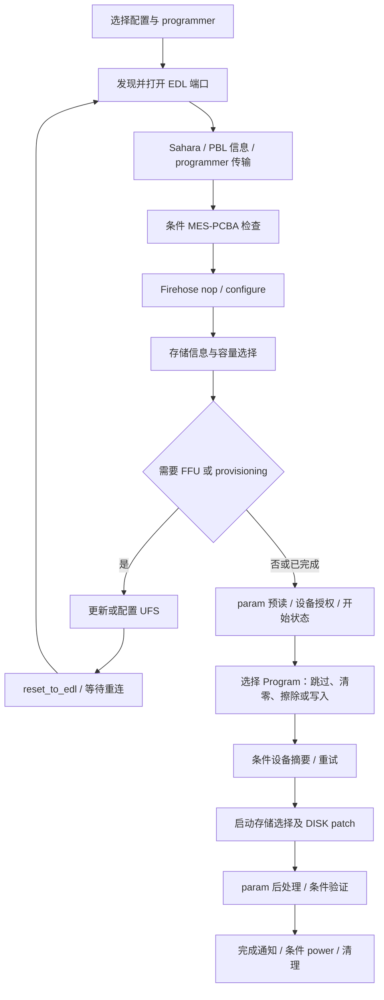

# MSMDownloadTool 刷写协议

2026-11-15 补充：第 11 节记录官方 OplusFlashTool 5.9.18.0；第 12 节记录第三方 Anteasy OplusTool 4.2026.009 的候选路径。此前各节仍按原 MSM 样本限定。

本文提取五个已分析主版本的客户端传输、写入和状态机行为。详细字节与分支主要来自 4.0.28.0，新增认证、param 和 UFS 更新行为由 5.0.15.0、5.1.75.0、5.1.77.0 的对应证据补充。版本地址和行为分别限定，不把旧版实现缺陷当作所有 programmer 必须遵守的协议。

精确样本身份见 [认证协议 §1](auth.md)，输入格式及源偏移见 [OTA 解包解析](ota.md)。现有验证包括静态指令分析和部分隔离执行；没有真实设备刷写、断电恢复或开机验收。文中的 XML 为字段示意，含占位符，不是可直接发送的命令集。

## 1. 版本覆盖

| 版本 | 主下载入口 | 已恢复的主要范围 | 主要限制 |
|---|---|---|---|
| 3.0.2.0 | `0x417420` | 散装 XML、Sahara、Firehose、厂商 UFS provisioning、普通/sparse 写入和回读 | 未验证真实串口/设备 |
| 4.0.28.0 | `0x420f10` | OPS/外部文件、传输细节、param、设备摘要和错误返回 | 未取得完整 OPS 与匹配 programmer 的内部实现 |
| 5.0.15.0 | `0x4436a0` | 条件 demacia/setprojmodel、param、摘要重试、patch 和结束策略 | token 核心未输出级验证，部分 API 仍受保护 |
| 5.1.75.0 | `0x4b9690` | MES/PCBA、DDR/DPIndex 选择、FFU、分阶段 param、授权及写入 | 所有模式、文件 API 和设备响应未动态覆盖 |
| 5.1.77.0 | `0x4b9830` | 新版 token 输入与输出、P19 FFU 决策、文件及命令链 | Win7/factory、完整 OPS 和目标端接受条件未验证 |

证据：[多版本报告 §5–8](../msmdownloadtool-analysis.md#multi)、[4.0.28 报告 §7–12](../msmdownloadtool-analysis.md#v4028)、[5.1.75 报告 §7–8](../msmdownloadtool-analysis.md#v5175)。

## 2. 会话与刷写状态机

以下为主链的合并视图。MES、FFU、授权、provisioning 和 param 等节点均有版本/模式条件，不是每次任务都必经。



4.0.28.0 的准确顺序为：端口/Sahara → nop/configure → UFS 信息 → 条件 provisioning 和重连 → param 开始写回 → Program → boot drive → DISK patch → param 完成写回 → 等待约 3 秒并通知完成 → 非 SMT 的 reset/off → 清理。

5.1.75.0 在 Sahara 后、Firehose 前存在条件 PCBA 消息检查；在普通镜像阶段前还增加设备授权及分阶段 param。失败通常进入清理路径，但已经发生的写入没有事务回滚。外层重入/重试计数不代表任意阶段错误都自动重试。

## 3. 设备与 Sahara

### 3.1 枚举和端口

3.0.2.0 的 SetupDi 分支匹配 `Qualcomm HS-USB QDLoader 9008`、`Forge HS-USB QDLoader 9008`，另有 Qualcomm MMC Storage 路径。这是该实现的设备名条件，不表示任意驱动命名均兼容。

4.0.28.0 的 `0x4263e0` 独占读写设备句柄，并设置串口状态，包括 115200、8N1。DCB 数值不等于 USB 实际吞吐率。新版同样通过 Windows 设备/串口对象，但不能复用旧地址或全部错误语义。

### 3.2 programmer 选择和传输

3.0.2.0 的实际配置指定 image ID 13 和 `prog_ufs_firehose_8996_ddr.elf`。4.0.28.0 的 `0x421bc0` 按配置选择 loader，CheckHwId 路径比较镜像身份与设备信息；loader 可来自外部文件或 OPS 解密范围。5.1.75.0 的 `0x4c1a20/0x4c0920` 另含 DDR、DPIndex 等条件。

4.0.28.0 的 Sahara 处理器 `0x426c10` 可见以下接收命令。这里只列已恢复的命令分支，不补造完整 Sahara 结构定义。

| 收到的命令 | 客户端动作 |
|---|---|
| `0x01` HELLO | 构造并发送 HELLO 响应 |
| `0x03` READ_DATA | 按请求的偏移、长度发送 programmer 数据 |
| `0x04` END_IMAGE_TX | 处理传输结果并发送 DONE |
| `0x06` DONE_RESP | 处理结束状态 |
| `0x08` RESET_RESP | 处理复位回复 |
| `0x12` READ_DATA_64 | 存在分支，但此客户端只取偏移/长度的低 32 位 |

3.0.2.0 的 `0x417d10 → 0x41b200` 也可见这些分派。外层时间窗口常量为 15000，接收超时参数为 2000；它们是静态参数，不是所有系统的精确耗时保证。4.0.28.0 有约 2 MiB 的加载缓冲及约 15 秒的循环窗口。

数据请求的范围检查、64 位截断存在待验证边界，但现有材料没有恶意输入复现或可利用性证明。programmer 本身的签名接受策略和设备端校验逻辑也不由 EXE 单独决定。

证据：[3.0.2 Sahara](../msmdownloadtool-multi-version-evidence/op3/asm/0x41b200.txt)、[4.0.28 Sahara](../msmdownloadtool-4.0.28-evidence/hlil/0x426c10.txt)、[5.1.75 主链](../msmdownloadtool-5.1.75-evidence/main/asm/0x4b9690.txt)。

## 4. Firehose 会话和命令

### 4.1 XML 外层与 configure

4.0.28.0 的 `0x42e500` 添加 XML 声明和 data 容器，形式如下：

```xml
<?xml version="1.0" ?>
<data>
  <!-- 单条命令元素 -->
</data>
```

Sahara 后先 nop，再 configure。4.0.28.0 的配置模板包含：

| 属性 | 客户端值或来源 |
|---|---|
| ZlpAwareHost | `1` |
| SkipStorageInit | 条件值 `0` 或 `1`，provisioning 会改变会话状态 |
| TargetName | 模板文字 `8974`，不能用它识别本包实际 SoC |
| SkipWrite | `0` |
| AckRawDataEveryNumPackets | `100` |
| MemoryName | `emmc` 或 `ufs` |
| MaxPayloadSizeToTargetInBytes | 下载请求 `0x80000`（512 KiB）；回读请求 `0x8000`（32 KiB） |

3.0.2.0 基础 configure 的 payload 为 32768，模板也含 TargetName 及条件替换；不能将上述 4.0.28.0 数值推广到所有版本。完整的对端 payload 协商逻辑尚未恢复。

### 4.2 命令矩阵

下表地址均属于 4.0.28.0；命令可构造不等于任意 programmer 均实现。

| 功能 | 命令 | 主要字段/作用 | 构造入口 |
|---|---|---|---|
| 会话探测 | nop | 通信探测 | `0x4286a0` |
| 会话配置 | configure | 见上表 | `0x428a80` |
| UFS 配置 | ufs / provisioning 配置数据 | 厂商和模式相关配置 | `0x429000 / 0x429280` |
| 存储信息 | getstorageinfo | 读取厂商、容量相关信息 | `0x429680` |
| 启动存储 | setbootablestoragedrive | UFS 传 1，eMMC 传 0 | `0x429a80` |
| 写入 | program | 扇区大小、数量、物理分区、起始扇区 | `0x42ac20 / 0x42c630` |
| 读取 | read | 同类范围字段；支持特定磁盘尾表达式 | `0x42b730 / 0x42beb0` |
| 补丁 | patch | 起始扇区、字节偏移、大小、值、物理分区 | `0x42a020` |
| 特定尾部补丁 | patch | 使用 NUM_DISK_SECTORS-1 | `0x42d180` |
| 摘要会话 | sha256init / sha256final | final 提取 Digest 文本 | `0x42d940 / 0x42dc60` |
| 硬件版本 | gethwversion | 条件硬件检查 | `0x42e100` |
| 电源 | power | reset、off 或 reset_to_edl；延时 1 秒 | `0x429da0` |

5.x 另有 demacia、setprojmodel、setswprojmodel、setprocstart 及 firmwarewrite 等扩展。认证字段和算法见 [认证协议 §3](auth.md)，FFU 命令见本文 §7。

### 4.3 响应与原始数据

4.0.28.0 的 configure 接收循环最多尝试 10 次。成功读到数据后仅搜索精确字串 `response value="NCK"`；没有该字串即可保持成功并退出，并不要求肯定 ACK。`NCK` 是代码字面值，不应“修正”为 NAK 后当作原始行为。

原始数据结束等待函数 `0x42ab30` 最多读 5 轮，搜索连续字串 `response value="ACK" rawmode="false"`。属性重排、空白和分片不一定被该匹配接受。其他命令有各自的响应处理，不能统一套用此条件。

| 层次 | 4.0.28.0 的量/处理 |
|---|---|
| 普通镜像业务批次 | 常见为 1024 个设备扇区 |
| configure 请求 payload | 下载 512 KiB；回读 32 KiB |
| 普通 WriteFile 分块 | 最多 `0x8000` 字节；另一系统分支整块发送 |
| 单轮计划读取 | 最多 `0x1000` 字节，再按队列可用量缩小 |

这些量不可相互替代。旧版读循环按计划量扣减剩余量、按实际量累计返回；写循环按请求量推进源指针，实际量另计。存在短读/短写边界，未证明真实驱动必然触发。5.1.75.0 的 `0x4b81f0` 重新确认了请求块推进模式，但底层是否保证完整写仍未证明。

证据：[XML 包装](../msmdownloadtool-4.0.28-evidence/hlil/0x42e500.txt)、[configure](../msmdownloadtool-4.0.28-evidence/hlil/0x428a80.txt)、[完成等待](../msmdownloadtool-4.0.28-evidence/hlil/0x42ab30.txt)、[4.0.28 报告 §8、§12](../msmdownloadtool-analysis.md#v4028)。

## 5. 普通镜像、清零、sparse 和 patch

### 5.1 范围与普通数据

Program 记录经容量、模式、选择标志、skip/not-overwrite 等条件筛选后才进入写入。`physical_partition_number`、`start_sector`、`num_partition_sectors` 和 `SECTOR_SIZE_IN_BYTES` 共同定义目标范围。OPS 源偏移 `FileOffsetInSrc << 9` 始终按 512 字节解释，不能乘目标的 4096 字节扇区大小。

4.0.28.0 普通写入 `0x425480` 支持外部文件及 OPS 范围；外部文件向上取整到 512/4096 字节设备扇区，末扇区不足部分补零，按批次发送并等待结束响应。BackupGPT 可选 `NUM_DISK_SECTORS-33`（eMMC）或 `-5`（UFS）；这些是该版本和记录的特定分支，不是通用 GPT 布局定义。

GPT、persist、param、NV 等名称在选择、跳过和执行路径中有特殊处理。只凭字符串列表不能断言这些分区总被保留或总被擦除。

### 5.2 清零与擦除

3.0.2.0 的 `0x418bb0` 和 4.0.28.0 的 `0x423800` 使用 program 发送零缓冲，实现 UI 所称的擦除。不能把这些分支描述为发送独立 erase 命令。

5.1.75.0 镜像迭代 `0x4bbbb0` 明确区分跳过、单独擦除和 erase_before_flash 后写入。现有报告没有给出这些新版擦除分支的完整线命令，不能把旧版 program 写零直接套用。擦除与写入中途失败不会撤销先前副作用。

### 5.3 sparse 的实际写集合

4.0.28.0 的 `0x4247f0` 检查 magic `0xed26ff3a`、major version 1、头长度及块/扇区关系。

| chunk | 代码分支 |
|---|---|
| RAW `0xcac1` | 读入原始数据，合并或写出 |
| FILL `0xcac2` | 展开填充值，合并或写出 |
| DONT_CARE `0xcac3` | 依上下文只推进地址，或补零并入待写缓冲 |
| CRC32 `0xcac4` | 无专门分支，进入未知类型 |

合并缓冲最大约 128 MiB，部分阈值约 32 MiB，刷新还可按 64 MiB 拆分。有待写缓冲时，某些内部空洞会补零；尾部空洞在部分刷新路径被扣除。因此不能将 DONT_CARE 一律视为保留盘上内容，必须根据具体 chunk 顺序计算实际写集合。

3.0.2.0 也确认前三种 chunk 分派；5.1.75.0 通过 `0x4bd7a0` 选择 sparse `0x4be650` 或普通 `0x4bf6c0`，尚未完成真实包的逐字节范围验证。

### 5.4 patch 与 boot drive

4.0.28.0 在 Program 后先设置 bootable drive，再由 `0x425dc0` 遍历 Patch。仅 `filename` 精确等于 `DISK` 的项进入设备 patch；其他项在该分发器跳过，不能称为完整本地镜像补丁引擎。

该函数初始结果为 1，只有执行 DISK 项才更新。若进入阶段但没有合格项，可能在镜像已经写入后返回非零。5.1.75.0 的 `0x4c0060` 重新确认了同类行为，但配置可以跳过整个 patch 阶段。两者都没有事务回滚证据。

证据：[4.0.28 报告 §9](../msmdownloadtool-analysis.md#v4028)、[sparse](../msmdownloadtool-4.0.28-evidence/hlil/0x4247f0.txt)、[patch 分派](../msmdownloadtool-4.0.28-evidence/hlil/0x425dc0.txt)、[5.1.75 报告 §7.2、§8](../msmdownloadtool-analysis.md#v5175)。

## 6. 设备身份、授权与 param

5.0.15.0 在配置 `+0xb0 > 0` 时先执行 demacia `0x44c5d0`，再 setprojmodel `0x44c6f0`；授权失败终止当前正常写入链。5.1.75.0 对应条件为配置 `+0xcc > 0`，调用 `0x4c02f0/0x4c03f0`。新版结构偏移不同，具体映射和三种 token 的恢复规则见 [认证协议 §3](auth.md)。

5.1.75.0 的条件 PCBA 检查通过 `0x1b74` 消息执行，在 Firehose 配置前。MES Upload 关闭或 SMT 条件造成的本地跳过，不等于服务端批准；流程细节见 [认证协议 §5](auth.md)。

param 处理在普通镜像表之外产生设备写入，不能仅靠 Program/Patch 列表计算全部副作用：

| 版本 | 已恢复 param 行为 |
|---|---|
| 4.0.28.0 | 查找 label 精确为 param 的记录，读取/写回 16 KiB；下载前写状态 `0x53`（S），完成后 `0x46`（F），同时更新时间及模式字段 |
| 5.0.15.0 | `0x447ed0` 预读/后处理，读取 PCBA、mobid 等；primary/backup 加密内容有独立校验 |
| 5.1.75.0 | `0x4bc920` 以参数 0 预读、1 获取标识、2 写开始信息、3 后处理、4 provisioning 相关处理 |

5.1.75.0 后处理还包括软件/运营商字段及条件 param 读回。部分配置可使处理器直接返回 0，不存在“所有任务都执行同一固定 param 写入”的证明。旧版 param helper 也可能以末尾 ACK 覆盖早先命令/数据错误。

上述仅描述客户端读改写，不构成 param 的完整官方磁盘结构，也未验证设备在中断后如何使用这些记录。

## 7. UFS provisioning 与 FFU

### 7.1 provisioning

3.0.2.0 按 UFS 厂商选择配置；实际包包含 hynix、samsung、toshiba 配置。4.0.28.0 的 provisioning 受 SMT/UFS 条件控制，执行后发送 reset_to_edl，等待约 5 秒再建立 Sahara/Firehose 会话。5.1.75.0 还结合 param 阶段 4 保存或处理软件项目字段。

provisioning 改变存储配置，与普通分区镜像写入及 UFS 固件更新属于不同操作。现有报告没有完整恢复每种厂商配置的线上字段或所有设备接受规则。

### 7.2 5.1.77.0 固件选择

状态函数 `0x4c17b0` 将当前固件字符串映射为 `400 → P04`、`900 → P09`、`302 → P13`、`903 → P19`。两个项目集合是工具内的字符串集合，没有全部映射为零售机型：

| 集合 | 项目 |
|---|---|
| P13 | `19805, 20806, 20807, 20808, 20809, 20828, 20838` |
| P19 | `19815, 20857, 20858, 20859, 2085A, 19825, 20851, 20852, 20853, 20854, 2080A` |

| 当前固件 | 条件 | 更新准备 |
|---|---|---|
| P19 | 任意 | 清更新标志 |
| P13 | 项目在 P19 集合 | 目标 P19 |
| P13 | 不在 P19 集合 | 清更新标志 |
| P09 | 项目在 P19 集合 | 目标 P19 |
| P09 | 不在 P19 集合，但在 P13 集合 | 目标 P13 |
| P09 | 两集合都不在 | 清更新标志 |
| P04 | 已识别路径 | 先选择 P09 文件 |
| 未识别 | 任意 | 记录 unknown，清更新标志 |

随后检查下载对象 `+0x5d4`：值为 6 时视为已 provisioning，P04 返回 `0x14` 并停止 SMT，其他已识别固件返回 `0x13`，跳过 FFU/provision；值为 3 时保留前面的更新判断并返回 0；其他值清更新标志。`0x13/0x14` 是此状态机的控制结果，不能统一解释成系统错误。

### 7.3 文件、命令和重连

`0x4c13f0` 只在已分析的 `128G/256G` 容量路径选择文件，其他容量返回 2。5.1.77.0 包内有两个容量各自的 P09、P13、HID_P19 共六份文件；已取得的 5.1.75.0 包只有 P09/P13 共四份。旧 EXE 出现 P19 分支文字并不等于其包内含有 P19 文件。

文件路径 `0x4c0c30` 及恢复续段取得长度后，进入 `0x4cfff0` 构造：

```xml
<firmwarewrite SECTOR_SIZE_IN_BYTES="1" num_partition_sectors="{文件字节数}" ... />
```

随后发送文件原始数据、读取结果并解析 `ufs_fw_update_type`，再按主链发送 reset_to_edl、重开设备、检查新的固件状态。P04 先到 P09 后还可能继续至 P13/P19，不能简化为一次 program 分区写入。

文件 API 的受保护返回、所有 FFU 返回分支、目标接受及掉电恢复尚未动态验证。证据：[多版本报告 §8](../msmdownloadtool-analysis.md#multi)、[FFU 状态机汇编](../msmdownloadtool-multi-version-evidence/op9pro/asm/0x4c17b0.txt)、[文件选择](../msmdownloadtool-multi-version-evidence/op9pro/hlil/0x4c13f0.txt)、[firmwarewrite](../msmdownloadtool-multi-version-evidence/op9pro/hlil/0x4cfff0.txt)。

## 8. 摘要验证与独立回读

### 8.1 设备摘要

4.0.28.0 的 `0x423aa0` 结合 readbackverify、全局 SHA 选项及包/外部标志决定是否执行 `sha256init → 镜像写入 → sha256final → 比较 Digest`。失配最多尝试三轮。5.0.15.0 的 `0x4491d0` 和 5.1.75.0 的 `0x4cca50/0x4ccd70` 也有条件摘要/重试；后者存在明确的跳过路径。

EXE 只证明客户端请求 programmer 返回摘要。其对象究竟是接收流、缓存还是最终介质，需要对应 loader 的实现证据。字段名 readbackverify 不足以证明主机已完整回读逐字节比较。

### 8.2 Read Back

3.0.2.0 的独立入口是 `0x4179b0`，4.0.28.0 为 `0x421860`。回读同样建立 Sahara/Firehose 会话，再按配置和选择标志决定范围；现有链没有证明先读 GPT 后自动备份全部分区。

4.0.28.0 的已确认细节：

- 普通零长度条目不自动扩展为完整分区，xbl 有 `0x300` 扇区的特殊分支。
- 输出前缀为 `C:\`，优先使用记录文件名，否则用 label 加 `.bin`。
- `fopen(..., "wb")` 可覆盖同名文件，未见临时文件原子替换或 partial 标记。
- 分批 read 后写入实际收到的数据，再等待结束响应；取消可能留下部分文件，某些局部取消分支返回 0。
- 成功路径发送 power off，因此此功能不只是被动导出主机文件。

设备摘要、主机回读和包 MD5 是独立操作，详见 [OTA 解包解析 §8](ota.md)。没有真实回读文件或恢复验证，不能据此声称备份可恢复。

证据：[4.0.28 报告 §10–11](../msmdownloadtool-analysis.md#v4028)、[回读范围](../msmdownloadtool-4.0.28-evidence/hlil/0x4233c0.txt)、[回读数据](../msmdownloadtool-4.0.28-evidence/hlil/0x425a10.txt)。

## 9. 失败、结束和成功的边界

| 已确认的客户端行为 | 适用版本 | 判断限制 |
|---|---|---|
| configure 以精确 NCK 子串判否定 | 4.0.28.0 | 函数成功不证明收到肯定配置 ACK |
| 计划量与实际传输计数分离 | 4.0.28.0；5.1.75.0 有独立写路径证据 | 需要结合调用者和底层保证判断完整传输 |
| param helper 可采用最后等待的结果 | 4.0.28.0 | 最终 0 不证明前面 16 KiB 已完整处理 |
| 取消局部可能返回 0 | 3.0.2.0/4.0.28.0 的相应路径 | 须结合停止标志及已传输字节，不能只看局部返回 |
| patch 阶段没有 DISK 项可保留失败值 | 4.0.28.0、5.1.75.0 | 先前镜像写入不回滚；阶段也可能被跳过 |
| power 包装最多尝试 5 轮且最终返回 0 | 4.0.28.0、5.1.75.0 | 不能证明收到 power ACK 或设备已复位 |
| 完成通知早于 power，或后面仍检查错误 | 4.0.28.0、5.1.75.0 | Download Complete 不等于全部后处理成功 |
| 未启用摘要/回读也可结束 | 多个已分析版本 | 写入成功不等于介质内容已验证 |

5.1.75.0 某些模式可能在 Download Complete 日志之后仍报告 Serial Download Failed。SMT 等模式还可能抑制结束 power。上述是具体实现事实，不要求其他客户端复制宽松响应或错误吞并行为。

应分别记录传输是否完成、协议是否肯定确认、所选介质内容是否验证、设备是否成功启动。现有证据不能从前一层自动推出后一层。

## 10. 剩余协议缺口

| 范围 | 尚需恢复或验证 |
|---|---|
| Sahara | 完整字段布局、64 位/长度边界、所有异常和目标端 loader 接受策略 |
| Firehose | 各命令完整响应 schema、流分片、payload 协商和 programmer 特定扩展 |
| 新版普通写入 | 受保护文件 API、短读/短写、擦除线命令和全模式范围 |
| param/provisioning | 完整字段结构、厂商配置、设备消费状态及中断后行为 |
| UFS FFU | 受保护返回链、所有状态码、目标端接受、掉电和重试恢复 |
| 验证 | programmer 的摘要覆盖对象、真实设备完整回读、启动和恢复验收 |
| 样本差异 | 未分析 programmer、Win7/factory 和其他包的行为等价性 |

原始报告保留了地址、HLIL/汇编、向量和阶段性结论。本文采用其最新证据提取客户端协议，不把“已恢复调用链”扩大为“所有硬件上的完整刷写已验证”。

## 11. OplusFlashTool 5.9.18.0：RMX3800 / SM8650

本节来自 [5.9.18 专项报告](../oplusflashtool-5.9.18-analysis.md)。样本为官方 Sales 包；并非旧 MSM 5.1.77 的算法升级等价证明。DLL 下述地址均以 `0x10000000` 为基址，必须带模块名使用。

### 11.1 识别与包的后端

Bridge!`0x1001d050` 根据包成员的 `META` 前缀设置 mode=1；Bridge!`0x10018590` 将该模式的 Qualcomm profile 分派给 `FTLibOplusQCom.dll`。现有 RMX3800 ZIP 有 META/，但本轮没有执行完整 Windows 包加载器。

OplusQCom!`0x1001f870` 取得 Sahara PBL 的 MSM ID 和 32 字节哈希。`0x1002ff80` 先查工具目录 `qcplatform.json`，失败后查本地 `online\qcplatform.json`。`0x1002f760` 要求 ID 相同，并接受相等 hash 或空配置 hash。本版 SM8650 为 ID `0x448`、hash 空、ddr `ddr`、storage 1、disable_vip 0、lanuch_delay 5000、digest_size 0。

这证明客户端存在 SM8650 平台路由，不能证明设备公钥、RMX3800 项目或账号授权匹配。平台查找的空 hash 规则不等于 programmer 安全启动验签关闭。

### 11.2 售后刷写主链

`QCSolution::makeSFP @ OplusQCom!0x10038a20` 生成 action 列表，`QCFlashWorker::runActions @ 0x1000d960` 执行。已追踪的主要依赖为：

```text
项目/Setting 与 profile
 → EDL / Sahara PBL / 平台查找
 → 下载并运行 programmer
 → digest/VIP / configure
 → getsigndata / RCSM sign / OSIG 预校验 / 设备 verify
 → NV、存储、OCDT/CDT 项目检查
 → GPT、条件固件更新、擦除/普通或 sparse 写入
 → patch、动态分区、下载标志、启动盘、条件 reboot
```

该顺序是静态生成路径摘要。multi-DDR、SMT、NV digest、efuse、重连和 FFU 有分支，不能当作一次实际设备记录。

| 行为 | OplusQCom 地址 | 关键条件/失败 |
|---|---|---|
| programmer 选择与 Sahara 下载 | 0x1001eda0 | 按 preset/platform/memory/project/storage 选文件；含 ddr/fwupdate 回退；Sahara 失败 0x7919 |
| digest/VIP | 0x1001d9d0 | DigestsToSign、链式表与 NV 变体；VIP 初始化失败 0x7d05 |
| 设备授权 | 0x1001cc50、0x10005b90、0x10006c60 | getsigndata → sign → verify；设备需 ACK 并返回通过文本 |
| OCDT 项目检查 | 0x10016a50 | 读手机 0x1000 字节并解密、选包内 OCDT、比较项目值；不匹配 0x753f |
| 分区写入 | 0x10013720 | 普通/sparse、program/RAW、条件 sha256init/final；RAW 错误 0x792c |
| action 失败 | 0x1000d960 | 非零停止；取消为 0x1869f |

`verify` XML 含 `EnableVip`，先等 ACK 再发原始缓冲区，最后查找 `verfiy passed` 或 `verify passed`。SFP 的 verify 长度参数为 4096，本地 RSA 预校验的签名长度为 256，不能混用。完整认证数据流见 [认证 §9](auth.md#9-oplusflashtool-59180rcsm-与设备签名)。

### 11.3 RMX3800 的实际证据边界

固件 `version_info.txt` / Projectconfig 指向 SM8650 / 23631，Setting 的 BasicInfo@Project 为 22825。项目列表、BasicInfo map 与 profile 小写 project 分别有独立消费路径；最终还比较设备与包内 OCDT，不能只比较两个 XML 数字判定支持与否。

Setting 声明 UFS、programmer Id 13、Program/Patch 0–5、IsOcdtVer=1 和 ImgSHA256Check=true。售后默认 UpdateOcdt=false。由此可定位 OCDT 校验与写入分支，但没有取得真实设备 PBL/OCDT、服务签名、ACK、完整 LUN 几何、读回或开机结果。**当前结论是识别和刷写路径存在，不是 RMX3800 刷写验收通过。**

证据：[后端分派](../oplusflashtool-5.9.18-evidence/bridge/hlil/0x10018590.txt)、[平台查找](../oplusflashtool-5.9.18-evidence/oplusqcom/asm/0x1002f760.txt)、[action 生成](../oplusflashtool-5.9.18-evidence/oplusqcom/hlil/0x10038a20.txt)、[OCDT 校验](../oplusflashtool-5.9.18-evidence/oplusqcom/asm/0x10016a50.txt)、[写入实现](../oplusflashtool-5.9.18-evidence/oplusqcom/hlil/0x10013720.txt)。

## 12. Anteasy OplusTool 4.2026.009 的候选路径

第三方预览版的已恢复设备认证链是 `SWM 操作授权 → 本地 demacia → 响应 → 本地 setprojmodel → 响应`。EXE 主循环 `0x14059e240` 最多迭代 8 次，action 1/3 生成和发送命令，等待/解析响应，action 5 返回本步骤成功。响应 NAK 或错误状态进入诊断路径。不能将这一步成功写成分区写入或启动验收成功。

另一条相关路径是云端 loader：列表筛选含 MSM ID、SHA-256/SHA-384 公钥哈希和 device_code，资产需经过票据与大小/摘要检查。主程序型号目录含 `Realme / GT6 / RMX3800` 和数值 `23631`，但本轮没有领取该型号的云端 loader，也没有验证 PBL 接受、Firehose 授权或实际刷写。因此它目前只是 RMX3800 的候选研究路径，尚不是已验证的免 RCSM 方案。

证据：[专项报告](../anteasy-oplustool-4.2026.009-analysis.md)、[认证循环](../anteasy-oplustool-4.2026.009-evidence/app/hlil/0x14059e240.txt)、[型号目录](../anteasy-oplustool-4.2026.009-evidence/app/hlil/0x1407681d0.txt)、[loader 列表请求](../anteasy-oplustool-4.2026.009-evidence/loader/hlil/0x18003ba10.txt)。

### 12.1 云端分件下载与官方 RMX3800 对照

自动匹配状态机 `OplusTool!0x1405ba2a0` 使用 Sahara PK hash/MSM key 查询 `qualcomm` 列表；零项失败，多项不直接选择首项。单项的 DIGEST scheme 会下载 loader、digest、sign 三种资产。型号目录含 RMX3800/23631，尚未证明它对应的云端 profile ID、PK hash 或具体文件。匿名列表实测在请求签名门槛返回 401，不能将其解释为该型号无库存。

官方 RMX3800 16.0.5.740 包内 loader 的命令表已由 Binary Ninja 与原始数据核验：getsigndata=`0x149a19b8`、verify=`0x149a1a6c`、program=`0x149a27fc`、read=`0x149a29e8`。verify 的成功状态写入 `0x80269b48`，program 的前置 helper 读取该状态；VIP 启用时 program 还要求 label 并检查权限表。安全状态下权限表另有签名认证，Sahara 上传、设备授权和分区权限是独立阶段。read 存在特定模式例外，未证明当前手机处于该模式。

后续离线执行已补齐 SHA 所需的堆初始化，验证 RSA-2048/PKCS#1 v1.5/SHA-256，并在固定厂商公钥下观察到无效签名依次进入 Y、N 两次验签后拒绝，授权通过位保持为零。测试密钥能通过通用 RSA 函数，不代表它能使设备授权通过；厂商签名的 Y/N 成功路径、外层传输和真实刷写仍未动态验证。环境适配、用例与完整边界见[密码与授权执行报告](../anteasy-oplustool-4.2026.009-analysis.md#10-官方-rmx3800-loader-的-sha-环境修复与-rsayn-执行验证)。

[getsigndata 追加分析](../anteasy-oplustool-4.2026.009-analysis.md#11-getsigndata-字段来源存储记录与离线执行)进一步确认 DigestWrite 来自前序接收的签名摘要表缓冲之 SHA-256；DigestRead 来自另一个固定位置的旧签名记录；NV 来自 oplusreserve1 内记录的 Base64。官方包声明 oplusreserve1 位于物理分区 5、4096 字节扇区、LBA 32，与 UFS 代码默认 NV LBA `0x4ad` 相符，仍需核验真实 GPT。普通读取失败可使字段为空/默认值而 getsigndata 仍准备成功；此时两个授权字段仍为零，不能把挑战准备或 ACK 参数等同于获得写入权限。

EXE 的“DIGEST mode, skipping authorization detection”只证明主机流程选择不同；Qualcomm 模块仍能构造 verify/EnableVip 和 sha256init。没有实际云端资产及设备 ACK，不能由该日志判定免 RCSM 或免设备验签。本轮未连接手机、上传 programmer 或写入分区。详细哈希、来源与缺口见 [追加报告](../anteasy-oplustool-4.2026.009-analysis.md#9-云端-loader-与-rmx3800-对照样本的继续追踪)，[命令表](../anteasy-oplustool-4.2026.009-evidence/cloud-loader/rmx3800-command-table.json)和 [program 汇编](../anteasy-oplustool-4.2026.009-evidence/cloud-loader/rmx3800/asm/0x149a27fc.txt)。

### 12.2 官方 RMX3800 的签名表接受与 writever

官方 loader 的 `0x149a47a8` 在接收表后，先执行安全状态相关认证及 SVIP 结构检查，成功后才计算整个表的 SHA-256 形成 DigestWrite，并设置表状态。安全路径通过 `SMC 0x02000201`、类型 `0x1a` 提交认证；非零调用返回或非零服务状态均被拒绝。两种外层错误传播实测返回 7，不能用非零缓存指针判断表已接受。

本轮官方六表的 ECDSA/SHA-384 与包内证书链离线验证通过，但设备根、回滚策略和 SMC 服务执行尚未验证。这也不替代独立的 verify/OSIG/RSA 设备授权。详细边界见[认证 §11.2](auth.md#112-官方-rmx3800-的表认证与持久签名记录)。

命令表中的 `writever=0x149a1b10` 读取授权通过位；未授权实测返回 `0x90000001`，没有存储调用。静态通过路径将当前 Rand、DigestWrite、DigestRead 和此前 verify 缓存的签名组装后写入 dinfo。官方 GPT 与 XML 均将 dinfo 定位在 LUN 3、LBA `0x260`；DigestRead 后续读取同一位置，验签后复制旧记录 `+0x40` 的 DigestWrite。

公开包的 dinfo 项没有输入文件。oplusreserve1 的 emmc_fw 文件也未覆盖 NV 所需的分区内偏移 `0x48d000`；稀疏空洞不能作为真实设备零数据。扫描 68 个已下载成员仍未找到可验证 DigestRead 成功的记录。本轮没有实际写入、设备 ACK 或读回。证据：[writever 原始指令](../anteasy-oplustool-4.2026.009-evidence/rmx3800-secure-auth/rmx3800/asm/0x149a1b10.txt)、[格式/拒绝验证](../anteasy-oplustool-4.2026.009-evidence/rmx3800-secure-auth/boundary-validation.json)、[包分区对照](../anteasy-oplustool-4.2026.009-evidence/rmx3800-secure-auth/record-search-and-partitions.json)。
