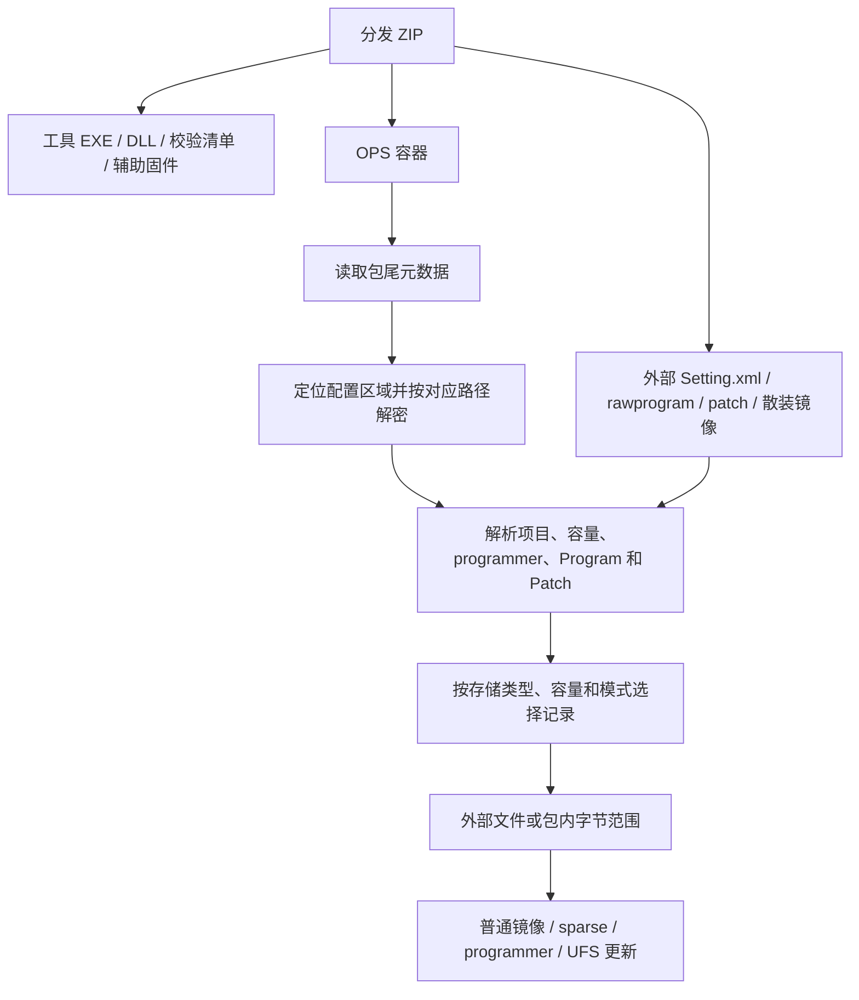

# MSMDownloadTool OTA 解包与解析

2026-11-15 补充：第 10 节单独记录 OplusFlashTool 5.9.18.0 的新证据；此前各节仍按原 MSM 样本限定。

本文的 OTA 指既有报告分析的 MSM 售后刷机包：分发 ZIP、OPS 容器，以及外部 XML 加散装镜像。现有材料没有恢复标准 Android OTA 的 `payload.bin`、增量操作或 update_engine 协议，本文不将这些格式补入 MSM 包结构。

本文覆盖 3.0.2.0、4.0.28.0、5.0.15.0、5.1.75.0、5.1.77.0 五个主样本。精确 EXE 哈希和变体边界见 [认证协议 §1](auth.md)。描述依据既有 Binary Ninja 输出、包目录及已提取成员；本次整理没有新增完整 OPS 解包实验。解析结果如何变成设备操作见 [刷写协议](flash.md)。

## 1. 版本和实际取得的材料

| 主版本 | 输入形式和已确认内容 | 不能据此声称的内容 |
|---|---|---|
| 3.0.2.0 | 取得 Setting.xml、六份 rawprogram、六份 patch、厂商 provisioning 配置及 programmer | 所有大镜像均已下载或校验 |
| 4.0.28.0 | 恢复 OPS 元数据读取、XML 解析和局部 AES-CFB128 解密路径；存在外部 Setting.xml 分支 | 本包 OPS 已完整解密、分区表已逐项验算 |
| 5.0.15.0 | 包目录含 `hotdogb_14_O.05_191012.ops`；有 OPS 选择和外部 XML、SupportMultiTarget 路径 | OPS 内部精确分区清单、跨版本密钥一致性 |
| 5.1.75.0 | 已取得 EXE、MES DLL 和部分辅助成员；刷写器支持包内镜像及配置选择 | 匹配 OPS 的全部 XML、镜像或 programmer 已分析 |
| 5.1.77.0 | 已取得主 EXE 等成员和六份 UFS 更新文件；包内存在 OPS | OPS 已整体解析、Win7/factory 输入行为完全相同 |

来源：[4.0.28 报告 §2、§6](../msmdownloadtool-analysis.md#v4028)、[5.1.75 报告 §2、§7](../msmdownloadtool-analysis.md#v5175)、[多版本报告 §2、§5.2、§6.1、§8](../msmdownloadtool-analysis.md#multi)。

## 2. 分发容器、软件包和镜像的层次

既有获取过程使用 HTTP Range 读取 ZIP 中央目录及选定成员，对取得的成员核对 CRC/哈希。该证据验证所提取成员的身份，不能扩大为整个 ZIP、OPS 内容或所有镜像均完整。ZIP 层的压缩/CRC、OPS 内部加密、设备镜像摘要是三个独立层次。

本节的流程图是解析关系；各包不一定同时包含两种输入形式，解析器支持的字段也不等于该包实际出现的字段。

## 3. 外部 XML 与散装镜像

### 3.1 3.0.2.0 的可核验实例

该包的 `Setting.xml` 声明：

| 项目 | 实际值 |
|---|---|
| Project | `15081` |
| TargetName / MemoryName / ChipType | `MSM8996` / `ufs` / `1` |
| CheckImage / NeedUsbDownload | `false` / `true` |
| Sahara image ID | `13` |
| programmer 文件 | `prog_ufs_firehose_8996_ddr.elf` |
| programmer SHA-256 | `c34ec1fddfac05d8f63eed3ee90c8e6983fe2b0e4b2837b30d8619a29633649c` |
| UFS 厂商配置 | hynix、samsung、toshiba |
| Program0..5 的容量项 | 64G / 128G |

Program 和 Patch 容量项引用对应 `rawprogramN.xml` / `patchN.xml`。六份 rawprogram 合计 73 条 program 声明，扇区大小均为 4096；六份 patch 合计 156 条声明。记录中有空文件名、跳过标志和模式条件，不能将 73 条声明当作每次必写的 73 个分区。

`md5sum.md5` 仅含 15 个条目。已取得的 rawprogram0.xml 与其 MD5 一致，其余大镜像没有因此获得验证。`CheckImage=false` 是这份配置的值，不代表所有路径都不做任何检查。

证据：[原始 Setting.xml](../msmdownloadtool-multi-version-evidence/op3/config/Setting.xml)、[配置统计和 MD5 检查](../msmdownloadtool-multi-version-evidence/op3/config-summary.json)、[配置解析函数](../msmdownloadtool-multi-version-evidence/op3/hlil/0x40c920.txt)。

### 3.2 其他版本的入口

4.0.28.0 的有效 OPS 路径与明文 Setting.xml 路径分别处理输入；无有效 OPS 时，内网分支允许读取明文配置。该模式条件见 [认证协议 §7](auth.md)。外部内容与包内内容的加载 helper 分别包括 `0x4146e0` 和 `0x414e30`。

5.0.15.0 的 `0x41abd0/0x41ae50` 处理 OPS 选择，`0x41f520` 保留外部 Setting.xml 并增加 SupportMultiTarget。后两版的保护层和未取得的 OPS 限制了完整配置恢复，不能将旧版字段列表宣称为所有新版文件的完整 schema。

## 4. OPS 元数据：4.0.28.0

`0x415000` 的可见处理顺序如下：

1. 从文件末尾向前 512 字节定位元数据区域。
2. 读取 `0xac` 字节元数据。
3. 检查 magic `0x7cef`、metadata version `2`、crypt version `1`。
4. 把配置扇区偏移乘以 512，定位配置区域。
5. 读取、解密配置并交给 XML 解析器。

现有报告未给出这 `0xac` 字节内全部字段的偏移、宽度、端序及校验关系，因而本文不提供臆造的 packed struct。`EOF-512` 是尾部定位规则，不表示最后 512 字节全部属于已恢复的结构。

部分文件读调用只检查读取量非零；这不是每个范围和长度均经过严格验证的格式保证。实际解包实现仍需分别确认文件长度、偏移加法和配置长度的界限，不能把客户端宽松检查当作格式允许任意截断。

证据：[元数据读取](../msmdownloadtool-4.0.28-evidence/hlil/0x415000.txt)、[4.0.28 报告 §6.1](../msmdownloadtool-analysis.md#v4028)。

## 5. 解密区域与算法边界

4.0.28.0 的 `0x41e730` 初始化固定 16 字节反馈状态，进入 `0x41e5f0`。后者以密文反馈、调用 AES 块函数并 XOR 得到明文；`0x41e210` 使用 AES T-table 和静态 key schedule。结构识别为 AES-CFB128。

这里的 CFB128 指反馈段大小 128 位，不能据此推定 AES 密钥长度为 128 位。报告没有导出一套已用完整 OPS 验证的原始 key/IV、尾部不足块及跨区域状态重置规范。

| 数据区域 | 已确认的处理 |
|---|---|
| OPS 配置 | 走上述解密链，再解析 XML |
| 包内 programmer/loader | 有上述解密链 |
| 镜像身份信息 | 有相关解密调用 |
| 普通镜像数据读取 `0x42e760` | 函数本身没有调用该解密器 |

因此，不能先对整个 OPS 用一个连续 CFB 流解密，再把所有结果直接当作镜像。应按具体读取链确认区域、长度和反馈状态。跨版本 key schedule 兼容性尚未验证。

证据：[反馈循环](../msmdownloadtool-4.0.28-evidence/hlil/0x41e5f0.txt)、[AES 块函数](../msmdownloadtool-4.0.28-evidence/hlil/0x41e210.txt)、[常量补充](../msmdownloadtool-4.0.28-evidence/supplemental-data.json)。

## 6. 配置模型与字段

4.0.28.0 已恢复的主要层级为 `BasicInfo`、`MEMORY_SIZE/Memory`、`SAHARA`、`UFS_PROVISION`、`Program0..7` 和 `Patch0..7`。容量支持项覆盖 Is16GSupport 至 Is256GSupport 的五个档位。执行前还会按存储类型、实际容量和模式选择列表。

| 对象 | 已恢复字段 | 解析入口 |
|---|---|---|
| BasicInfo | Project、Version、TargetName、MemoryName、GrowLastPartToFillDisk、LogEnable、LogPosition、DelayStartTime、UseGPT、CheckImage、CheckHwId、CheckHwVersion、NeedUsbDownload、BackupPart、BackupPartId、ChipType | `0x4125f0` |
| Program | label、filename、Sha256、filepath、start_sector、NUM_DISK_SECTORS、num_partition_sectors、skip_download、file_sector_offset、not_overwrite、sparse、partofsingleimage、physical_partition_number、readbackverify、SECTOR_SIZE_IN_BYTES、FileOffsetInSrc、SizeInSectorInSrc、SizeInByteInSrc | `0x4138d0` |
| Patch | filename、start_sector、value、byte_offset、size_in_bytes、physical_partition_number、SECTOR_SIZE_IN_BYTES | `0x413fd0` |

Program 的 `0xa0` 和 Patch 的 `0x58` 是客户端内存记录步长，不是 OPS 磁盘记录大小。字段可解析不意味着每个分支都会使用；字符串形式的地址表达式也不等于实现支持任意表达式求值。

### 6.1 源偏移与目标扇区

| 量 | 已知单位/处理 | 限制 |
|---|---|---|
| OPS 配置位置 | 配置扇区偏移 × 512 字节 | 元数据内完整字段布局未恢复 |
| 普通包内镜像 FileOffsetInSrc | `FileOffsetInSrc << 9`，即 512 字节单位 | 不随设备 sector size 自动变化 |
| SizeInSectorInSrc / SizeInByteInSrc | 解析器保留的源长度字段 | 各路径优先级及全部边界未形成完整 schema |
| file_sector_offset | 独立的配置属性 | 不能仅凭名称与 FileOffsetInSrc 合并 |
| start_sector / num_partition_sectors | 目标存储扇区位置/数量 | 结合所选记录的 SECTOR_SIZE_IN_BYTES |
| physical_partition_number | 目标存储区域编号 | 不等于 XML 列表编号或 Android 分区名 |
| byte_offset / size_in_bytes | patch 的字节偏移/长度 | 结合设备 patch 命令解释 |

4.0.28.0 普通写入支持 512/4096 字节设备扇区。外部文件路径会向上取整到设备扇区并对末扇区补零；包内路径按源范围读取。不能用目标扇区大小重新解释 OPS 的 512 字节源偏移。

`NUM_DISK_SECTORS-33` 和 `NUM_DISK_SECTORS-5` 是特定 BackupGPT 路径的磁盘尾表达式；不是 OPS 的源文件偏移，也不是所有设备 GPT 的通用常量。

证据：[Program 解析](../msmdownloadtool-4.0.28-evidence/hlil/0x4138d0.txt)、[Patch 解析](../msmdownloadtool-4.0.28-evidence/hlil/0x413fd0.txt)、[普通镜像读取/写入](../msmdownloadtool-4.0.28-evidence/hlil/0x425480.txt)。

### 6.2 sparse 镜像

3.0.2.0 和 4.0.28.0 的 sparse 分派识别 magic `0xed26ff3a`；4.0.28.0 要求 major version 1，并检查头长度、块/扇区关系。已确认 RAW `0xcac1`、FILL `0xcac2` 和 DONT_CARE `0xcac3`；4.0.28.0 的 CRC32 `0xcac4` 落入未知类型路径。

解包得到 sparse 文件并不等于得到实际写入范围。4.0.28.0 合并缓冲时可能把 DONT_CARE 内部空洞补零并写出，也可能只推进设备地址。块展开和写入语义见 [刷写协议 §5](flash.md)。5.1.75.0 有独立 sparse 分派，未用完整 OPS 做逐字节写集合验算。

## 7. 辅助 UFS 固件

UFS 更新文件是分发包中的独立成员，不能当作一般 Android 分区镜像。5.1.75.0 的已取得包有 128GB/256GB 的 P09、P13 共四份；5.1.77.0 包另含 128GB/256GB 的 HID_P19，共六份，成员已核验。

文件选择受当前 UFS 固件、项目集合和容量影响；`firmwarewrite` 使用 `SECTOR_SIZE_IN_BYTES="1"`，数量为文件字节数。文件的选择和升级/重连状态机见 [刷写协议 §7](flash.md)。这些独立成员的完整性不能替代 OPS 内主系统镜像的完整性。

证据：[多版本报告 §8.3](../msmdownloadtool-analysis.md#multi)、[5.1.77 ZIP 索引](../msmdownloadtool-multi-version-evidence/op9pro/archive-index.json)。

## 8. 校验含义

| 检查 | 作用对象 | 已知边界 |
|---|---|---|
| ZIP CRC/成员 SHA-256 | 实际提取的成员 | 不是全包或厂商发布签名 |
| 3.0.2.0 md5sum.md5 | 清单中的文件 | 只有 15 项；本次仅部分文件可验证 |
| 4.0.28.0 md5sum_pack.md5 | OPS 输入包 | 缺文件或不足要求的 33 字节时可跳过并保留成功状态 |
| Program.Sha256 / readbackverify | 写入阶段的设备摘要流程 | 是否启用取决于配置；摘要范围需分析 programmer |
| 独立 Read Back | 指定设备范围导出的文件 | 与包解析和包 MD5 相互独立 |
| License4.dat 验签 | 主机许可证 | 与 OPS/镜像签名没有等价关系 |

4.0.28.0 明文模式的 Verify 还调用外部批处理，行为依赖未取得的 `checkMd5.bat`。现有报告没有建立 OPS 厂商数字签名的完整验证链。

## 9. 可交付的解析结论与缺口

现有材料可以确定输入层次、4.0.28.0 的尾部定位/版本检查、XML 字段、源/目标单位及局部解密路径，并可直接复核 3.0.2.0 的真实配置。尚不足以宣称已形成适配五个版本的完整 OPS 解包器。

| 未恢复项 | 完成协议所需证据 |
|---|---|
| OPS 完整元数据布局 | 每字段偏移、端序、长度、范围及版本分派 |
| 加密参数 | 原始 key/IV、轮数、尾块/重置语义、区域边界及完整包明文验算 |
| 新版 OPS | 实际配置、完整镜像范围、字段变更及跨版本差分 |
| sparse 写集合 | 给定真实 chunk 序列，重放跳过、补零、合并及末尾处理 |
| 全包校验 | 取得完整 OPS/镜像并按实际清单复算，区分校验跳过与通过 |
| 标准 Android OTA | 现有报告未覆盖 payload.bin、增量 OTA 或 update_engine |

详细原始依据保留在 [4.0.28 报告 §6、§9–10](../msmdownloadtool-analysis.md#v4028)、[5.1.75 报告 §7](../msmdownloadtool-analysis.md#v5175) 和 [多版本报告 §5–8](../msmdownloadtool-analysis.md#multi)。

## 10. OplusFlashTool 5.9.18.0 与 RMX3800 服务包

本节新增 [5.9.18 分析](../oplusflashtool-5.9.18-analysis.md#33-rmx3800-的项目字段不能混用) 的包解析证据。输入为本地 `RMX3800domestic_11_14.1.0.190CN01_2025012302300313.zip`，369 个成员；读取并验证四个配置成员的 CRC/SHA，未在本轮重哈希整个固件 ZIP，也未验证所有镜像。

| 成员 | 实际内容 | 5.9.18 客户端依据 |
|---|---|---|
| version_info.txt | SM8650、项目 23631、RMX3800_14.1.0.190(CN01)_250123 | 用作包身份佐证，未证明参与所有刷写判断 |
| IMAGES/Projectconfig.xml | program project=23631、emmcsize=128G | OplusQCom!0x1004f9f0 解析 project/emmcsize 并生成项目列表 |
| IMAGES/Setting.xml | BasicInfo Project=22825、TargetName=SM8650、MemoryName=ufs、IsOcdtVer=1 | OplusQCom!0x100506d0 收集全部 BasicInfo 属性，存入独立 map |
| 同一 Setting.xml | SAHARA Id=13、prog_firehose_ddr.elf；Program/Patch 0–5；UFS 配置 | OplusQCom!0x1004fec0 分派 SAHARA/UFS/Program/Patch 解析 |
| ofp_version.txt | 4.0 | 格式版本文本，不是 FlashTool EXE 版本 |
| META/ 及其成员 | 位于 ZIP 根目录 | Bridge!0x1001d050 的 META 前缀条件选择 mode 1 后端 |

`QComSfpParser::parse @ OplusQCom!0x10048980` 先处理项目配置，再处理 Setting。GUI 从项目列表选值并写入 profile，worker 使用 profile 的小写 project，后续还做设备/包内 OCDT 匹配。因此不能将 BasicInfo@Project=22825 直接当作唯一目标项目；也不能仅凭 Projectconfig=23631 宣称完整兼容。

这些证据属于服务 ZIP 的目录与配置解析，没有恢复新的 OFP/OZIP 加密算法，也没有证明标准 OTA payload.bin 的解析能力。包中存在动态分区元数据，且客户端有 super 相关入口，但完整重建、镜像摘要和实际写集合仍待验证。

证据：[配置成员摘要](../oplusflashtool-5.9.18-evidence/firmware/selected-member-provenance.json)、[成员列表](../oplusflashtool-5.9.18-evidence/firmware/member-list.json)、[项目解析](../oplusflashtool-5.9.18-evidence/oplusqcom/hlil/0x1004f9f0.txt)、[Setting 解析](../oplusflashtool-5.9.18-evidence/oplusqcom/hlil/0x1004fec0.txt)。
