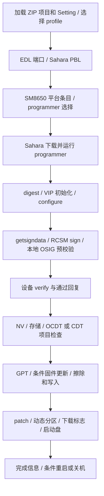

# OplusFlashTool 5.9.18.0：RMX3800 / SM8650、登录授权与刷写分析

> 后续进展：RMX3800 已有通过第三方 preview 云端配套资产路径完成实刷和启动的记录；该结果不等于本报告的官方 Windows 工具已通过实机验收。详见[实刷记录](../implementation/rmx3800-cloud-flash-20261116.md)；总览见[研究索引](README.md)。

分析日期：2026-11-15 UTC。工具：Binary Ninja 5.2.8614 Personal GUI、Unicorn 2.1.4。本文补充 [MSM 多版本报告 §13](msmdownloadtool-analysis.md#multi-13)，不把旧版 MSMDownloadTool 的 token 或许可证算法推广到 OplusFlashTool。

后续[当前原包授权核查](rmx3800-session-authorization.md)已用实机挑战运行 14.1.0.190 loader 和本报告主机端的原始 OSIG/SHA 指令，输出逐字节一致，平台公钥也匹配。第三方公开默认账号的一次请求失败；没有取得厂商有效签名。本文原有“未连接设备”等描述保留为对应研究阶段的范围。

## 1. 结果与适用边界

**5.9.18.0 具有可追踪的 SM8650 平台识别、realme RCSM 登录、服务器刷写签名和 Oplus Qualcomm 刷写路径。尚未证明它能完成这台 RMX3800 的授权与刷写。** 本轮新增的证据如下。

- SM8650 配置的 ID 为 `0x448`，`hash` 为空。原生查找逻辑要求 ID 匹配，并接受“配置 hash 等于 PBL hash”或“配置 hash 为空”。这只是平台路由，不是 RMX3800 型号授权。
- 工具按包内容选择后端：包含以 `META` 开头的成员时进入 mode 1，Qualcomm profile 使用 `FTLibOplusQCom.dll`。现有 RMX3800 ZIP 包含 `META/`，具备该分支的静态输入条件；本轮没有运行 Windows 包加载器验证完整装载。
- RCSM 登录走 `/api/tools/login`，成功后保存服务器 token；刷写走 `/api/tools/sign`，输入来自 Firehose 的设备签名数据。客户端还有本地签名预校验和设备端 `verify`，登录成功不等于允许写入。
- 恢复了本地 `OSIG` 的 208 字节序列化布局。4 组合成输入运行原始原生指令，序列化和 SHA-256 均与独立参考一致。执行在平台公钥查找前停止，没有伪造服务器签名或授权成功值。
- RMX3800 包的 `Projectconfig.xml` / `version_info.txt` 为 **23631**，`Setting.xml/BasicInfo@Project` 为 **22825**。程序分别解析项目列表和 BasicInfo；最终还有手机 OCDT 与包内 OCDT 的值比较。不能仅凭其中一个 XML 字段判定包不匹配或可刷。
- `FTLibBase.dll` 的六个压缩区段已静态恢复，但 RCSM `s_msg` 生成、响应预处理等仍进入 VMProtect 代码。本轮没有完成这些虚拟化业务体的恢复。

证据等级：**静态确认**表示有客户端指令、交叉引用或配置；**局部执行验证**只覆盖列明的原始代码区间和合成输入；**待验证**表示没有真实服务或设备结果。本轮没有启动 Windows 目标进程，没有连接手机，没有向登录、MES、签名服务发送请求。

## 2. 样本、来源和恢复方法

### 2.1 身份绑定

完整 ZIP 来自 [realme RMS 服务器](https://rms01.realme.net/SW/Tool/OplusFlashTool_v5.9.18.0_for_Sales.zip)，大小 **140,229,205 字节**。SHA-256 为 `37b5a78fb2a30ca464a10354ec1b18a4a003376e99f0a5d19cadb82d255f6c8b`，与下载响应的 `x-amz-meta-sha256` 一致；286 个 ZIP 条目 CRC 全部通过。另一个 RMS 地址只验证了 Range、大小及服务器摘要，没有重复全量下载。

| 模块 | 原始字节数 | SHA-256 |
|---|---:|---|
| `DownloadTool.exe` | 2,024,120 | `8f83cbf571adcf76e2d8e960e36a05486bf5eef50c46877335710dfece86a711` |
| `FTLibBase.dll` | 6,980,792 | `0de775be899b17c4d2870b4a8d3ce88515834a2d39d340fc6075c2e86799abee` |
| `FTLibBridge.dll` | 394,936 | `459991e437b709af752420030dc863c3a076440deb73f16915ff4c9cfbe36ef5` |
| `FTLibOplusQCom.dll` | 576,184 | `72c52a93a1c6fbc6e8723857b50031964f75396253b1cb1403b0e6cad91986f3` |
| `FTLibQCom.dll` | 576,184 | `371d87b44603a5e29d1d51fb91da886da39a990e491fdcb8339a01d6624e6c25` |

EXE 的产品信息为 `OPLUS Flash Tool GUI For Sales`、版本 `5.9.18.0`。嵌入证书主体为 Guangdong OPPO Mobile Telecommunications Corp., Ltd.；没有执行 Windows Authenticode 信任链校验。来源、版本、证书主体和哈希分别是不同证据，不能互相替代。

证据：[获取记录](oplusflashtool-5.9.18-evidence/acquisition.json)、[EXE 元数据](oplusflashtool-5.9.18-evidence/exe-metadata.json)、[模块清单](oplusflashtool-5.9.18-evidence/pe-inventory.json)。

### 2.2 Binary Ninja 与压缩层

主 EXE 为 x86 PE32，ImageBase `0x400000`，入口 `0x4cea74`。本文四个 DLL 均以 `0x10000000` 为首选 ImageBase，**所有 DLL 地址必须带模块名阅读**。下文简称 `Base`、`Bridge`、`OplusQCom` 分别代表对应 DLL；Base 地址来自恢复镜像，其他地址来自原始文件。

Base 的静态解压表位于文件偏移 `0x25dd93`，恢复 `.text/.rdata/.data/.gfids/.tls/.vmp0` 六段。恢复文件大小 12,943,360 字节，SHA-256 为 `45e6ca712d6f116f23e8b194032f2bca475e31c2da7e12858af7fbea0c8cf4ab`。这只是 LZMA 区段重建，不是可运行脱壳 EXE、完整 IAT 修复或完整去虚拟化。

通过 Binary Ninja GUI Python API 建立五个视图，导出符号、字符串交叉引用、函数及选定 HLIL/汇编。部分 HLIL 的寄存器参数、字符串长度、C++ 类型推断失真；关键结构偏移、条件跳转和调用实参均以汇编复核。编译器库函数的自动名称不作为业务语义证据。

证据：[解压日志](oplusflashtool-5.9.18-evidence/FTLibBase.unpack.log)、[恢复摘要](oplusflashtool-5.9.18-evidence/unpack-manifest.json)、[解压器来源](oplusflashtool-5.9.18-evidence/unpacker-provenance.json)、[BN 导出脚本](../../runs/oplusflashtool-5.9.18-analysis/collect.py)。

## 3. 设备识别、后端和项目匹配

### 3.1 两个 Qualcomm 后端

`Bridge::OpFlashMode::init @ 0x1001d050` 枚举包成员，匹配前缀常量 `META`；匹配时将 mode 设为 1。常量初始化位于 `Bridge!0x100013f0`。`Bridge::OpFlashManager::startFlash @ 0x10018590` 的分派为：

| 条件 | Qualcomm profile 行为 |
|---|---|
| mode == 1，profile 类型 == 0 | `QCFlashAgent::addProfile/start`，导入自 `FTLibOplusQCom.dll` |
| mode != 1，profile 类型 == 0 | `qcom_flash_agent_add_profile/start`，导入自 `FTLibQCom.dll` |
| profile 类型 == 1 | 对应模式的 MTK 后端 |

RMX3800 ZIP 的成员清单包含 `META/`、`IMAGES/Setting.xml` 和 `IMAGES/Projectconfig.xml`，因此本轮主要分析 OplusQCom；这不是对另一 Qualcomm 后端的全路径审计。

证据：[模式判断](oplusflashtool-5.9.18-evidence/bridge/hlil/0x1001d050.txt)、[META 常量](oplusflashtool-5.9.18-evidence/bridge/hlil/0x100013f0.txt)、[后端分派](oplusflashtool-5.9.18-evidence/bridge/hlil/0x10018590.txt)、[ZIP 成员清单](oplusflashtool-5.9.18-evidence/firmware/member-list.json)。

### 3.2 从端口到 SM8650

Base 的 `op_device_manager_query_device @ 0x100246a0` 从 `SYSTEM\CurrentControlSet\Enum\USB\VID_%s&PID_%s` 枚举设备实例、读取 FriendlyName、解析 COM 并构建端口路径。`OplusQCom::QCFlashAgent::onDeviceCallback @ 0x1000a740` 有 `Qualcomm HS-USB QDLoader 9008` 名称匹配分支。本轮没有证明所有 VID/PID、驱动名称或复合设备都能正确识别。

OplusQCom 的平台识别链：

```text
QCFlashWorker::doActionGetPlatform 0x1001f870
  → QCSahara::getPblInfo 0x10037bb0
  → MSM ID + 32 字节 PBL 哈希，哈希格式化为小写十六进制
  → queryPlatform 0x1002ff80
      先读取工具目录 qcplatform.json：0x1002fc80
      失败后读取工具目录 online\qcplatform.json：0x1002fe00
      两者共用 queryPlatformImp：0x1002f760
```

这里的 `online\qcplatform.json` 是本地路径；这条函数链没有直接证明发生了网络更新。查找按 JSON 顺序检查数字 ID 与 hash：ID 相同且 hash 相等，或者 ID 相同且配置 hash 是空字符串，才选中条目。Sahara 取值失败报 `0x791a`；平台未命中报 `0x7535`。

本样本的 SM8650 条目：

```json
{"id":"0x00000448","hash":"","name":"sm8650","ddr":"ddr",
 "storage":1,"disable_vip":0,"lanuch_delay":5000,"digest_size":0}
```

空 hash 在这条查询中是通配规则，**不表示跳过 programmer 的安全启动签名检查**。`disable_vip=0` 也不能单独证明设备当前 VIP 已启用；还需 action 参数、设备回复和后续 `verify`。工具的单镜像配置虽列出 `sm8650`，品牌范围只列 `oppo, oneplus`，不能据此声称 realme 单镜像入口受支持。

证据：[平台函数](oplusflashtool-5.9.18-evidence/oplusqcom/hlil/0x1001f870.txt)、[平台查找汇编](oplusflashtool-5.9.18-evidence/oplusqcom/asm/0x1002f760.txt)、[平台配置](oplusflashtool-5.9.18-evidence/config/qcplatform.json)、[工具配置](oplusflashtool-5.9.18-evidence/config/toolsconfig.xml)。

### 3.3 RMX3800 的项目字段不能混用

本轮读取本地 `RMX3800domestic_11_14.1.0.190CN01_2025012302300313.zip` 的四个配置成员，验证各成员 CRC 与 SHA-256。没有重新计算整个固件 ZIP 的摘要。

| 来源 | 实际值 | 已恢复的消费路径 |
|---|---|---|
| `version_info.txt` | platform `SM8650`；project `23631`；版本 `RMX3800_14.1.0.190(CN01)_250123` | 包身份佐证，未证明是刷写判定的唯一来源 |
| `Projectconfig.xml` | program project `23631`，emmcsize `128G` | `QComProjectCfgParser::parse @ 0x1004f9f0` 生成项目条目 |
| `Setting.xml/BasicInfo` | Project `22825`；TargetName `SM8650`；MemoryName `ufs`；IsOcdtVer `1` | `collectBasicInfo @ 0x100506d0` 把属性复制到 BasicInfo map |
| `Setting.xml/SAHARA` | Id `13`，Path `prog_firehose_ddr.elf` | `QComSettingParser::parse @ 0x1004fec0` 进入 Sahara 文件收集 |
| `ofp_version.txt` | `4.0` | 容器版本文本，不能当作 FlashTool 版本 |

`QComSfpParser::parse @ 0x10048980` 先解析项目配置，再解析 Setting。GUI 的 `CheckProjectNoIsSingle @ 0x4ae6f0` 读取项目列表，`SetProfileProperty @ 0x4b48f0` 调用 `OpFlashProfile::setProject`。worker 的 `prepareSolution @ 0x1000f050` 从 profile 的小写 `project` 属性取得选择值，写入 worker `+0x18b4`。因此 `BasicInfo@Project` 与当前选择项目属于不同数据路径；本轮没有执行完整 GUI/profile 构造，不能宣称所有分支已证明取 23631。

`doActionValidateProjectByOCDT @ 0x10016a50` 会查找 `ocdt/OCDT` 分区，读取 `0x1000` 字节并调用 `opOcdtCustomDecrypt`。程序按当前选择项目寻找包内 OCDT，随后读取设备和文件内部偏移所指的项目值，进行数值比较（`0x10017000–0x100170e1`）。不相等报 `project_mismatch` / `0x753f`；找不到合适文件报 `0x753e`。

`QCSolution::makeSFP @ 0x10038a20` 接受 `IsOcdtVer` 为 `true` 或 `1`；未要求强制 UpdateOCDT 的分支选择 OCDT/CDT 校验 action。本包 `IsOcdtVer=1`，售后默认 `UpdateOcdt=false`，给出了 OCDT 校验路径的静态依据；实际 profile、设备 OCDT 和解密结果仍未采集。

证据：[固件配置及成员摘要](oplusflashtool-5.9.18-evidence/firmware/selected-member-provenance.json)、[项目解析](oplusflashtool-5.9.18-evidence/oplusqcom/hlil/0x1004f9f0.txt)、[BasicInfo](oplusflashtool-5.9.18-evidence/oplusqcom/hlil/0x100506d0.txt)、[profile 使用](oplusflashtool-5.9.18-evidence/oplusqcom/hlil/0x1000f050.txt)、[OCDT 比较汇编](oplusflashtool-5.9.18-evidence/oplusqcom/asm/0x10016a50.txt)。

## 4. 登录与服务器授权

### 4.1 realme RCSM 的入口和状态

配置中的 RCSM 售后服务包括 China、India、Europe、Other，域名分别为 `rcsm-cn.realmeservice.com`、`rcsm-in.realmeservice.com`、`rcsm-eu.realmeservice.com`、`rcsm-sg.realmeservice.com`，均配置 HTTPS、验证码显示及 `DEV,SALES` 使用范围。这是样本配置，不是当前服务可用性验证。MES 项标为 `DEV`，本报告不把生产 MES 登录当作此 Sales 包的默认 realme 登录。

```text
DownloadTool!Login::LoginService 0x429c80，type 4
 → ServerApi::loginRcsmBlock 0x420940，QString → UTF-8
 → Bridge!OpFlashAuthManager::loginRcsm 0x1000fcc0
 → Base!auth_exec_login 0x1001bf00，type 4 分派
 → Base!auth_rcsm_login 0x10018cb0
 → RCSM helper 0x1002bde0，路径 /api/tools/login
```

Bridge 构造 type 4 请求，包含 server（`+0x4`）、user（`+0x204`）、password（`+0x284`）及 verification_code（`+0x384`）。Base 组装参数 map：

| 字段 | 本层来源 |
|---|---|
| board_id / cpu_id / disk_id | auth manager `+0x840 / +0x740 / +0x940` |
| ip / mac | manager `+0x540 / +0x640` |
| user_id / password / verification_code | Bridge 请求上述三个输入字段 |
| login_type / version | 常量字符串 `1` / `0` |

这里的 `password` 是本层收到的值；没有据此认定 UI 输入以明文上网，也没有把旧版 MSM 的 MD5 公式套进来。

本地响应检查依次尝试 `/Data/response`、`/Data/response/message`、`/Data/message` 取状态；要求状态为 `0000`。随后要求存在 countryname 和 token，token 复制到 `Base!0x1021b480`，country 存入 `0x1021a900`，设置 auth type 4 并返回 0。**usertype 缺失会记录错误，但该低层函数仍可返回 0**；不能把它描述成必需字段。Bridge 将低层返回 0 转成布尔成功，并记录 `after-sale` / `RCSM`。

`auth_exec_get_token_status @ Base!0x1001da80` 只对 auth type 5/6 调用在线状态查询，其他类型直接返回 0。不能据此认定 RCSM token 永不过期；服务器仍可拒绝后续签名，UI 也可能另有状态处理。

证据：[登录 wrapper](oplusflashtool-5.9.18-evidence/bridge/hlil/0x1000fcc0.txt)、[登录参数和响应](oplusflashtool-5.9.18-evidence/base/hlil/0x10018cb0.txt)、[登录汇编](oplusflashtool-5.9.18-evidence/base/asm/0x10018cb0.txt)、[服务器配置](oplusflashtool-5.9.18-evidence/config/serverconfig.xml)、[token 状态分派](oplusflashtool-5.9.18-evidence/base/hlil/0x1001da80.txt)。

### 4.2 RCSM 外层封装与 VM 缺口

`Base!0x1002bde0` 生成十进制时间字符串，然后依次调用：

| 地址 | 已知作用 |
|---|---|
| `0x1002b3f0` | 检查 helper `+0x284` 非空，然后调用受保护入口 `0x103a6d6e`；`s_msg` 等中间数据的完整生成未恢复 |
| `0x1002b140` | 按固定顺序拼接签名原文，调用 `op_md5_str` |
| `0x1002b600` | 构造表单字段；对 `s_msg` 和可选 `s_msg_c` 调用 escape 辅助函数 |
| `0x1002b760` | Content-Type 为 `application/x-www-form-urlencoded`，拼接 server + path，设置请求及响应回调并发送 |
| `0x1002b9e0` | 先调用受保护入口 `0x104e9413` 处理响应，再将结果展开为路径键值 map |

`0x1002b140` 的可见输入串为：

```text
path + "\napp_id=" + app_id
     + "\ns_msg=" + s_msg
     + ["\ns_msg_c=" + s_msg_c]       # 非空时才拼接
     + "\ns_msg_md_5=" + s_msg_md_5
     + "\ntimestamp=" + timestamp
     + "\n" + helper[+0x244]
```

最后一项的设置与密码学角色未完整追踪，不能只凭这个 MD5 拼接器实现可用客户端。请求表单固定包含 `app_id, timestamp, sign, s_msg, s_msg_md_5`，条件追加 `s_msg_c`。**`s_msg` 的序列化、加密参数、`s_msg_md_5` 的被摘要对象和响应解封装均未证明。** HTTP/TLS 实现的完整选项、信任策略和重试语义也不在本轮完整审计范围。

证据：[外层拼接汇编](oplusflashtool-5.9.18-evidence/base/asm/0x1002b140.txt)、[表单构造](oplusflashtool-5.9.18-evidence/base/hlil/0x1002b600.txt)、[发送](oplusflashtool-5.9.18-evidence/base/hlil/0x1002b760.txt)、[VM 入口一](oplusflashtool-5.9.18-evidence/base/asm/0x1002b3f0.txt)、[VM 入口二](oplusflashtool-5.9.18-evidence/base/asm/0x1002b9e0.txt)。

### 4.3 设备签名数据与刷写授权

`OplusQCom::doActionVerify @ 0x1001cc50` 的顺序是 `getsigndata → resolveSignData → sign → 设备 verify`。`getsigndata` 的实际 XML 构造在 `0x10005b90`：

```xml
<data><getsigndata value="ping" /></data>
```

`resolveSignData @ 0x100210e0` 从 Firehose 接收缓冲区取 `Version:` 段，按 `;` 分割字段。下表用 **R = worker + 0x3c** 表示授权输入结构，避免把 worker 偏移误当作结构偏移。

| 设备字段 | R 内偏移 | RCSM 签名字段 |
|---|---:|---|
| Version | `0x000` | meta_ver、version |
| Platform1 | `0x100` | main_platform |
| Platform2 | `0x200` | sub_platform |
| Mode | `0x300` | 本地 OSIG 输入；RCSM read_write_mode 本层固定为 `W` |
| Rand | `0x400` | random_num |
| ProjectWrite / ProjectRead | `0x500 / 0x600` | new_project_no / old_project_no |
| DigestWrite / DigestRead | `0x700 / 0x800` | new_sw_name_sign / old_sw_name_sign |
| 单独的 ID 段 | `0x900` | chip_sn |

NV 为另一段 Base64 数据，进入 NV 选择；本轮没有完整证明其结构或所有生产模式的失败条件。上面的随机值来自设备回复，尚未证明是客户端自行生成；不要称其为旧 MSM token 的同一算法。

`OplusQCom::sign @ 0x10020ce0 → Base::auth_exec_flash_sign @ 0x1001c3d0` 在 auth type 4 时进入 `auth_rcsm_flash_sign @ 0x10019410`，路径 `/api/tools/sign`。除表中字段，还发送 `disk_id, ext_ip, mac, token` 以及固定 `lock_ver=1, login_type=1`。`token` 来自 RCSM 登录全局值，不是设备 `Rand` 或本地 `OSIG` 的别名。响应 `/Data/response/encrypt` 被 Base64 解码到调用方缓冲区。

`sign` 还有 service ticket 事件与等待/取消分支。它在 `new_package_flag==1` 时把特定错误 `0x7d0c` 归一化为 0；随后仍进入设备 `verify`，不能将该兼容分支解释为免授权能力。

证据：[设备字段解析及偏移](oplusflashtool-5.9.18-evidence/oplusqcom/asm/0x100210e0.txt)、[签名请求](oplusflashtool-5.9.18-evidence/base/hlil/0x10019410.txt)、[sign 条件分支](oplusflashtool-5.9.18-evidence/oplusqcom/asm/0x10020ce0.txt)、[verify 主链](oplusflashtool-5.9.18-evidence/oplusqcom/hlil/0x1001cc50.txt)。

### 4.4 RCSM 签名状态的异常比较

不能直接把登录的 `message=0000` 成功规则复制给签名接口。`Base!0x100197bd` 开始的签名状态比较先接受空串；非空分支先比较 `0`，再比较 `0000`，指令条件并非通常预期的“三者任选其一”。

本轮对原始比较代码做隔离执行，停止在读取 encrypt 或记录服务错误之前：

| 合成状态串 | 停止地址 | 实际分支 |
|---|---|---|
| 空串 | `0x10019875` | 继续取 encrypt |
| `0` | `0x10019851` | 服务错误 |
| `0000` | `0x10019851` | 服务错误 |
| `1001` | `0x10019851` | 服务错误 |

这是当前静态恢复镜像的本地比较结果，不证明真实服务器登录/签名不可用，也不证明空状态就授权成功。响应预处理仍受保护，正常签名响应如何形成空状态、是否存在运行时修改均未验证；后续还必须有 encrypt、本地预校验及设备验证。

证据：[比较汇编](oplusflashtool-5.9.18-evidence/base/asm/0x10019410.txt)、[字符串读回](oplusflashtool-5.9.18-evidence/literal-readback.json)、[4 个比较案例](oplusflashtool-5.9.18-evidence/rcsm-sign-guard-validation.json)、[复现脚本](../../runs/oplusflashtool-5.9.18-analysis/validate_rcsm_guard.py)。

## 5. OSIG 序列化、本地预校验与设备 verify

### 5.1 208 字节结构

`Base::pre_verify_flash_sign @ 0x1001d420` 清零 `0xd0` 字节后按固定宽度拷贝以下内容。表中的长度为字节；固定宽度拷贝不能改成任意长度字符串拼接。

| OSIG 偏移 | 长度 | 来源 |
|---|---:|---|
| `0x00` | 4 | ASCII `OSIG` |
| `0x04` | 4 | R+0 的前 4 字节；随后部分覆盖 |
| `0x05` | 1 | 扩展模式时 `atoi(R+0xd24)` 的低字节 |
| `0x06` | 1 | 扩展模式时 `atoi(R+0xc24)` 的低字节 |
| `0x05..0x07` | 3 | 非扩展模式改为零；扩展模式不单独覆盖 `0x07` |
| `0x08` | 2 | 首次为 `0x0059`，即 `Y\0`；失败重试为 `0x004e`，即 `N\0` |
| `0x0a` | 2 | 初始清零保留 |
| `0x0c` | 4 | R+0x300，Mode |
| `0x10` | 8 | R+0x100，Platform1 |
| `0x18` | 8 | R+0x200，Platform2 |
| `0x20` | 16 | R+0x900，ID |
| `0x30` | 16 | R+0x400，Rand |
| `0x40` | 64 | R+0x700，DigestWrite |
| `0x80` | 64 | R+0x800，DigestRead |
| `0xc0` | 8 | R+0x500，ProjectWrite |
| `0xc8` | 8 | R+0x600，ProjectRead |

`0x1003f860 → 0x1003f8c0 → 0x1003f580` 对整个 208 字节做 SHA-256。之后按 Platform2 取平台公钥，读取 RSA 公钥并调用 `0x10044d80`：类型参数 `0x2a0`、摘要长 `0x20`、签名长 `0x100`。首次失败将上述 `Y` 改为 `N` 后重算并再验。RSA 密钥来源、全部平台变体及验签函数内部 padding 路径尚未完成独立验证。

`auth_exec_flash_sign` 只在远端函数返回 0 且 R+0xb20 为零时进入本地预校验；先扩展模式，再非扩展模式。两者失败可重新取签名，总计最多 5 次循环；普通远端非零错误直接返回，不能概括成“所有网络错误重试五次”。失败处理还调用受保护入口 `0x1055e0d3`。

证据：[序列化汇编](oplusflashtool-5.9.18-evidence/base/asm/0x1001d420.txt)、[SHA 初始化](oplusflashtool-5.9.18-evidence/base/hlil/0x1003f860.txt)、[分派与重试汇编](oplusflashtool-5.9.18-evidence/base/asm/0x1001c3d0.txt)。

### 5.2 原始机器码验证结果

运行范围为 `Base!0x1001d420 → 0x1001d5b9`，在平台公钥查询前停止。使用恢复镜像的原始指令和 CRT/SHA 实现，只有观察及停止 hook，**没有 API stub、密码函数替代或授权返回值修改**。

四组覆盖：全零字段、常见 ASCII 字段的非扩展模式、同字段的扩展模式、另一组固定宽度字段的扩展模式。所有案例的 208 字节输出与独立布局参考一致，原生 SHA-256 与 Python hashlib 一致。此次覆盖初次 `Y` 序列化；`N` 重试、RSA 验签、VM 及真实设备数据没有执行验证。

证据：[完整输入、OSIG 与摘要](oplusflashtool-5.9.18-evidence/osig-native-validation.json)、[复现脚本](../../runs/oplusflashtool-5.9.18-analysis/validate_osig.py)。

### 5.3 设备端的最终检查

`OplusQCom::QCFirehose::execVerify @ 0x10006c60` 发送：

```xml
<data><verify value="ping" EnableVip="%d"/></data>
```

先等响应和 ACK，再发送调用方提供的原始签名缓冲区，继续等响应，并检查文本 `verfiy passed` 或 `verify passed`。Sales/SFP action 生成器中 verify 的长度参数文本是 `4096`；本地 RSA 预校验使用的签名长度则是 `256` 字节，两个长度属于不同边界，不应混为同一个载荷大小。

等待、发送、ACK 或通过文本检查任一失败均返回错误。设备实际接受条件取决于对应 programmer，本轮未反编译 RMX3800 的 programmer，也未观察它的回复。成功日志规则只证明客户端如何判断，不能证明设备端密码逻辑已恢复。

证据：[verify 命令与 RAW 发送](oplusflashtool-5.9.18-evidence/oplusqcom/asm/0x10006c60.txt)、[SFP action 生成](oplusflashtool-5.9.18-evidence/oplusqcom/hlil/0x10038a20.txt)。

## 6. 刷写阶段与失败出口

`QCFlashWorker::runActions @ OplusQCom!0x1000d960` 顺序执行生成的 action 列表，每个 action 还带参数和描述；非零返回停止当前链，取消码为 `0x1869f`。`QCSolution::makeSFP @ 0x10038a20` 按 DDR、OCDT、固件更新、用户数据和 profile 条件生成步骤。下图是已恢复依赖关系，**不是对 RMX3800 一次实际刷机日志的重放**。



multi-DDR 等分支会先运行 lite programmer、检查 DDR、重启到 EDL 后重新下载；digest、NV 和 configure 也可能重复。不能将图中一个节点等同于“只发一次命令”。

| 阶段 | OplusQCom 地址 | 新证据与限制 |
|---|---|---|
| 计划生成 / action 分派 | `0x10038a20 / 0x1000d960` | `get_platform, download_programmer, run_programmer, download_digest, configure, get_sign_data, verify` 等有实际构造及消费调用；生成器另有 SMT、仅 efuse 等分支 |
| programmer | `0x1001eda0` | 根据 preset、platform、memory、project、storage 选文件；存在 `prog_firehose_ddr.elf` 和 fwupdate 回退路径；以 Sahara 传输，失败 `0x7919` |
| digest | `0x1001d9d0` | 查找 DigestsToSign 和 ChainedTableOfDigests 及 NV 变体；VIP 初始化失败 `0x7d05`；某些缺失链式摘要文件分支仅警告并返回 0，不能把所有缺失都称为致命 |
| configure / verify | `0x1001d750 / 0x1001cc50` | 传输配置和 VIP 参数；设备最终 verify 失败 `0x791b` |
| 项目检查 | `0x10016a50 / 0x100174d0` | OCDT/CDT 分开实现；本包给出 OCDT 路径的静态条件 |
| 分区写入 | `0x10013720` | 文件选择、普通与 sparse 分支、program、RAW 模式、条件 sha256init/final；RAW 失败 `0x792c`、sparse 错误 `0x7d09` |
| 动态分区 | `0x1001a9f0 / 0x1001ae30 / 0x1001b700` | 已定位读取/写入 super metadata 和逻辑分区入口；未逐路径恢复全部布局算法 |
| 收尾 action | `runActions` 与 `makeSFP` | apply_patches、下载标志、启动存储选择、结束信息和条件 reboot；实际写集合取决于生成后的计划 |

现有 RMX3800 `Setting.xml` 声明 Program/Patch 0–5、UFS provision、`VerifyCdt=true`、`DownloadConfigSigned=true`、`ImgSHA256Check=true`。这些字段及 action 只支持“存在相应消费路径”的结论；没有验证六个 LUN 的真实几何、所有镜像哈希、设备 ACK、读回或开机。

证据：[action 执行](oplusflashtool-5.9.18-evidence/oplusqcom/hlil/0x1000d960.txt)、[programmer](oplusflashtool-5.9.18-evidence/oplusqcom/hlil/0x1001eda0.txt)、[digest](oplusflashtool-5.9.18-evidence/oplusqcom/hlil/0x1001d9d0.txt)、[普通/sparse 写入](oplusflashtool-5.9.18-evidence/oplusqcom/hlil/0x10013720.txt)、[Setting.xml](oplusflashtool-5.9.18-evidence/firmware/Setting.xml)。

## 7. 验证记录与未确认项

| 验证 | 本轮结果 | 不能外推的内容 |
|---|---|---|
| 工具 ZIP 完整性 | 全量 SHA 与服务器头一致；286 条目 CRC 通过 | Windows 信任链、型号许可 |
| 静态解压 | 6 段成功，原始与恢复哈希留存 | 完整去虚拟化、可运行性 |
| Binary Ninja | 五个模块视图、交叉引用、选定 HLIL/ASM | 函数数量不等于路径覆盖率 |
| RMX3800 输入 | 四个配置成员 CRC/SHA；完整成员名清单 | 全固件重哈希、镜像验签及目标机适配 |
| OSIG + SHA-256 | 4/4 原生局部执行与独立参考一致 | RSA 验签、Y/N 全组合、真实设备挑战 |
| RCSM 状态比较 | 4/4 案例落入上述确定分支 | 正常服务响应、服务器授权规则 |
| 网络/设备 | 未调用授权接口；未刷机 | 登录、刷写、读回、开机成功 |

仍需补齐的关键证据：

1. **RMX3800 实机 PBL 与包内 programmer 的匹配。** 当前只有工具 SM8650 条目和固件 platform 字段，没有该设备本轮的 MSM ID、公钥哈希、Sahara programmer 接受结果。
2. **项目与 NV 的最终选择。** 需要完整 profile 构造、手机及包内 OCDT 解密值、服务端型号/国家码/NV 返回；23631 与 22825 的字段差异不能自行归因为错误。
3. **RCSM 内层协议。** 优先恢复 `Base!0x103a6d6e` 和 `0x104e9413`，确认 s_msg、密码预处理、密钥/IV、响应展开以及非空状态异常分支的运行时适用性。
4. **本地验签剩余部分。** 需验证公钥选择、RSA padding、扩展字段来源、N 模式及失败后受保护处理，才能把 OSIG 字节恢复提升为完整验签复现。
5. **服务端权限与 token 生命周期。** 配置中的域名和 API 不是有效账号、设备权限或当前在线服务的证明；MES、工单以及 RCSM 的跨区域策略未实测。
6. **设备端 verify / VIP / 镜像写入。** 尚未分析目标 programmer 内部实现，也没有真实 ACK/NAK、写入长度、摘要、读回及启动验收。
7. **旁支范围。** 自动更新、遥测、缓存、所有 MTK/legacy QCom、efuse、SMT、FFU 和本地许可证没有全量审计。不能声称“完整行为已全部恢复”或“新版不存在许可证”。

## 8. 可复现产物

- BN 数据库：[GUI](../../runs/oplusflashtool-5.9.18-analysis/bn/gui.bndb)、[Bridge](../../runs/oplusflashtool-5.9.18-analysis/bn/bridge.bndb)、[Base 恢复镜像](../../runs/oplusflashtool-5.9.18-analysis/bn/base.bndb)、[OplusQCom](../../runs/oplusflashtool-5.9.18-analysis/bn/oplusqcom.bndb)、[legacy QCom](../../runs/oplusflashtool-5.9.18-analysis/bn/qcom.bndb)。
- [产物检查结果](oplusflashtool-5.9.18-evidence/artifact-validation.json)记录链接、五个原始核心 PE 摘要及两组局部实验的核验。
- [证据文件 SHA-256 清单](oplusflashtool-5.9.18-evidence/evidence-manifest.json)绑定导出内容；数据库保存在 runs，不作为完整恢复程序分发。
- [认证协议补充](msmdownloadtool/auth.md#9-oplusflashtool-59180rcsm-与设备签名)、[刷写协议补充](msmdownloadtool/flash.md#11-oplusflashtool-59180rmx3800--sm8650)、[包解析补充](msmdownloadtool/ota.md#10-oplusflashtool-59180-与-rmx3800-服务包)。

## 9. 与 Anteasy 4.2026.009 预览版对照

[第三方 OplusTool 专项分析](anteasy-oplustool-4.2026.009-analysis.md)已恢复一加离线 demacia / setprojmodel、前置 SWM 操作授权及云端 loader 请求。EXE 有 `Realme / GT6 / RMX3800` 目录项及数值 23631，但没有取得并验证匹配的云端 programmer。其旧一加 token 不能直接作为本报告 RCSM / SFP 路径的替代证据；5.9.18.0 中已确认的设备 verify 依赖仍成立。

## 10. 官方 RMX3800 programmer 的设备端对照

[云端 loader 追踪追加报告](anteasy-oplustool-4.2026.009-analysis.md#9-云端-loader-与-rmx3800-对照样本的继续追踪)已用 Binary Ninja 分析 realme 官方 RMX3800 16.0.5.740 包内 `prog_firehose_ddr.elf`，SHA-256 为 `daaddec2d87fa2f30a527f0e3d656044ef9e2fdece8163afde856cb9505e34ea`。设备端保留 getsigndata、4096 字节 verify 接收、256 字节签名、208 字节 OSIG、Y/N 验签分支及读写/VIP 状态门槛。3 组合成输入的 loader OSIG 与本报告主机端非扩展、首次 Y 的原生序列化逐字节一致。

这是对第 4–5 节客户端协议的新设备端证据，不是实机认证成功。首轮在 RSA 前停止，并复现 SHA 空上下文；[后续密码验证](anteasy-oplustool-4.2026.009-analysis.md#10-官方-rmx3800-loader-的-sha-环境修复与-rsayn-执行验证)已确认原因是离线入口未初始化通用堆。调用原始堆初始化、仅适配堆校验字段的硬件随机来源后，loader SHA 的 9 组边界/长度用例及 3 组原 OSIG 均与独立摘要一致；后 3 组也与本报告已保存的主机端原生摘要相等。

原始 RSA 已验证为 RSA-2048、指数 65537、PKCS#1 v1.5/SHA-256。独立测试密钥的接受/拒绝用例 6/6 符合预期；未修改固定厂商公钥的授权用例 5/5 符合预期，其中 4 例真实执行 Y→N 两次失败，1 例拒绝 255 字节长度参数。Y/N 成功置位仍只有静态证据，缺有效厂商签名与实机验证。Anteasy 云端列表匿名访问返回 401，实际云端 RMX3800 文件仍未取得，不能将官方对照样本的结论替代为云端资产结论。

证据：[样本身份](anteasy-oplustool-4.2026.009-evidence/cloud-loader/official-loader-identity.json)、[首轮原生输出差分](anteasy-oplustool-4.2026.009-evidence/cloud-loader/osig-loader-native-validation.json)、[SHA 环境对照](anteasy-oplustool-4.2026.009-evidence/rmx3800-crypto/sha-environment-validation.json)、[RSA 与固定公钥授权验证](anteasy-oplustool-4.2026.009-evidence/rmx3800-crypto/rsa-authorization-validation.json)。

[getsigndata 字段追加报告](anteasy-oplustool-4.2026.009-analysis.md#11-getsigndata-字段来源存储记录与离线执行)已追踪五类字段：ID 为序列号寄存器的 `%x` 文本；Rand 在所测原始路径由来源字两两异或、取前 64 位编码；DigestWrite 是前序签名摘要表缓冲的 SHA-256；DigestRead 在验签旧记录后取其 `+0x40`，失败使用默认串；NV 是另一记录前 352 字节的 Base64。10 组完整离线入口用例符合预期，仍止于真实响应传输前；有效厂商旧记录与 Y/N 成功授权没有动态正例。详细输入、环境适配和 GPT 未命中时的栈输出依赖均在该报告中分列。

[安全表与 dinfo 追加分析](anteasy-oplustool-4.2026.009-analysis.md#12-签名摘要表的安全世界边界与真实旧记录搜索)已追踪 loader 以 `SMC 0x02000201`、类型值 `0x1a` 提交签名表，且要求调用返回值及服务结果均为零。官方包六个表的 ECDSA P-384/SHA-384 签名、12 项段摘要及包内证书链均通过离线检查；证书链以包内根为锚并关闭时间检查，尚不证明设备根、回滚策略或 SMC 实际接受。

DigestRead 读取的是 LUN 3、LBA `0x260` 的 dinfo。`writever` 在授权通过后持久化记录，未授权调用实测返回 `0x90000001`。该记录没有 OSIG 头，也不存 ID；验签时才加入当前芯片 ID 重建 OSIG。68 个已下载官方成员中未找到符合原生记录格式的候选，XML 也没有为 dinfo 提供镜像。因此表签名的离线正例不能补足设备绑定 RSA 或 DigestRead 成功正例；5.9.18.0 的设备授权依赖结论未变。
