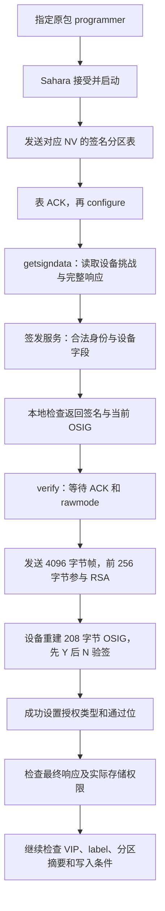

# RMX3800：原包会话授权与公开签发路径核查

> 历史范围：本文记录原包会话与签发请求的早期结果。后续 preview 云端配套资产路径已有实刷和启动证据，不改变本文原包验证结果。详见[实刷记录](../implementation/rmx3800-cloud-flash-20261116.md)；总览见[研究索引](README.md)。

日期：2026-11-15（America/Los_Angeles）。

**结论：新增找到一条公开客户端实际使用的 realme 签名 API，但经用户授权的一次请求返回 `050203 / 账户不存在`，没有签名。当前仍没有取得可供这台 RMX3800 使用的有效授权材料。OplusTool 的正常云端资产流程仍是候选，不能因匿名请求失败而判定原版客户端也不可用。**

后续核查用户提供的两份 AdaUnlocked 指引，另定位到 `Files_For_Chimera_OPLUS/SM8650_8Gen3` 配套 loader、Digest、Sign 的公开资源入口。这是尚未验证的离线候选，不能用原包授权失败替代其结果。具体缺项、下载限制及目标固件对比见第 8 节。

本轮把上一轮实机挑战与 **14.1.0.190 原包 programmer** 对齐，运行原始机器码核对 OSIG、SHA 和拒绝分支，并核查第三方签发入口。没有再次进入 EDL，没有向手机发送命令，没有修改产品代码、依赖、loader、公钥或验签结果。此前设备结果见[第六阶段实机记录](../implementation/phase-6-rmx3800.md)。

## 1. 固定样本与证据范围

| 对象 | 身份与用途 |
| --- | --- |
| 本次目标 | RMX3800 / 项目 23631 / NV 10010111；使用上次已结束 EDL 会话的接收记录 |
| programmer | 14.1.0.190 包内 `IMAGES/prog_firehose_ddr.elf`，1,558,188 字节，SHA-256 `9e9f62830e2442fdfd754ef67238f9719b278defd4b4d545a2d03f592ecc3734` |
| AArch64 分析副本 | 原文件偏移 `0x10e154` 起；SHA-256 `f23c8b349d0bb20ab33fc6fd031ce364b6e914c96fdb842a7bb0e0679b10d4a2`；仅供分析，不是另一个可刷写 loader |
| 实机 RX | 上轮 `probe-06/rx.bin`；SHA-256 `fa9926da0c8866c03983281daf06e8482ef20fba7cb4de9af6ebecfa0eea4041` |
| 官方主机端 | 既有 OplusFlashTool 5.9.18.0 的 `FTLibBase` 恢复镜像与 `auth.pub`；沿用[样本来源](oplusflashtool-5.9.18-analysis.md) |
| Anteasy | 继续复核已固定的 4.2026.009 实现；另取得官网下载的 v3.2026.028 ZIP 做完整 CRC 和资产清单检查 |
| 新增公开实现 | [MultiFlash-Tool 固定提交](https://github.com/stanley-fork/MultiFlash-Tool/tree/dd0dce4728d889bbcddfef4e3c1122d63e9e84d3)，README 称 SakuraEDL；原上游地址本轮返回 repository not found，因此结论只绑定该公开 fork |

新分析使用 Capstone、pyelftools、Unicorn 和 OpenSSL。原有 Binary Ninja 导出用于对照；本轮没有把旧数据库地址直接当成本版本地址，也没有宣称重新完成 Binary Ninja 全程序分析。[当前命令表与公钥位置](rmx3800-session-authorization-evidence/current-loader-map.json)、[公开客户端来源与文件哈希](rmx3800-session-authorization-evidence/public-client-provenance.json)固定本轮对象。

## 2. 原包授权的完整阶段及已验证位置



上图是官方原包的挑战签发流程。它不表示本轮已经走通所有阶段，也不表示所有其他 programmer 必须用同样的前序。本轮实机证据只到 E；F 的新增候选失败，G–K 没有有效厂商签名的成功正例。

| 阶段 | 当前 14.1 loader / 主机实现 | 结果或边界 |
| --- | --- | --- |
| 表接收 | 原包 `DigestsToSign_nv10010111.bin.mbn`；上一轮设备 ACK | 是签名分区摘要表，不是 RSA 会话签名；DigestWrite 与整表 SHA-256 一致 |
| configure | handler `0x149a20c0`，厂商字段解析 `0x149a1ce8` | 实际 ACK，但日志有缺项；键名是 `ModeType`，日志显示为 Mode；`EnableFlash` 决定 W/R 状态，不等于授权通过位 |
| 获取挑战 | `getsigndata → 0x149a19c0` | 读取序列号、生成 Rand、准备旧记录摘要和 NV，再输出字段；上一轮已收齐日志和 ACK |
| 官方签发 | `OplusQCom!0x1001cc50 → resolveSignData → sign → Base!auth_rcsm_flash_sign` | RCSM 登录 token 与 `/api/tools/sign`；调用链已恢复，`s_msg` 的 VM 内层封装仍有缺口 |
| verify 前导 | `0x149a1a60 → 0x149a1cc8 → 0x149a824c(1,1)` | 进入接收原始数据阶段；须区分此前的配置 ACK 与本命令的响应 |
| 原始帧 | 接收函数 `0x149a141c` | 要求缓冲可容纳 4096 字节，接收长度应为 4096；只将前 256 字节传给会话验签函数 |
| OSIG / RSA | `0x149a122c → 0x149a4418 → 0x149c5e20` | RSA-2048、PKCS#1 v1.5、SHA-256；先验证 Y，失败再验证 N |
| 成功状态 | Y/N 成功分别调用 `0x149a8930(1/2)`；外层成功调用 `0x149a88f0(1)` | 分别写 `0x80269b4c` 和 `0x80269b48`；没有有效签名时不能把这些状态设置成成功 |
| 后续权限 | read `0x149a297c`，program `0x149a2790` | 当前 read 被授权位挡住；program 还检查 W/R、ModeType、授权类型与 VIP，签名正确也不自动等于所有写入可执行 |

官方请求字段包括 `chip_sn`、`random_num`、`new_sw_name_sign`、`old_sw_name_sign`、`new_project_no`、`old_project_no`、平台、版本和登录 token。芯片序列号、Rand 和 token 是不同对象。项目 23631 是包/请求选择值；本次设备输出的 ProjectWrite/Read 均为 `00000`，不能将 OSIG 内两个字段擅自替换成 23631。详见[官方请求字段与状态检查](oplusflashtool-5.9.18-analysis.md#43-设备签名数据与刷写授权)。

对于本原包，`EnableVip=0` 不是任意关闭 VIP 的许可。配置函数只有在已有特定授权类型时才接受相关关闭动作；program 仍有独立拒绝条件。当前生产配置尚未完整对齐这些厂商参数，本轮没有修改或试探特殊模式。

## 3. 14.1 与此前 16.0 loader 的重要差异

此前报告主要绑定 `daaddec2…05e34ea` 的 16.0.5.740 programmer。本轮原包并非该文件，至少以下内容不能直接移植：

| 项目 | 14.1.0.190 原包 | 16.0.5.740 对照 |
| --- | --- | --- |
| getsigndata | `0x149a19c0` | `0x149a19b8` |
| verify | `0x149a1a60` | `0x149a1a6c` |
| OSIG 验签函数 | `0x149a122c` | `0x149a1224` |
| 上下文起点 | `0x8025b280` 已是 ID | `0x8025b280` 为准备标志，ID 从下一字节开始 |
| 显式前序门槛 | verify 入口未检查上述 getsigndata 准备标志 | verify 检查准备标志等于 1 |
| SHA/RSA 实现入口 | SHA `0x149a5e6c`，RSA core `0x149c5e20` | SHA `0x149a6090`，RSA core `0x149c5964` |

**由此需要修正一种过强推断：不发送 getsigndata 的固定 digest/sign 文件流程，不能仅凭“少了一步”就判定对 14.1 原包无效。** 但没有该检查不等于验签被跳过；本轮已执行其完整 RSA 拒绝路径。固定文件是否可用，仍取决于具体 loader 初始化状态、表内容、所签 OSIG 和厂商公钥。当前没有取得可验证的配套 sign 文件，也没有证明存在可跨会话复用的通用签名。

另一个静态边界：`0x149a146c` 检测接收长度不是 4096 后，经错误日志路径到 `0x149a14dc` 将本函数返回值置 0，但不设置授权位。外层可能因此生成 ACK。该分支没有实机或完整传输仿真正例，本轮按静态证据保留；后续客户端不能仅凭最后一个 ACK 宣布授权成功，应同时保留错误日志、验签通过证据及实际权限结果。[会话与接收汇编](rmx3800-session-authorization-evidence/session-asm.txt)保留精确分支。

## 4. 使用真实挑战完成的本地验证

本轮解析上次 RX 中的真实字段，在独立内存中重建调用所需上下文。没有再次向设备读取或刷新 Rand。分别执行原包 AArch64 的 OSIG 构造函数，以及官方 x86 主机端 `pre_verify_flash_sign` 的原始指令。

| 检查 | 本次结果 |
| --- | --- |
| 原包 OSIG 对比独立布局 | 208 字节逐字节相等 |
| 官方主机端 OSIG 对比原包 | 208 字节逐字节相等 |
| 官方主机端原始 SHA-256 | 等于独立 hashlib 结果 |
| 原包原始 SHA-256 | 等于上述两者；摘要 `357011ad479b5a15c24f4546c1900a46bb0e5ad014d71e09e9774bf52a4b60cd` |
| 主机平台公钥对应关系 | `auth.pub/SM8650/key` 等于本次会话函数使用的 `0x149ce808` 模数；`key_c` 另匹配 `0x149ceae0`，不将两者混用 |
| 固定厂商公钥 + 256 字节全零签名 | 原始 RSA 先 Y 后 N 均失败，返回 `0xffffffff`；授权通过位和类型均为 0 |
| 长度 255 | 在长度检查处拒绝，未调用 RSA；授权状态保持 0 |

OSIG 布局继续为 magic/version、Y/N、W/R、Platform1/2、ID、Rand、DigestWrite/Read、ProjectWrite/Read，分别使用固定宽度。摘要字段参与 OSIG 的是设备输出的 64 字节文本，不能擅自解成 32 字节后重新拼接。当前固定公钥模数字节的 SHA-256 为 `56cceb8ef82b2428d534769c09898c689d5cd718c42922a416c9c77c85800331`。

OSIG 重放只跳过诊断日志函数，在 RSA 前停止；主机重放在公钥查找前停止。后续 SHA/RSA 拒绝测试运行原始算法和分配器，仅为测试堆的三个确定调用点提供固定校验字段，诊断日志不合成返回值。检查的代码区执行前后逐字节不变。没有使用测试密钥替换厂商密钥，也没有提供授权成功返回值。

证据：[OSIG 与公钥比较](rmx3800-session-authorization-evidence/current-osig-validation.json)、[SHA 与真实拒绝路径](rmx3800-session-authorization-evidence/current-crypto-validation.json)、[辅助函数地址匹配](rmx3800-session-authorization-evidence/native-helper-map.json)、[RSA 与存储权限汇编](rmx3800-session-authorization-evidence/rsa-and-permission-asm.txt)。复现脚本位于 [runs](../../runs/rmx3800-session-auth-20261115/validate_current_crypto.py)。这些结果没有提供厂商签名成功正例。

## 5. 新发现的第三方签发入口及唯一请求结果

公开 fork 的 README 概述为后端签名回调，但[实际回调](https://github.com/stanley-fork/MultiFlash-Tool/blob/dd0dce4728d889bbcddfef4e3c1122d63e9e84d3/mainwindow.cpp#L2991)包含完整 HTTP JSON 请求，默认目标为 `https://opluspro.top/api/sign/sign`。其[配置文档](https://github.com/stanley-fork/MultiFlash-Tool/blob/dd0dce4728d889bbcddfef4e3c1122d63e9e84d3/docs/REALME_VS_OPLUS_VIP.md)明确说明使用内置默认账号/授权键，也允许用户覆盖。本文不转载授权键。

数据流为：`realme_auth.c` 收集挑战 → 解析材料 → `performRealmeCloudSign` 提交 JSON → 从响应解析签名 → 归一化到 256 字节 → 补成 4096 字节帧 → verify/raw 发送 → 判断结果。JSON 包含 chipSn、randomNum、两个摘要、项目、平台、模式、NV 信息及账号字段。它是第三方服务，不是 Anteasy SWM 或 realme 官方 RCSM 域名。

本轮先只读访问首页和端点。首页为默认站点页面；端点 GET 返回业务“解密失败”。此结果只证明有响应。随后完成本地请求预览和 OSIG 验证，用户明确允许一次请求，才发送上一轮已结束会话的相关字段。使用公开回调字段及其默认账号参数，NV 编号填入已确认的 10010111；没有登录官方 RCSM，没有发送完整 NV 原始记录。

唯一 POST 于 **2026-11-15 01:47:47–01:47:49（America/Los_Angeles）** 完成：

```json
{"code":"050203","msg":"账户不存在","data":null}
```

HTTP 状态为 200，但业务失败。响应 53 字节，SHA-256 `334cf25741b65c5268ce68ee7b836d60dbd4b9d37c5942e5c5ff775b42bee7a4`。没有可解析签名，因此没有返回签名可供本地验签，更没有设备认证成功。本轮没有重试、替换账号、猜测凭据或追加签发请求。

可得结论是**该公开默认账号在这一次请求中不可用**，不是“服务永久关闭”“RMX3800 不受支持”或“任意有效账户也不能签发”。请求的其余字段与服务端规则没有获得成功验证。例如公开回调默认 nvPlatForm 取 SM8650，而官方 `auth.pub` 中 nv_platform 为 pineapple；当前无依据把二者视为可互换。

证据：[唯一签发请求摘要](rmx3800-session-authorization-evidence/sign-request-attempt.json)、[此前只读端点检查](rmx3800-session-authorization-evidence/sign-endpoint-readonly.json)。真实挑战、完整请求预览及原始响应保留在 runs；报告证据不复制账号授权键或原始 NV。

此实现还有不能直接移植的宽松判断：对不足 256 字节的签名补零、过长输入截断，并允许最终 ACK 单独代表成功。当前 loader 的上述接收异常路径说明，仅复制这种返回条件不足以完成可靠验收。后续接入应先严格校验返回长度与本地签名，再检查完整设备响应。

## 6. OplusTool 的公开资源还能提供什么

4.2026.009 的三类许可沿用已有代码证据，但必须分开解释：

| 路径 | 正常实现与当前检查 | 对当前设备的判断 |
| --- | --- | --- |
| 一加离线 token | 本地 demacia / setprojmodel，客户端正常入口有 SWM 操作许可；本轮重新取得的[官方发布说明](https://oplustool.anteasy.com/downloads)仍限定部分一加 7/8/9 | 不能作为 RMX3800 原包 RSA 签名 |
| 云端 loader 资产 | SWM enrollment ticket → loader enroll → 临时凭据 → 签名 list → asset ticket → 大小/哈希/票据校验 → loader；DIGEST scheme 另取 digest 和 sign | 仍是实际候选；必须取得资产身份和字节，不能用型号目录替代 |
| 软件操作授权 | `operation-authorizations` 与 consume，绑定操作、主机/模块及 challenge | 不直接产生手机 OSIG；它也不必然意味着用户须购买账户，当前证据没有证明收费或人工登录要求 |

本轮再次匿名只读查询 Anteasy 云端列表，返回 **401 / signature_required / 缺少签名请求头**。[请求记录](rmx3800-session-authorization-evidence/anteasy-anonymous-list.json)保留筛选条件；未知的 PBL hash 和 MSM 身份留空，没有伪造匹配值。此请求未领取 enrollment、operation grant 或 asset ticket，不能判断正常原版 Windows 客户端是否能自动完成 SWM 初始化并获得该型号资产。

所以，**正常运行原版 OplusTool，完成其 SWM/enroll 流程，取得匹配的 loader/digest/sign，再离线核对，是尚未排除的公开工具路径。** 当前 Mac 会话没有运行 Windows 客户端，也没有取得匹配 profile/asset。不能因为匿名 HTTP 不成功就写成“该工具一定需要用户另购厂商授权”；也不能把下载页可用写成“它已能授权本机”。

另外，本轮从同一官网下载了 v3.2026.028：ZIP 42,587,409 字节，SHA-256 `1be03340a6f4afc3766aa2b01b459f502a28a456c1f30e4b00b35b846a4f2bbd`，12 个条目 CRC 全部通过。清单只有程序、依赖、打包工具和 misc 镜像，没有单独的 RMX3800 loader/digest/sign 资产。这个检查没有排除 EXE 内部嵌入或运行时取得材料，也没有完成 V3 NativeAOT 控制流审计。[获取记录](rmx3800-session-authorization-evidence/v3-acquisition.json)和[完整成员清单](rmx3800-session-authorization-evidence/v3-members.json)界定了该结论。

此前已查的 OplusEdlTool / Toolkit 是外部 digest/sign 文件消费者，不是已验证的签发服务。[bkerler/edl #692](https://github.com/bkerler/edl/issues/692)中的明确 SM8650 附件来源仍是 RMX3888，RMX3800 内容是索取文件；不能把它列为本机免授权成功证据。ColorOS 升级助手的包安装授权属于 Android 侧安装链，也不能替代 Firehose 会话验签。

## 7. 当前可执行的判断与剩余缺口

目前没有发现并验证一套“公开下载后即可为本机完成授权”的材料。新增第三方服务的公开默认账号已在一次请求中失败，不能接入产品后当作可用授权后端。原厂 RCSM 路径在协议上与本原包相容，但仍缺有效服务身份及签发成功记录；其 VM 内层请求封装也未完全恢复。

OplusTool 正常云端路径继续保留为候选。下一份有决定性价值的证据应是：由正常客户端取得的匹配 profile/asset、原始 loader/digest/sign 字节与哈希，或有权使用的服务返回的有效签名。取得后先检查具体 OSIG 和厂商公钥，再区分设备验签、存储权限和写入成功。当前无需重复对手机发送已知会拒绝的读写命令。

本轮没有改变上轮固件整包适配状态：super、短容器、别名输入、VIP label 和完整配置仍是独立工作项。签名成功本身不会自动解决这些缺口。

所有新增证据的[校验清单](rmx3800-session-authorization-evidence/manifest.json)与[验证结果](rmx3800-session-authorization-evidence/validation.json)单独保存。未提交或推送。

## 8. AdaUnlocked 两份指引的缺项核查

追加日期：2026-11-15。本次只检查公开资料、截图、下载入口和本地实现；没有连接手机或更改产品代码。本文前述实机系统信息沿用同日记录，没有在此次资源核查中重新采集。

固定来源：

- [解锁指南，cc2b5d1](https://github.com/AdaUnlocked/Oplus-Qualcomm-Unlock-2026-Universal-Guide/tree/cc2b5d1ba426625b73f89a11582bb32c52cb1fd9)：演示 Find X6 Pro / 8 Gen 2 / 16.0.1.300，作者在末尾限定实测对象。
- [救砖指南，9da9b12](https://github.com/AdaUnlocked/OnePlus-9008-JiuZhuan-Guide/tree/9da9b123a9a823e8ec904380f2d432566559b525)：演示一加平板 Pro / 8 Gen 3，并提供真我固件索引与引导资源。

### 8.1 新找到的是另一套 loader 配套材料

救砖指南的[文件选择截图](rmx3800-session-authorization-evidence/ada-guides/sm8650-file-selection.png)明确显示目录 `Files_For_Chimera_OPLUS/SM8650_8Gen3`。结合其[刷写截图日志](rmx3800-session-authorization-evidence/ada-guides/partition-protection.png)，可读出：

| 文件 | 截图可确定的身份 | 当前状态 |
| --- | --- | --- |
| Loader | 文件名前缀 `OPPO_SM8650_New_Chimera_V1.0.21…`，类型 MELF，显示 1,514 KB | 未取得原始字节；截断部分不能补猜 |
| Digest | `OPPO_SM8650_New_Chimera_Digest.elf`，显示 33 KB | 未取得、未核验 |
| Sign | `OPPO_SM8650_New_Chimera_Sign.bin`，显示 4 KB | 未取得、未核验 |

Find X6 Pro 指南中的 `v2.6/v2.7` 属于其示例，不能直接套用到 RMX3800 / SM8650。原包 programmer 的实机版本是 `SM8650_V1.0.25`，与截图候选不同。原包 `DigestsToSign_nv10010111.bin.mbn` 已被设备接受，也不能因此视为候选 Digest ELF 的等价替代；三件套必须按实际字节和协议配套核对。

资源入口本次仍可打开，但没有取得压缩包：

- [123 分享](https://www.123865.com/s/XKfLVv-k9U0?notoken=1)显示 `Files_For_Chimera_OPLUS.7z`、2.49 MB；点击浏览器下载出现流量付费界面，未付款或订阅。
- [蓝奏分享](https://www.ilanzou.com/s/rGUNAZq5)显示同名压缩包、2.47 MB；点击下载要求登录，未登录。还列出 `OplusEDLTool_release_v2.0.1.zip`、高通工具箱和解锁资料包。
- 指南的 [XDA 备用入口](https://xdaforums.com/t/oppo-oneplus-realme-qualcomm-files-share.4769736/)本次无法读取：网页工具 502，直接公开 GET 403。

两个网盘的显示大小不同，不能在未下载时宣称内容完全相同。截图中的 OPLUS EDL 工具也不能因名称相似而等同于 Anteasy OplusTool 4.2026.009。

### 8.2 指南里的目标固件与本地包高度吻合

已下载指南链接的公开真我固件索引，并找到“真我 GT6 / 14.1.0.190(CN01)”对应的 [allawnofs ZIP](https://dfs-serverauto-in.allawnofs.com/dfs/25/02/07/7d8b08f1518e49bd9f081e9fbcd792ca.zip)。HTTP Range 对比结果：

- 远端与本地均为 11,140,209,208 字节、369 个成员。
- 全部成员的名称、大小、压缩大小、CRC、偏移及压缩方式一致。
- 远端 programmer、对应 NV 的摘要表、`super_def.10010111.json` 与本地逐字节一致。

因此当前没有证据表明需要另找一个不同的 14.1.0.190 包；仍缺的是把现有服务包转换成工具可正确执行的刷写计划。本次只读取 721,476 字节范围，没有重下 11 GB 或计算远端整包哈希，不能将抽样写成远端整包逐字节校验。[对比结果](rmx3800-session-authorization-evidence/ada-guides/firmware-comparison.json)与[固件索引摘录](rmx3800-session-authorization-evidence/ada-guides/gt6-firmware-links.txt)保留依据。

### 8.3 对当前任务的具体缺项

| 项目 | 当前证据 | 仍需补齐 |
| --- | --- | --- |
| 离线授权材料 | 已定位 SM8650 三件套入口；未取得文件 | 原始文件、来源与哈希；loader 信任链/版本及 Digest/Sign 配套关系；不能用任意 sign 文件拼接 |
| 本机适用性 | 原包 loader 可启动，存储读取被拒绝；本机记录为 16.0.5.740、2026-04-01 补丁 | 候选 loader 的设备接受与实际读权限证据；当前还没有 PBL 公钥哈希，不能只按芯片名称判定兼容 |
| 主机授权实现 | `src/device.rs` 只发送可选摘要表再 configure；`src/cli.rs` 没有 sign 文件输入 | 对齐候选流程的签名传输、命令次序、完整响应和失败停止条件；原包所需厂商配置/VIP label 也仍待处理 |
| 固件输入 | 目标服务包已校验；本地约 434 GiB 可用空间，足够教程约 30 GB 的 Super 合并要求 | 构建并验证对应 NV 的 Super，处理别名/容器与长度规则；常规 rawprogram 仍有 5 个字面路径缺失、37 个长度问题 |
| 原机备份与分区保护 | GPT/关键分区尚未读出；CLI 没有对应保护选项 | 取得并校验原机 OCDT、persist、NV 等备份；按教程选择保护 LUN5，并审查 program、patch 和 GPT 影响 |
| 降级后启动 | 16 → 14 尚未验证 | 回滚策略、数据兼容性、刷写后回读与启动验收；授权成功不能替代这些检查 |

本机能正常启动，不属于教程的 OCDT 损坏修复场景。现有 `rawprogram3.xml` 会为 OCDT 选择 `oplus`，`rawprogram0.xml` 会写 `persist.img`；保护 LUN5 并不会保护 LUN3 的 OCDT 或 LUN0 的 persist。普通 `rawprogram5.xml` 也包含有文件的 program 和 GPT 项，不能只因 modemst/fsg 的 filename 为空就认为整个 LUN5 不会改变。任何保护策略还必须覆盖相关 patch，不能只隐藏界面中的分区行。上述是刷写计划要求，本次没有生成或执行新的写入计划。

指南对升级后“熔断”作了广泛声明，并列举一加 13/13T 的 16.0.3.501；没有给出 RMX3800 当前版本的熔丝读数、完整版本矩阵或本机日志。当前系统晚于其警告时间，只能记录为兼容性疑点，不能判定本机已永久熔断。原包 loader 被接受也不能证明 Chimera 候选被接受。

第一个指南的改写 ABL/OCDT、特殊进入顺序、OEM 解锁和 `fastboot flashing unlock` 服务于它的 BL 解锁目标，不能自动列为本次 EDL 刷原包的前置步骤。尤其不能向 RMX3800 使用 X6 Pro/X7 Ultra 的解锁镜像。Mac 已有成功 USB/EDL 通信证据；Windows 9008 驱动只在改用教程的 Windows GUI 时构成环境要求。

**优先顺序应为取得并离线核验 SM8650 三件套，再验证本机只读权限；通过后做原机备份与固件转换。** 本次结果保留了无需在线签发的公开候选，尚未证明它能在这台设备上成功。原包在线签发与此候选是两条不同路径，某一条失败不能替代另一条的验证。

本节证据独立登记于 [Ada 指引来源及校验清单](rmx3800-session-authorization-evidence/ada-guides/provenance.json)，不计入前一轮根目录 manifest 的旧验证结果。
